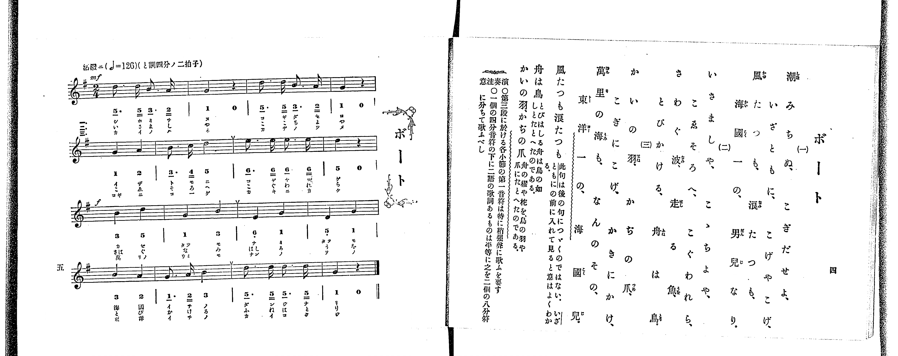

# ボート

> Re:Shōka 使用 AI 協助辨識與重建樂譜，可能會有錯誤。歡迎[回報](https://github.com/TMDLang/reshoka/issues)。

- **鋼琴伴奏版**：<br><audio controls src="boto.mp3"></audio>
- **NEUTRINO 歌聲合成版**：<br><audio controls src="boto_neutrino.mp3"></audio>

- 出處：共益商社樂器店《唱歌教科書 教師用 巻二》第四～五頁（第一學期第二曲）
- NDL Digital Collections PID 854863（https://dl.ndl.go.jp/pid/854863）掃描 P008.jpg

## 說明

原書資訊與歌詞全文（NDL PID 854863《唱歌教科書 教師用 巻二》第四～五頁，掃描 P008.jpg）：
調性與拍號：ト調四分ノ二拍子（G 大調 2/4 拍），♩=126，「活潑ニ」
註記：共益商社唱歌教科書教師用巻二 第五頁 / 1.
原典演奏注意：第三段各小節之第一音符須特稍強聲歌唱；一個四分音符下配有兩個音節歌詞者，平均分作兩個八分音符歌唱。
原典語釋：「風たつも浪たつも」一句不接後句，移至「いざともに」之前理解則意義自明；「舟は鳥」謂飛馳之舟如鳥；「かいの羽、かぢの爪」以鳥之羽與爪比喻船之櫂與柁（舵）。


## 歌詞

```text
一、
潮みちぬ こぎだせよ
いざともに こげやこげ
風たつも 浪たつも
海國一の 男兒なり

二、
いさましや こゝちよや
こゑそろへ こぐわれら
さわぐ波 走る魚
とびかける 舟は鳥

三、
かいの羽 かぢの爪
こぎにこげ かきにかけ
萬里の海も なんのその
東洋一の 海國兒
```

## ABC

<div class="abc-score" data-abc-src="boto.abc" aria-label="五線譜載入中"></div>

[下載 ABC 原始檔](boto.abc)

## TMD 檔案連結

- [主旋律 TMD 檔案](boto.tmd) [[在 TMD Studio 編輯](https://tmdlang.github.io/Tmd-TS/#tmd=s7IKdvYPcrWy4qpTUCpJTLdSSM7PyUlNLsnMz7PKrsxPzc6ML87Iz05Ugisoy88pzU21yk7MizeKtzA1sTAzRkgW55cWJafGFySmp1oFGBhYoMtYFSdn5OfnxJekVpQk5ednI-QLivLLUvMS84BqCooy80pSU8CKEApSyzJTUkHSxclAq8tSizLTMlNTkNyVWlQMcjXUCSVFiXnFyUWZBSCvIFSl5RflWhWXFOUXZGQmI4RLMlKBfgLrKcgvQrIVIlGeWJJahBDML8pMz8yzyk3NzMrE4hWgARn56UWJBRmVVhmZxSVA5cmJOfHAEAMGo5aWwuPmOY-b9zxu7lDQ0uJStFUwNDLjsrdVcOeyMdI3sQMZ87R914uZU9_vmfW0dePz2V1Pp7Y9X7Lv2YqmpzNXPN01_XFD19MpG5-t7Xk2debz5ROfzd6hAGQ93bH6-ZQVCk-3736yq-dxQ_fzNWuezp79fu-8J7umvFzQ-H5PB1DkyY6Gp2t3PJszH8Te1fNs9qb3ezrBLvdz8VFwAXqrJDFHwRmeBooVAjxdFCCxDDQho6SkoNhKXz8lRy8PiNPz9bIK9AsyU_RhKjqf9TU_6-9XAMU9UC5diYtLX0vBllqAS0FB4WnffKCPX2xuf7Gi60VHOzAYXqyc97R1xbNp7UAXgryBcDKZIdWD5gugv4BxAbL8xar9zxqWg6zt7n0xcz5QFBiNQEGg_qcdbY-b-0CB2t37dO0EoFvcFZ4uWQ6UVABGqwJQFGxMz6OZK22BMQ5kPW7oebZl97O9Ex83dz9u6AWbv2L3ixUz0CIezQtwH0A8oACOSpDDFfQVDPWgQfS0dcezPVOeLu1_tnnFs5Z-oIng2O98tm7r0wktTzf0P1_f8GQnyOvAJPFy_ubna5a9XNDxvHPn8xW9T_dsf9G4CWgl0OL3e2aD0kxDN8SHEJVPdnS_bO19NqfzaetKoBRIcH0DJCJeNLQCffZ05-anc9uB6p_snQNR87R1NVw7xOTHDU0It75YNe9lezcoOBt6Xi5a8bhx_uPGJY-bmp5tXQVnA4MI5JT-pU929D7rW_p0Xw-QDbTs-fLdL9o3AzU-bmx53DjtceMKkOLG1SD1O7ufdvY-n9D2Yvnip53twIB4vm_li_ZVz2b0AT0G1PKiA2j4-peblwIVv1jT9HLx7JfLNgN1AcWfLmsCikOUPW7sBhu-7vm-vY8bGsHcRSBuxyqQLbuXAlWCQnPfXmDSAAo-Wz_l6bTdLzp2AgWfrW4CpZf5oBz4omMrMBGAfA7yOtA3QMNArGd71z1u3P-4ceHjxjUKjxsnP27se9y44HHj7MdNHSB5NJ9BlEx63AQUBTFASpBDTQE52MDmb93-dE43yL7GdQrPp2x_2jrpceOqx01dEHeAcgHYHWB7pj5u3Pe4cTrQdLA9TXNB7mrqAPIhSoBCEx83zn3c1Pu4cQfEKRMeN_U_bup53NQJUTIVxG-c8GzzIoUXWzc8bup-uRacfUA-aNwMDr6JQFEFePBDwwMYNFB3IMIbwoGGNswFoPBZDfE8RB7oFiAfZC44G01Y87IdGGvrgB4HhQfYs0DFwFAG-mYdOEjmbny2BRYkkPABhgpIhvJiCgoUtPS5uJzyS_KtAjIT8_IdagxqqkEWKNgYmmnZgVnVuWm1YAawlHzctB1YNcwG4vlA3KhQAyR7QGTTZiBeB-Q1AOndYPEVILNB-moUTBV0gdBUwRhMGwFFDMEsXQUDKE2UGrBpPoZAwxung0UeN-4G4v1Q9kKQtcDECVEdDzcZGAdQFX1AvADKng12dge6aogdRiBdLVCVU4F4H5Q9HawLIoPdjslgl4DZQNOxqobYYQzS1Q3VBUrH66Ds9WDz1mKxA6Z6EZLqJWA7GrHaAY6xJUC8DRwjHUAM1NrcDY-xTUAeSH4zWGQTIsZgYW8Etx0SLybQeAKJmIFpMzgNi0PsMQYLBWAhgeSjFdCQAqX_1VhCE5h1oOEHEgPJTMIemuAYg-gCmTcRyay5ULFeIHsHFjsmAOX6oWogibkTux3gGIPbAUxNCLMgbofEPsyFyDEGshumBhz8jTAXotpRjZzXgIVo0x6wg_YD46kFHIeg-OsC5z-EOEgUHnOQeALlJJgrYHEJkwHGHMxSmBQw6jCEkOIO4guQ2-cg-W0-XHQJQhQYkzBRYPkOyZpQ5Qh1CFXIsQcqkeGaJyDpXAUXRTZvPawUAJkHcyFIog0uCo8JpPgDFvWIZNIFy0dQnQgbkJwI9gpCE4oOSNpCEYXFH7DAVgCW2OBAAeYxYGkJbHuB4xBYRjaDch-wZgLGJUhkFWb8IXIeJEaMkOIPVlbCaPxlJaiegjsTWMPAAhm5jFuI5i9oKQn09ePGGVA1q8Be6YKqwpb_ILkZpHYzklmwPDARLZ62QsXXgss8CHsFPjvA8QesnRER3IHg4PMNcikLy_X9YBmI35BtquXi0rVTAFWJCkBamQsA)]
- [鋼琴伴奏 TMD 檔案](boto_piano.tmd) [[在 TMD Studio 編輯](https://tmdlang.github.io/Tmd-TS/#tmd=s7IKdvYPcrWy4qpTUCpJTLdSyC8qychPL0osyKi0ysgsLskvykxOzInPTsxLVOLS0lJ43DzncfOex80d7_d0vOze83zClid7tjxd2v-8EyjSqaClxaVoq2BoZMZlb6vgzmVjpG9iBzL7afuuFzOnvt8z62nrxuezu55ObXu-ZN-zFU1PZ654umv644aup1M2Plvb82zqzOfLJz6bvUMByHq6Y_XzKSsUnm7f_WRXz-OG7udr1jydPfv93nlPdk15uaAR6ACgyJMdDU_X7ng2Zz6Ivavn2exNQGcogaz0c_FRcMlMzyxJzFFwzs_JSU0uyczPK1YI8HRRsDA1sTAzBpqQUVJSUGylr5-So5cHxOn5elkF-gWZKfowFZ3P-pqf9fcrBBgYWADl0pW4uJzyS_KtAjIT8_KDPBxqDGqquRSAwMbQTMsOzKrOTasFM_SBwdW0HRhks4F4PhA3KtQAyR4Q2bQZiNcBeQ1AejdYfIWClj5YX42CqYIuEJoqGINpI6CIIZilq2AApYlSAzbNxxBoeON0sMjjxt1AvB_KXgiytnENVHU83OTHjZOhKvqAeAGUPRvs7A501RA7jEC6WqAqpwLxPih7OlgXRAa7HZPBLgGzgaZjVQ2xwxikqxuqqwWI10HZ68HmrcViB0z1IiTVS8B2NGK1AxxjS4B4GzhGOoAYqLW5Gx5jm4A8kPxmsMgmRIzBwt4IbjskXkyg8QQSMQPTZnAaFofYYwwWCo8bpyH5aAU0pJqA7NVYQnMSPPxAYiCZSdhDExxjEF0g8yYimTUXKtYLZO_AYscEoFw_VA0kMXditwMcY3A7gKkJYRbE7ZDYh7kQOcZAdsPUgIO_EeZCVDuqkfPaaiDeA3bQfmA8tYDjEBR_XeD8hxAHicJjDhJPoJwEcwUsLmEywJiDWQqTAkYdhhBS3EF8AXL7HCS_zYeLLkGIAmMSJroKljWhyhHqEKqQY28qLBogkYLQuQouimzeelgpADIP5kKQRBtcFB4TSPG34XETIpl0wfIRVCfCBiQngr2C0ISiA5K2UERh8fds63aFp3MgeQ2Yx4Cl5ePmPnAcAsvIZlDu2wGOS5DIKsz4Q-Q8SIwYIcUfrKyE0fjLym7kzDf5cSMskJHLuIVo_oKWkkBfP26cAVWzCuyVLqgqbPkPkptBajcjmQXLAxPR4mkrVHwtuMyDsFfgswMcfyuQI7gDwcHnG-RSFpbr-8EyEL8h21SLXCP6INeIJtAKERi3L_q6Xrb3Pm3d8XJ2K6TBgFTZxccrRJvGxwKZwHgBsg0hTKzi2PSYANkmGEw0HUgGIzFxq0exAZcTgUwDSBDo2imAQiHaBygDZxshsY3BbGUuAA)]

## 分析

```text
================================================================================
📊 TMD Song Profile: [ ボート ]
================================================================================
⏱  Duration:       0:15 (15.2s), 16 measures total
🎼 Key & Tempo:    首調基準 G, != 126.0 BPM, <2/4>
   - 分析範圍：      由實際發聲的音符與和弦推測調性；播放脈絡另行呈現
🎤 人聲音域:    D4 (MIDI 62) – E5 (MIDI 76) [跨度: 14 個半音 / 1.2 個八度, 難度: moderate]
   - 最低音:  D4 in [Boto #1 @ m.12, 0:10]
   - 最高音: E5 in [Boto #1 @ m.7, 0:05]
   - 適合: soprano, mezzo-soprano, contralto, tenor, baritone, bass
🏛  結構:      Boto (15.2s)
⚡ 編曲密度:        Peak 1 軌道同時演奏
🗝  調性診斷：       G 大調（純淨自然大調，未偵測到可信轉調）
   - 風格氣質:    純淨自然大調（陽光明朗、易唱易記，無明顯調外色彩）
   - 轉調歷程:    全曲維持單一推測調性（未偵測到可信轉調）
   - 核心骨幹音:  D, G, B, E, A
   - 調性數值:    G 大調 [相關度: 0.90, 穩定度: High, 自然音純度: 100.0%]
   - 候選調性 (K-S): G 大調 (0.90), D 大調 (0.71), B 小調 (0.70)
   - 五度圈歷程:   +1
   - 各段落調性細節:
     • [Boto #1]: G 大調 (r: 0.90, 自然音純度: 100.0%)

  [ 五度圈游移軌跡 ]
               C  
         F           [G ]*
      Bb               D  
      Eb               A  
         Ab           E  
            Db       B  
               F# 
     (* = active key center)

  [ 十二半音累積音高分佈 ]
     C  : █                          0.9%
     C# :                            0.0%
     D  : ████████████████████████  28.6%
     D# :                            0.0%
     E  : █████████                 10.7%
     F  :                            0.0%
     F# :                            0.0%
     G  : ███████████████████████   27.7%
     G# :                            0.0%
     A  : ████████                   9.8%
     A# :                            0.0%
     B  : ███████████████████       22.3%
--------------------------------------------------------------------------------
Assignment 軌道音域：
  - Piano         : D4 – E5 (14 個半音 / 1.2 個八度, 38 個音符)
================================================================================
```


## 原書掃描頁




