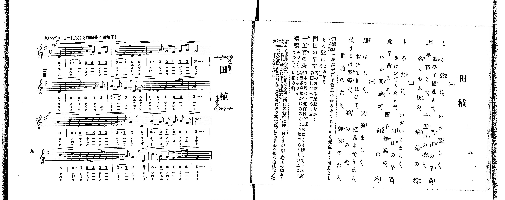

# 田植

> Re:Shōka 使用 AI 協助辨識與重建樂譜，可能會有錯誤。歡迎回報。

- **鋼琴伴奏版**：<br><audio controls src="taue.mp3"></audio>
- **NEUTRINO 歌聲合成版**：<br><audio controls src="taue_neutrino.mp3"></audio>

- 出處：共益商社樂器店《唱歌教科書 教師用 巻二》第八～九頁（第四曲）
- NDL Digital Collections PID 854863（https://dl.ndl.go.jp/pid/854863）掃描 P010.jpg

## 說明

原書資訊與歌詞全文（NDL PID 854863《唱歌教科書 教師用 巻二》第八～九頁，掃描 P010.jpg）：
調性與拍號：ト調四分ノ四拍子（G 大調 4/4 拍，譜上記 C），♩=112，「樂シゲニ」，弱起一拍
註記：單聲部，分節歌三節（譜下配字三行：一＝片假名、二＝平假名、三＝片假名）。四段各以弱起一拍開始、以附點二分音符結束；力度原書標 mf（第一段起）、f（第三段起）、mf（第四段第三小節），各小節另有漸強漸弱記號。各段第二小節第三拍前有換氣記號（v）。五線譜與簡譜逐音核對一致。譜下配字與右頁歌詞用字略有出入（如右頁「植ゑよや」譜下作「ウエヨヤ」），歌詞以右頁為準。
原典演奏注意：〇各段第二小節第三拍之音符，易有如強按般歌唱之弊，須注意柔和歌唱。〇各段末小節之附點二分音符，務須保持其應有之時值。
原典語釋：「もろ聲に」＝こゑをそろへて；「門田の早苗」＝門の外、即ち屋敷ちかくの田に生へてある苗；「千五百の秋」＝日本の國は千五百秋千足の國とも稱して、千秋萬歳五穀ゆたかにみのるよき國であるといふこと；「瑞穗」＝みづ〳〵しくみのりてめでたい稻の穗。
原典曲意：「田植は一粒萬倍、四千餘萬の命の本であるから元氣よく植ゑよといふ意。」


## 歌詞

```text
一、
もろ聲に、いざ賑しく、
歌ひて植ゑよや、門田の早苗、
此早苗こそ、千五百の秋と、
名におふ國の、瑞穗の稻。

二、
もろ共に、いざいさましく、
きほひてうゑよや、山田の早苗、
此早苗こそ、四千餘萬の、
わが同胞が、命の本。

三、
賑はしく、又勇ましく、
歌ひてきほひて、植ゑよや、うゑよ、
植うるは我等が、務のみか、
同胞のため、御國のため。
```

## ABC

<div class="abc-score" data-abc-src="taue.abc" aria-label="五線譜載入中"></div>

[下載 ABC 原始檔](taue.abc)

## TMD 檔案連結

- [主旋律 TMD 檔案](taue.tmd) [[在 TMD Studio 編輯](https://tmdlang.github.io/Tmd-TS/#tmd=s7IKdvYPcrWy4qpTUCpJTLdSSM7PyUlNLsnMz7PKrsxPzc6ML87Iz05Ugisoy88pzU21yk7MizeKtzA1sTAzRkgW55cWJadaFSdn5OfnxJekVpQk5edno8vHFySmp1oFGBgaIGQKivLLUvMS84C6C4oy80pSU8DaEQpSyzJTUkHSxclAq8tSizLTMlNTkNyVWlQMcjXUipKixLzi5KLMApBXEKrSU_OKUq2SMzJzUopS8-KL8_PSEZJp-UW5VsUlRfkFGZnJCOGSjFSgh8vzi5A8AhEryEnMQ3JiflFmemaeVW5qZlYmkue1tBSeT9nwbEmvgpYWl6KtgqGhEZe9rYI7l42JvokdSPfT9l0vZk59v2fW09aNz2d3PZ3a9nzJvmcrmp7OXPF01_THDV1Pp2x8trbn2dSZz5dPfDZ7hwKQ9XTH6udTVig83b77ya6exw3dz9esedq6-v3eeU92zn25oPH9ng6QyOzZz2Zver-nE-xIPxcfBRegE0sScxSc4fFcrBDg6aIAiUmgroySkoJiK339lBy9PCBOz9fLKtAvyEzRh6nofNbX_Ky_XwEUf0A5YPhx6Wsp2FILcCkoKDztmw_05YvN7S9WdL3oaAd6_cXKeU9bVzyb1g50IcgbCCeTGTo9aL4A-gsY_iDLX6za_6xhOcja7t4XM-cDRR83dwAFgWH5tKPtcXMfKFC7e5-unQB0i7vC0yXLgZIKwKhUAIoCDX6xds6THV0vVsxQcAYb2vNo5kpbYJwDWY8beoCx-rhp--OmTY-bux83gNQ_3bPxxdbtT3Y0ALWD7V-xG6gZlBimrXvRuOll8wqQoo625-sbgL58sqMTyADaDLam-2Ur0CHTgYIvFvYAtQBNeb9n7vPO9qeN7U8n9D5uaAR6HyjydOdmhMgOoKMQaoBufNzQBPLTuq1PJ7Q82b0U2UEvp3U_XQ50aCNQ_OXMlpe75wENBDrm5fzNz9cse751wrO5wBCa_bRr9tNdyyDR9mzFTIXcNEj6AxmybivQNLAtjXDRTmRRmGKIGyDyTzf0g70JCj-gqyDcp_3Lns3pfLZnx9M928HkRmBAAaMI5P4JLVC9QOeBFUPtAUZUZy9IV__sZxsWQ9QDrSuDePvJrinPt88CBiUwup9vWAhkvGyYAPTbswU7nm7oBbr-RfsWoDLksAaqfNq_GZiGIKkSmMqAgs-nLgXaAczGT1uXAk1_uqwJogYU4Ut6HzdNfNzU8bipBRjhEKOe7J0DlHrctOxx04rHzUC0BJwWQL6FGAuKBrAJz5t2Pds1DegGaL542rrj2Z4pT5f2P9u84llLPyh1NgCjEafvn-zshsQVyOgZk0GuBDoOGH49nS861gAtA2YeoJqne7qACl4u6IAY-2z-lKeTQE4BygLthlvxbM5qiPkgYzGSAyiuumcCDXmyf-6znsanrduetXcCbQQqfjaz6WnDHhRvvFg172V7N9gDwJAA5opeYGp_3LgaHBJzHzdOBgfbpMeNc4FSjxt3PG4EWjAbqPjltAZgefq4cd2z6StfdAOLR5B6oCBQ5OkSYFA1Pu3d_Lhx4dON3c-mbgcyHjd2P27sB8qCdQHLhfkQ0x43Ai3tBpoAMfZpbzMoOczcB1IJSvMgY59NB0bsGpDJc4CGrIerASoAsl9sA1oEkVoB9MLzFRsfN04HmQxyQzNQzYsJwCDeDNKysuFxU9vjRqDVQMWrHzfuB2oE2g5KF429YBOWQ9wDMqqx5XHjVlAINALzPshtzyfOe74S6lOw3qWPGzY_bgCqAVoH9BrEtC6Q1U2NYKOAFrU8X7Eb5BeQRuTkM3sTLOH0QOoloMeASf35pklA5z5tAJURoLKut_nlkhlAEZAPJ-4FBTcoIOCuBDq982lrMzBTgf3Qj0jnMA8AbQGnnV4ukOVAG4AGg1iokQ10LlDxtBebJ0I9A1EETHuPQSqWoeafRozIh6peAuWDAm0uJPxRYhPoKIhSUCEIigBgYG0Fh_s6oAQ0fIFKgUEGDCywg0EVB5KDgXUzsoPB5NTHjUALkJwNjMzHjcBQB7n8cWMbssufbtxInMtRwx7uBmA0A4vCnhfN84AMkDp4pMAcvANUmoKrEFBgroc77Gl_x9PudnSnwkMYxc0NjWgBjvAFVBsovQCFQNnhWcfE52s7oc7pnglyLSgpguoLSFBDXAsUnQ9Kl0BF-xZCwxwqAk6XlDcaoEBBS5-LKySxFNi4zEzMy3eo0TWsqQbZoGBjoWUHZlTnptWCGcA2y-PmRQo1QHItEO8BhvAWKL0CTINkuqEiS4B4G0ykaR2Q7ofKbIepbVqvoAEs0DVBbgCZX6NgoKALx6bxQKJGwRBI6ioYKRgDsSEQ1wBZIBFdsAxQERDBVMHUGANFjKCqQBBiFNgOH8MaBRAPhoEJFWwNMLVCFT9unAIWnwgRb1yNZBAwBQPxNCTxx419QLwezJoO1dGPoqMNYbcRYbtXIIvjtLsFKjIViPfhsRtkLtRuYzS7wWaDdPTBVePzxT4gnk-S3Qh_g9JN035grE8C4jYgexk4xYDSBiTdACtzoMhqIN0JDg6QWmCwNm0F0l3wlDUDlFo2I6UWSBSDIh2UGBBJA5QIEEnDDORdMBckCkkckOQCgdVptWB9iPQB8inED5uAeBnUN6AUAXJcB8yHTaCQAGZdIF4J9j9MFzCxA0MHxFoFDZkdKCEzGWEbMEUACxLibQOSoFAH6VpAum3ANIDNb71gN4DkNsF1YXcHxH5QzMLzB9yF2GIdLRZBcQjL-5uhpcFeIN0IFgGmgebZED1gmUVAvBYc8x3AmG_uQop5U7BtxgpmQJYpUnaHpAVoyYFIDKBIN4Rrg0AQGznK10E9AErWoICEBCNIBhSAELm5YHIhVByWEXZDdQOreXBgguRA2RgRKOCIQYpw4u2CZa3Z0OCfDA1wcIYE8hCmwZIJKBMiRzcoQkDioGQKzuAQFUC6ByrTCZQBsR83LoHaBnE9sLaB-2w_VKYbxV8g85AiG1TQrwLSQG-BI3A9eqUAjlpwKdLcihbZoMiHqAX2-WHRbAaNKVAUQ2IQSzSDqid4gkCU_8hZHFSdIMc1rOgGpsrGrWAWNEzgBS66v5dCRRFxDYp9kMxaJHuQqhlwPENDGBhOoFCGFBaQsAfxIHKQkIeZBksZC2H2wKsC5BSFZA8ojqGmgYsiqD0gvYjMDolLZP9AimqQf2H-AakEmQVSh2pPLReXrp0CqI2gAKSVuQA)]
- [鋼琴伴奏 TMD 檔案](taue_piano.tmd) [[在 TMD Studio 編輯](https://tmdlang.github.io/Tmd-TS/#tmd=s7IKdvYPcrWy4tLSUng-ZcOzJb3v93S87N7zfMKWJ3u2PF3a_7yz4_2eTgUtLS5FWwVDQyMue1sFdy4bE30TO646BaWn7btezJz6fs-sp60bn8_uejq17fmSfc9WND2dueLprumPG7qeTtn4bG3Ps6kzny-f-Gz2DgUg6-mO1c-nrFB4un33k109jxu6n69Z87R19fu9857snPtyQSPQASCR2bOfzd4EtFoJZI2fi4-CS2Z6ZklijoJzfk5OanJJZn5esUKAp4uChamJhZkxUFdGSUlBsZW-fkqOXh4Qp-frZRXoF2Sm6MNUdD7ra37W368QYGBoAJRLV-LiCkksTbUKyEzMyw_ycKjRNayp5lIAAhsLLTswozo3rRbM0NdSeNy8SKEGSK4F4j0Kj5u2QOkVYBok0w0VWQLE22AiTeuAdD9UZjtMbdN6BY3HTcs0FbT0webXKBgo6MKxaTyQqFEwBJK6CkYKxkBsCMQ1QBZIRBcsA1QERDBVMDXGQBEjqCoQhBgFtsPHsEYBxIPhx01NYGseN_VCFT9unAIWnwgRb1yNZNDjxhYgnoYk_rixD4jXg1nToTr6UXS0Iew2Imz3CmRxnHa3QEWmAvE-PHaDzIXabYxmN9hskI4-uGp8vtgHxPNJshvhb1C6adoPjPVJQNwGZC8DpxhQ2oCkm8fNoNSyGkh3goMDpBYYrE1bgXQXPGXNAKWWzUipBRLFoEgHJQZE0gAlAkTSMAN5F8wFiUISByS5QGB1Wi1YHyJ9gHwK8cMmIF4G9Q0oRYAc1wHzYRMoJB43ApN340qw_2G6gIkdGDog1ipoyOxACZnJCNuAKeJx427ibQOSoFAH6VpAum3ANIDNb71gN4DkNsF1YXcHxH5QzMLzB9yF2GIdLRZBcQjL-5uhpcFeIN0IFgGmgebZED1gmUVAvBYc8x3AmG_uQop5U7BtxgpmQJYpUnaHpAVoyYFIDKBIN4Rrg0AQGznK10E9AErWoICEBCNIBhSAELm5YHIhVByWEXZDdT9ubAIHJkgOlI0RgQKOGKQIJ94uWNaaDQ3-ydAAB2dIIA9hGiyZgDIhcnSDIgQkDkqm4AwOUQGke6AynUAZEPtx4xKobRDXP25qhPtsP1SmG8VfIPOQIhtU0K8C0kBvgSNwPXqlAI5acCnS3IoW2aDIh6jtRUSzGTSmQFEMiUEs0QyqnuAJAlH-I2dxUHWCHNewohuYKhu3glnQMIEXuOj-XgoVRcQ1KPZBMmuR7EGqZsDxDA1hYDiBQhlSWEDCHsSDyEFCHmYaLGUshNkDrwqQUxSSPaA4hpoGLoqg9oD0IjI7JC6R_QMpqkH-hfkHpBJkFkgdqj21yE0EH5Qmggm0iQCM_hd9XS_be5-27ng5uxXSbELEo2G8QrRhLIyqAeXEeCDbND4WwYD4hzS1cAGyVZsAmSZEuQKqEiaCbibCBBJ9R21zDSAxpmunAIq0aB-gKJxthMQ2BrOVuQA)]

## 分析

```text
================================================================================
📊 TMD Song Profile: [ 田植 ]
================================================================================
⏱  Duration:       0:34 (34.3s), 16 measures total
🎼 Key & Tempo:    首調基準 G, != 112.0 BPM, <4/4>
   - 分析範圍：      由實際發聲的音符與和弦推測調性；播放脈絡另行呈現
🎤 人聲音域:    D4 (MIDI 62) – E5 (MIDI 76) [跨度: 14 個半音 / 1.2 個八度, 難度: moderate]
   - 最低音:  D4 in [Taue #1 @ m.1, 0:01]
   - 最高音: E5 in [Taue #1 @ m.10, 0:20]
   - 適合: soprano, mezzo-soprano, contralto, tenor, baritone, bass
🏛  結構:      Taue (34.3s)
⚡ 編曲密度:        Peak 1 軌道同時演奏
🗝  調性診斷：       D 調性不明確（純淨自然大調，未偵測到可信轉調）
   - 風格氣質:    純淨自然大調（陽光明朗、易唱易記，無明顯調外色彩）
   - 轉調歷程:    全曲維持單一推測調性（未偵測到可信轉調）
   - 核心骨幹音:  A, D, G, B, E
   - 調性數值:    D 調性不明確 [相關度: 0.79, 穩定度: Ambiguous, 自然音純度: 100.0%]
   - 候選調性 (K-S): D 大調 (0.79), G 大調 (0.78), B 小調 (0.59)
   - 五度圈歷程:   +2
   - 各段落調性細節:
     • [Taue #1]: D 大調 (r: 0.81, 自然音純度: 100.0%)

  [ 五度圈游移軌跡 ]
               C  
         F            G  
      Bb              [D ]*
      Eb               A  
         Ab           E  
            Db       B  
               F# 
     (* = active key center)

  [ 十二半音累積音高分佈 ]
     C  :                            0.0%
     C# :                            0.0%
     D  : ███████████████████████   24.2%
     D# :                            0.0%
     E  : █████                      5.5%
     F  :                            0.0%
     F# :                            0.0%
     G  : ███████████████████████   24.2%
     G# :                            0.0%
     A  : ████████████████████████  25.8%
     A# :                            0.0%
     B  : ███████████████████       20.3%
--------------------------------------------------------------------------------
Assignment 軌道音域：
  - Piano         : D4 – E5 (14 個半音 / 1.2 個八度, 71 個音符)
================================================================================
```


## 原書掃描頁




