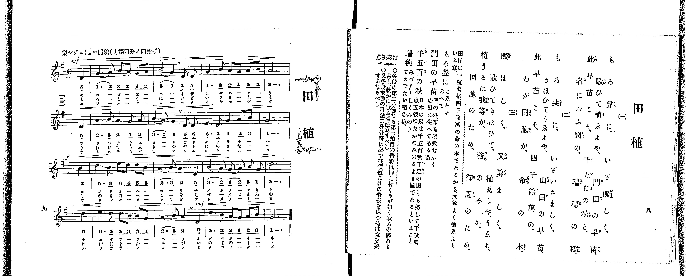

# 田植

> Re:Shōka 使用 AI 協助辨識與重建樂譜，可能會有錯誤。歡迎[回報](https://github.com/TMDLang/reshoka/issues)。

- **鋼琴伴奏版**：<br><audio controls src="taue.mp3"></audio>
- **NEUTRINO 歌聲合成版**：<br><audio controls src="taue_neutrino.mp3"></audio>

- 出處：共益商社樂器店《唱歌教科書 教師用 巻二》第八～九頁（第四曲）
- NDL Digital Collections PID 854863（https://dl.ndl.go.jp/pid/854863）掃描 P010.jpg

## 說明

原書資訊與歌詞全文（NDL PID 854863《唱歌教科書 教師用 巻二》第八～九頁，掃描 P010.jpg）：
調性與拍號：ト調四分ノ四拍子（G 大調 4/4 拍，譜上記 C），♩=112，「樂シゲニ」，弱起一拍
註記：單聲部，分節歌三節（譜下配字三行：一＝片假名、二＝平假名、三＝片假名）。四段各以弱起一拍開始、以附點二分音符結束；力度原書標 mf（第一段起）、f（第三段起）、mf（第四段第三小節），各小節另有漸強漸弱記號。各段第二小節第三拍前有換氣記號（v）。五線譜與簡譜逐音核對一致。譜下配字與右頁歌詞用字略有出入（如右頁「植ゑよや」譜下作「ウエヨヤ」），歌詞以右頁為準。
原典演奏注意：〇各段第二小節第三拍之音符，易有如強按般歌唱之弊，須注意柔和歌唱。〇各段末小節之附點二分音符，務須保持其應有之時值。
原典語釋：「もろ聲に」＝こゑをそろへて；「門田の早苗」＝門の外、即ち屋敷ちかくの田に生へてある苗；「千五百の秋」＝日本の國は千五百秋千足の國とも稱して、千秋萬歳五穀ゆたかにみのるよき國であるといふこと；「瑞穗」＝みづ〳〵しくみのりてめでたい稻の穗。
原典曲意：「田植は一粒萬倍、四千餘萬の命の本であるから元氣よく植ゑよといふ意。」


## 歌詞

```text
一、
もろ聲に、いざ賑しく、
歌ひて植ゑよや、門田の早苗、
此早苗こそ、千五百の秋と、
名におふ國の、瑞穗の稻。

二、
もろ共に、いざいさましく、
きほひてうゑよや、山田の早苗、
此早苗こそ、四千餘萬の、
わが同胞が、命の本。

三、
賑はしく、又勇ましく、
歌ひてきほひて、植ゑよや、うゑよ、
植うるは我等が、務のみか、
同胞のため、御國のため。
```

## ABC

<div class="abc-score" data-abc-src="taue.abc" aria-label="五線譜載入中"></div>

[下載 ABC 原始檔](taue.abc)

## TMD 檔案連結

- [主旋律 TMD 檔案](taue.tmd) [[在 TMD Studio 編輯](https://tmdlang.github.io/Tmd-TS/#tmd=s7IKdvYPcrWy4qpTUCpJTLdSSM7PyUlNLsnMz7PKrsxPzc6ML87Iz05Ugisoy88pzU21yk7MizeKtzA1sTAzRkgW55cWJadaFSdn5OfnxJekVpQk5edno8vHFySmp1oFGBgaIGQKivLLUvMS84C6C4oy80pSU8DaEQpSyzJTUkHSxclAq8tSizLTMlNTkNyVWlQMcjXUipKixLzi5KLMApBXEKrSU_OKUq2SMzJzUopS8-KL8_PSEZJp-UW5VsUlRfkFGZnJCOGSjFSgh8vzi5A8AhEryEnMQ3JiflFmemaeVW5qZlYmFs_nF5Vk5KcXJRZkVFplZBaXAJUnJ-bEA0MSGLxaWgrPp2x4tqRXQUuLS9FWwdDQiMveVsGdy8ZE38QOZMbT9l0vZk59v2fW09aNz2d3PZ3a9nzJvmcrmp7OXPF01_THDV1Pp2x8trbn2dSZz5dPfDZ7hwKQ9XTH6udTVig83b77ya6exw3dz9esedq6-v3eeU92zn25oPH9ng6QyOzZz2Zver-nE-xUPxcfBRegP0oScxSc4YmhWCHA00UBEt1AXRklJQXFVvr6KTl6eUCcnq-XVaBfkJmiD1PR-ayv-Vl_vwIokoFywEDm0tdSsKUW4FJQUHjaNx_oyxeb21-s6HrR0Q70-ouV8562rng2rR3oQpA3EE4mM3R60HwB9Bcw_EGWv1i1_1nDcpC13b0vZs4Hij5u7gAKAsPyaUfb4-Y-UKB29z5dOwHoFneFp0uWAyUVgFGpABQFGvxi7ZwnO7perJih4Aw2tOfRzJW2wDgHsh439ABj9XHT9sdNmx43dz9uAKl_umfji63bn-xoAGoH279iN1AzKDFMW_eicdPL5hUgRR1tz9c3AH35ZEcnkAG0GWxN98tWoEOmAwVfLOwBagGa8n7P3Oed7U8b259O6H3c0Aj0PlDk6c7NCJEdQEch1ADd-LihCeSndVufTmh5snspsoNeTut-uhzo0Eag-MuZLS93zwMaCHTMy_mbn69Z9nzrhGdzgSE0-2nX7Ke7lkGi7dmKmQq5aZD0BzJk3VagaWBbGuGinciiMMUQN0Dkn27oB3sTFH5AV0G4T_uXPZvT-WzPjqd7toPJjcCAAkYRyP0TWqB6gc4DK4baA4yozl6Qrv7ZzzYshqgHWlcG8faTXVOeb58FDEpgdD_fsBDIeNkwAei3Zwt2PN3QC3T9i_YtQGXIYQ1U-bR_MzANQVIlMJUBBZ9PXQq0A5iNn7YuBZr-dFkTRA0owpf0Pm6a-Lip43FTCzDCIUY92TsHKPW4adnjphWPm4FoCTgtgHwLMRYUDWATnjfterZrGtAN0HzxtHXHsz1Tni7tf7Z5xbOWflDqbABGI07fP9nZDYkrkNEzJoNcCXQcMPx6Ol90rAFaBsw8QDVP93QBFbxc0AEx9tn8KU8ngZwClAXaDbfi2ZzVEPNBxmIkB1Bcdc8EGvJk_9xnPY1PW7c9a-8E2ghU_Gxm09OGPSjeeLFq3sv2brAHgCEBzBW9wNT-uHE1OCTmPm6cDA62SY8b5wKlHjfueNwItGA2UPHLaQ3A8vRx47pn01e-6AYWjyD1QEGgyNMlwKBqfNq7-XHjwqcbu59N3Q5kPG7sftzYD5QF6wKWC_Mhpj1uBFraDTQBYuzT3mZQcpi5D6QSlOZBxj6bDozYNSCT5wANWQ9XA1QAZL_YBrQIIrUC6IXnKzY-bpwOMhnkhmagmhcTgEG8GaRlZcPjprbHjUCrgYpXP27cD9QItB2ULhp7wSYsh7gHZFRjy-PGraAQaATmfZDbnk-c93wl1KdgvUsfN2x-3ABUA7QO6DWIaV0gq5sawUYBLWp5vmI3yC8gjcjJZ_YmWMLpgdRLQI8Bk_rzTZOAzn3aACojQGVdb_PLJTOAIiAfTtwLCm5QQMBdCXR659PWZmCmAvuhH5HOYR4A2gJOO71cIMuBNgANBrFQIxvoXKDiaS82T4R6BqIImPYeg1QsQ80_jRiRD1W9BMoHBdpcSPijxCbQURCloEIQFAHAwNoKDvd1QAlo-AKVAoMMGFhgB4MqDiQHA-tmZAeDyamPG4EWIDkbGJmPG4GhDnL548Y2ZJc_3biROJejhj3cDcBoBhaFPS-a5wEZIHXwSIE5eAeoNAVXIaDAXA932NP-jqfd7ehOhYcwipsbGtECHOELqDZQegEKgbLDs46Jz9d2Qp3TPRPkWlBSBNUXkKCGuBYoOh-ULoGK9i2EhjlUBJwuKW80QIGClj4XV0hiKbAFmpmYl-9Qo2tYUw2yQcHGQssOzKjOTasFM4BtlsfNixRqgORaIN4DDOEtUHoFmAbJdENFlgDxNphI0zog3Q-V2Q5T27ReQQNYoGuC3AAyv0bBQEEXjk3jgUSNgiGQ1FUwUjAGYkMgrgGyQCK6YBmgIiCCqYKpMQaKGEFVgSDEKLAdPoY1CiAeDAMTKtgaYGqFKn7cOAUsPhEi3rgaySBgCgbiaUjijxv7gHg9mDUdqqMfRUcbwm4jwnavQBbHaXcLVGQqEO_DYzfIXKjdxmh2g80G6eiDq8bni31APJ8kuxH-BqWbpv3AWJ8ExG1A9jJwigGlDUi6AVbmQJHVQLoTHBwgtcBgbdoKpLvgKWsGKLVsRkotkCgGRTooMSCSBigRIJKGGci7YC5IFJI4IMkFAqvTasH6EOkD5FOIHzYB8TKob0ApAuS4DpgPm0AhAcy6QLwS7H-YLmBiB4YOiLUKGjI7UEJmMsI2YIoAFiTE2wYkQaEO0rWAdNuAaQCb33rBbgDJbYLrwu4OiP2gmIXnD7gLscU6WiyC4hCW9zdDS4O9QLoRLAJMA82zIXrAMouAeC045juAMd_chRTzpmDbjBXMgCxTpOwOSQvQkgORGECRbgjXBoEgNnKUr4N6AJSsQQEJCUaQDCgAIXJzweRCqDgsI-yG6gZW8-DABMmBsjEiUMARgxThxNsFy1qzocE_GRrg4AwJ5CFMgyUTUCZEjm5QhIDEQckUnMEhKoB0D1SmEygDYj9uXAK1DeJ6YG0D99l-qEw3ir9A5iFFNqigXwWkgd4CR-B69EoBHLXgUqS5FS2yQZEPUQvs88Oi2QwaU6AohsQglmgGVU_wBIEo_5GzOKg6QY5rWNENTJWNW8EsaJjAC1x0fy-FiiLiGhT7IJm1SPYgVTPgeIaGMDCcQKEMKSwgYQ_iQeQgIQ8zDZYyFsLsgVcFyCkKyR5QHENNAxdFUHtAehGZHRKXyP6BFNUg_8L8A1IJMgukDtWeWi4uXTsFUBtBAUgrcwEA)]
- [鋼琴伴奏 TMD 檔案](taue_piano.tmd) [[在 TMD Studio 編輯](https://tmdlang.github.io/Tmd-TS/#tmd=s7IKdvYPcrWy4qpTUCpJTLdSyC8qychPL0osyKi0ysgsLskvykxOzInPTsxLVOLS0lJ4PmXDsyW97_d0vOze83zClid7tjxd2v-8s-P9nk4FLS0uRVsFQ0MjLntbBXcuGxN9EzuQwU_bd72YOfX9nllPWzc-n931dGrb8yX7nq1oejpzxdNd0x83dD2dsvHZ2p5nU2c-Xz7x2ewdCkDW0x2rn09ZofB0--4nu3oeN3Q_X7Pmaevq93vnPdk59-WCRqADQCKzZz-bvQlotRLIGj8XHwWXzPTMksQcBef8nJzU5JLM_LxihQBPFwULUxMLM2OgroySkoJiK339lBy9PCBOz9fLKtAvyEzRh6nofNbX_Ky_XyHAwNAAKJeuxMUVkliaahWQmZiXH-ThUKNrWFPNpQAENhZadmBGdW5aLZihr6XwuHmRQg2QXAvEexQeN22B0ivANEimGyqyBIi3wUSa1gHpfqjMdpjapvUKGo-blmkqaOmDza9RMFDQhWPTeCBRo2AIJHUVjBSMgdgQiGuALJCILlgGqAiIYKpgaoyBIkZQVSAIMQpsh49hjQKIB8OPm5rA1jxu6oUqftw4BSw-ESLeuBrJoMeNLUA8DUn8cWMfEK8Hs6ZDdfSj6GhD2G1E2O4VyOI47W6BikwF4n147AaZC7XbGM1usNkgHX1w1fh8sQ-I55NkN8LfoHTTtB8Y65OAuA3IXgZOMaC0AUk3j5tBqWU1kO4EBwdILTBYm7YC6S54ypoBSi2bkVILJIpBkQ5KDIikAUoEiKRhBvIumAsShSQOSHKBwOq0WrA-RPoA-RTih01AvAzqG1CKADmuA-bDJlBIPG4EJu_GlWD_w3QBEzswdECsVdCQ2YESMpMRtgFTxOPG3cTbBiRBoQ7StYB024BpAJvfesFuAMltguvC7g6I_aCYhecPuAuxxTpaLILiEJb3N0NLg71AuhEsAkwDzbMhesAyi4B4LTjmO4Ax39yFFPOmYNuMFcyALFOk7A5JC9CSA5EYQJFuCNcGgSA2cpSvg3oAlKxBAQkJRpAMKAAhcnPB5EKoOCwj7IbqftzYBA5MkBwoGyMCBRwxSBFOvF2wrDUbGvyToQEOzpBAHsI0WDIBZULk6AZFCEgclEzBGRyiAkj3QGU6gTIg9uPGJVDbIK5_3NQI99l-qEw3ir9A5iFFNqigXwWkgd4CR-B69EoBHLXgUqS5FS2yQZEPUduLiGYzaEyBohgSg1iiGVQ9wRMEovxHzuKg6gQ5rmFFNzBVNm4Fs6BhAi9w0f29FCqKiGtQ7INk1iLZg1TNgOMZGsLAcAKFMqSwgIQ9iAeRg4Q8zDRYylgIswdeFSCnKCR7QHEMNQ1cFEHtAelFZHZIXCL7B1JUg_wL8w9IJcgskDpUe2qRmwg-KE0EE2gTARj9L_q6Xrb3Pm3d8XJ2K6TZhIhHw3iFaMNYGFUDyonxQLZpfCyCAfEPaWrhAmSrNgEyTYhyBVQlTATdTIQJJPqO2uYaQGJM104BFGnRPkBRONsIiW0MZitzAQA)]

## 分析

```text
================================================================================
📊 TMD Song Profile: [ 田植 ]
================================================================================
⏱  Duration:       0:34 (34.3s), 16 measures total
🎼 Key & Tempo:    首調基準 G, != 112.0 BPM, <4/4>
   - 分析範圍：      由實際發聲的音符與和弦推測調性；播放脈絡另行呈現
🎤 人聲音域:    D4 (MIDI 62) – E5 (MIDI 76) [跨度: 14 個半音 / 1.2 個八度, 難度: moderate]
   - 最低音:  D4 in [Taue #1 @ m.1, 0:01]
   - 最高音: E5 in [Taue #1 @ m.10, 0:20]
   - 適合: soprano, mezzo-soprano, contralto, tenor, baritone, bass
🏛  結構:      Taue (34.3s)
⚡ 編曲密度:        Peak 1 軌道同時演奏
🗝  調性診斷：       D 調性不明確（純淨自然大調，未偵測到可信轉調）
   - 風格氣質:    純淨自然大調（陽光明朗、易唱易記，無明顯調外色彩）
   - 轉調歷程:    全曲維持單一推測調性（未偵測到可信轉調）
   - 核心骨幹音:  A, D, G, B, E
   - 調性數值:    D 調性不明確 [相關度: 0.79, 穩定度: Ambiguous, 自然音純度: 100.0%]
   - 候選調性 (K-S): D 大調 (0.79), G 大調 (0.78), B 小調 (0.59)
   - 五度圈歷程:   +2
   - 各段落調性細節:
     • [Taue #1]: D 大調 (r: 0.81, 自然音純度: 100.0%)

  [ 五度圈游移軌跡 ]
               C  
         F            G  
      Bb              [D ]*
      Eb               A  
         Ab           E  
            Db       B  
               F# 
     (* = active key center)

  [ 十二半音累積音高分佈 ]
     C  :                            0.0%
     C# :                            0.0%
     D  : ███████████████████████   24.2%
     D# :                            0.0%
     E  : █████                      5.5%
     F  :                            0.0%
     F# :                            0.0%
     G  : ███████████████████████   24.2%
     G# :                            0.0%
     A  : ████████████████████████  25.8%
     A# :                            0.0%
     B  : ███████████████████       20.3%
--------------------------------------------------------------------------------
Assignment 軌道音域：
  - Piano         : D4 – E5 (14 個半音 / 1.2 個八度, 71 個音符)
================================================================================
```


## 原書掃描頁




