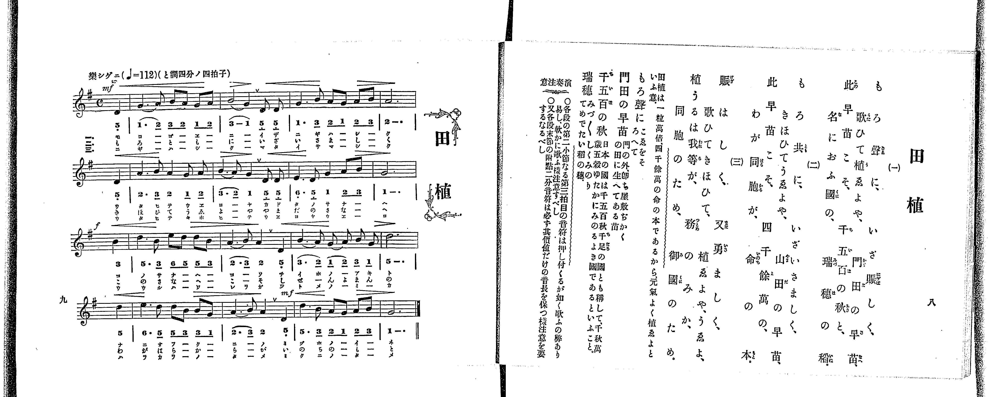

# 田植

> Re:Shoka 使用 AI 協助辨識與重建樂譜，可能會有錯誤。歡迎回報。

<audio controls src="taue.mp3"></audio>

- 出處：共益商社樂器店《唱歌教科書 教師用 巻二》第八～九頁（第四曲）
- NDL Digital Collections PID 854863（https://dl.ndl.go.jp/pid/854863）掃描 P010.jpg

## 說明

原書資訊與歌詞全文（NDL PID 854863《唱歌教科書 教師用 巻二》第八～九頁，掃描 P010.jpg）：
調性與拍號：ト調四分ノ四拍子（G 大調 4/4 拍，譜上記 C），♩=112，「樂シゲニ」，弱起一拍
註記：單聲部，分節歌三節（譜下配字三行：一＝片假名、二＝平假名、三＝片假名）。四段各以弱起一拍開始、以附點二分音符結束；力度原書標 mf（第一段起）、f（第三段起）、mf（第四段第三小節），各小節另有漸強漸弱記號。各段第二小節第三拍前有換氣記號（v）。五線譜與簡譜逐音核對一致。譜下配字與右頁歌詞用字略有出入（如右頁「植ゑよや」譜下作「ウエヨヤ」），歌詞以右頁為準。
原典演奏注意：〇各段第二小節第三拍之音符，易有如強按般歌唱之弊，須注意柔和歌唱。〇各段末小節之附點二分音符，務須保持其應有之時值。
原典語釋：「もろ聲に」＝こゑをそろへて；「門田の早苗」＝門の外、即ち屋敷ちかくの田に生へてある苗；「千五百の秋」＝日本の國は千五百秋千足の國とも稱して、千秋萬歳五穀ゆたかにみのるよき國であるといふこと；「瑞穗」＝みづ〳〵しくみのりてめでたい稻の穗。
原典曲意：「田植は一粒萬倍、四千餘萬の命の本であるから元氣よく植ゑよといふ意。」

## 歌詞

```text
一、
もろ聲に、いざ賑しく、
歌ひて植ゑよや、門田の早苗、
此早苗こそ、千五百の秋と、
名におふ國の、瑞穗の稻。

二、
もろ共に、いざいさましく、
きほひてうゑよや、山田の早苗、
此早苗こそ、四千餘萬の、
わが同胞が、命の本。

三、
賑はしく、又勇ましく、
歌ひてきほひて、植ゑよや、うゑよ、
植うるは我等が、務のみか、
同胞のため、御國のため。
```

## ABC

```abc
X:1
T:田植
M:4/4
L:1/16
Q:1/4=112
K:G
V:V1 name="Piano" snm="Pia"
[V:V1]
!mf! z4 z4 z4 D4 | G6 A2 B2 A2 G2 A2 | B8 G4 D2 D2 | G6 B2 A2 G2 A2 B2 |
A12 D4 | A6 B2 A4 G2 A2 | B6 A2 G4 D2 D2 | E6 D2 G4 A2 B2 |
!f! G12 B4 | d6 B2 e2 d2 d2 B2 | A6 B2 A4 D4 | B6 A2 G2 A2 B2 G2 |
d12 d4 | e6 d2 d2 B2 B2 G2 | A6 B2 A4 D4 | !mf! d6 B2 A2 G2 A2 B2 |
G12 z4 | !mf! z4 z4 z4 D4 | G6 A2 B2 A2 G2 A2 | B8 G4 D2 D2 |
G6 B2 A2 G2 A2 B2 | A12 D4 | A6 B2 A4 G2 A2 | B6 A2 G4 D2 D2 |
E6 D2 G4 A2 B2 | !f! G12 B4 | d6 B2 e2 d2 d2 B2 | A6 B2 A4 D4 |
B6 A2 G2 A2 B2 G2 | d12 d4 | e6 d2 d2 B2 B2 G2 | A6 B2 A4 D4 |
!mf! d6 B2 A2 G2 A2 B2 | G12 z4 | !mf! z4 z4 z4 D4 | G6 A2 B2 A2 G2 A2 |
B8 G4 D2 D2 | G6 B2 A2 G2 A2 B2 | A12 D4 | A6 B2 A4 G2 A2 |
B6 A2 G4 D2 D2 | E6 D2 G4 A2 B2 | !f! G12 B4 | d6 B2 e2 d2 d2 B2 |
A6 B2 A4 D4 | B6 A2 G2 A2 B2 G2 | d12 d4 | e6 d2 d2 B2 B2 G2 |
A6 B2 A4 D4 | !mf! d6 B2 A2 G2 A2 B2 | G12 z4 |
```

## TMD 檔案連結

- [主旋律 TMD 檔案](taue.tmd) [[在 TMD Studio 編輯](https://tmdlang.github.io/Tmd-TS/#tmd=s7IKdvYPcrWy4qpTUCpJTLdSSM7PyUlNLsnMz7PKrsxPzc6ML87Iz05Ugisoy88pzU21yk7MizeKtzA1sTAzRkgW55cWJadaFSdn5OfnxJekVpQk5edno8vHFySmp1oFGBgaIGQKivLLUvMS84C6C4oy80pSU8DaEQpSyzJTUkHSxclAq8tSizLTMlNTkNyVWlQMcjXUipKixLzi5KLMApBXEKrSU_OKUq2SMzJzUopS8-KL8_PSEZJp-UW5VsUlRfkFGZnJCOGSjFSgh8vzi5A8AhEryEnMAzpRS0vh-ZQNz5b0KmhpcSnaKhgaGnHZ2yq4c9mY6JvYgfQ8bd_1YubU93tmPW3d-Hx219Opbc-X7Hu2ounpzBVPd01_3ND1dMrGZ2t7nk2d-Xz5xGezdygAWU93rH4-ZYXC0-27n-zqedzQ_XzNmqetq9_vnfdk59yXCxrf7-kAicye_Wz2pvd7OsFO83PxUXDJTM8sScxRcIZHZLFCgKeLAiSqgLoySkoKiq309VNy9PKAOD1fL6tAvyAzRR-movNZX_Oz_n4FUAQB5YABxKWvpWBLLcCloKDwtG8-0JcvNre_WNH1oqMd6PUXK-c9bV3xbFo70IUgbyCcTGbo9KD5AugvYPiDLH-xav-zhuUga7t7X8ycDxR93NwBFASG5dOOtsfNfaBA7e59unYC0C3uCk-XLAdKKgCjUgEoCjT4xdo5T3Z0vVgxQ8EZbGjPo5krbYFxDmQ9bugBxurjpu2PmzY9bu5-3ABS_3TPxhdbtz_Z0QDUDrZ_xW6gZlBimLbuReOml80rQIo62p6vbwD68smOTiADaDPYmu6XrUCHTAcKvljYA9QCNOX9nrnPO9ufNrY_ndD7uKER6H2gyNOdmxEiO4COQqgBuvFxQxPIT-u2Pp3Q8mT3UmQHvZzW_XQ50KGNQPGXM1te7p4HNBDomJfzNz9fs-z51gnP5gJDaPbTrtlPdy2DRNuzFTMVctMg6Q9kyLqtQNPAtjTCRTuRRWGKIW6AyD_d0A_2Jij8gK6CcJ_2L3s2p_PZnh1P92wHkxuBAQWMIpD7J7RA9QKdB1YMtQcYUZ29IF39s59tWAxRD7SuDOLtJ7umPN8-CxiUwOh-vmEhkPGyYQLQb88W7Hi6oRfo-hftW4DKkMMaqPJp_2ZgGoKkSmAqAwo-n7oUaAcwGz9tXQo0_emyJogaUIQv6X3cNPFxU8fjphZghEOMerJ3DlDqcdOyx00rHjcD0RJwWgD5FmIsKBrAJjxv2vVs1zSgG6D54mnrjmd7pjxd2v9s84pnLf2g1NkAjEacvn-ysxsSVyCjZ0wGuRLoOGD49XS-6FgDtAyYeYBqnu7pAip4uaADYuyz-VOeTgI5BSgLtBtuxbM5qyHmg4zFSA6guOqeCTTkyf65z3oan7Zue9beCbQRqPjZzKanDXtQvPFi1byX7d1gDwBDApgreoGp_XHjanBIzH3cOBkcbJMeN84FSj1u3PG4EWjBbKDil9MagOXp48Z1z6avfNENLB5B6oGCQJGnS4BB1fi0d_PjxoVPN3Y_m7odyHjc2P24sR8oC9YFLBfmQ0x73Ai0tBtoAsTYp73NoOQwcx9IJSjNg4x9Nh0YsWtAJs8BGrIergaoAMh-sQ1oEURqBdALz1dsfNw4HWQyyA3NQDUvJgCDeDNIy8qGx01tjxuBVgMVr37cuB-oEWg7KF009oJNWA5xD8ioxpbHjVtBIdAIzPsgtz2fOO_5SqhPwXqXPm7Y_LgBqAZoHdBrENO6QFY3NYKNAlrU8nzFbpBfQBqRk8_sTbCE0wOpl4AeAyb155smAZ37tAFURoDKut7ml0tmAEVAPpy4FxTcoICAuxLo9M6nrc3ATAX2Qz8incM8ALQFnHZ6uUCWA20AGgxioUY20LlAxdNebJ4I9QxEETDtPQapWIaafxoxIh-qegmUDwq0uZDwR4lNoKMgSkGFICgCgIG1FRzu64AS0PAFKgUGGTCwwA4GVRxIDgbWzcgOBpNTHzcCLUByNjAyHzcCQx3k8seNbcguf7pxI3EuRw17uBuA0QwsCnteNM8DMkDq4JECc_AOUGkKrkJAgbke7rCn_R1Pu9vRnQoPYRQ3NzSiBTjCF1BtoPQCFAJlh2cdE5-v7YQ6p3smyLWgpAiqLyBBDXEtUHQ-KF0CFe1bCA1zqAg4XVLeaIACBS19Lq6QxFJg6zEzMS_focagRqEaZIOCjYWWHZhRnZtWC2YA2yyPmxcp1ADJtUC8BxjCW6D0CjANkumGiiwB4m0wkaZ1QLofKrMdprZpvYIGsEDXBLkBZH6NgoGCLhybxgOJGgVDIKmrYKRgDMSGQFwDZIFEdMEyQEVABFMFU2MMFDGCqgJBiFFwPzTtB7pgEhC3AdnLwK4HuRPiB2DFAhRZDaQ7wW4Eqe0D0luBdBfclzNALt-M5HKIdSAHgByGcCbIQQhnmoEcAuaCRCEOhTgdAqvTasH6EG5FsxtkMyz0NkPDcy-QbgSLAF3ePBuiByyzCIjXgt3bAXRvcxeSe02h7jUDskyRAgziA2jYI7wAcqohXBs0VFEdCormVUB6KtTy9ehJAuys-WCRVjSHghwOUQts8cOcaAa1BeQ8iO1YnAhKnHDPIGIfOVBBiamGq5aLS9dOAZTSFbDQylwA)]

## 分析

```text
================================================================================
📊 TMD Song Profile: [ 田植 ]
================================================================================
⏱  Duration:       1:49 (109.3s), 51 measures total
🎼 Key & Tempo:    首調基準 G, != 112.0 BPM, <4/4>
   - 分析範圍：      由實際發聲的音符與和弦推測調性；播放脈絡另行呈現
🎤 人聲音域:    D4 (MIDI 62) – E5 (MIDI 76) [跨度: 14 個半音 / 1.2 個八度, 難度: moderate]
   - 最低音:  D4 in [Taue #1 @ m.1, 0:01]
   - 最高音: E5 in [Taue #1 @ m.10, 0:20]
   - 適合: soprano, mezzo-soprano, contralto, tenor, baritone, bass
🏛  結構:      Taue (36.4s) -> Taue (36.4s) -> Taue (36.4s)
⚡ 編曲密度:        Peak 1 軌道同時演奏
🗝  調性診斷：       D 調性不明確（純淨自然大調，未偵測到可信轉調）
   - 風格氣質:    純淨自然大調（陽光明朗、易唱易記，無明顯調外色彩）
   - 轉調歷程:    全曲維持單一推測調性（未偵測到可信轉調）
   - 核心骨幹音:  A, D, G, B, E
   - 調性數值:    D 調性不明確 [相關度: 0.79, 穩定度: Ambiguous, 自然音純度: 100.0%]
   - 候選調性 (K-S): D 大調 (0.79), G 大調 (0.78), B 小調 (0.59)
   - 五度圈歷程:   +2 -> +2 -> +2
   - 各段落調性細節:
     • [Taue #1]: D 調性不明確 (r: 0.79, 自然音純度: 100.0%)
     • [Taue #2]: D 調性不明確 (r: 0.79, 自然音純度: 100.0%)
     • [Taue #3]: D 調性不明確 (r: 0.79, 自然音純度: 100.0%)

  [ 五度圈游移軌跡 ]
               C  
         F            G  
      Bb              [D ]*
      Eb               A  
         Ab           E  
            Db       B  
               F# 
     (* = active key center)

  [ 十二半音累積音高分佈 ]
     C  :                            0.0%
     C# :                            0.0%
     D  : ███████████████████████   24.2%
     D# :                            0.0%
     E  : █████                      5.5%
     F  :                            0.0%
     F# :                            0.0%
     G  : ███████████████████████   24.2%
     G# :                            0.0%
     A  : ████████████████████████  25.8%
     A# :                            0.0%
     B  : ███████████████████       20.3%
--------------------------------------------------------------------------------
Assignment 軌道音域：
  - Piano         : D4 – E5 (14 個半音 / 1.2 個八度, 213 個音符)
================================================================================
```


## 原書掃描頁




