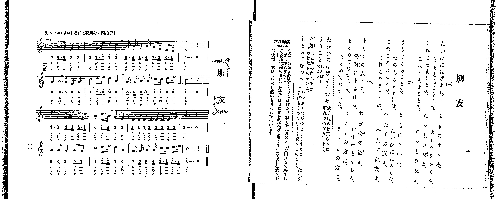

# 朋友

> Re:Shōka 使用 AI 協助辨識與重建樂譜，可能會有錯誤。歡迎回報。

- **鋼琴伴奏版**：<br><audio controls src="hoyu.mp3"></audio>
- **NEUTRINO 歌聲合成版**：<br><audio controls src="hoyu_neutrino.mp3"></audio>

- 出處：共益商社樂器店《唱歌教科書 教師用 巻二》第十～十一頁（第五曲）
- NDL Digital Collections PID 854863（https://dl.ndl.go.jp/pid/854863）掃描 P011.jpg

## 說明


- 出處：出處：共益商社樂器店《唱歌教科書 教師用 巻二》第十～十一頁（第五曲）
- 出處：NDL Digital Collections PID 854863（https://dl.ndl.go.jp/pid/854863）掃描 P011.jpg
- 調性與拍號：調號 ?= C，拍號 <4/4>，速度 != 138


## 歌詞

```text
（TMD 檔案未包含歌詞註解）
```

## ABC

```abc
X:1
T:朋友
M:4/4
L:1/16
Q:1/4=138
K:C
V:V1 name="Piano" snm="Pia"
[V:V1]
!mf! G4 A3 G E4 G4 | c4 d3 e d4 c4 | A3 A c3 A G3 E D3 C | D12 z4 |
w: 1.~た が _ ひ に | は げ _ ま し | よ _ き に す _ す _ | み
w: 2.~う き _ こ と | あ る _ と き | と _ も に う _ れ _ | へ
w: 3.~ま こ _ と の | と も _ こ そ | わ _ が み の _ え き | よ
G4 A3 G E4 G4 | c4 d3 e d4 A4 | G3 G A3 A c3 c d3 e | c12 z4 |
w: 1.~と も _ ど も | こ ら _ し て | あ _ し き を _ さ く | る
w: 2.~た の _ し き | と き _ に は | た が ひ に た の し _ | む
w: 3.~み う _ ち に | ま さ _ れ る | た _ す け と な ら _ | ん
[M:3/4] d3 d d3 e d3 c | [M:4/4] A4 c3 A G4 E4 | D2 D2 D2 C2 D2 C2 D2 E2 | G12 z4 |
w: 1.~こ れ こ _ そ _ | ま こ _ と の | た だ し き と _ も _ | よ
w: 2.~こ れ こ _ そ _ | ま こ _ と の | へ だ て ぬ と _ も _ | よ
w: 3.~も と め _ て _ | む つ _ べ よ | ま こ と の と _ も _ | に
[M:3/4] A3 A G4 A2 G2 | [M:4/4] c4 d3 e d4 A4 | G3 G A3 A c3 c d3 e | c12 z4 |
w: 1.~こ れ こ そ _ | ま こ _ と の | た だ し き と _ も _ | よ
w: 2.~こ れ こ そ _ | ま こ _ と の | へ だ て ぬ と _ も _ | よ
w: 3.~も と め て _ | む つ _ べ よ | ま こ と の と _ も _ | に
```

## TMD 檔案連結

- [主旋律 TMD 檔案](hoyu.tmd) [[在 TMD Studio 編輯](https://tmdlang.github.io/Tmd-TS/#tmd=s7IKdvYPcrWy4qpTUCpJTLdSSM7PyUlNLsnMz7PKrsxPzc6ML87Iz05Ugisoy88pzU21yk7MizeKtzA1sTAzRkgW55cWJadaFSdn5OfnxJekVpQk5edno8vHFySmp1oFGBgaImQKivLLUvMS84C6C4oy80pSU8DaEQpSyzJTUkHSxclAq8tSizLTMlNTkNyVWlQMcjXUipKixLzi5KLMApBXEKrSU_OKUq2SMzJzUopS8-KL8_PSEZJp-UW5VsUlRfkFGZnJCOGSjFSgh9OKMlPzUoozMgsQMvlFmemZeVa5qZlZmUi-1dJSeDan-2l_t4KWFpeirYKhsQWXva2CM5eNib6JHUj30_ZdL2ZOfb9n1tPWjc9ndz2d2vZ8yb5nK5qezlzxdNf0xw1dT6dsfLa259nUmc-XT3w2e4cCkPV0x-rnU1YoPN2--8munscN3c_XrHna2_h-7zwg-WRHw8sFje_3dAAFn-ya8mz2pvd7OsHu9HPxUXABurIkMUfBGR63xQoBni4KkNgD6sooKSkottLXT8nRywPi9Hy9rAL9gswUfZiKzmd9zc_6-xVAcQaUA4YZl76Wgi21AJeCgsLTvvlAj77Y3P5iRdeLjnag71-snPe0dcWzae1AF4K8gXAy-QHUg-YRoNeAsQCy_8Wq_c8aloNs7u59MXM-UPRxcz9Q8Ons2U872h439wEZQKmnaycAneOs8HTJcqCkAjBCFYCiQINfrJ3zZEfXixUzFJzBhvY8mrnSFhjzQNbjhh5g3D5u2v64adPj5u7HDb1gC1fsBqoGpYFp6140bnrZvAKoFGjV8_UNQJ892dEJZACtApvb_bIVaPN0oOCLhT1ALUDvvN8z93ln-9PG9qcTeh83NAK9DBR5unMzQmQH0BUINUBHPW5oAgXo7E0gr6zbCkx7wJB52rr26YZ-sF09T7tmP9217NmKmQq5aSDuhBagMnCS6oGoeTZn9bM5nc_6Zz_bsBjoeHA4dZRB_AtXDQoxsOrnTbtezmx5uXseSH9H28v5m5-vWfa0awEkSJ_smfhs7SKgCNBZzzaveNbSD0kCIPt2dEIt3tEAcxw4ae-cC3crMJk_3z4LGDrAKHu-YSGQ8XxW25O9cxSM4vSM4kCkMZg0jAM6D6QG7DCsxoLTRydhk830zBRMFYAYaOLT9ctezpr9tLn1ae8GkHNBaaDj-Z5dQKPBbFCIPJuz5tmqKc-m7XmxchMiCGetBgVwtY0xsCyoVXiye-nT_QuApj2d2PG8fx8wCID2QUIKlBZnNj1t2AMMIEw3vWyYAFT2bMGOpxt6gZa-aN8CVAbNSE9bdzzbM-Xp0n5IuILSckP786nbgFH_uHHd02VNjxt7geyXi1YAuY-bgNx1jxtXP25c_3Rfw-OGVlDM7umEOALkviXTQAoaeh43bn3cCCydeh83TXq2fTeI29QNMnBP1_Mp8x83zng2YzJQAcTSx40zHzfuBKtvAtoOSR3A9AMMAqAWzHQBsr11G5D9dMM-kPnrup7N3vKsaw_QBKDix439QLue7AJatwrk-BWLobY0TXqxrBFkF8SW_aufbQE6bDUwBwENBNneBLQO5IznLdseN3YDPfu0H-jTDUhSQMHOx43AIEIKvher5r1s7wYHHNAgoN-AJDDsQGH0uHHS48Z9QP1Pdk0EBhYwOEAZb-18YMkAUtDQ83RaC8hZm9aALAAF0HpIbQDydiMwgFY9buoCBWIjMPSBpULX-z2zwba0AT32GKRgBcRMsBOB3I2PG4H-B3obJAVR_HLVihdNwCTWARZcAnYYMJqBORzsmAlA02a8WAbUsu7FQqAnpz9u3A100uMmYKxMBHkHEuVAEZDJW6EOAAmueNwEDM1l4KABGrvzcVMH1DFQEWAgAp29Hli-wESAQTEDFD3AOAB5FuL-pmdTW8GhATStAxy-m5HNf7JjLcjkxv4nu5Y8bgK6FpwQYXq5QPEATNNA3SAWrvAHuwFoCDDQgOJA24Ehth-uB2gT0L6VYHIy2AXAUACWNUDrgSJANigVP26cCklZcG1ApUCrgA4BGga0BOwiUOIHagMG2zyITlBkggKGHD1Q34FqKKh2pHgHpQdgGAIZoBIc5gmg79rAVuxADhFgeIF9AVENCRqIlYjAgikDRhURjt3xuHEBKIwa1xDvQUw9sOgDJkaodoQWcC4AmwOKO2Ca6XmxC-jMdcA2EMI-SOIGux-ocyrIbnAEgb0DLFSAKRhoFjAXdYKyB9QSnIkXKIJmPyhVkqEHXDpQ3taBAgUtfS4uj_zKUquAzMS8fIcag5pqkAUKNoZmWnZgVnVuWi2YAWxqPW7aD8RrFB437wHiSUDcrVADJPuBopugovOA7O1g0RUQkaa1YHWPm3ZC-RAapGI-yH6Q2TXAGk0XDM3ApKmCMZQPE69RMIyDMoH1KogCV6xQIbhcDdQAM5gQqK4Eq1YwgqgEKoGwMKEBzBCwm3wMgU5snA8VAyYSOGsTnLUabi0w3cNFJ8FZ--Cs6QiVTR1w0V64OcA0BReFsUCm7sfh1nhUtxqB1LahmQtiTYazViCZ2gQTberGkEfoBqmEizZB9EDcCrepCRYqILU7iHOrMUgtImQwXQhM7nhcgKpnLkJlUz9cFOIqUOghzAJWAXD_IccCfteCUn1zBxAvgqbvTjAbZMBmIGslNE1vB9JtYFGoOpAIOOVD80XTVii9Hp76V1Mr9UN0gVRB1INahxBxqC4ghdCGZBY6xJYBsAX_SgwxkEp4pDR1wlXCkj2wcENSiTAJIg-KEmA9CBedCqX7wSEKS6L4IwqSBRDZFRHtCDf0IrkBM7kjsjMiMyPMBCUqWNaHZAKY-Dq07N1AnHvB2QCWvZEz70IM96BmGEjoIGc-RBihhgGkIAHWVXD_AmsspPgBuRYWa_hdCy78QQkeWPiDaVBS3gtPyqBCHyoKzix9YKOBua-5ASkrgGRAKiBZBFJFQLMAtCMCzQ7QxAruQIFZiNQOTLvIqRPielBIYC0UkFIGUSpBcQIv6ID1V1MjXCU8_ULdCxpEgbkXlgHR6hxQrQMLaFCdA8OGaDRIFaIMQIfYMiXxpScoMQAbR2ASlEghyR1btia-TIQEKPFuANULMDeAghHYTKPcDeCogmU1YKsJztoJNxVmEsy1EJdC7IW4EIcb4BkPvxvQMwVRGQIkgpwpYCqIyhiwch25vgCxB1-WGLD6irSsAUmYKPUQ3bMGzA2Q4ARlDvpnDYhbEbUEqE4jN2vUcnHp2imAehUKQFqZCwA)]
- [鋼琴伴奏 TMD 檔案](hoyu_piano.tmd) [[在 TMD Studio 編輯](https://tmdlang.github.io/Tmd-TS/#tmd=s7IKdvYPcrWy4tLSUng2p_tpf_f7PR0vu_c8n7DlyZ4tT5f2P-_seL-nU0FLi0vRVsHQ2ILL3lbBmcvGRN_EjqtOQelp-64XM6e-3zPraevG57O7nk5te75k37MVTU9nrni6a_rjhq6nUzY-W9vzbOrM58snPpu9QwHIerpj9fMpKxSebt_9ZFfP44bu52vWPO1tfL93HpB8sqPh5YJGoBuAgk92TXk2exPQdiWQTX4uPgoumemZJYk5Cs75OTmpySWZ-XnFCgGeLgoWpiYWZsZAXRklJQXFVvr6KTl6eUCcnq-XVaBfkJmiD1PR-ayv-Vl_v0KAgaEhUC5diYvLI7-y1CogMzEvP8jDocagpppLAQhsDM207MCs6ty0WjBDX0vhcdN-IF6j8Lh5DxBPAuJuhRog2Q8U3QQVnQdkbweLroCINK0Fq3vctBPKh9AgFfMVtPTBZtcomCrogqEZmDRVMIbyYeI1CoZxUKYRhGEcB2PpIuRqoAaYwYTMoCYYKxhBVAKVQFiY0ABmCNhNPoZAJzbOh4o9buyBszbBWavh1j5uXA8XnQRn7YOzpiNUNnXARXvh5jxunAkXhbFApu7H4dZ4VLcagdS2oZkLYk2Gs1YgmdoEE23qxpBH6AaphIs2QfRA3Aq3qQkWKiC1O4hzqzFILSJkMF34uHEdHheg6pmLUNnUDxeFuAoUegizHjdCwh3kP-RYwO9aUKpv7gDiRdD03QlmgwzYDGSthKbp7UC6DSwKVQcSAad8aL5o2gql18NT_2pqpX6ILpAqiHpT9EwApBDakMxCh9gyALbgX4khBlIJj5SmTrhKWLJ_3LgMSSXCJIg8KEoeNyGyzVQo3Q8OUVgSxR9RkCyAyK6IaEe4oRfJDZjJHZGdEZkZYSYoUcGyPiQTwMTXoWXvBuLcC84GsOyNnHkXYrgHNcNAQgc58yHCCDUMIAXJ48aJcP8-blyFFD8g18JiDb9rwYU_KMEDC38wDUrKe-FJGVToQ0XBmaUPbDQw9zU3IGUFkAxIBSSLQKoIaBaotjEGVqmQigZYQEMSKJDCSO3AtIucOiGuB4UE1kIBKWUQpRIUJ_CCDlh_NTXCVcLTL9S9oCYAzL2wDIhW54BqHVhAg-ocGDZEo0GqEGUAOsSWKYkvPUGJ4XHjAjAJSqSQ5I4tWxNfJkIClHg3gOoFmBtAwfi4cQ3lbgBHFSyrPW5cAmfthJsKMwnmWohLIfZCXIjDDfCMh98N6JmCqAwBEkHOFDAVRGUMWLmOXF-A2IMvSwxYfUVa1oAkTJR6iO5ZA-YGSHCCMgf9swbErYhaAlSnkZs1apE7FT7InQoTaJ8CmHFe9HW9bO992rrj5exWSFcL0RoyjFeINoyFUTWYIlB1JkCuCYo603gg2zQ-FswwgCvEaSDUBJg6FO1gBqrlMBNRMyWKLmx5gYA7IRZhOBW7ZQizsOY6VG-RYBMw0nTtFEDxFu0DFIWzjZDYxmC2MhcA)]

## 分析

```text
================================================================================
📊 TMD Song Profile: [ 朋友 ]
================================================================================
⏱  Duration:       0:26 (27.0s), 16 measures total
🎼 Key & Tempo:    首調基準 C, != 138.0 BPM, <4/4>
   - 分析範圍：      由實際發聲的音符與和弦推測調性；播放脈絡另行呈現
🎤 人聲音域:    C4 (MIDI 60) – E5 (MIDI 76) [跨度: 16 個半音 / 1.3 個八度, 難度: moderate]
   - 最低音:  C4 in [Hoyu #1 @ m.3, 0:05]
   - 最高音: E5 in [Hoyu #1 @ m.2, 0:02]
   - 適合: soprano, mezzo-soprano, contralto, tenor, baritone, bass
🏛  結構:      Hoyu (27.0s)
⚡ 編曲密度:        Peak 1 軌道同時演奏
🗝  調性診斷：       G 調性不明確（純淨自然大調，未偵測到可信轉調）
   - 風格氣質:    純淨自然大調（陽光明朗、易唱易記，無明顯調外色彩）
   - 轉調歷程:    全曲維持單一推測調性（未偵測到可信轉調）
   - 核心骨幹音:  D, C, G, A, E
   - 調性數值:    G 調性不明確 [相關度: 0.77, 穩定度: Ambiguous, 自然音純度: 100.0%]
   - 候選調性 (K-S): G 大調 (0.77), C 大調 (0.75), A 小調 (0.56)
   - 五度圈歷程:   +1
   - 各段落調性細節:
     • [Hoyu #1]: G 調性不明確 (r: 0.77, 自然音純度: 100.0%)

  [ 五度圈游移軌跡 ]
               C  
         F           [G ]*
      Bb               D  
      Eb               A  
         Ab           E  
            Db       B  
               F# 
     (* = active key center)

  [ 十二半音累積音高分佈 ]
     C  : ███████████████████████   25.9%
     C# :                            0.0%
     D  : ████████████████████████  26.7%
     D# :                            0.0%
     E  : ████████                   9.1%
     F  :                            0.0%
     F# :                            0.0%
     G  : ████████████████████      22.0%
     G# :                            0.0%
     A  : ███████████████           16.4%
     A# :                            0.0%
     B  :                            0.0%
--------------------------------------------------------------------------------
Assignment 軌道音域：
  - Piano         : C4 – E5 (16 個半音 / 1.3 個八度, 77 個音符)
================================================================================
```


## 原書掃描頁




