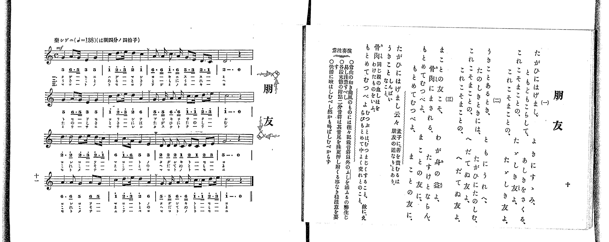

# 朋友

> Re:Shoka 使用 AI 辨識樂譜，可能會有錯誤。歡迎回報。

<audio controls src="hoyu.mp3"></audio>

- 出處：共益商社樂器店《唱歌教科書 教師用 巻二》第十～十一頁（第五曲）
- NDL Digital Collections PID 854863（https://dl.ndl.go.jp/pid/854863）掃描 P011.jpg

## 說明

・出處：出處：共益商社樂器店《唱歌教科書 教師用 巻二》第十～十一頁（第五曲）
・出處：NDL Digital Collections PID 854863（https://dl.ndl.go.jp/pid/854863）掃描 P011.jpg
・調性與拍號：調號 ?= C，拍號 <4/4>，速度 != 138

## 歌詞

```text
（TMD 檔案未包含歌詞註解）
```

## ABC

```abc
X:1
T:朋友
M:4/4
L:1/16
Q:1/4=138
K:C
V:V1 name="Piano" snm="Pia"
[V:V1]
!mf! G4 A3 G E4 G4 | c4 d3 e d4 c4 | A3 A c3 A G3 E D3 C | D12 z4 |
G4 A3 G E4 G4 | c4 d3 e d4 A4 | G3 G A3 A c3 c d3 e | c12 z4 |
[M:3/4] d3 d d3 e d3 c | [M:4/4] A4 c3 A G4 E4 | D2 D2 D2 C2 D2 C2 D2 E2 | G12 z4 |
[M:3/4] A3 A G4 A2 G2 | [M:4/4] c4 d3 e d4 A4 | G3 G A3 A c3 c d3 e | c12 z4 |
!mf! G4 A3 G E4 G4 | c4 d3 e d4 c4 | A3 A c3 A G3 E D3 C | D12 z4 |
G4 A3 G E4 G4 | c4 d3 e d4 A4 | G3 G A3 A c3 c d3 e | c12 z4 |
[M:3/4] d3 d d3 e d3 c | [M:4/4] A4 c3 A G4 E4 | D2 D2 D2 C2 D2 C2 D2 E2 | G12 z4 |
[M:3/4] A3 A G4 A2 G2 | [M:4/4] c4 d3 e d4 A4 | G3 G A3 A c3 c d3 e | c12 z4 |
!mf! G4 A3 G E4 G4 | c4 d3 e d4 c4 | A3 A c3 A G3 E D3 C | D12 z4 |
G4 A3 G E4 G4 | c4 d3 e d4 A4 | G3 G A3 A c3 c d3 e | c12 z4 |
[M:3/4] d3 d d3 e d3 c | [M:4/4] A4 c3 A G4 E4 | D2 D2 D2 C2 D2 C2 D2 E2 | G12 z4 |
[M:3/4] A3 A G4 A2 G2 | [M:4/4] c4 d3 e d4 A4 | G3 G A3 A c3 c d3 e | c12 z4 |
```

## TMD 檔案連結

- [主旋律 TMD 檔案](hoyu.tmd) [[在 TMD Studio 編輯](https://tmdlang.github.io/Tmd-TS/#tmd=s7IKdvYPcrWy4qpTUCpJTLdSSM7PyUlNLsnMz7PKrsxPzc6ML87Iz05Ugisoy88pzU21yk7MizeKtzA1sTAzRkgW55cWJadaFSdn5OfnxJekVpQk5edno8vHFySmp1oFGBgaImQKivLLUvMS84C6C4oy80pSU8DaEQpSyzJTUkHSxclAq8tSizLTMlNTkNyVWlQMcjXUipKixLzi5KLMApBXEKrSU_OKUq2SMzJzUopS8-KL8_PSEZJp-UW5VsUlRfkFGZnJCOGSjFSgh9OKMlPzUoozMguUuLS0FJ7N6X7a362gpcWlaKtgaGzBZW-r4MxlY6JvYgfS-LR914uZU9_vmfW0dePz2V1Pp7Y9X7Lv2YqmpzNXPN01_XFD19MpG5-t7Xk2debz5ROfzd6hAGQ93bH6-ZQVCk-3736yq-dxQ_fzNWue9ja-3zsPSD7Z0fByQeP7PR1AwSe7pjybven9nk6wE_1cfBRcMtMzSxJzFJzhkVesEODpogCJHqCujJKSgmIrff2UHL08IE7P18sq0C_ITNGHqeh81tf8rL9fARQpQDlgoHDpaynYUgtwKSgoPO2bD_Toi83tL1Z0vehoB_r-xcp5T1tXPJvWDnQhyBsIJ5MfQD1oHgF6DRgLIPtfrNr_rGE5yObu3hcz5wNFHzf3AwWfzp79tKPtcXMfkAGUerp2AtA5zgpPlywHSioAI1QBKAo0-MXaOU92dL1YMUPBGWxoz6OZK22BMQ9kPW7oAcbt46btj5s2PW7uftzQC7ZwxW6galAamLbuReOml80rgEqBVj1f3wD02ZMdnUAG0Cqwud0vW4E2TwcKvljYA9QC9M77PXOfd7Y_bWx_OqH3cUMj0MtAkac7NyNEdgBdgVADdNTjhiZQgM7eBPLKuq3AtAcMmaeta59u6Afb1fO0a_bTXcuerZipkJsG4k5oASoDJ6keiJpnc1Y_m9P5rH_2sw2LgY4Hh1NHGcS_cNWgEAOrft606-XMlpe754H0d7S9nL_5-ZplT7sWQIL0yZ6Jz9YuAooAnfVs84pnLf2QJACyb0cn1OIdDTDHgZP2zrlwtwKT-fPts4ChA4yy5xsWAhnPZ7U92TtHwShOzygORBqDScM4oPNAasAOw2osOH10EjbZTM9MwVQBiIEmPl2_7OWs2U-bW5_2bgA5F5QGOp7v2QU0GswGhcizOWuerZrybNqeFys3IYJw1mpQAFfbGAPLglqFJ7uXPt2_AGja04kdz_v3AYMAaB8kpEBpcWbT04Y9wADCdNPLhglAZc8W7Hi6oRdo6Yv2LUBl0Iz0tHXHsz1Tni7th4QrKC03tD-fug0Y9Y8b1z1d1vS4sRfIfrloBZD7uAnIXfe4cfXjxvVP9zU8bmgFxeyeTogjQO5bMg2koKHncePWx43A0qn3cdOkZ9t3g7hN3SAD93Q9nzL_ceOMZzMmAxVALH3cOPNx406w-iag7ZDUAUw_wCAAasFMFyDbW7cB2U837AOZv67r2ewtz7r2AE0AKn7c2A-068kuoHWrQI5fsRhqS9OkF8saQXZBbNm_-tkWoMNWA3MQ0ECQ7U1A60DOeN6y7XFjN9CzT_uBPt2AJAUU7HzcCAwipOB7sWrey_ZucMABDQL6DUgCww4URo8bJz1u3AfU_2TXRGBgAYMDlPHWzgeWDCAFDT1Pp7WAnLVpDcgCUACth9QGIG83AgNo1eOmLlAgNgJDH1gqdL3fMxtsSxvQY49BClZAzAQ7Ecjd-LgR6H-gt0FSEMUvV6140QRMYh1gwSVghwGjGZjDwY6ZADRtxotlQC3rXiwEenL648bdQCc9bgLGykSQdyBRDhQBmbwV6gCQ4IrHTcDQXAYOGqCxOx83dUAdAxUBBiLQ2euB5QtMBBgUM0DRA4wDkGch7m96NrUVHBpA0zrA4bsZ2fwnO9aCTG7sf7JryeMmoGvBCRGmlwsUD8A0DdQNYuEKf7AbgIYAAw0oDrQdGGL74XqANgHtWwkmJ4NdAAwFYFkDtB4oAmSDUvHjxqmQlAXXBlQKtAroEKBhQEvALgIlfqA2YLDNg-gERSYoYMjRA_UdqIaCakeKd1B6AIYhkAEqwWGeAPquDWzFDuQQAYYX2BcQ1ZCggViJCCyYMmBUEeHYHY8bF4DCqHEN8R7E1AOLPmBihGpHaAHnArA5oLgDppmeF7uAzlwHbAMh7IMkbrD7gTqnguwGRxDYO8BCBZiCgWYBc1EnKHtALcGZeIEiaPaDUiUZesClA-VtHShQ0NLn4vLIryy1CshMzMt3qDGoUagG2aBgY2imZQdmVeem1YIZwLbW46b9QLxG4XHzHiCeBMTdCjVAsh8ougkqOg_I3g4WXQERaVoLVve4aSeUD6FBKuaDHAAyuwZYpemCoRmYNFUwhvJh4jUKhnFQJrBiBVHgmhUqBJergRpgBhMCVZZg1QpGEJVAJRAWJjSAGQL3b3MHEC-C-qwTzAa6u2kzkLUS6pvtQLoNLApVBxIB-xkaIk1bofR6uL9XU8vfEF0gVRD1oIYBiveBFEIbklmEvQ72JDCqwTTI-XvhzgdFMVQUHEB9YO8Dk0ZzA5L3QTIgFZBggSQIqLeh7Q5oEEAdCG4vofkQ6F6Ii6rBvRaYDpi30eIYFMuw8ADFMQwbotEgVYiQJy0oiAoGkAhyUMBUEBUcsBhEThkgNraAoHPaqOXi0rVTABUYClhoZS4A)]

## 分析

```text
================================================================================
📊 TMD Song Profile: [ 朋友 ]
================================================================================
⏱  Duration:       1:20 (80.9s), 48 measures total
🎼 Key & Tempo:    首調基準 C, != 138.0 BPM, <4/4>
   - 分析範圍：      由實際發聲的音符與和弦推測調性；播放脈絡另行呈現
🎤 人聲音域:    C4 (MIDI 60) – E5 (MIDI 76) [跨度: 16 個半音 / 1.3 個八度, 難度: moderate]
   - 最低音:  C4 in [Hoyu #1 @ m.3, 0:05]
   - 最高音: E5 in [Hoyu #1 @ m.2, 0:02]
   - 適合: soprano, mezzo-soprano, contralto, tenor, baritone, bass
🏛  結構:      Hoyu (27.0s) -> Hoyu (27.0s) -> Hoyu (27.0s)
⚡ 編曲密度:        Peak 1 軌道同時演奏
🗝  調性診斷：       G 調性不明確（純淨自然大調，未偵測到可信轉調）
   - 風格氣質:    純淨自然大調（陽光明朗、易唱易記，無明顯調外色彩）
   - 轉調歷程:    全曲維持單一推測調性（未偵測到可信轉調）
   - 核心骨幹音:  D, C, G, A, E
   - 調性數值:    G 調性不明確 [相關度: 0.77, 穩定度: Ambiguous, 自然音純度: 100.0%]
   - 候選調性 (K-S): G 大調 (0.77), C 大調 (0.75), A 小調 (0.56)
   - 五度圈歷程:   +1 -> +1 -> +1
   - 各段落調性細節:
     • [Hoyu #1]: G 調性不明確 (r: 0.77, 自然音純度: 100.0%)
     • [Hoyu #2]: G 調性不明確 (r: 0.77, 自然音純度: 100.0%)
     • [Hoyu #3]: G 調性不明確 (r: 0.77, 自然音純度: 100.0%)

  [ 五度圈游移軌跡 ]
               C  
         F           [G ]*
      Bb               D  
      Eb               A  
         Ab           E  
            Db       B  
               F# 
     (* = active key center)

  [ 十二半音累積音高分佈 ]
     C  : ███████████████████████   25.9%
     C# :                            0.0%
     D  : ████████████████████████  26.7%
     D# :                            0.0%
     E  : ████████                   9.1%
     F  :                            0.0%
     F# :                            0.0%
     G  : ████████████████████      22.0%
     G# :                            0.0%
     A  : ███████████████           16.4%
     A# :                            0.0%
     B  :                            0.0%
--------------------------------------------------------------------------------
Assignment 軌道音域：
  - Piano         : C4 – E5 (16 個半音 / 1.3 個八度, 231 個音符)
================================================================================
```


## 原書掃描頁




