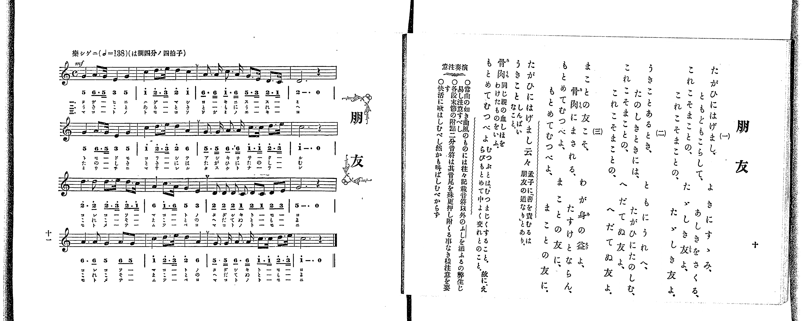

# 朋友

> Re:Shōka 使用 AI 協助辨識與重建樂譜，可能會有錯誤。歡迎[回報](https://github.com/TMDLang/reshoka/issues)。

- **鋼琴伴奏版**：<br><audio controls src="hoyu.mp3"></audio>
- **NEUTRINO 歌聲合成版**：<br><audio controls src="hoyu_neutrino.mp3"></audio>

- 出處：共益商社樂器店《唱歌教科書 教師用 巻二》第十～十一頁（第五曲）
- NDL Digital Collections PID 854863（https://dl.ndl.go.jp/pid/854863）掃描 P011.jpg

## 說明


- 出處：出處：共益商社樂器店《唱歌教科書 教師用 巻二》第十～十一頁（第五曲）
- 出處：NDL Digital Collections PID 854863（https://dl.ndl.go.jp/pid/854863）掃描 P011.jpg
- 調性與拍號：調號 ?= C，拍號 <4/4>，速度 != 138


## 歌詞

```text
（TMD 檔案未包含歌詞註解）
```

## ABC

<div class="abc-score" data-abc-src="hoyu.abc" aria-label="五線譜載入中"></div>

[下載 ABC 原始檔](hoyu.abc)

## TMD 檔案連結

- [主旋律 TMD 檔案](hoyu.tmd) [[在 TMD Studio 編輯](https://tmdlang.github.io/Tmd-TS/#tmd=s7IKdvYPcrWy4qpTUCpJTLdSSM7PyUlNLsnMz7PKrsxPzc6ML87Iz05Ugisoy88pzU21yk7MizeKtzA1sTAzRkgW55cWJadaFSdn5OfnxJekVpQk5edno8vHFySmp1oFGBgaImQKivLLUvMS84C6C4oy80pSU8DaEQpSyzJTUkHSxclAq8tSizLTMlNTkNyVWlQMcjXUipKixLzi5KLMApBXEKrSU_OKUq2SMzJzUopS8-KL8_PSEZJp-UW5VsUlRfkFGZnJCOGSjFSgh9OKMlPzUoozMgsQMvlFmemZeVa5qZlZmVh8m19UkpGfXpRYkFFplZFZXAJUnpyYEw8MOmB4amkpPJvT_bS_W0FLi0vRVsHQ2ILL3lbBmcvGRN_EDmTG0_ZdL2ZOfb9n1tPWjc9ndz2d2vZ8yb5nK5qezlzxdNf0xw1dT6dsfLa259nUmc-XT3w2e4cCkPV0x-rnU1YoPN2--8munscN3c_XrHna2_h-7zwg-WRHw8sFje_3dAAFn-ya8mz2pvd7OsGu9XPxUXABeqUkMUfBGZ4AihUCPF0UIFEM1JVRUlJQbKWvn5KjlwfE6fl6WQX6BZkp-jAVnc_6mp_19yuAIhYoBwxYLn0tBVtqAS4FBYWnffOBHn2xuf3Fiq4XHe1A379YOe9p64pn09qBLgR5A-Fk8gOoB80jQK8BYwFk_4tV-581LAfZ3N37YuZ8oOjj5n6g4NPZs592tD1u7gMygFJP104AOsdZ4emS5UBJBWCEKgBFgQa_WDvnyY6uFytmKDiDDe15NHOlLTDmgazHDT3AuH3ctP1x06bHzd2PG3rBFq7YDVQNSgPT1r1o3PSyeQVQKdCq5-sbgD57sqMTyABaBTa3-2Ur0ObpQMEXC3uAWoDeeb9n7vPO9qeN7U8n9D5uaAR6GSjydOdmhMgOoCsQaoCOetzQBArQ2ZtAXlm3FZj2gCHztHXt0w39YLt6nnbNfrpr2bMVMxVy00DcCS1AZeAk1QNR82zO6mdzOp_1z362YTHQ8eBw6iiD-BeuGhRiYNXPm3a9nNnycvc8kP6OtpfzNz9fs-xp1wJIkD7ZM_HZ2kVAEaCznm1e8aylH5IEQPbt6IRavKMB5jhw0t45F-5WYDJ_vn0WMHSAUfZ8w0Ig4_mstid75ygYxekZxYFIYzBpGAd0HkgN2GFYjQWnj07CJpvpmSmYKgAx0MSn65e9nDX7aXPr094NIOeC0kDH8z27gEaD2aAQeTZnzbNVU55N2_Ni5SZEEM5aDQrgahtjYFlQq_Bk99Kn-xcATXs6seN5_z5gEADtg4QUKC3ObHrasAcYQJhuetkwAajs2YIdTzf0Ai190b4FqAyakZ627ni2Z8rTpf2QcAWl5Yb251O3AaP-ceO6p8uaHjf2AtkvF60Ach83AbnrHjeufty4_um-hscNraCY3dMJcQTIfUumgRQ09Dxu3Pq4EVg69T5umvRs-24Qt6kbZOCerudT5j9unPFsxmSgAoiljxtnPm7cCVbfBLQdkjqA6QcYBEAtmOkCZHvrNiD76YZ9IPPXdT2bveVZ1x6gCUDFjxv7gXY92QW0bhXI8SsWQ21pmvRiWSPILogt-1c_2wJ02GpgDgIaCLK9CWgdyBnPW7Y9buwGevZpP9CnG5CkgIKdjxuBQYQUfC9WzXvZ3g0OOKBBQL8BSWDYgcLoceOkx437gPqf7JoIDCxgcIAy3tr5wJIBpKCh5-m0FpCzNq0BWQAKoPWQ2gDk7UZgAK163NQFCsRGYOgDS4Wu93tmg21pA3rsMUjBCoiZYCcCuRsfNwL9D_Q2SAqi-OWqFS-agEmsAyy4BOwwYDQDczjYMROAps14sQyoZd2LhUBPTn_cuBvopMdNwFiZCPIOJMqBIiCTt0IdABJc8bgJGJrLwEEDNHbn46YOqGOgIsBABDp7PbB8gYkAg2IGKHqAcQDyLMT9Tc-mtoJDA2haBzh8NyOb_2THWpDJjf1Pdi153AR0LTghwvRygeIBmKaBukEsXOEPdgPQEGCgAcWBtgNDbD9cD9AmoH0rweRksAuAoQAsa4DWA0WAbFAqftw4FZKy4NqASoFWAR0CNAxoCdhFoMQP1AYMtnkQnaDIBAUMOXqgvgPVUFDtSPEOSg_AMAQyQCU4zBNA37WBrdiBHCLA8AL7AqIaEjQQKxGBBVMGjCoiHLvjceMCUBg1riHeg5h6YNEHTIxQ7Qgt4FwANgcUd8A00_NiF9CZ64BtIIR9kMQNdj9Q51SQ3eAIAnsHWKgAUzDQLGAu6gRlD6glOBMvUATNflCqJEMPuHSgvK0DBQpa-lxcHvmVpVYBmYl5-Q41BjXVIAsUbAzNtOzArOrctFowA9jUety0H4jXKDxu3gPEk4C4W6EGSPYDRTdBRecB2dvBoisgIk1rweoeN-2E8iE0SMV8kP0gs2uANZouGJqBSVMFYygfJl6jYBgHZQLrVRAFrlihQnC5GqgBZjAhUF0JVq1gBFEJVAJhYUIDmCFgN_kYAp3YOB8qBkwkcNYmOGs13FpguoeLToKz9sFZ0xEqmzrgor1wc4BpCi4KY4FM3Y_DrfGobjUCqW1DMxfEmgxnrUAytQkm2tSNIY_QDVIJF22C6IG4FW5TEyxUQGp3EOdWY5BaRMhguhCY3PG4AFXPXITKpn64KMRVoNBDmAWsAuD-Q44F_K4FpfrmDiBeBE3fnWA2yIDNQNZKaJreDqTbwKJQdSARcMqH5oumrVB6PTz1r6ZW6ofoAqmCqAe1DiHiUF1ACqENySx0iC0DYAv-lRhiIJXwSGnqhKuEJXtg4YakEmESRB4UJcB6EC46FUr3g0MUlkTxRxQkCyCyKyLaEW7oRXIDZnJHZGdEZkaYCUpUsKwPyQQw8XVo2buBOPeCswEseyNn3oUY7kHNMJDQQc58iDBCDQNIQQKsq-D-BdZYSPEDci0s1vC7Flz4gxI8sPAH06CkvBeelEGFPlQUnFn6wEYDc19zA1JWAMmAVECyCKSKgGYBaEcEmh2giRXcgQKzEKkdmHaRUyfE9aCQwFooIKUMolSC4gRe0AHrr6ZGuEp4-oW6FzSIAnMvLAOi1TmgWgcW0KA6B4YN0WiQKkQZgA6xZUriS09QYgA2jsAkKJFCkju2bE18mQgJUOLdAKoXYG4ABSOwmUa5G8BRBctqwFYTnLUTbirMJJhrIS6F2AtxIQ43wDMefjegZwqiMgRIBDlTwFQQlTFg5TpyfQFiD74sMWD1FWlZA5IwUeohumcNmBsgwQnKHPTPGhC3ImoJUJ1Gbtao5eLStVMA9SoUgLQyFwA)]
- [鋼琴伴奏 TMD 檔案](hoyu_piano.tmd) [[在 TMD Studio 編輯](https://tmdlang.github.io/Tmd-TS/#tmd=s7IKdvYPcrWy4qpTUCpJTLdSyC8qychPL0osyKi0ysgsLskvykxOzInPTsxLVOLS0lJ4Nqf7aX_3-z0dL7v3PJ-w5cmeLU-X9j_v7Hi_p1NBS4tL0VbB0NiCy95WwZnLxkTfxA5k8NP2XS9mTn2_Z9bT1o3PZ3c9ndr2fMm-Zyuans5c8XTX9McNXU-nbHy2tufZ1JnPl098NnuHApD1dMfq51NWKDzdvvvJrp7HDd3P16x52tv4fu88IPlkR8PLBY1ANwAFn-ya8mz2JqDtSiCb_Fx8FFwy0zNLEnMUnPNzclKTSzLz84oVAjxdFCxMTSzMjIG6MkpKCoqt9PVTcvTygDg9Xy-rQL8gM0UfpqLzWV_zs_5-hQADQ0OgXLoSF5dHfmWpVUBmYl5-kIdDjUFNNZcCENgYmmnZgVnVuWm1YIa-lsLjpv1AvEbhcfMeIJ4ExN0KNUCyHyi6CSo6D8jeDhZdARFpWgtW97hpJ5QPoUEq5ito6YPNrlEwVdAFQzMwaapgDOXDxGsUDOOgTCMIwzgOxtJFyNVADTCDCZlBTTBWMIKoBCqBsDChAcwQsJt8DIFObJwPFXvc2ANnbYKzVsOtfdy4Hi46Cc7aB2dNR6hs6oCL9sLNedw4Ey4KY4FM3Y_DrfGobjUCqW1DMxfEmgxnrUAytQkm2tSNIY_QDVIJF22C6IG4FW5TEyxUQGp3EOdWY5BaRMhguvBx4zo8LkDVMxehsqkfLgpxFSj0EGY9boSEO8h_yLGA37WgVN_cAcSLoOm7E8wGGbAZyFoJTdPbgXQbWBSqDiQCTvnQfNG0FUqvh6f-1dRK_RBdIFUQ9abomQBIIbQhmYUOsWUAbMG_EkMMpBIeKU2dcJWwZP-4cRmSSoRJEHlQlDxuQmSbqVC6HxyisCSKP6IgWQCRXRHRjnBDL5IbMJM7IjsjMjPCTFCigmV9SCaAia9Dy94NxLkXnA1g2Rs58y7EcA9qhoGEDnLmQ4QRahhACpLHjRPh_n3cuAopfkCuhcUafteCC39QggcW_mAalJT3wpMyqNCHioIzSx_YaGDua25AygogGZAKSBaBVBHQLFBtYwysUiEVDbCAhiRQIIWR2oFpFzl1QlwPCgmshQJSyiBKJShO4AUdsP5qaoSrhKdfqHtBTQCYe2EZEK3OAdU6sIAG1TkwbIhGg1QhygB0iC1TEl96ghLD48YFYBKUSCHJHVu2Jr5MhAQo8W4A1QswN4CC8XHjGsrdAI4qWFZ73LgEztoJNxVmEsy1EJdC7IW4EIcb4BkPvxvQMwVRGQIkgpwpYCqIyhiwch25vgCxB1-WGLD6irSsAUmYKPUQ3bMGzA2Q4ARlDvpnDYhbEbUEqE4jN2vUIncqfJA7FSbQPgUw47zo63rZ3vu0dcfL2a2QrhaiNWQYrxBtGAujajBFoOpMgFwTFHWm8UC2aXwsmGEAV4jTQKgJMHUo2sEMVMthJqJmShRd2PICAXdCLMJwKnbLEGZhzXWo3iLBJmCk6dopgOIt2gcoCmcbIbGNwWxlLgA)]

## 分析

```text
================================================================================
📊 TMD Song Profile: [ 朋友 ]
================================================================================
⏱  Duration:       0:26 (27.0s), 16 measures total
🎼 Key & Tempo:    首調基準 C, != 138.0 BPM, <4/4>
   - 分析範圍：      由實際發聲的音符與和弦推測調性；播放脈絡另行呈現
🎤 人聲音域:    C4 (MIDI 60) – E5 (MIDI 76) [跨度: 16 個半音 / 1.3 個八度, 難度: moderate]
   - 最低音:  C4 in [Hoyu #1 @ m.3, 0:05]
   - 最高音: E5 in [Hoyu #1 @ m.2, 0:02]
   - 適合: soprano, mezzo-soprano, contralto, tenor, baritone, bass
🏛  結構:      Hoyu (27.0s)
⚡ 編曲密度:        Peak 1 軌道同時演奏
🗝  調性診斷：       G 調性不明確（純淨自然大調，未偵測到可信轉調）
   - 風格氣質:    純淨自然大調（陽光明朗、易唱易記，無明顯調外色彩）
   - 轉調歷程:    全曲維持單一推測調性（未偵測到可信轉調）
   - 核心骨幹音:  D, C, G, A, E
   - 調性數值:    G 調性不明確 [相關度: 0.77, 穩定度: Ambiguous, 自然音純度: 100.0%]
   - 候選調性 (K-S): G 大調 (0.77), C 大調 (0.75), A 小調 (0.56)
   - 五度圈歷程:   +1
   - 各段落調性細節:
     • [Hoyu #1]: G 調性不明確 (r: 0.77, 自然音純度: 100.0%)

  [ 五度圈游移軌跡 ]
               C  
         F           [G ]*
      Bb               D  
      Eb               A  
         Ab           E  
            Db       B  
               F# 
     (* = active key center)

  [ 十二半音累積音高分佈 ]
     C  : ███████████████████████   25.9%
     C# :                            0.0%
     D  : ████████████████████████  26.7%
     D# :                            0.0%
     E  : ████████                   9.1%
     F  :                            0.0%
     F# :                            0.0%
     G  : ████████████████████      22.0%
     G# :                            0.0%
     A  : ███████████████           16.4%
     A# :                            0.0%
     B  :                            0.0%
--------------------------------------------------------------------------------
Assignment 軌道音域：
  - Piano         : C4 – E5 (16 個半音 / 1.3 個八度, 77 個音符)
================================================================================
```


## 原書掃描頁




