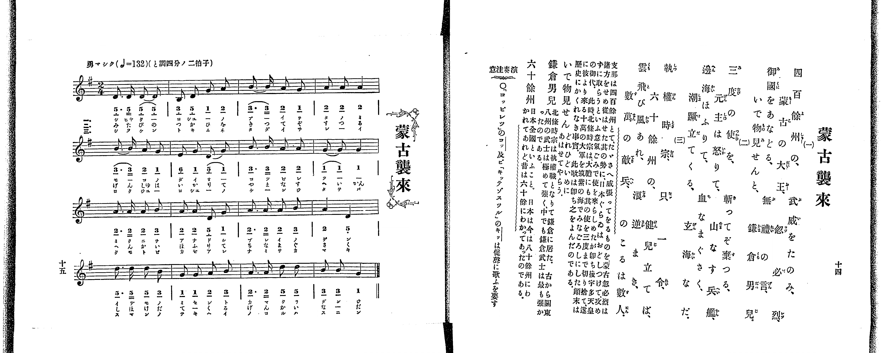

# 蒙古襲來

> Re:Shōka 使用 AI 協助辨識與重建樂譜，可能會有錯誤。歡迎[回報](https://github.com/TMDLang/reshoka/issues)。

- **鋼琴伴奏版**：<br><audio controls src="moko_shurai.mp3"></audio>
- **NEUTRINO 歌聲合成版**：<br><audio controls src="moko_shurai_neutrino.mp3"></audio>

- 出處：共益商社樂器店《唱歌教科書 教師用 巻二》第十四～十五頁（第七曲）
- NDL Digital Collections PID 854863（https://dl.ndl.go.jp/pid/854863）掃描 P013.jpg

## 說明

原書資訊與歌詞全文（NDL PID 854863《唱歌教科書 教師用 巻二》第十四～十五頁，掃描 P013.jpg）：
調性與拍號：ト調四分ノ二拍子（G 大調 2/4 拍），♩=132，「勇マシク」
註記：單聲部，分節歌三節（譜下配字三行：一＝片假名、二＝平假名與片假名混排、三＝片假名）。全曲四段共十六小節。第三段第四小節（第十二小節）五線譜為二個四分音符（A4、D4，即 2 5_），簡譜於 5_ 右側多印一點（似附點），依五線譜與 2/4 拍號作四分音符。又第二節末句右頁歌詞作「邊海潮蹴立てくる、山なす兵艦、玄海なだ。」，譜下配字第三段作「へんかい なみけた てくるや まなす」、第四段作「ヘイカン げん カイ なだ ノ コ ラー ハ ー ー だ」（多出「のうらは」等字以湊足四小節），歌詞全文依右頁錄入。
原典演奏注意：〇「コッピレツ」のコッ及び「キッテゾスツル」のキッは促聲に歌ふを要す。
原典曲意：「支那は四百餘州とて、たいさう廣い國であるのに、蒙古の忽必烈は其の支那を攻め從へた勢に威張って、日本ぐらゐはおどしつけて手に入れやうといふ意氣ごみで、度々無禮な手紙を持たせて、使をよこした。此時北條時宗は、大膽にも其の使を三度まで切捨てて仕舞った。そこで忽必烈は大に怒って、十萬の大軍を筑紫の海へさしむけたが、神風がおこって、敵の舟は皆覆り、生きて歸ったものは僅に三人であった、といふことが歴史にかいてある。此歌は即ち之をよんだのである。」
原典語釋：「いで物見せん」＝どれひどいめにあはせてやらう；「鎌倉男兒」＝北條時宗は執權職となりて鎌倉に居た。古から關東八州の武士は極めて強く、中でも鎌倉武士は最も強かったのである；「六十餘州」＝日本全國といふこと。日本は今は八十餘州にわかれてあれど、昔は六十餘にわかってあったのである。


## 歌詞

```text
一、
四百餘州の、武威をたのみ、
蒙古の大王、忽必烈、
御國をあなどる、無禮の言、
いで物見せんと、鎌倉男兒。

二、
三度の使を、斬ってぞ棄つる、
元主は怒りて、血なまぐさく、
邊海潮蹴立てくる、山なす兵艦、
玄海なだ。

三、
執權時宗、只一令、
六十餘州の、健兒立てば、
雲飛び風あれ、浪逆まき、
數萬の敵兵、のこるは數人。
```

## ABC

<div class="abc-score" data-abc-src="moko_shurai.abc" aria-label="五線譜載入中"></div>

[下載 ABC 原始檔](moko_shurai.abc)

## TMD 檔案連結

- [主旋律 TMD 檔案](moko_shurai.tmd) [[在 TMD Studio 編輯](https://tmdlang.github.io/Tmd-TS/#tmd=s7IKdvYPcrWy4qpTUCpJTLdSSM7PyUlNLsnMz7PKrsxPzc6ML87Iz05Ugisoy88pzU21yk7MizeKtzA1sTAzRkgW55cWJadaFSdn5OfnxJekVpQk5edno8vHFySmp1oFGBgi6Swoyi9LzUvMA-ouKMrMK0lNAWtHKEgty0xJBUkXJwOtLkstykzLTE1BcldqUTHI1VArSooS84qTizILQF5BqEpPzStKtUrOyMxJKUrNiy_Oz0tHlyxILCnKzC_JTEZIpOUX5VoVlxTlF2QgC5dkpAJDIiOzuCS_qBJdODczJ7MkEVk8vygzPTPPKjc1MysTS9jkF5Vk5KcXJRZkVELNzExOzIkHBjQw9LW0FF5Mmvm0f8mLpZue7GtT0NLiUrRVMDQ24rK3VXDnsjHSN7EDmfS0fdeLmVPf75n1tHXj89ldT6e2PV-y79mKpqczVzzdNf1xQ9fTKRufre15NnXm8-UTn83eoQBkPd2x-vmUFQpPt-9-sqvncUP38zVrnvY2Pp09-_3eeUDGk11TXi5ofL-nAyj-ZEfzs9mb3u_pBDvbz8VHwQXop5LEHAVneLopVgjwdFGApAygroySkoJiK339lBy9PCBOz9fLKtAvyEzRh6nofNbX_Ky_XwGUHoBywPjg0tdSsKUW4FJQUHjaNx_o1xeb21-s6HrR0Q4MgBcr5z1tXfFsWjvQhSBvIJxMURj1oPkF6DtgXICc8GLV_mcNy0GWd_e-mDkfKPq4uQMoCDTiaUfb4-Y-oLlAqadrJwBd5K7wdMlyoKQCMFoVgKJgY3oezVxpC4xxIOtxQ8_T7vbHzfMeN21_3LT-cUMv2IoVu1-smAGK-2nrXjRuetm8AqgUaPjz9Q1A7zzZ0QlkAA1_sXbOkx3dL1uBdk0HCr5Y2APU8mQHUGru8872p43tTyf0Pm4AegkoPvfpzs0QEaDL4bLPtm9_1jcJpGYH0F0IXUBnPm5oAoXr7E1Afz1btxWYCkHB1Lr26YZ-oO1AWXAi6gRKgUIQ6HewOCRxgcOxBybSCQzT59tnAV37vGkXSLyhGxJWL-dvfr5mGVCLownQCS4mIE_2blYwUjCNh4TT8w0LgbqeTdsDFFF42g_0wJanS2Y97d0A9OTL3fOAOp_s2fNyZguYDdLwZN9cuGVAf8JCHRhNT_bOQbYU5Lt-cD7Y1QMK1Tmrn_YvBdoAjHtImgKqB8bNy6auZ1u3P9u77sXOLc9Xdz9uXPa4sf9xUzfQuU83bnzcuOpx48ynrVtfdAINbHze1wJUDBZcADQfGJdAFyHHETzEIIY_btzxuGny40agsS0KYG37HzdOfNw4H8iB2dMEktkHsQhoIMgWcGgjDGme8bhpyeOm1Y-bNwOVTgKaqADiNS2BGLlAAZgigSJAyeaVj5v3AKl-IAbRQAxyKNCVHaBQbd8FdtO6x41tj5s6HzeCEuPztZ2gtLV76bOdXS-2bUaKZlBoI-c-YMhDgu9lT8vT1qVA_0Oz69PWHc_2THm6tP_Z5hXPWvpB2aWhHWRT0-bHzc2Pm6c8bl7zuLkF5Dmg3WDBp_1djxs3g9WsBasBOmjf46adIGXNq2EqwVKN65_sbwZmkceNq4Guedy49XHTpBfLGsGhheyC2Ztgdvc8m7L-ZdNioE6gb57P3PdyyYyn2-c9blwBCvQGoM75wOh43DgVGAxPdwOVtTydA4yg5Y8bm0DxAQoeoAsaIUU4kPt0_96n-1ufN3eADGzdBhSBmt806dmU3Y-bGp_uAxq-A2js0-5FQL1PVzQ-3bP1cSPQZJB1z6YvfTZnzePGCaAgb5oACvVGoOdXPm6c_rgRaD4wOSx71gm0dzUoUJuAIQJ0WxvYtUDGVqCnnm0AGjUFnHaWg5LlLqCxrc9bFj5fBnTqKqDe51tmghzTA_HabIi9T_buBwo-bgI6G5gCgXbNB4bXs7VLns1setoz_dmiuSDGOqA4MBU0goqwtr0gjzcBywSQHyHagYkZZB0ofS5_CiwPe8Fh2Ljsye6pLzqAvgY6DGTs48a5YFuWo4TVEmCQrn7WMAkeFMBC48UEYFCsA1m3uxdo_vO1E59vWQ0KUlC2AoYhMFKmP25qgOSSx43A0rPx-dJ5LxcB7QXGPTDcgLbAAnYqMJDXvegAKlv_fFbbi2XANNQFUj8FKAJMQMuerQUaCHZhE9CFwLBa_7S5FegkoKee7NoFjXGoF4BBBw1wsBUg656t3fK0H5TsIPkX7HFwCoEEIygtrgcWZo8bFz7ZCczG4KAGZfYFYLtgyQlcSiCS6YtV8162d0OSKdjQ5c87V75YBrRgNkgzKKsCg3IlKB2AkjwwlbQAUxjYEUC3ApMOOHaBSQSUf9ve75kNKsL6gAVu5_Mp25-2Agt6kAloEfx0_vZna7peNAKDGOixVaBgalwG0QVKdhuBgQKKRXByB_qk8-X0Oc_mbnzauhqcbdY9W7vs6WKgA9Y_WwrMfEDHLHu6B2hUP7hSWQvyalMTxDSEyjkNoJQEUgb0GjiIkQIF4mxQTdPbCM2cYGdDsgqwtAFnSNT4AAY6NCOtf7Ib6H5gVlyN0A5KuP1gxwPDDRJPQMZKUCqZAcw5QMVQuxAqIckIngJQ44wLFGPAKghoADjuUMqRdSBjgT5d0QiKdaje_VCliGJjyfLnfeBqBJ4noIbtWwjyH0gr0HJgAQ6MbZA6WI5e92IFzF4sKQQUFI2oMQ51LaitA9YFy7TQPAxy7TRguEH8O-_ZYqCZwOoEZCXYOa3NT3bsBsUZMKeCUwao8FsIzIJApwHzPbDEAmZKUGSDVJNUXYI0oFWZ0IAFtj0gloNTJjShAo3oXwUM9Ce7l8DdhpREwOH-tHEp0M8wmzfAXDV708vFwJyxGVxQgCMf6Omtq142AAtSoB9AtSpI3bOpOyAFELDsALoSnO2BIT4ZXO6vB8qCygVIrUJ5YxYKFLT0ubh887PzgzNKixIzrQIyE_PyHWoMaqpB1ijYGJpp2YFZwIY0sIkIrLUnPW5eDGSuB1fgNUByBUjicfNSaK3eBxacBuVtAOJNIJGm_ZCGQPN8kJUgE2tAjSpdIARSYBaYqFEwhrMNgdgIIgZWaAzmgURrwCwYBsEasJk-hkCrGqeDRUBFVFMzkOqHKQG6ogMsASzEW6GCwCCGSDVug4k0TQCTk6Di8-GqgPkI1TYjkDxEDNJs2oxi4hIwrxviFhQze6F6gCHZuAzMmgeVmQnmgXU2gXQi2WaM7DeQzolgVZOhOleAxUEmA6soMHstkg9AfGBbDNjSA7EWQoOjBx4KIHGEXaDYbl4EiUNw0w0Sqw1AHrBd1wyPfLAcMIybpwDxGrAaYIMR2rqDxzNm7JnBohcez6iqILEOEodhtDhuaoK7HOR_RJgvgPsGWJLC9EFVwcJtC1gW5HdYLCFD5LgFxRckjOGJBpgVoRohQQmO3qYuMBsUlSAZUPCC-KtAjWcwC5SkQDJT4c6GOw4RuU2wZAFsITcCm9WwNEog4YKSAcyRM8AyoAgHyYDcA1G7AcU2cPQC0ys4F3fDsygowruAuBOIV8Oz8RpopIOTQNMmIGszImoh2c8ITIMiEJExkWIWuyJo1sfMvrAMBQqF1WCfwbINKNJBoQoiV4JlQKGPyLygSIXFCyx0IFEIyyjoEbwDKewgGRWkGyQDsQXkFmhGQwtVsPvA9oM6SRAZUFxDYx6Sk9FzLyTSQakXll9BJQZIBmL5HDAJ9iY8fYIcAnEKJPlA1KJaB0k4yNELjrJ2aC6G5F5QhO8GRx9wwAAcmauBrHnQZLASlsNB8k07kEppSEyBaUjswfIkenwCO85glbDcDMJY8i60rAG2HaD5GBFZkOCeDY8uSCjBwgfE3wcNRWBDECoDzvFQ1aDkjyOKwX1cSHTBSkxQ0oDpxIx8lDIBzoLYhx6vkLgGuw5qHsxHkNIdFD8QlyDsAKmAlF_QZAQvWGApB9wcRKTaWi4uXTsFRGWtAOQpcwEA)]
- [鋼琴伴奏 TMD 檔案](moko_shurai_piano.tmd) [[在 TMD Studio 編輯](https://tmdlang.github.io/Tmd-TS/#tmd=s7IKdvYPcrWy4qpTUCpJTLdSyC8qychPL0osyKi0ysgsLskvykxOzInPTsxLVOLS0lJ4MWnm0_4lL5ZuerKv7f2ejpfde55P2PJkz5anS_ufd3a839OpoKXFpWirYGhsxGVvq-DOZWOkb2IHMv5p-64XM6e-3zPraevG57O7nk5te75k37MVTU9nrni6a_rjhq6nUzY-W9vzbOrM58snPpu9QwHIerpj9fMpKxSebt_9ZFfP44bu52vWPO1tfDp79vu984CMJ7umvFzQCHQGUPzJjuZnszcBHaAEsszPxUfBJTM9syQxR8E5PycnNbkkMz-vWCHA00XBwtTEwswYqCujpKSg2EpfPyVHLw-I0_P1sgr0CzJT9GEqOp_1NT_r71cIMDA0BsqlK3Fx-eZn5wdnlBYlZloFZCbm5Qd5ONQY1FRzKQCBjaGZlh2Ypa-l8Lhpu8Lj5kmPmxcDmeuBzD0KNUByBUjicfNSsMDj5j6w4DQobwMQbwKJNO0Hyz1unq-gpQ82sUbBNF5BFwiBFJgFJmoUjOFsQyA2goiBFRqDeSDRGjALhkGwBmymjyHQqsbpYJHHjZseNzUDqX6YEqArOsAS0x83tUIFHzeug0g1boOJNE0Ak5Og4vPhqh437ke1zQgkDxEDqXvcuBnFxCVgXjfELShm9kL1AEOycRmYNQ8qMxPMA-tsAulEss0Y2W8gnRPBqiZDda4Ai4NMftzUAGavRfIBiL8AiFvArIXQ4OiBhwJIHGEXKLabF0HisGkzPFYbgLwlQBoe-WA5YBg3TwHiNWA1LdCY34OIZ8zYM4NFLzyeUVVBYh0kDsNocdzUBHc5yP-IMF8A983jJqSIB6uChdsWsCzI77BYQobIcQuKL0gYwxPN48b1UI2QoARHb1MXmA2KSpAMKHhB_FVAvA_MAiUpkMxUuLPhjkNEbhMsWfQD8QxEGiWQcEHJAObIGWAZUISDZEDugajdgGIbOHqB6RWci7vhWRQU4V1A3AnEq-HZeA000sFJoGkTkLUZEbWQ7GcEpkERiMiYSDGLXRE062NmX1iGAoXCarDPYNkGFOmgUAWRK8EyoNBHZF5QpMLiBRY6kCiEZRT0CN6BFHaQjArSDZKB2AJyCzSjoYUq2H1g-x83wfSA4hoa85CcjJ57IZEOSr2w_AoqMUAyEMvngEmwN-HpE-QQiFMgyQeiFtU6SMJBjl5wlLVDczEk94IifDc4-h43d4AjczWQNQ-aDFbCcjhIvmkHUikNiSkwDYk9WJ5Ej08jsBoQhuRmEMaSd6FlzePG5dB8jIgsSHDPhkcXJJRg4QPi74OG4uOmTqgMOMdDVYOSP44oBtoKy6ywEhOUNGA6MSMfpUyAsyD2occrJK7BroOaB_MRpHQHxQ_EJQg7QCog5Rc0GcELFljKASZ_5FRbi1lX-yDX1SaIqvpFX9fL9t6nrTtezm6FNGUQ8WkYrxBtGAtkgCpgINs0Hi8HXlcjyZoA2SZYdMGMxqaHBLuIciFQkQEkUHTtFBDhEu0D1IkmYoQhYgwWUeYCAA)]

## 分析

```text
================================================================================
📊 TMD Song Profile: [ 蒙古襲來 ]
================================================================================
⏱  Duration:       0:14 (14.5s), 16 measures total
🎼 Key & Tempo:    首調基準 G, != 132.0 BPM, <2/4>
   - 分析範圍：      由實際發聲的音符與和弦推測調性；播放脈絡另行呈現
🎤 人聲音域:    B3 (MIDI 59) – D5 (MIDI 74) [跨度: 15 個半音 / 1.2 個八度, 難度: moderate]
   - 最低音:  B3 in [MokoShurai #1 @ m.2, 0:00]
   - 最高音: D5 in [MokoShurai #1 @ m.13, 0:10]
   - 適合: soprano, mezzo-soprano, contralto, tenor, baritone, bass
🏛  結構:      MokoShurai (14.5s)
⚡ 編曲密度:        Peak 1 軌道同時演奏
🗝  調性診斷：       D 大調（純淨自然大調，未偵測到可信轉調）
   - 風格氣質:    純淨自然大調（陽光明朗、易唱易記，無明顯調外色彩）
   - 轉調歷程:    全曲維持單一推測調性（未偵測到可信轉調）
   - 核心骨幹音:  A, D, G, B, E
   - 調性數值:    D 大調 [相關度: 0.76, 穩定度: Moderate, 自然音純度: 100.0%]
   - 候選調性 (K-S): D 大調 (0.76), G 大調 (0.65), B 小調 (0.50)
   - 五度圈歷程:   +2
   - 各段落調性細節:
     • [MokoShurai #1]: D 大調 (r: 0.76, 自然音純度: 100.0%)

  [ 五度圈游移軌跡 ]
               C  
         F            G  
      Bb              [D ]*
      Eb               A  
         Ab           E  
            Db       B  
               F# 
     (* = active key center)

  [ 十二半音累積音高分佈 ]
     C  :                            0.0%
     C# :                            0.0%
     D  : ███████████████           21.9%
     D# :                            0.0%
     E  : █                          1.6%
     F  :                            0.0%
     F# :                            0.0%
     G  : ███████████████           21.9%
     G# :                            0.0%
     A  : ████████████████████████  34.4%
     A# :                            0.0%
     B  : ██████████████            20.3%
--------------------------------------------------------------------------------
Assignment 軌道音域：
  - Piano         : B3 – D5 (15 個半音 / 1.2 個八度, 59 個音符)
================================================================================
```


## 原書掃描頁




