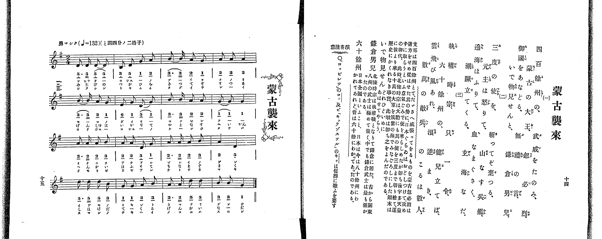

# 蒙古襲來

*找不到鋼琴伴奏版 TMD，未產生音訊。*

- 出處：共益商社樂器店《唱歌教科書 教師用 巻二》第十四～十五頁（第七曲）
- NDL Digital Collections PID 854863（https://dl.ndl.go.jp/pid/854863）掃描 P013.jpg

## 說明

原書資訊與歌詞全文（NDL PID 854863《唱歌教科書 教師用 巻二》第十四～十五頁，掃描 P013.jpg）：
調性與拍號：ト調四分ノ二拍子（G 大調 2/4 拍），♩=132，「勇マシク」
註記：單聲部，分節歌三節（譜下配字三行：一＝片假名、二＝平假名與片假名混排、三＝片假名）。全曲四段共十六小節。第三段第四小節（第十二小節）五線譜為二個四分音符（A4、D4，即 2 5_），簡譜於 5_ 右側多印一點（似附點），依五線譜與 2/4 拍號作四分音符。又第二節末句右頁歌詞作「邊海潮蹴立てくる、山なす兵艦、玄海なだ。」，譜下配字第三段作「へんかい なみけた てくるや まなす」、第四段作「ヘイカン げん カイ なだ ノ コ ラー ハ ー ー だ」（多出「のうらは」等字以湊足四小節），歌詞全文依右頁錄入。
原典演奏注意：〇「コッピレツ」のコッ及び「キッテゾスツル」のキッは促聲に歌ふを要す。
原典曲意：「支那は四百餘州とて、たいさう廣い國であるのに、蒙古の忽必烈は其の支那を攻め從へた勢に威張って、日本ぐらゐはおどしつけて手に入れやうといふ意氣ごみで、度々無禮な手紙を持たせて、使をよこした。此時北條時宗は、大膽にも其の使を三度まで切捨てて仕舞った。そこで忽必烈は大に怒って、十萬の大軍を筑紫の海へさしむけたが、神風がおこって、敵の舟は皆覆り、生きて歸ったものは僅に三人であった、といふことが歴史にかいてある。此歌は即ち之をよんだのである。」
原典語釋：「いで物見せん」＝どれひどいめにあはせてやらう；「鎌倉男兒」＝北條時宗は執權職となりて鎌倉に居た。古から關東八州の武士は極めて強く、中でも鎌倉武士は最も強かったのである；「六十餘州」＝日本全國といふこと。日本は今は八十餘州にわかれてあれど、昔は六十餘にわかってあったのである。

## 歌詞

```text
一、
四百餘州の、大王、
蒙古の忽必烈、
御國をあなどる、無禮の言、
いで物見せんと、鎌倉男兒。

二、
三度の使を、斬ってぞ棄つる、
元主は怒りて、血なまぐさく、
邊海潮蹴立てくる、山なす兵艦、
玄海なだ。

三、
執權時宗、只一令、
六十餘州の、健兒立てば、
雲飛び風あれ、浪逆まき、
數萬の敵兵、のこるは數人。
```

## ABC

```abc
X:1
T:蒙古襲來
M:2/4
L:1/16
Q:1/4=132
K:G
V:V1 name="Piano" snm="Pia"
[V:V1]
D3 D D2 D2 | B,2 D2 G2 A2 | B3 B A2 G2 | A2 A2 A4 |
B3 B A2 G2 | E2 G2 D2 G2 | B3 B A2 A2 | G2 G2 G4 |
A3 A A2 B2 | A2 A2 D2 G2 | A3 A A2 B2 | A4 D4 |
d3 d d2 B2 | G2 G2 A2 B2 | A3 A d2 d2 | B2 B2 G4 |
D3 D D2 D2 | B,2 D2 G2 A2 | B3 B A2 G2 | A2 A2 A4 |
B3 B A2 G2 | E2 G2 D2 G2 | B3 B A2 A2 | G2 G2 G4 |
A3 A A2 B2 | A2 A2 D2 G2 | A3 A A2 B2 | A4 D4 |
d3 d d2 B2 | G2 G2 A2 B2 | A3 A d2 d2 | B2 B2 G4 |
D3 D D2 D2 | B,2 D2 G2 A2 | B3 B A2 G2 | A2 A2 A4 |
B3 B A2 G2 | E2 G2 D2 G2 | B3 B A2 A2 | G2 G2 G4 |
A3 A A2 B2 | A2 A2 D2 G2 | A3 A A2 B2 | A4 D4 |
d3 d d2 B2 | G2 G2 A2 B2 | A3 A d2 d2 | B2 B2 G4 |
```

## TMD 檔案連結

- [主旋律 TMD 檔案](moko_shurai.tmd) [[在 TMD Studio 編輯](https://tmdlang.github.io/Tmd-TS/#tmd=s7IKdvYPcrWy4qpTUCpJTLdSSM7PyUlNLsnMz7PKrsxPzc6ML87Iz05Ugisoy88pzU21yk7MizeKtzA1sTAzRkgW55cWJadaFSdn5OfnxJekVpQk5edno8vHFySmp1oFGBgi6Swoyi9LzUvMA-ouKMrMK0lNAWtHKEgty0xJBUkXJwOtLkstykzLTE1BcldqUTHI1VArSooS84qTizILQF5BqEpPzStKtUrOyMxJKUrNiy_Oz0tHlyxILCnKzC_JTEZIpOUX5VoVlxTlF2QgC5dkpAJDIiOzuCS_qBJdODczJ7MkESSupaXwYtLMp_1LXizd9GRfm4KWFpeirYKhsRGXva2CO5eNkb6JHUjz0_ZdL2ZOfb9n1tPWjc9ndz2d2vZ8yb5nK5qezlzxdNf0xw1dT6dsfLa259nUmc-XT3w2e4cCkPV0x-rnU1YoPN2--8munscN3c_XrHna2_h09uz3e-cBGU92TXm5oPH9ng6g-JMdzc9mb3q_pxPsUj8XHwWXzHSgE3MUnOFxXqwQ4OmiAIlVoK6MkpKCYit9_ZQcvTwgTs_XyyrQL8hM0Yep6HzW1_ysv18BFJdAOWBYculrKdhSC3ApKCg87ZsP9OuLze0vVnS96GgHBsCLlfOetq54Nq0d6EKQNxBOpiiMetD8AvQdMC5ATnixav-zhuUgy7t7X8ycDxR93NwBFAQa8bSj7XFzH9BcoNTTtROALnJXeLpkOVBSARitCkBRsDE9j2autAXGOJD1uKHnaXf74-Z5j5u2P25a_7ihF2zFit0vVswAxf20dS8aN71sXgFUCjT8-foGoHee7OgEMoCGv1g758mO7petQLumAwVfLOwBanmyAyg193ln-9PG9qcTeh83AL0EFJ_7dOdmiAjQ5XDZZ9u3P-ubBFKzA-guhC6gMx83NIHCdfYmoL-erdsKTIWgYGpd-3RDP9B2oCw4EXUCpUAhCPQ7WBySuMDh2AMT6QSG6fPts4Cufd60CyTe0A0Jq5fzNz9fswyoxdEE6AQXE5AnezcrGCmYxkPC6fmGhUBdz6btAYooPO0HemDL0yWznvZuAHry5e55QJ1P9ux5ObMFzAZpeLJvLtwyoD9hoQ6Mpid75yBbCvJdPzgf7OoBheqc1U_7lwJtAMY9JE0B1QPj5mVT17Ot25_tXfdi55bnq7sfNy573Nj_uKkb6NynGzc-blz1uHHm09atLzqBBjY-72sBKgYLLgCaD4xLoIuQ4wgeYhDDHzfueNw0-XEj0NgWBbC2_Y8bJz5unA_kwOxpAsnsg1gENBBkCzi0EYY0z3jctORx0-rHzZuBSicBTVQA8ZqWQIxcoABMkUARoGTzysfNe4BUPxCDaCAGORToyg5QqLbvArtp3ePGtsdNnY8bQYnx-dpOUNravfTZzq4X2zYjRTMotJFzHzDkIcH3sqflaetSoP-h2fVp645ne6Y8Xdr_bPOKZy39oOzS0A6yqWnz4-bmx81THjevedzcAvIc0G6w4NP-rseNm8Fq1oLVAB2073HTTpCy5tUwlWCpxvVP9jcDs8jjxtVA1zxu3Pq4adKLZY3g0EJ2wexNMLt7nk1Z_7JpMVAn0DfPZ-57uWTG0-3zHjeuAAV6A1DnfGB0PG6cCgyGp7uBylqezgFG0PLHjU2g-AAFD9AFjZAiHMh9un_v0_2tz5s7QAa2bgOKQM1vmvRsyu7HTY1P9wEN3wE09mn3IqDepysan-7Z-rgRaDLIumfTlz6bs-Zx4wRQkDdNAIV6I9DzKx83Tn_cCDQfmByWPesE2rsaFKhNwBABuq0N7FogYyvQU882AI2aAk47y0HJchfQ2NbnLQufLwM6dRVQ7_MtM0GO6YF4bTbE3id79wMFHzcBnQ1MgUC75gPD69naJc9mNj3tmf5s0VwQYx1QHJgKGkFFWNtekMebgGUCyI8Q7cDEDLIOlD6XPwWWh73gMGxc9mT31BcdQF8DHQYy9nHjXLAty1HCagkwSFc_a5gEDwpgofFiAjAo1oGs290LNP_52onPt6wGBSkoWwHDEBgp0x83NUByyeNGYOnZ-HzpvJeLgPYC4x4YbkBbYAE7FRjI6150AJWtfz6r7cUyYBrqAqmfAhQBJqBlz9YCDQS7sAnoQmBYrX_a3Ap0EtBTT3btgsY41AvAoIMGONgKkHXP1m552g9KdpD8C_Y4OIVAghGUFtcDC7PHjQuf7ARmY3BQgzL7ArBdsOQELiUQyfTFqnkv27shyRRs6PLnnStfLANaMBukGZRVgUG5EpQOQEkemEpagCkM7AigW4FJBxy7wCQCyr9t7_fMBhVhfcACt_P5lO1PW4EFPcgEtAh-On_7szVdLxqBQQz02CpQMDUug-gCJbuNwEABxSI4uQN90vly-pxnczc-bV0Nzjbrnq1d9nQx0AHrny0FZj6gY5Y93QM0qh9cqawFebWpCWIaQuWcBlBKAikDeg0cxEiBAnE2qKbpbYRmTrCzIVkFWNqAMyRqfAADHZqR1j_ZDXQ_MCuuRmgHJdx-sOOB4QaJJyBjJSiVzADmHKBiqF0IlZBkBE8BqHHGBYoxYBUENAAcdyjlyDpIhnneB6okwJU5ZlEB1bdvIcgrwLQBsgdYVgMjFqQJlnnXvVgBswJLYgD5uhE1cqEOAzVrwLpg-ROaXUH-nQYMIojX5j1bDDQTWHPA3Pm0tfnJjt2g6AFmSnAiAJVzC4G5Deg0YBYHFk7A_AeKV5BqkmpGkAa02hEahsBmBsRycCKEpkmgEf2rgOH7ZPcSuNuQUgMkiBuXAv0Ms3kDzFWzN71cDMwEm8FlAjiegZ7euuplA7DMBPoBVIGC1D2bugNS1gCLCaArwTkcGOKTwUX8eqAsqAiAVCCUt1uhQEFLn4vLNz87PzijtCgx0yogMzEv36HGoEahGmSPgo2hmZYdmAVsNAObg8AaetLj5sVA5npwZV0DJFeAJB43L4XW4H1gQWBmAlb2YIFNMJVN-yH1fvN8kLUgQ2tAbShdIARSYBaYqFEwhrMNgdgIIgZWaAzmgURrwCwYBsEauEObF0HsBrcwkB0ExqvhDgJJNwPxFCBeA1YGbNqANW4CNV3grsS02wzmOLgrUVVB3AwSh2E0FwIbVOAw7AaHEMgxIDd3AXEnEK8GO2Ya2FmQkAT7ogkUlkjugvjcCEyDbEeECZKzsCuChjq6u8B2tUNDEBJyIJfuBtsL7FOAXQEKwHlQ96-EhC5EvmkHUsxCrADTEGthIYHuEGDbGqwSFoYgjAixWi4uXTsFRBpVIMBT5gIA)]

## 分析

```text
================================================================================
📊 TMD Song Profile: [ 蒙古襲來 ]
================================================================================
⏱  Duration:       0:43 (43.6s), 48 measures total
🎼 Key & Tempo:    首調基準 G, != 132.0 BPM, <2/4>
   - 分析範圍：      由實際發聲的音符與和弦推測調性；播放脈絡另行呈現
🎤 人聲音域:    B3 (MIDI 59) – D5 (MIDI 74) [跨度: 15 個半音 / 1.2 個八度, 難度: moderate]
   - 最低音:  B3 in [MokoShurai #1 @ m.2, 0:00]
   - 最高音: D5 in [MokoShurai #1 @ m.13, 0:10]
   - 適合: soprano, mezzo-soprano, contralto, tenor, baritone, bass
🏛  結構:      MokoShurai (14.5s) -> MokoShurai (14.5s) -> MokoShurai (14.5s)
⚡ 編曲密度:        Peak 1 軌道同時演奏
🗝  調性診斷：       D 大調（純淨自然大調，未偵測到可信轉調）
   - 風格氣質:    純淨自然大調（陽光明朗、易唱易記，無明顯調外色彩）
   - 轉調歷程:    全曲維持單一推測調性（未偵測到可信轉調）
   - 核心骨幹音:  A, D, G, B, E
   - 調性數值:    D 大調 [相關度: 0.76, 穩定度: Moderate, 自然音純度: 100.0%]
   - 候選調性 (K-S): D 大調 (0.76), G 大調 (0.65), B 小調 (0.50)
   - 五度圈歷程:   +2 -> +2 -> +2
   - 各段落調性細節:
     • [MokoShurai #1]: D 大調 (r: 0.76, 自然音純度: 100.0%)
     • [MokoShurai #2]: D 大調 (r: 0.76, 自然音純度: 100.0%)
     • [MokoShurai #3]: D 大調 (r: 0.76, 自然音純度: 100.0%)

  [ 五度圈游移軌跡 ]
               C  
         F            G  
      Bb              [D ]*
      Eb               A  
         Ab           E  
            Db       B  
               F# 
     (* = active key center)

  [ 十二半音累積音高分佈 ]
     C  :                            0.0%
     C# :                            0.0%
     D  : ███████████████           21.9%
     D# :                            0.0%
     E  : █                          1.6%
     F  :                            0.0%
     F# :                            0.0%
     G  : ███████████████           21.9%
     G# :                            0.0%
     A  : ████████████████████████  34.4%
     A# :                            0.0%
     B  : ██████████████            20.3%
--------------------------------------------------------------------------------
Assignment 軌道音域：
  - Piano         : B3 – D5 (15 個半音 / 1.2 個八度, 177 個音符)
================================================================================
```


## 原書掃描頁




