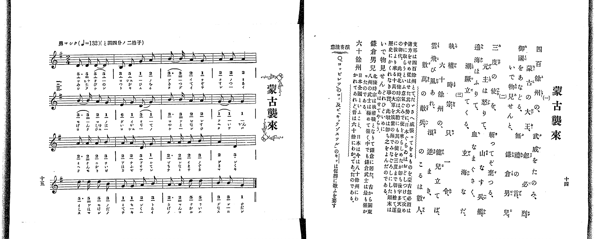

# 蒙古襲來

> Re:Shōka 使用 AI 協助辨識與重建樂譜，可能會有錯誤。歡迎回報。

- **鋼琴伴奏版**：<br><audio controls src="moko_shurai.mp3"></audio>
- **NEUTRINO 歌聲合成版**：<br><audio controls src="moko_shurai_neutrino.mp3"></audio>

- 出處：共益商社樂器店《唱歌教科書 教師用 巻二》第十四～十五頁（第七曲）
- NDL Digital Collections PID 854863（https://dl.ndl.go.jp/pid/854863）掃描 P013.jpg

## 說明

原書資訊與歌詞全文（NDL PID 854863《唱歌教科書 教師用 巻二》第十四～十五頁，掃描 P013.jpg）：
調性與拍號：ト調四分ノ二拍子（G 大調 2/4 拍），♩=132，「勇マシク」
註記：單聲部，分節歌三節（譜下配字三行：一＝片假名、二＝平假名與片假名混排、三＝片假名）。全曲四段共十六小節。第三段第四小節（第十二小節）五線譜為二個四分音符（A4、D4，即 2 5_），簡譜於 5_ 右側多印一點（似附點），依五線譜與 2/4 拍號作四分音符。又第二節末句右頁歌詞作「邊海潮蹴立てくる、山なす兵艦、玄海なだ。」，譜下配字第三段作「へんかい なみけた てくるや まなす」、第四段作「ヘイカン げん カイ なだ ノ コ ラー ハ ー ー だ」（多出「のうらは」等字以湊足四小節），歌詞全文依右頁錄入。
原典演奏注意：〇「コッピレツ」のコッ及び「キッテゾスツル」のキッは促聲に歌ふを要す。
原典曲意：「支那は四百餘州とて、たいさう廣い國であるのに、蒙古の忽必烈は其の支那を攻め從へた勢に威張って、日本ぐらゐはおどしつけて手に入れやうといふ意氣ごみで、度々無禮な手紙を持たせて、使をよこした。此時北條時宗は、大膽にも其の使を三度まで切捨てて仕舞った。そこで忽必烈は大に怒って、十萬の大軍を筑紫の海へさしむけたが、神風がおこって、敵の舟は皆覆り、生きて歸ったものは僅に三人であった、といふことが歴史にかいてある。此歌は即ち之をよんだのである。」
原典語釋：「いで物見せん」＝どれひどいめにあはせてやらう；「鎌倉男兒」＝北條時宗は執權職となりて鎌倉に居た。古から關東八州の武士は極めて強く、中でも鎌倉武士は最も強かったのである；「六十餘州」＝日本全國といふこと。日本は今は八十餘州にわかれてあれど、昔は六十餘にわかってあったのである。


## 歌詞

```text
一、
四百餘州の、武威をたのみ、
蒙古の大王、忽必烈、
御國をあなどる、無禮の言、
いで物見せんと、鎌倉男兒。

二、
三度の使を、斬ってぞ棄つる、
元主は怒りて、血なまぐさく、
邊海潮蹴立てくる、山なす兵艦、
玄海なだ。

三、
執權時宗、只一令、
六十餘州の、健兒立てば、
雲飛び風あれ、浪逆まき、
數萬の敵兵、のこるは數人。
```

## ABC

<div class="abc-score" data-abc-src="moko_shurai.abc" aria-label="五線譜載入中"></div>

[下載 ABC 原始檔](moko_shurai.abc)

## TMD 檔案連結

- [主旋律 TMD 檔案](moko_shurai.tmd) [[在 TMD Studio 編輯](https://tmdlang.github.io/Tmd-TS/#tmd=s7IKdvYPcrWy4qpTUCpJTLdSSM7PyUlNLsnMz7PKrsxPzc6ML87Iz05Ugisoy88pzU21yk7MizeKtzA1sTAzRkgW55cWJadaFSdn5OfnxJekVpQk5edno8vHFySmp1oFGBgi6Swoyi9LzUvMA-ouKMrMK0lNAWtHKEgty0xJBUkXJwOtLkstykzLTE1BcldqUTHI1VArSooS84qTizILQF5BqEpPzStKtUrOyMxJKUrNiy_Oz0tHlyxILCnKzC_JTEZIpOUX5VoVlxTlF2QgC5dkpAJDIiOzuCS_qBJdODczJ7MkEVk8vygzPTPPKjc1MysTKWy0tBReTJr5tH_Ji6WbnuxrU9DS4lK0VTA0NuKyt1Vw57Ix0jexA5nxtH3Xi5lT3--Z9bR14_PZXU-ntj1fsu_ZiqanM1c83TX9cUPX0ykbn63teTZ15vPlE5_N3qEAZD3dsfr5lBUKT7fvfrKr53FD9_M1a572Nj6dPfv93nlAxpNdU14uaHy_pwMo_mRH87PZm97v6QQ72M_FR8EF6NySxBwFZ3iSKFYI8HRRgEQ6UFdGSUlBsZW-fkqOXh4Qp-frZRXoF2Sm6MNUdD7ra37W368AimqgHDCoufS1FGypBbgUFBSe9s0H-vXF5vYXK7pedLQDA-DFynlPW1c8m9YOdCHIGwgnUxRGPWh-AfoOGBcgJ7xYtf9Zw3KQ5d29L2bOB4o-bu4ACgKNeNrR9ri5D2guUOrp2glAF7krPF2yHCipAIxWBaAo2JieRzNX2gJjHMh63NDztLv9cfO8x03bHzetf9zQC7Zixe4XK2aA4n7auheNm142rwAqBRr-fH0D0DtPdnQCGUDDX6yd82RH98tWoF3TgYIvFvYAtTzZAZSa-7yz_Wlj-9MJvY8bgF4Cis99unMzRATocrjss-3bn_VNAqnZAXQXQhfQmY8bmkDhOnsT0F_P1m0FpkJQMLWufbqhH2g7UBaciDqBUqAQBPodLA5JXOBw7IGJdALD9Pn2WUDXPm_aBRJv6IaE1cv5m5-vWQbU4mgCdIKLCciTvZsVjBRM4yHh9HzDQqCuZ9P2AEUUnvYDPbDl6ZJZT3s3AD35cvc8oM4ne_a8nNkCZoM0PNk3F24Z0J-wUAdG05O9c5AtBfmuH5wPdvWAQnXO6qf9S4E2AOMekqaA6oFx87Kp69nW7c_2rnuxc8vz1d2PG5c9bux_3NQNdO7TjRsfN6563DjzaevWF51AAxuf97UAFYMFFwDNB8Yl0EXIcQQPMYjhjxt3PG6a_LgRaGyLAljb_seNEx83zgdyYPY0gWT2QSwCGgiyBRzaCEOaZzxuWvK4afXj5s1ApZOAJiqAeE1LIEYuUACmSKAIULJ55ePmPUCqH4hBNBCDHAp0ZQcoVNt3gd207nFj2-OmzseNoMT4fG0nKG3tXvpsZ9eLbZuRohkU2si5DxjykOB72dPytHUp0P_Q7Pq0dcezPVOeLu1_tnnFs5Z-UHZpaAfZ1LT5cXPz4-Ypj5vXPG5uAXkOaDdY8Gl_1-PGzWA1a8FqgA7a97hpJ0hZ82qYSrBU4_on-5uBWeRx42qgax43bn3cNOnFskZwaCG7YPYmmN09z6asf9m0GKgT6JvnM_e9XDLj6fZ5jxtXgAK9AahzPjA6HjdOBQbD091AZS1P5wAjaPnjxiZQfICCB-iCRkgRDuQ-3b_36f7W580dIANbtwFFoOY3TXo2Zffjpsan-4CG7wAa-7R7EVDv0xWNT_dsfdwINBlk3bPpS5_NWfO4cQIoyJsmgEK9Eej5lY8bpz9uBJoPTA7LnnUC7V0NCtQmYIgA3dYGdi2QsRXoqWcbgEZNAaed5aBkuQtobOvzloXPlwGdugqo9_mWmSDH9EC8Nhti75O9-4GCj5uAzgamQKBd84Hh9Wztkmczm572TH-2aC6IsQ4oDkwFjaAirG0vyONNwDIB5EeIdmBiBlkHSp_LnwLLw15wGDYue7J76osOoK-BDgMZ-7hxLtiW5ShhtQQYpKufNUyCBwWw0HgxARgU60DW7e4Fmv987cTnW1aDghSUrYBhCIyU6Y-bGiC55HEjsPRsfL503stFQHuBcQ8MN6AtsICdCgzkdS86gMrWP5_V9mIZMA11gdRPAYoAE9CyZ2uBBoJd2AR0ITCs1j9tbgU6CeipJ7t2QWMc6gVg0EEDHGwFyLpna7c87QclO0j-BXscnEIgwQhKi-uBhdnjxoVPdgKzMTioQZl9AdguWHIClxKIZPpi1byX7d2QZAo2dPnzzpUvlgEtmA3SDMqqwKBcCUoHoCQPTCUtwBQGdgTQrcCkA45dYBIB5d-293tmg4qwPmCB2_l8yvanrcCCHmQCWgQ_nb_92ZquF43AIAZ6bBUomBqXQXSBkt1GYKCAYhGc3IE-6Xw5fc6zuRuftq4GZ5t1z9Yue7oY6ID1z5YCMx_QMcue7gEa1Q-uVNaCvNrUBDENoXJOAyglgZQBvQYOYqRAgTgbVNP0NkIzJ9jZkKwCLG3AGRI1PoCBDs1I65_sBrofmBVXI7SDEm4_2PHAcIPEE5CxEpRKZgBzDlAx1C6ESkgygqcA1DjjAsUYsAoCGgCOO5RyZB3IWKBPVzSCYh2qdz9UKaLYWLL8eR-4GoHnCahh-xaC_AfSCrQcWIADYxukDpaj171YAbMXSwoBBUUjaoxDXQtq64B1wTItNA-DXDsNGG4Q_857thhoJrA6AVkJdk5r85Mdu0FxBsyp4JQBKvwWArMg0GnAfA8ssYCZEhTZINUkVZcgDWhVJjRggW0PiOXglAlNqEAj-lcBA_3J7iVwtyElEXC4P21cCvQzzOYNMFfN3vRyMTBnbAYXFODIB3p666qXDcCCFOgHUK0KUvds6g5IAQQsO4CuBGd7YIhPBpf764GyoHIBUqtQ3piFAgUtfS4u3_zs_OCM0qLETKuAzMS8fIcag5pqkDUKNoZmWnZgFrAhDWwiAmvtSY-bFwOZ68EVeA2QXAGSeNy8FFqr94EFp0F5G4B4E0ikaT-kIdA8H2QlyMQaUKNKFwiBFJgFJmoUjOFsQyA2goiBFRqDeSDRGjALhkGwBmymjyHQqsbpYBFQEdXUDKT6YUqArugASwAL8VaoIDCIIVKN22AiTRPA5CSo-Hy4KmA-QrXNCCQPEYM0mzajmLgEzOuGuAXFzF6oHmBINi4Ds-ZBZWaCeWCdTSCdSLYZI_sNpHMiWNVkqM4VYHGQycAqCsxei-QDEB_YFgO29ECshdDg6IGHAkgcYRcotpsXQeIQ3HSDxGoDkAds1zXDIx8sBwzj5ilAvAasBthghLbu4PGMGXtmsOiFxzOqKkisg8RhGC2Om5rgLgf5HxHmC-C-AZakMH1QVbBw2wKWBfkdFkvIEDluQfEFCWN4ogFmRahGSFCCo7epC8wGRSVIBhS8IP4qUOMZzAIlKZDMVLiz4Y5DRG4TLFkAW8iNwGY1LI0SSLigZABz5AywDCjCQTIg90DUbkCxDRy9wPQKzsXd8CwKivAuIO4E4tXwbLwGGungJNC0CcjajIhaSPYzAtOgCERkTKSYxa4ImvUxsy8sQ4FCYTXYZ7BsA4p0UKiCyJVgGVDoIzIvKFJh8QILHUgUwjIKegTvQAo7SEYF6QbJQGwBuQWa0dBCFew-sP2gThJEBhTX0JiH5GT03AuJdFDqheVXUIkBkoFYPgdMgr0JT58gh0CcAkk-ELWo1kESDnL0gqOsHZqLIbkXFOG7wdEHHDAAR-ZqIGseNBmshOVwkHzTDqRSGhJTYBoSe7A8iR6fwI4zWCUsN4MwlrwLLWuAbQdoPkZEFiS4Z8OjCxJKsPAB8fdBQxHYEITKgHM8VDUo-eOIYnAfFxJdsBITlDRgOjEjH6VMgLMg9qHHKySuwa6DmgfzEaR0B8UPxCUIO0AqIOUXNBnBCxZYygE3BxGptpaLS9dOAVFZKwB5ylwA)]
- [鋼琴伴奏 TMD 檔案](moko_shurai_piano.tmd) [[在 TMD Studio 編輯](https://tmdlang.github.io/Tmd-TS/#tmd=s7IKdvYPcrWy4tLSUngxaebT_iUvlm56sq_t_Z6Ol917nk_Y8mTPlqdL-593drzf06mgpcWlaKtgaGzEZW-r4M5lY6RvYsdVp6D0tH3Xi5lT3--Z9bR14_PZXU-ntj1fsu_ZiqanM1c83TX9cUPX0ykbn63teTZ15vPlE5_N3qEAZD3dsfr5lBUKT7fvfrKr53FD9_M1a572Nj6dPfv93nlAxpNdU14uaAQ6Ayj-ZEfzs9mbgA5QAlnm5-Kj4JKZnlmSmKPgnJ-Tk5pckpmfV6wQ4OmiYGFqYmFmDNSVUVJSUGylr5-So5cHxOn5elkF-gWZKfowFZ3P-pqf9fcrBBgYGgPl0pW4uHzzs_ODM0qLEjOtAjIT8_KDPBxqDGqquRSAwMbQTMsOzNLXUnjctF3hcfOkx82Lgcz1QOYehRoguQIk8bh5KVjgcXMfWHAalLcBiDeBRJr2g-UeN89X0NIHm1ijYBqvoAuEQArMAhM1CsZwtiEQG0HEwAqNwTyQaA2YBcMgWAM208cQaFXjdLDI48ZNj5uagVQ_TAnQFR1giemPm1qhgo8b10GkGrfBRJomgMlJUPH5cFWPG_ej2mYEkoeIgdQ9btyMYuISMK8b4hYUM3uheoAh2bgMzJoHlZkJ5oF1NoF0ItlmjOw3kM6JYFWToTpXgMVBJj9uagCz1yL5AMRfAMQtYNZCaHD0wEMBJI6wCxTbzYsgcdi0GR6rDUDeEiANj3ywHDCMm6cA8RqwmhZozO9BxDNm7JnBohcez6iqILEOEodhtDhuaoK7HOR_RJgvgPvmcRNSxINVwcJtC1gW5HdYLCFD5LgFxRckjOGJ5nHjeqhGSFCCo7epC8wGRSVIBhS8IP4qIN4HZoGSFEhmKtzZcMchIrcJliz6gXgGIo0SSLigZABz5AywDCjCQTIg90DUbkCxDRy9wPQKzsXd8CwKivAuIO4E4tXwbLwGGungJNC0CcjajIhaSPYzAtOgCERkTKSYxa4ImvUxsy8sQ4FCYTXYZ7BsA4p0UKiCyJVgGVDoIzIvKFJh8QILHUgUwjIKegTvQAo7SEYF6QbJQGwBuQWa0dBCFew-sP2Pm2B6QHENjXlITkbPvZBIB6VeWH4FlRggGYjlc8Ak2Jvw9AlyCMQpkOQDUYtqHSThIEcvOMraobkYkntBEb4bHH2PmzvAkbkayJoHTQYrYTkcJN-0A6mUhsQUmIbEHixPosenEVgNCENyMwhjybvQsuZx43JoPkZEFiS4Z8OjCxJKsPAB8fdBQ_FxUydUBpzjoapByR9HFANthWVWWIkJShownZiRj1ImwFkQ-9DjFRLXYNdBzYP5CFK6g-IH4hKEHSAVkPILmozgBQss5QCTP3KqrcWsq32Q62oTRFX9oq_rZXvv09YdL2e3QpoyiPg0jFeINowFMkAVMJBtGo-XA6-rkWRNgGwTLLpgRmPTQ4JdRLkQqMgAEii6dgqIcIn2AepEEzHCEDEGiyhzAQA)]

## 分析

```text
================================================================================
📊 TMD Song Profile: [ 蒙古襲來 ]
================================================================================
⏱  Duration:       0:14 (14.5s), 16 measures total
🎼 Key & Tempo:    首調基準 G, != 132.0 BPM, <2/4>
   - 分析範圍：      由實際發聲的音符與和弦推測調性；播放脈絡另行呈現
🎤 人聲音域:    B3 (MIDI 59) – D5 (MIDI 74) [跨度: 15 個半音 / 1.2 個八度, 難度: moderate]
   - 最低音:  B3 in [MokoShurai #1 @ m.2, 0:00]
   - 最高音: D5 in [MokoShurai #1 @ m.13, 0:10]
   - 適合: soprano, mezzo-soprano, contralto, tenor, baritone, bass
🏛  結構:      MokoShurai (14.5s)
⚡ 編曲密度:        Peak 1 軌道同時演奏
🗝  調性診斷：       D 大調（純淨自然大調，未偵測到可信轉調）
   - 風格氣質:    純淨自然大調（陽光明朗、易唱易記，無明顯調外色彩）
   - 轉調歷程:    全曲維持單一推測調性（未偵測到可信轉調）
   - 核心骨幹音:  A, D, G, B, E
   - 調性數值:    D 大調 [相關度: 0.76, 穩定度: Moderate, 自然音純度: 100.0%]
   - 候選調性 (K-S): D 大調 (0.76), G 大調 (0.65), B 小調 (0.50)
   - 五度圈歷程:   +2
   - 各段落調性細節:
     • [MokoShurai #1]: D 大調 (r: 0.76, 自然音純度: 100.0%)

  [ 五度圈游移軌跡 ]
               C  
         F            G  
      Bb              [D ]*
      Eb               A  
         Ab           E  
            Db       B  
               F# 
     (* = active key center)

  [ 十二半音累積音高分佈 ]
     C  :                            0.0%
     C# :                            0.0%
     D  : ███████████████           21.9%
     D# :                            0.0%
     E  : █                          1.6%
     F  :                            0.0%
     F# :                            0.0%
     G  : ███████████████           21.9%
     G# :                            0.0%
     A  : ████████████████████████  34.4%
     A# :                            0.0%
     B  : ██████████████            20.3%
--------------------------------------------------------------------------------
Assignment 軌道音域：
  - Piano         : B3 – D5 (15 個半音 / 1.2 個八度, 59 個音符)
================================================================================
```


## 原書掃描頁




