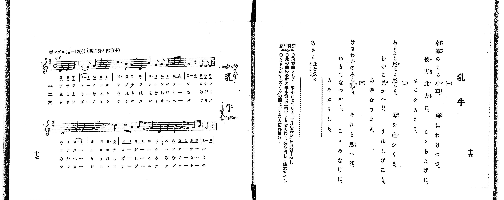

# 乳牛

> Re:Shōka 使用 AI 協助辨識與重建樂譜，可能會有錯誤。歡迎[回報](https://github.com/TMDLang/reshoka/issues)。

- **鋼琴伴奏版**：<br><audio controls src="nyugyu.mp3"></audio>
- **NEUTRINO 歌聲合成版**：<br><audio controls src="nyugyu_neutrino.mp3"></audio>

- 出處：共益商社樂器店《唱歌教科書 教師用 巻二》第十六～十七頁（第八曲）
- NDL Digital Collections PID 854863（https://dl.ndl.go.jp/pid/854863）掃描 P014.jpg

## 說明

原書資訊與歌詞全文（NDL PID 854863《唱歌教科書 教師用 巻二》第十六～十七頁，掃描 P014.jpg）：
調性與拍號：ト調四分ノ四拍子（G 大調 4/4 拍，譜上記 C），♩=120，「樂シゲニ」，弱起一拍半（三個八分音符）
註記：單聲部，分節歌三節（譜下配字三行：一＝片假名、二＝平假名、三＝片假名）。全曲兩段共八小節（含首尾不完全小節），力度標 mf，第一段第二小節第三拍後、第二段第二小節第一拍後及第三小節第三拍後有換氣記號（v）。五線譜與簡譜逐音核對一致。
原典演奏注意：〇豫習曲として一學年に出でたる「一月の遊び」を復習すべし。〇此の曲の最初の半小節は三拍半より初まれり、歌ひ出しに注意すべし。〇「あさつゆ」と「のこる」の間に自らなる切れ目あり。
原典語釋：「あさる」＝食を求めること。


## 歌詞

```text
一、
朝露のこる小草、角にわけつつ、
彼方此方に、こゝちよげに、なにをあさる。

二、
あとより尾ふり尾ふり、母を追ひくる、
わがこ見かへり、うれしげにも、あゆむさまよ。

三、
けさわがのみし乳も、それと思へば、
わきてなつかし、こゝろなげに、あそぶうしも。
```

## ABC

<div class="abc-score" data-abc-src="nyugyu.abc" aria-label="五線譜載入中"></div>

[下載 ABC 原始檔](nyugyu.abc)

## TMD 檔案連結

- [主旋律 TMD 檔案](nyugyu.tmd) [[在 TMD Studio 編輯](https://tmdlang.github.io/Tmd-TS/#tmd=s7IKdvYPcrWy4qpTUCpJTLdSSM7PyUlNLsnMz7PKrsxPzc6ML87Iz05Ugisoy88pzU21yk7MizeKtzA1sTAzRkgW55cWJadaFSdn5OfnxJekVpQk5edno8vHFySmp1oFGBiaIGQKivLLUvMS84C6C4oy80pSU8DaEQpSyzJTUkHSxclAq8tSizLTMlNTkNyVWlQMcjXUipKixLzi5KLMApBXEKrSU_OKUq2SMzJzUopS8-KL8_PSEZJp-UW5VsUlRfkFGZnJCOGSjFSghxPzMnMTc9BF8xJLSotSEaL5RZnpmXlWuamZWZlY_J9fVJKRn16UWJBRaZWRWVwCVJ6cmBMPDExgCGtpKTzZufl552wFLS0uRVsFQyMDLntbBXcuGxN9EzuQGU_bd72YOfX9nllPWzc-n931dGrb8yX7nq1oejpzxdNd0x83dD2dsvHZ2p5nU2c-Xz7x2ewdCkDW0x2rn09ZofB0--4nu3oeN3Q_X7PmaW_j09a17_fOAzKe7Gh-uaDx_Z4OkHjr6mezN73f0wl2sJ-Lj4IL0DcliTkKzvBUUawQ4OmiAIl3oK6MkpKCYit9_ZQcvTwgTs_XyyrQL8hM0Yep6HzW1_ysv18BFNtAOWBoc-lrKdhSC3ApKCg87ZsP9OuLze0vVnS96GgHBsCLlfOetq54Nq0d6EKQNxBOpiiMetD8AvQdMC5ATnixav-zhuUgy7t7X8ycDxR93NwBFHw6e_bTjrbHzX1ABlDq6doJQBe5KzxdshwoqQCMVgWgKNDgF2vnPNnR9WLFDAVnsKE9j2autAXGP5D1uKEHGMOPm7Y_btr0uLn7cQNI_dM9G19s3f5kRwPI0N4uoKFPdnQ-begGxiDQvpfzNz9fswxoENhpK3YDzQWlmWnrXjRuetm8AqS_o-35-gZgMAC1ARlA_WAXdL9sBbpxOlDwxcIeoBagBe_3zH3e2f60sf3phN7HDY3A8AGKPN25GSGyA-hehBqgrY8bmkChP3vT09aVz9ZtBaZVkLM29EMsejph9ctl055u2PdkR-_TdT1AlTApkL-fds1-umvZsxUzFXLTgFxgRIA8uW4riLGrB6ISLNgJ8vk-YOg0QqSwqQGHzr6ep_1dEC2Y2p_N6XzWP_vZhsXAIALHW0cZxANPdk15vn0WMFCAcfp8w0Ig42XDBGC4Pluw4-mGXqDRL9q3AJVBk9_T1h3P9kx5urT_2eYVz1r6QdHf0P5i4-rn-ycBg-Fx44rHjdMfNy4Danu6dsfTnVseN64GZuXHjcsfN85_3ASMU2A8NDyb0_G4cd3Lxq7HjZuBsfy4adLTfSuBJjxunPm4cSfIhIYmoLHP1i4BKgMbu-7ZnIanHXOBDGAagHjuceN6qOd6ux43dTxu6gIr2Pe4qQfIBoYWMM4fN24C2w500mqIg9GsALrncWPT48apjxuXPG5qAzkG6AWQ4LrHjZPBDgaKrHs5bTLQhBftqx43dT5uBJLdTzvagRY9nw1UBkyxQOuQAujFqnkv27vBQQMzHWwQMPG8XAwMhUnPNgL1NIIEgXaA7GviAukGhgzQ2SDWszlzX84BeRviCKCHX_QC46rxxXJgGK1-3AT0xkSQi4EIouHp3j3Ppu0EBhiQBKloaATrBIbHQlDYNIK1gQRXgfUDuXBnQe0GlQZgo8BSK6AhumHf48atyAxQuK4HxdiL_XuBofu4sR9sCEQnyF1AH09-sQzoMyDaAdHwuLENFCmgWIA4HxjyQEFgGADFgfEIDHxgrHUgggHkVYhTgL4EuhJiLDAw9gMNAVYcMBPmgo1d8awB6M8djxs3ILsDGG3LwN4FhhLQKcD4hgVJE1AKKA4PEqB3gfq3gVwJVAYyGhyXlJfYUKCgpc_F5VdZml5ZahWQmZiX71Cja1hTDbJDwcZCyw7MqM5NqwUzgFWGxuOmRUBPbFV43NyiqVADpJYB8R4g7gMKbwbSq8Gim4C8DTCFYBGgfHM3EK8Him4Ei4L0gWRaQKauBjK6gFL7NUFuAtlWo2AAh6bxCmbxCubxQEFDBV0oNFIwBvJqFEzBPGMgXxekUBcoZAwWMgQKgbAxkjYDkEEQVAO2xsewRiEeDoFBDsRTgXgJyG1NbXDbgJEMxJOBYt1gmUlQ0Qlg9SDWErDVIHUQGaCXmvpBCQVJDkSDIMgmYGg0rgLi-TCXGGG6ZAXQjA6wfV0IlwDtBqZ4sBiySyAiINZ6qG0gGqYeGLiNwFhp7IfIAX0BdwnYlT1g30FdYozqEpAPgGECVAcytQctTPYD8XSwzEKo6EKg2iYway7UNogesH9ALgHKArMF1JUb0FzSC8TLoC4BJjlIsgKnDXiSAQYdSBQs0wgWARoMSoZNQC-CkyMoqYGDB8wCJUdgugWrACVJiCmrEUkNnG5AaQSWcmogyQmIzcAipuCEZgxOckgJDZH2MBMaBCJSGSh8QWGwCkzOh6oDia8Gi0BkQSQkDEHh1gFmg2IYpgqkG6YHFreQsAalQtSYhUBE6gLFFUglSAUk_KEugKYbUGpHxBUkTpHshsYpiETkDWAxCc8B-6AyIFdjcQEwVcF8D8oHEHfAwmA6Zhg09YJlIDqQwwDqAnDqAvG3wdwONgXkApAKVBfUcnHp2ilAyjoFIEuZCwA)]
- [鋼琴伴奏 TMD 檔案](nyugyu_piano.tmd) [[在 TMD Studio 編輯](https://tmdlang.github.io/Tmd-TS/#tmd=s7IKdvYPcrWy4qpTUCpJTLdSyC8qychPL0osyKi0ysgsLskvykxOzInPTsxLVOLS0lJ4snPz887Z7_d0vOze83zClid7tjxd2v-8s-P9nk4FLS0uRVsFQyMDLntbBXcuGxN9EzuQwU_bd72YOfX9nllPWzc-n931dGrb8yX7nq1oejpzxdNd0x83dD2dsvHZ2p5nU2c-Xz7x2ewdCkDW0x2rn09ZofB0--4nu3oeN3Q_X7PmaW_j09a17_fOAzKe7Gh-uaAR6AyQeOvqZ7M3AR2gBLLMz8VHwSUzPbMkMUfBOT8nJzW5JDM_r1ghwNNFwcLUxMLMGKgro6SkoNhKXz8lRy8PiNPz9bIK9AsyU_RhKjqf9TU_6-9XCDAwNAHKpStxcflVlqZXlloFZCbm5Qd5ONToGtZUcykAgY2Flh2YUZ2bVgtm6GspaDxuWqTwuGmrwuPmFk2FGiC1DIj3AHEfUHgzkF4NFt0E5G2AKQSLAOWbu4F4PVB0I1gUpA8k0wIydTWQ0QWU2q-poKUPtq1GwQAOTeMVzOIVzOOBgoYKulBopGAM5NUomIJ5xkC-LkihLlDIGCxkCBQCYWMkbQYggyCoBmyNj2GNQjwcPm5sAuKpQLwE5LamNrhtjxvXAfFkoFg3WGYSVHQCWD2ItQRsNUgdRAbopaZ-ID0RSQ5EgyDIJmBoNK4C4vkwlxhhumQF0IwOsH1dCJcA7X7cCAxZoBiySyAiINZ6qG0gGqYeGLiNwFhp7IfIAX0BdwnYlT1g30FdYozqEpAPgGECVAcytQctTPYD8XSwzEKo6EKg2iYway7UNogesH9ALgHKPm7cAXXlBjSX9ALxMqhLgEkOkqzAaQOeZIBBBxIFyzSCRYAGg5JhE9CL4OQISmrg4AGzQMkRmG7BKkBJEmLKakRSA6cbUBqBpZwaSHICYjOwiCk4oRmDkxxSQkOkPcyEBoGIVAYKX1AYrAKT86HqQOKrwSIQWRAJCUNQuHWA2aAYhqkC6YbpgcUtJKxBqRA1ZiEQkbpAcQVSCVIBCX-oC6DpBpTaEXEFiVMku6FxCiIReeNxUwM8B-yDyoBcjcUFwFQF8z0oH0DcAQuD6Zhh0NQLloHoQA4DqAvAqQvE3wZzO9gUkAtAKlBdUIta1PmgFHUm0KIOmNxe9HW9bO992rrj5exWSDWASCWG8QrRhrHAuAfSpvGxQBFQyoFyoJIQvxJQixCFqjYB8k1iYRRILVQ_mqlwjZgqMczEYhuKuaC0CQwVXTsFSMBE-wDFkXhGKDxjME-ZCwA)]

## 分析

```text
================================================================================
📊 TMD Song Profile: [ 乳牛 ]
================================================================================
⏱  Duration:       0:18 (18.0s), 9 measures total
🎼 Key & Tempo:    首調基準 G, != 120.0 BPM, <4/4>
   - 分析範圍：      由實際發聲的音符與和弦推測調性；播放脈絡另行呈現
🎤 人聲音域:    D4 (MIDI 62) – E5 (MIDI 76) [跨度: 14 個半音 / 1.2 個八度, 難度: moderate]
   - 最低音:  D4 in [Nyugyu #1 @ m.1, 0:01]
   - 最高音: E5 in [Nyugyu #1 @ m.7, 0:13]
   - 適合: soprano, mezzo-soprano, contralto, tenor, baritone, bass
🏛  結構:      Nyugyu (18.0s)
⚡ 編曲密度:        Peak 1 軌道同時演奏
🗝  調性診斷：       G 大調（純淨自然大調，未偵測到可信轉調）
   - 風格氣質:    純淨自然大調（陽光明朗、易唱易記，無明顯調外色彩）
   - 轉調歷程:    全曲維持單一推測調性（未偵測到可信轉調）
   - 核心骨幹音:  G, D, B, A, E
   - 調性數值:    G 大調 [相關度: 0.90, 穩定度: High, 自然音純度: 100.0%]
   - 候選調性 (K-S): G 大調 (0.90), D 大調 (0.74), B 小調 (0.62)
   - 五度圈歷程:   +1
   - 各段落調性細節:
     • [Nyugyu #1]: G 大調 (r: 0.87, 自然音純度: 100.0%)

  [ 五度圈游移軌跡 ]
               C  
         F           [G ]*
      Bb               D  
      Eb               A  
         Ab           E  
            Db       B  
               F# 
     (* = active key center)

  [ 十二半音累積音高分佈 ]
     C  :                            0.0%
     C# :                            0.0%
     D  : ███████████████████       24.3%
     D# :                            0.0%
     E  : ████████                  10.0%
     F  :                            0.0%
     F# : █                          1.4%
     G  : ████████████████████████  30.0%
     G# :                            0.0%
     A  : █████████████             15.7%
     A# :                            0.0%
     B  : ███████████████           18.6%
--------------------------------------------------------------------------------
Assignment 軌道音域：
  - Piano         : D4 – E5 (14 個半音 / 1.2 個八度, 42 個音符)
================================================================================
```


## 原書掃描頁




