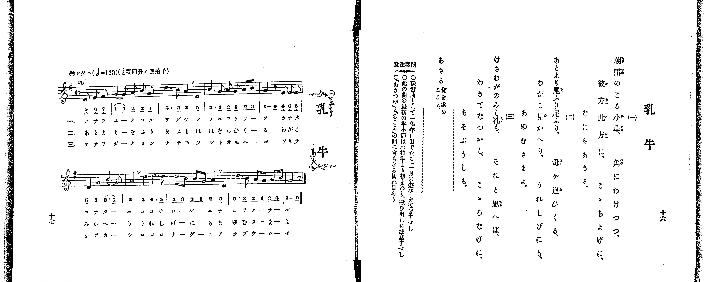

# 乳牛

> Re:Shōka 使用 AI 協助辨識與重建樂譜，可能會有錯誤。歡迎回報。

- **鋼琴伴奏版**：<br><audio controls src="nyugyu.mp3"></audio>
- **NEUTRINO 歌聲合成版**：<br><audio controls src="nyugyu_neutrino.mp3"></audio>

- 出處：共益商社樂器店《唱歌教科書 教師用 巻二》第十六～十七頁（第八曲）
- NDL Digital Collections PID 854863（https://dl.ndl.go.jp/pid/854863）掃描 P014.jpg

## 說明

原書資訊與歌詞全文（NDL PID 854863《唱歌教科書 教師用 巻二》第十六～十七頁，掃描 P014.jpg）：
調性與拍號：ト調四分ノ四拍子（G 大調 4/4 拍，譜上記 C），♩=120，「樂シゲニ」，弱起一拍半（三個八分音符）
註記：單聲部，分節歌三節（譜下配字三行：一＝片假名、二＝平假名、三＝片假名）。全曲兩段共八小節（含首尾不完全小節），力度標 mf，第一段第二小節第三拍後、第二段第二小節第一拍後及第三小節第三拍後有換氣記號（v）。五線譜與簡譜逐音核對一致。
原典演奏注意：〇豫習曲として一學年に出でたる「一月の遊び」を復習すべし。〇此の曲の最初の半小節は三拍半より初まれり、歌ひ出しに注意すべし。〇「あさつゆ」と「のこる」の間に自らなる切れ目あり。
原典語釋：「あさる」＝食を求めること。


## 歌詞

```text
一、
朝露のこる小草、角にわけつつ、
彼方此方に、こゝちよげに、なにをあさる。

二、
あとより尾ふり尾ふり、母を追ひくる、
わがこ見かへり、うれしげにも、あゆむさまよ。

三、
けさわがのみし乳も、それと思へば、
わきてなつかし、こゝろなげに、あそぶうしも。
```

## ABC

<div class="abc-score" data-abc-src="nyugyu.abc" aria-label="五線譜載入中"></div>

[下載 ABC 原始檔](nyugyu.abc)

## TMD 檔案連結

- [主旋律 TMD 檔案](nyugyu.tmd) [[在 TMD Studio 編輯](https://tmdlang.github.io/Tmd-TS/#tmd=s7IKdvYPcrWy4qpTUCpJTLdSSM7PyUlNLsnMz7PKrsxPzc6ML87Iz05Ugisoy88pzU21yk7MizeKtzA1sTAzRkgW55cWJadaFSdn5OfnxJekVpQk5edno8vHFySmp1oFGBiaIGQKivLLUvMS84C6C4oy80pSU8DaEQpSyzJTUkHSxclAq8tSizLTMlNTkNyVWlQMcjXUipKixLzi5KLMApBXEKrSU_OKUq2SMzJzUopS8-KL8_PSEZJp-UW5VsUlRfkFGZnJCOGSjFSghxPzMnMTc9BF8xJLSotSEaL5RZnpmXlWuamZWZlI_tfSUniyc_PzztkKWlpcirYKhkYGXPa2Cu5cNib6JnYg3U_bd72YOfX9nllPWzc-n931dGrb8yX7nq1oejpzxdNd0x83dD2dsvHZ2p5nU2c-Xz7x2ewdCkDW0x2rn09ZofB0--4nu3oeN3Q_X7PmaW_j09a17_fOAzKe7Gh-uaDx_Z4OkHjr6mezN73f0wl2qp-Lj4IL0KEliTkKzvAIL1YI8HRRgEQpUFdGSUlBsZW-fkqOXh4Qp-frZRXoF2Sm6MNUdD7ra37W368AikigHDAgufS1FGypBbgUFBSe9s0H-vXF5vYXK7pedLQDA-DFynlPW1c8m9YOdCHIGwgnUxRGPWh-AfoOGBcgJ7xYtf9Zw3KQ5d29L2bOB4o-bu4ACj6dPftpR9vj5j4gAyj1dO0EoIvcFZ4uWQ6UVABGqwJQFGjwi7VznuzoerFihoIz2NCeRzNX2gLjH8h63NADjOHHTdsfN2163Nz9uAGk_umejS-2bn-yowFkaG8X0NAnOzqfNnQDYxBo38v5m5-vWQY0COy0FbuB5oLSzLR1Lxo3vWxeAdLf0fZ8fQMwGIDagAygfrALul-2At04HSj4YmEPUAvQgvd75j7vbH_a2P50Qu_jhkZg-ABFnu7cjBDZAXQvQg3Q1scNTaDQn73paevKZ-u2AtMqyFkb-iEWPZ2w-uWyaU837Huyo_fpuh6gSpgUyN9Pu2Y_3bXs2YqZCrlpQC4wIkCeXLcVxNjVA1EJFuwE-XwfMHQaIVLY1IBDZ1_P0_4uiBZM7c_mdD7rn_1sw2JgEIHjraMM4oEnu6Y83z4LGCjAOH2-YSGQ8bJhAjBcny3Y8XRDL9DoF-1bgMqgye9p645ne6Y8Xdr_bPOKZy39oOhvaH-xcfXz_ZOAwfC4ccXjxumPG5cBtT1du-Ppzi2PG1cDs_LjxuWPG-c_bgLGKTAeGp7N6XjcuO5lY9fjxs3AWH7cNOnpvpVAEx43znzcuBNkQkMT0Nhna5cAlYGNXfdsTsPTjrlABjANQDz3uHE91HO9XY-bOh43dYEV7Hvc1ANkA0MLGOePGzeBbQc6aTXEwWhWAN3zuLHpcePUx41LHje1gRwD9AJIcN3jxslgBwNF1r2cNhlowov2VY-bOh83Asnupx3tQIuezwYqA6ZYoHVIAfRi1byX7d3goIGZDjYImHheLgaGwqRnG4F6GkGCQDtA9jVxgXQDQwbobBDr2Zy5L-eAvA1xBNDDL3qBcdX4YjkwjFY_bgJ6YyLIxUAE0fB0755n03YCAwxIglQ0NIJ1AsNjIShsGsHaQIKrwPqBXLizoHaDSgOwUWCpFdAQ3bDvceNWZAYoXNeDYuzF_r3A0H3c2A82BKIT5C6gjye_WAb0GRDtgGh43NgGihRQLECcDwx5oCAwDIDiwHgEBj4w1joQwQDyKsQpQF8CXQkxFhgY-4GGACsOmAlzwcaueNYA9OeOx40bkN0BjLZlYO8CQwnoFGB8w4KkCSgFFIcHCdC7QP3bQK4EKgMZDY5LyktsKFDQ0ufi8qssTa8stQrITMzLd6jRNaypBtmhYGNopmUHZlXnptWCGcA6Q-Nx0yKgL7YqPG5u0VSoAVLLgHgPEPcBhTcD6dVg0U1A3gaYQrAIUL65G4jXA0U3gkVB-kAyLSBTVwMZXUCp_ZogR4Fsq1EwUNDFwKbxQMIMRJiDiBoFQyCJDo2A2BiIQXI1CqZIMiBRkCwIgo0CwRqwMAyCNIGUwGiQHKY1ILeAnYEgasDO9jGsUQDx0DEwNsHkVDC5BGwoMJlhcT0wPYHJySCyqRuqchKKiglwsyB8kHkQr0B0I1SuBpvSD2ZPxFALY8MgxKUgO4EpEUzOR_jMCL_PVoBt6oC6twubz8C-AGZXMBukAtNnCDkIfz2Sa2FsZLNAKoHZHUyCfAlVCw43DJ9Bw6EHTILCF-ozY1w-g4QYOM7AekGuAOnGFWf7weR0qMqFKCpAPGAmhvPnIrkW2UxoSEJ8BlYPLEMQahs34PFZL5hcBvcZMMtCsiU4b8GzHDAjgkTBMo1gkRWQbNwEzLjg7AzKql0wteDsDMz3YBWgLA0xZTUiq8LzEiyfoOeoGkS2g9JmSCpAYpCMCtIHy7pYMiq2vEw4oyJjRC6FpABIiIPSOoQFSu_IEKQOlIcgsggdMBaEB4pbUDyCUj9EBJaqkXXDbEE2EywDTcuItAHL2bhSMjJG5E5I-oOYANOFSDtIPkLKX7ASCD0NwtIwFn8gpWEYC70sA9aeKP4A1qNIKmGhRMBHwFyJHDOwsgrhNyQfgd0LkcURR029UJUIE7HFEZKP4DkUIrMNTMLDC24jyEcwXbh9VMvFpWunAKlsFYAsZS4A)]
- [鋼琴伴奏 TMD 檔案](nyugyu_piano.tmd) [[在 TMD Studio 編輯](https://tmdlang.github.io/Tmd-TS/#tmd=s7IKdvYPcrWy4tLSUniyc_Pzztnv93S87N7zfMKWJ3u2PF3a_7yz4_2eTgUtLS5FWwVDIwMue1sFdy4bE30TO646BaWn7btezJz6fs-sp60bn8_uejq17fmSfc9WND2dueLprumPG7qeTtn4bG3Ps6kzny-f-Gz2DgUg6-mO1c-nrFB4un33k109jxu6n69Z87S38Wnr2vd75wEZT3Y0v1zQCHQGSLx19bPZm4AOUAJZ5ufio-CSmZ5Zkpij4Jyfk5OaXJKZn1esEODpomBhamJhZgzUlVFSUlBspa-fkqOXB8Tp-XpZBfoFmSn6MBWdz_qan_X3KwQYGJoA5dKVuLj8KkvTK0utAjIT8_KDPBxqdA1rqrkUgMDG0EzLDsyqzk2rBTP0tRQ0HjctUnjctFXhcXOLpkINkFoGxHuAuA8ovBlIrwaLbgLyNsAUgkWA8s3dQLweKLoRLArSB5JpAZm6GsjoAkrt11TQ0gfbVqNgoKCLgU3jgYQZiDAHETUKhkASHRoBsTEQg-RqFEyRZECiIFkQBBsFgjVgYRgEaQIpgdEgOUxrQG4BOwNB1ICd7WNYowDioePHjU1gciqYXAI29HFTGxbXP25cByYng8imbqjKSSgqJsDNgvBB5kG8AtGNULkabEo_mD0RQy2MDYMQl4LsfNy4CkzOR_jMCL_PVoBt6oC6twubz8C-eNy4FcwGqcD0GUIOwl-P5FoYG9kskMrHjZvAJMiXULXgcMPwGTQcesAkKHyhPjPG5TNIiIHjDKwX5AqQblxxth9MToeqXIiiAsR73AQKKwh_LpJrkc2EhiTEZ2D1jxt3INQ2bsDjs14wuQzuM2CWhWRLcN6CZzlgRgSJgmUawSIrINm4CZhxwdkZlFW7YGrB2RmY78EqQFkaYspqRFaF5yVYPkHPUTWIbAelzZBUgMQgGRWkD5Z1sWRUbHmZcEZFxohcCkkBkBAHpXUIC5TekSFIHSgPQWQROmAsCA8Ut6B4BKV-iAgsVSPrhtmCbCZYBpqWEWkDlrNxpWRkjMidkPQHMQGmC5F2kHyElL9gJRB6GoSlYSz-QErDMBZ6Wfa4qQHFH48b9yGphIUSAR8BcyVyzMDKKoTfkHwEdi9EFkccNfVCVSJMxBZHSD6C51CIzDYwCQ8vuI0gH8F04fZRLWpd64NS15pAq1pgdn3R1_Wyvfdp646Xs1sh7RBELjOMV4g2jAXmByBtGh8LFAHlPCgHKgkJOwJqEaJQ1SZAvkksjAKphepHMxWuEVMlhplYbEMx1wASKrp2CpCAifYBiiPxjFB4xmCeMhcA)]

## 分析

```text
================================================================================
📊 TMD Song Profile: [ 乳牛 ]
================================================================================
⏱  Duration:       0:18 (18.0s), 9 measures total
🎼 Key & Tempo:    首調基準 G, != 120.0 BPM, <4/4>
   - 分析範圍：      由實際發聲的音符與和弦推測調性；播放脈絡另行呈現
🎤 人聲音域:    D4 (MIDI 62) – E5 (MIDI 76) [跨度: 14 個半音 / 1.2 個八度, 難度: moderate]
   - 最低音:  D4 in [Nyugyu #1 @ m.1, 0:01]
   - 最高音: E5 in [Nyugyu #1 @ m.7, 0:13]
   - 適合: soprano, mezzo-soprano, contralto, tenor, baritone, bass
🏛  結構:      Nyugyu (18.0s)
⚡ 編曲密度:        Peak 1 軌道同時演奏
🗝  調性診斷：       G 大調（純淨自然大調，未偵測到可信轉調）
   - 風格氣質:    純淨自然大調（陽光明朗、易唱易記，無明顯調外色彩）
   - 轉調歷程:    全曲維持單一推測調性（未偵測到可信轉調）
   - 核心骨幹音:  G, D, B, A, E
   - 調性數值:    G 大調 [相關度: 0.90, 穩定度: High, 自然音純度: 100.0%]
   - 候選調性 (K-S): G 大調 (0.90), D 大調 (0.74), B 小調 (0.62)
   - 五度圈歷程:   +1
   - 各段落調性細節:
     • [Nyugyu #1]: G 大調 (r: 0.87, 自然音純度: 100.0%)

  [ 五度圈游移軌跡 ]
               C  
         F           [G ]*
      Bb               D  
      Eb               A  
         Ab           E  
            Db       B  
               F# 
     (* = active key center)

  [ 十二半音累積音高分佈 ]
     C  :                            0.0%
     C# :                            0.0%
     D  : ███████████████████       24.3%
     D# :                            0.0%
     E  : ████████                  10.0%
     F  :                            0.0%
     F# : █                          1.4%
     G  : ████████████████████████  30.0%
     G# :                            0.0%
     A  : █████████████             15.7%
     A# :                            0.0%
     B  : ███████████████           18.6%
--------------------------------------------------------------------------------
Assignment 軌道音域：
  - Piano         : D4 – E5 (14 個半音 / 1.2 個八度, 42 個音符)
================================================================================
```


## 原書掃描頁




