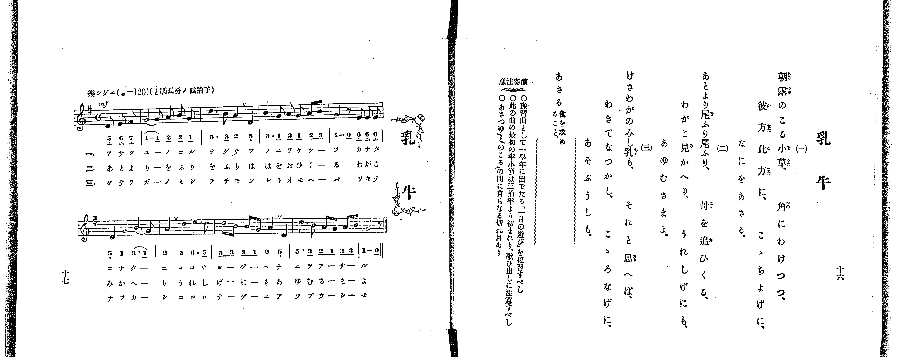

# 乳牛

*找不到鋼琴伴奏版 TMD，未產生音訊。*

- 出處：共益商社樂器店《唱歌教科書 教師用 巻二》第十六～十七頁（第八曲）
- NDL Digital Collections PID 854863（https://dl.ndl.go.jp/pid/854863）掃描 P014.jpg

## 說明

原書資訊與歌詞全文（NDL PID 854863《唱歌教科書 教師用 巻二》第十六～十七頁，掃描 P014.jpg）：
調性與拍號：ト調四分ノ四拍子（G 大調 4/4 拍，譜上記 C），♩=120，「樂シゲニ」，弱起一拍半（三個八分音符）
註記：單聲部，分節歌三節（譜下配字三行：一＝片假名、二＝平假名、三＝片假名）。全曲兩段共八小節（含首尾不完全小節），力度標 mf，第一段第二小節第三拍後、第二段第二小節第一拍後及第三小節第三拍後有換氣記號（v）。五線譜與簡譜逐音核對一致。
原典演奏注意：〇豫習曲として一學年に出でたる「一月の遊び」を復習すべし。〇此の曲の最初の半小節は三拍半より初まれり、歌ひ出しに注意すべし。〇「あさつゆ」と「のこる」の間に自らなる切れ目あり。
原典語釋：「あさる」＝食を求めること。

## 歌詞

```text
一、
朝露のこる小草、角にわけつつ、
彼方此方に、こゝちよげに、なにをあさる。

二、
あとより尾ふり尾ふり、母を追ひくる、
わがこ見かへり、うれしげにも、あゆむさまよ。

三、
けさわがのみし乳も、それと思へば、
わきてなつかし、こゝろなげに、あそぶうしも。
```

## ABC

```abc
X:1
T:乳牛
M:4/4
L:1/16
Q:1/4=120
K:G
V:V1 name="Piano" snm="Pia"
[V:V1]
!mf! z2 z2 z2 z2 z2 D2 E2 F2 | G10 A2 B2 G2 | d6 B2 A4 D4 | B6 G2 A2 G2 A2 B2 |
G8 z2 E2 E2 E2 | D4 G4 B6 G2 | A4 d4 e6 d2 | d2 B2 B2 G2 A4 D4 |
d6 B2 A2 G2 A2 B2 | G8 z2 z2 z2 z2 | !mf! z2 z2 z2 z2 z2 D2 E2 F2 | G10 A2 B2 G2 |
d6 B2 A4 D4 | B6 G2 A2 G2 A2 B2 | G8 z2 E2 E2 E2 | D4 G4 B6 G2 |
A4 d4 e6 d2 | d2 B2 B2 G2 A4 D4 | d6 B2 A2 G2 A2 B2 | G8 z2 z2 z2 z2 |
!mf! z2 z2 z2 z2 z2 D2 E2 F2 | G10 A2 B2 G2 | d6 B2 A4 D4 | B6 G2 A2 G2 A2 B2 |
G8 z2 E2 E2 E2 | D4 G4 B6 G2 | A4 d4 e6 d2 | d2 B2 B2 G2 A4 D4 |
d6 B2 A2 G2 A2 B2 | G8 z2 z2 z2 z2 |
```

## TMD 檔案連結

- [主旋律 TMD 檔案](nyugyu.tmd) [[在 TMD Studio 編輯](https://tmdlang.github.io/Tmd-TS/#tmd=s7IKdvYPcrWy4qpTUCpJTLdSSM7PyUlNLsnMz7PKrsxPzc6ML87Iz05Ugisoy88pzU21yk7MizeKtzA1sTAzRkgW55cWJadaFSdn5OfnxJekVpQk5edno8vHFySmp1oFGBiaIGQKivLLUvMS84C6C4oy80pSU8DaEQpSyzJTUkHSxclAq8tSizLTMlNTkNyVWlQMcjXUipKixLzi5KLMApBXEKrSU_OKUq2SMzJzUopS8-KL8_PSEZJp-UW5VsUlRfkFGZnJCOGSjFSghxPzMnMTc9BF8xJLSotSlbi0tBSe7Nz8vHO2gpYWl6KtgqGRAZe9rYI7l42JvokdSNPT9l0vZk59v2fW09aNz2d3PZ3a9nzJvmcrmp7OXPF01_THDV1Pp2x8trbn2dSZz5dPfDZ7hwKQ9XTH6udTVig83b77ya6exw3dz9esedrb-LR17fu984CMJzuaXy5ofL-nAyTeuvrZ7E3v93SCXejn4qPgkpmeWZKYo-AMj9FihQBPFwVInAF1ZZSUFBRb6eun5OjlAXF6vl5WgX5BZoo-TEXns77mZ_39CqCYAsoBQ4pLX0vBllqAS0FB4WnffKBfX2xuf7Gi60VHOzAAXqyc97R1xbNp7UAXgryBcDJFYdSD5heg74BxAXLCi1X7nzUsB1ne3fti5nyg6OPmDqDg09mzn3a0PW7uAzKAUk_XTgC6yF3h6ZLlQEkFYLQqAEWBBr9YO-fJjq4XK2YoOIMN7Xk0c6UtMP6BrMcNPcAYfty0_XHTpsfN3Y8bQOqf7tn4Yuv2JzsaQIb2dgENfbKj82lDNzAGgfa9nL_5-ZplQIPATluxG2guKM1MW_eicdPL5hUg_R1tz9c3AIMBqA3IAOoHu6D7ZSvQjdOBgi8W9gC1AC14v2fu8872p43tTyf0Pm5oBIYPUOTpzs0IkR1A9yLUAG193NAECv3Zm562rny2biswrYKctaEfYtHTCatfLpv2dMO-Jzt6n67rAaqESYH8_bRr9tNdy56tmKmQmwbkAiMC5Ml1W0GMXT0QlWDBTpDP9wFDpxEihU0NOHT29Tzt74JowdT-bE7ns_7ZzzYsBgYRON46yiAeeLJryvPts4CBAozT5xsWAhkvGyYAw_XZgh1PN_QCjX7RvgWoDJr8nrbueLZnytOl_c82r3jW0g-K_ob2FxtXP98_CRgMjxtXPG6c_rhxGVDb07U7nu7c8rhxNTArP25c_rhx_uMmYJwC46Hh2ZyOx43rXjZ2PW7cDIzlx02Tnu5bCTThcePMx407QSY0NAGNfbZ2CVAZ2Nh1z-Y0PO2YC2QA0wDEc48b10M919v1uKnjcVMXWMG-x009QDYwtIBx_rhxE9h2oJNWQxyMZgXQPY8bmx43Tn3cuORxUxvIMUAvgATXPW6cDHYwUGTdy2mTgSa8aF_1uKnzcSOQ7H7a0Q606PlsoDJgigVahxRAL1bNe9neDQ4amOlgg4CJ5-ViYChMerYRqKcRJAi0A2RfExdINzBkgM4GsZ7NmftyDsjbEEcAPfyiFxhXjS-WA8No9eMmoDcmglwMRBANT_fueTZtJzDAgCRIRUMjWCcwPBaCwqYRrA0kuAqsH8iFOwtqN6g0ABsFlloBDdEN-x43bkVmgMJ1PSjGXuzfCwzdx439YEMgOkHuAvp48otlQJ8B0Q6IhseNbaBIAcUCxPnAkAcKAsMAKA6MR2DgA2OtAxEMIK9CnAL0JdCVEGOBgbEfaAiw4oCZMBds7IpnDUB_7njcuAHZHcBoWwb2LjCUgE4BxjcsSJqAUkBxeJAAvQvUvw3kSqAykNHguKS8xIYCBS19Li6_ytL0ylKrgMzEvHyHGoMahWqQHQo2hmZadmBWdW5aLZgBrDM0HjctAvpiq8Lj5hZNhRogtQyI9wBxH1B4M5BeDRbdBORtgCkEiwDlm7uBeD1QdCNYFKQPJNMCMnU1kNEFlNqvCXIUyLYaBQMFXQxsGg8kzECEOYioUTAEkujQCIiNgRgkV6NgiiQDEgXJgiDYKBCsAQvDIEgTSAmMBslhWgNyC9gZCKIGFkiQgAD7Bu5JoNdBomCZRrDICkjANQGDChyAoMDpgqkFByAwpMEqQIEIMWU1InDgroe5DN0PNQiPQmkzJBUgMUjQgPTBAgtL0GALPcJBg4xruGq5uHTtFCAJTQEHS5kLAA)]

## 分析

```text
================================================================================
📊 TMD Song Profile: [ 乳牛 ]
================================================================================
⏱  Duration:       1:00 (60.0s), 30 measures total
🎼 Key & Tempo:    首調基準 G, != 120.0 BPM, <4/4>
   - 分析範圍：      由實際發聲的音符與和弦推測調性；播放脈絡另行呈現
🎤 人聲音域:    D4 (MIDI 62) – E5 (MIDI 76) [跨度: 14 個半音 / 1.2 個八度, 難度: moderate]
   - 最低音:  D4 in [Nyugyu #1 @ m.1, 0:01]
   - 最高音: E5 in [Nyugyu #1 @ m.7, 0:13]
   - 適合: soprano, mezzo-soprano, contralto, tenor, baritone, bass
🏛  結構:      Nyugyu (20.0s) -> Nyugyu (20.0s) -> Nyugyu (20.0s)
⚡ 編曲密度:        Peak 1 軌道同時演奏
🗝  調性診斷：       G 大調（純淨自然大調，未偵測到可信轉調）
   - 風格氣質:    純淨自然大調（陽光明朗、易唱易記，無明顯調外色彩）
   - 轉調歷程:    全曲維持單一推測調性（未偵測到可信轉調）
   - 核心骨幹音:  G, D, B, A, E
   - 調性數值:    G 大調 [相關度: 0.90, 穩定度: High, 自然音純度: 100.0%]
   - 候選調性 (K-S): G 大調 (0.90), D 大調 (0.74), B 小調 (0.62)
   - 五度圈歷程:   +1 -> +1 -> +1
   - 各段落調性細節:
     • [Nyugyu #1]: G 大調 (r: 0.90, 自然音純度: 100.0%)
     • [Nyugyu #2]: G 大調 (r: 0.90, 自然音純度: 100.0%)
     • [Nyugyu #3]: G 大調 (r: 0.90, 自然音純度: 100.0%)

  [ 五度圈游移軌跡 ]
               C  
         F           [G ]*
      Bb               D  
      Eb               A  
         Ab           E  
            Db       B  
               F# 
     (* = active key center)

  [ 十二半音累積音高分佈 ]
     C  :                            0.0%
     C# :                            0.0%
     D  : ███████████████████       24.3%
     D# :                            0.0%
     E  : ████████                  10.0%
     F  :                            0.0%
     F# : █                          1.4%
     G  : ████████████████████████  30.0%
     G# :                            0.0%
     A  : █████████████             15.7%
     A# :                            0.0%
     B  : ███████████████           18.6%
--------------------------------------------------------------------------------
Assignment 軌道音域：
  - Piano         : D4 – E5 (14 個半音 / 1.2 個八度, 126 個音符)
================================================================================
```


## 原書掃描頁




