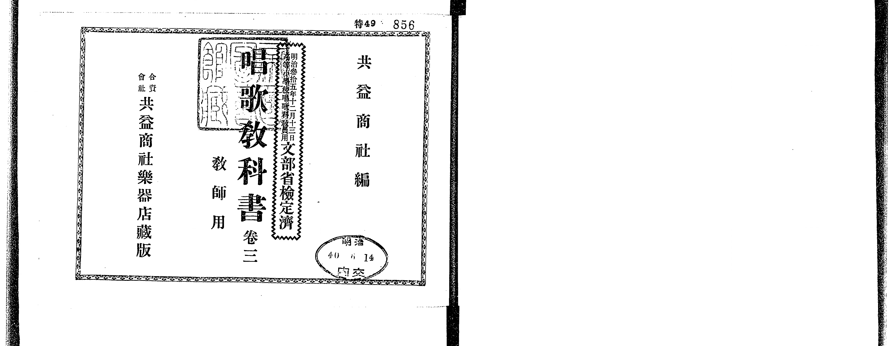
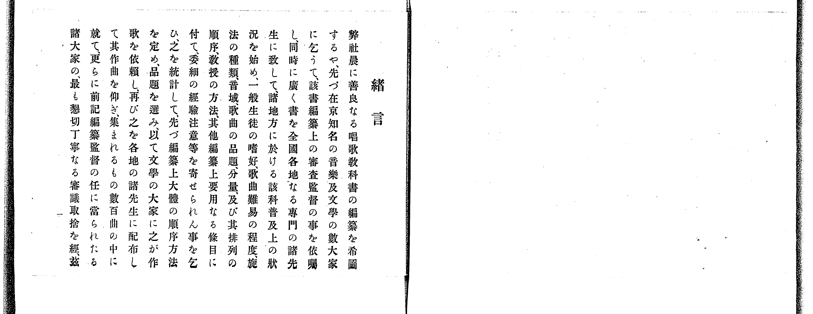
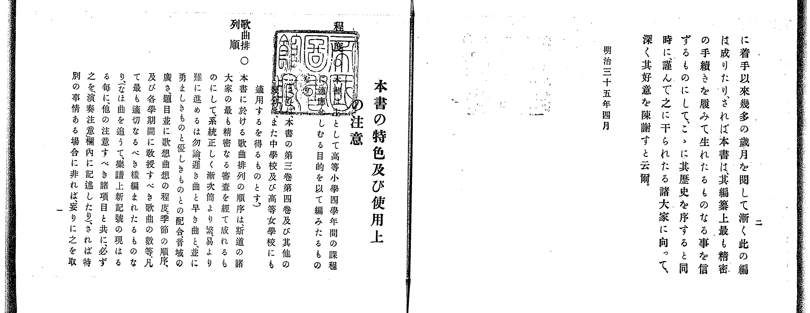
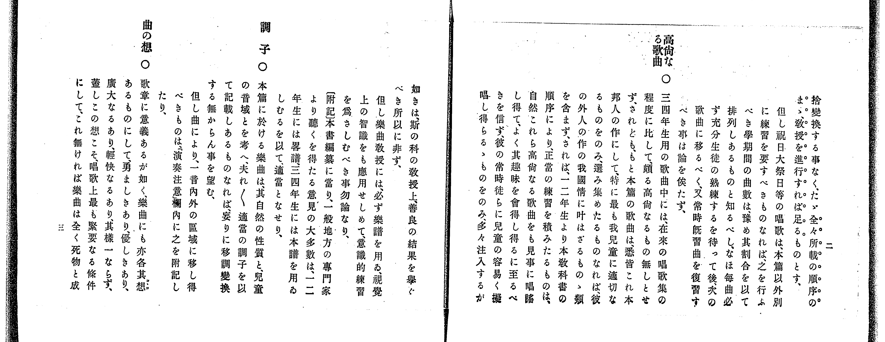
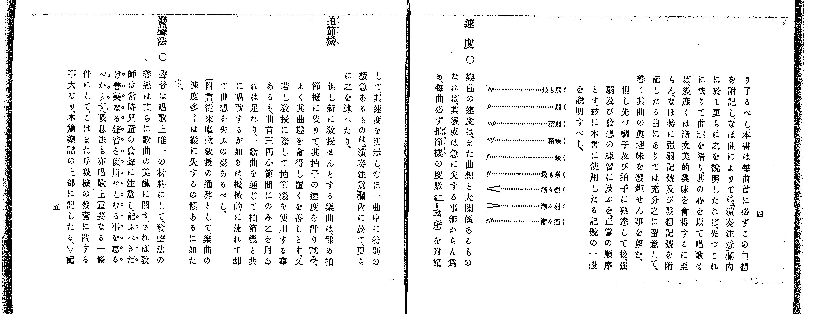
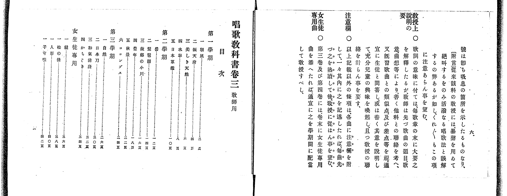
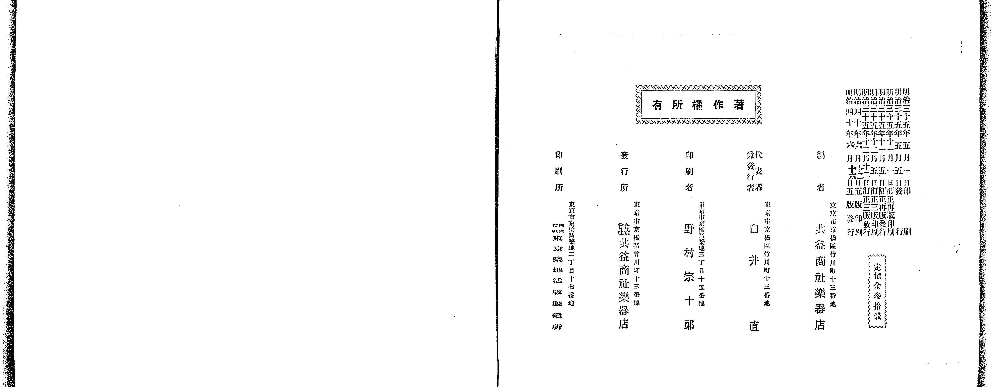

# 書訊與卷首／卷末掃描頁 — 《共益商社唱歌教科書》 巻三・教師用（NDL PID 854864）

本頁收錄本冊之封面、扉頁、目次（もくろく）、樂典大要、版權頁與封底等原書掃描圖檔（共 7 頁）。

### P001.jpg

本冊封面（左頁），題「共益商社編 唱歌教科書 卷三 教師用 共益商社樂器店出版」，中上方蓋有「文部省檢定濟 明治36年2月25日」印記。

### P002.jpg

「緒言」（第 1 頁）與「本書の特色及び使用上の注意」（第 2 頁）。

### P003.jpg

「本書の特色及び使用上の注意」續頁（第 3–4 頁）。

### P004.jpg

「發音圖解」（第 5 頁）與「速度」（第 6 頁）。

### P005.jpg

「速度」續頁與「唱歌教科書卷三（教師用）目次」（列出第一～三學期及「女生徒專用」共 19 首曲名與頁碼）。

### P006.jpg

「演奏上一般の注意」（第 1 頁）。

### P028.jpg

版權頁（右頁）：標明「明治三十五年五月一日印刷、明治三十五年五月五日發行、明治四十年六月二十五日訂正五版發行」、「編者 共益商社樂器店」、「代表兼發行者 白井直」、「發行所 合資會社共益商社樂器店」、「定價金參拾錢」。

