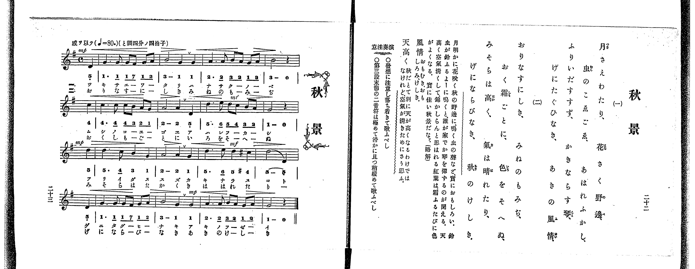

# 秋景

> Re:Shoka 使用 AI 辨識樂譜，可能會有錯誤。歡迎回報。

<audio controls src="shukei.mp3"></audio>

- 出處：共益商社樂器店《唱歌教科書 教師用 巻三》第二十二～二十三頁（第二學期第五曲）
- NDL Digital Collections PID 854864（https://dl.ndl.go.jp/pid/854864）掃描 P017.jpg

## 說明

原書資訊與歌詞全文（NDL PID 854864《唱歌教科書 教師用 巻三》第二十二～二十三頁，掃描 P017.jpg）：
調性與拍號：ト調四分ノ四拍子（G 大調 4/4 拍），♩=80，「感ヲ以テ」，弱起一拍（四分音符）
註記：單聲部，二節分節歌。開頭 mp，第七小節轉 mf，第八小節末拍（第三段弱起）轉 mp，第十一小節第四拍轉 mf 並出現 #4（C#5，4'），第十二小節末拍（第四段弱起）轉 mp。
原典演奏注意：注意發想，沉著歌唱；第三段末節（第十二小節）之二音符（5 - 5_）須極圓滑且稍放緩歌唱。
原典曲意：「月明かに、花咲く秋の野邊に、鳴く虫の聲など、實におもしろい。鈴虫が鈴ふるよーに鳴くと、誰が家でか琴を彈するのが聞える。天高く空氣清くして、錦かしらんと思はれる紅葉は、霜ふるたびに色がよくなる。實に佳い秋景だなー。（略解）」
原典語釋：「風情」：おもむき、おもしろみ、けしき；「天高く」：秋だとて別に天が高くなるわけではなけれど、空氣が清きためにさう思ふ。

## 歌詞

```text
一、
月さえわたり、花さく野邊、
虫のこゑごゑ、あはれふかし、
ふりいだすすず、かきならす琴、
げにたぐひなき、あきの風情。

二、
おりなすにしき、みねのもみぢ、
おく霜ごとに、色をそへぬ、
みそらは高く、氣は晴れたり、
げにならびなき、秋のけしき。
```

## ABC

```abc
X:1
T:秋景
M:4/4
L:1/16
Q:1/4=80
K:G
V:V1 name="Voice" snm="Voi"
[V:V1]
!mp! z4 z4 z4 D4 | G6 G2 G2 F2 G2 A2 | B8 G4 G4 | A6 A2 B2 A2 G2 A2 |
B8 z4 c4 | c6 c2 c2 B2 A2 G2 | A8 A4 D4 | !mf! d6 e2 d2 c2 B2 A2 |
!mp! G8 z4 d4 | d6 c2 B4 G4 | A8 A4 G4 | !mf! d6 e2 d4 ^c4 |
!mp! d8 D4 D4 | G6 G2 G2 F2 G2 A2 | B8 G4 G4 | A6 A2 B2 A2 G2 A2 |
G8 z4 z4 | !mp! z4 z4 z4 D4 | G6 G2 G2 F2 G2 A2 | B8 G4 G4 |
A6 A2 B2 A2 G2 A2 | B8 z4 c4 | c6 c2 c2 B2 A2 G2 | A8 A4 D4 |
!mf! d6 e2 d2 c2 B2 A2 | !mp! G8 z4 d4 | d6 c2 B4 G4 | A8 A4 G4 |
!mf! d6 e2 d4 ^c4 | !mp! d8 D4 D4 | G6 G2 G2 F2 G2 A2 | B8 G4 G4 |
A6 A2 B2 A2 G2 A2 | G8 z4 z4 |
```

## TMD 檔案連結

- [主旋律 TMD 檔案](shukei.tmd) [[在 TMD Studio 編輯](https://tmdlang.github.io/Tmd-TS/#tmd=s7IKdvYPcrWy4qpTUCpJTLdSSM7PyUlNLsnMz7PKrsxPzc6ML87Iz05Ugisoy88pzU21yk7MizeOtzA1sTAzQUgW55cWJadaFSdn5OfnxJekVpQk5edno8vHFySmp1oFGBiaI2QKivLLUvMS84C6C4oy80pSU8DaEQpSyzJTUkHSxclAq8tSizLTMlNTkNyVWlQMcjXUipKixLzi5KLMApBXEKrSU_OKUq2SMzJzUopS8-KL8_PSEZJp-UW5VsUlRfkFGZnJCOGSjFSgh4tTE4Gqi9GF8xJLSotS0UVzEvNSgO4swJDILS0GGa2lpfB8efezmesVtLS4FG0VLAy47G0V3LlsTPRN7EBanrbvejFz6vs9s562bnw-u-vp1LbnS_Y9W9H0dOaKp7umP27oejpl47O1Pc-mzny-fOKz2TsUgKynO1Y_n7JC4en23U92dD5u6H6-Zs2TXT1PexuB5Pu986DsHZ0vFzS-39MBlV2749mc-WD2lGezN73f0wl2sZ-Lj4JLZnpmSWKOgjM8RRQrBHi6KEDiHGhCRklJQbGVvn5Kjl4eEKfn62UV6BdkpujDVHQ-62t-1t-vAIppoBwwpLn0tRRsqQW4FBQUnvbNB_r-xeb2Fyu6XnS0A4Pkxcp5T1tXPJvWDnQhyBsIJ1Mh1HrQfAT0IzCOQA55sWr_s4blICd0976YOR8o-ri5Ayj4dPbspx1tj5v7gAyg1NO1E4Ducld4umQ5UFIBGN0KQFGwMT2PZq60tTAAMh439Dxrmf-4edOT3UsfN7c9bgAq6Hm6Z-OLrduf7GgAq--AmPty_ubna5YBtYOdsGL3ixUzQGlm2roXjZteNq8AagO6__n6BqBSIAn0-uOGppfTul8uWKuQWwCUBXl2R_PTDf1A2Rd7OxVy0yCCT1tXQwSfzVkNsQ-ssvPZuq0QdwCtBKuHGgIOogaIFhAX7FeIgQpPdiwDpubn_fsUlEGpxlnZFKjHRB3iZ6heYCBjWAcyBMM6oPuh0f60dcezPVOeLu1_tnnFs5Z-oLchjOcz9zxr3gyKqk2dLyZOB_oZGOnv98yGewBoB9AmqB1IdgPteLKzG8iFBWqHqYKugmk8UPzlgo5nS7c-nTP52e6JT3ZMeb6i99mUfc-3r4QYjuqm2ZsgrgFF4pyOZzP6Hjd2P25c_bih8UXXxqeTNj1u7Adm_ceN6162971s6oJIvdy8BSj-YuZqoDgw6h43rnrcuBIo_nT9MpCCxq7HTU2PG6c_bup93NgCisOOLWDFPUDG48atj5u6Hzd1PG7eA1QMMepx4wqQjas2ANU8XbftceNyoDOeT9jyuGnS070djxtngrQ0rgPKvmic97ixA8RtaHq6ZOXL1TNALly569mGxc92tIKNmv64cRnIkT1AxwB1AZ3R-bhpMtCKZw1zHzeuf9zUA9T-fEvri4mdIC5Q5Zw5UFc1zn_cuBnoqhedQE8BlQGtBhq4Cmod2HdP9gIVtECKw8eNC0CyQI80NIFiaOrSF8sXAyMAmAUQQfxi1byX7d2QIH65aMWz5lZwDpkFDaamhseNvUBHoIbafrDIRLBngIpnA_XCfQvRDo4VoPUrgL592rEU6DKgAlAQQ9RAHN0EZAANAYYm0K3ASJoI8jw4qiBBBlQPDjWgjfMfNwFtBEbS1MeNbeCQ2gpKKSB_APMKUAeIBUwiYAXACACaDNTSBUkoYMF-aBKBKIWkjseNkx83AV0wBUSCvAT0ITgGgKZDIgeiGhz-wNTVAvbTTDACBhhQA1AR0HVA3wAjayYoScA0TAK7FhhhEx5DkyAkGIE2ADWsgwU11Au7gGUJVCMwnIE2AdUD7QCaAAphsMb9jxvXgpwMigUgexGSBqDfQGlkCji4wZkDmECagC4ABtOOx41r4EqB-uaCnboeFleN4GBe_2wmMDEDvQ0NM2QvQPwGTFVQL0DyGzz2ofmV8goIChS09Lm4gjNKs1MzrcLyM5NTHWoMahSqQXYo2BiaadmBWdW5BbVgBrAK1ICUapoKj5tbFGoUHjetBeKtQLwCKLIHiNeDaZDMfiBrFRD3g3jNXVB1EHlgrQJT1zwT2dAFICeB7KpRMACWYSCITpvGQxk1CoZQFgiC2CBsDpIGMYzASoyRlMCUIdM1YHUwCGKDdIBo3GbAXGICMwMWOo-btkO81rQZ4k1osICCYwuE17QI7Ol-IF4DxFOh6lbD1W1HDo6piOCAWQazGISRnYrqEZhn0AKsOjetVgFUOcCgGUgezTTUcEX2MCglwLUjfA2K5qYlQLoBSO8E-2InEO8C-wuaSEAJoHklXB4UPh1IPm3ahPApsvtg7sIdZcg-RajA5keID4ABYKKOVR1KWEG8Cg85hF-7IUm7aQM0IU-CJ2RQEgdlB3AMg_0MSuSwGAaphcTwEoRX6ZSAccUnjK7hquXi0rVTgBQFCigsZS4A)]

## 分析

```text
================================================================================
📊 TMD Song Profile: [ 秋景 ]
================================================================================
⏱  Duration:       1:42 (102.0s), 34 measures total
🎼 Key & Tempo:    首調基準 G, != 80.0 BPM, <4/4>
   - 分析範圍：      由實際發聲的音符與和弦推測調性；播放脈絡另行呈現
🎤 人聲音域:    D4 (MIDI 62) – E5 (MIDI 76) [跨度: 14 個半音 / 1.2 個八度, 難度: moderate]
   - 最低音:  D4 in [Shukei #1 @ m.1, 0:02]
   - 最高音: E5 in [Shukei #1 @ m.8, 0:22]
   - 適合: soprano, mezzo-soprano, contralto, tenor, baritone, bass
🏛  結構:      Shukei (51.0s) -> Shukei (51.0s)
⚡ 編曲密度:        Peak 1 軌道同時演奏
🗝  調性診斷：       G 大調（純淨自然大調，未偵測到可信轉調）
   - 風格氣質:    純淨自然大調（陽光明朗、易唱易記，無明顯調外色彩）
   - 轉調歷程:    全曲維持單一推測調性（未偵測到可信轉調）
   - 核心骨幹音:  G, A, D, B, C
   - 調性數值:    G 大調 [相關度: 0.87, 穩定度: High, 自然音純度: 98.4%]
   - 候選調性 (K-S): G 大調 (0.87), D 大調 (0.72), G 小調 (0.50)
   - 五度圈歷程:   +1 -> +1
   - 各段落調性細節:
     • [Shukei #1]: G 大調 (r: 0.87, 自然音純度: 98.4%, 調外音: C#)
     • [Shukei #2]: G 大調 (r: 0.87, 自然音純度: 98.4%, 調外音: C#)

  [ 五度圈游移軌跡 ]
               C  
         F           [G ]*
      Bb               D  
      Eb               A  
         Ab           E  
            Db       B  
               F# 
     (* = active key center)

  [ 十二半音累積音高分佈 ]
     C  : ██████                     7.4%
     C# : █                          1.6%
     D  : ██████████████████        21.3%
     D# :                            0.0%
     E  : █                          1.6%
     F  :                            0.0%
     F# : █                          1.6%
     G  : ████████████████████████  28.7%
     G# :                            0.0%
     A  : ███████████████████       23.0%
     A# :                            0.0%
     B  : ████████████              14.8%
--------------------------------------------------------------------------------
Assignment 軌道音域：
  - Voice         : D4 – E5 (14 個半音 / 1.2 個八度, 130 個音符)
================================================================================
```


## 原書掃描頁




