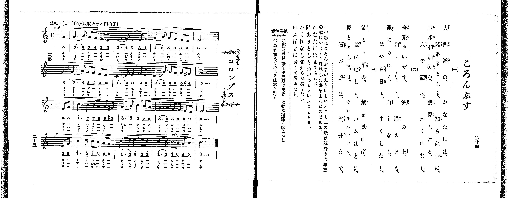

# コロンブス

> Re:Shōka 使用 AI 協助辨識與重建樂譜，可能會有錯誤。歡迎回報。

- **鋼琴伴奏版**：<br><audio controls src="koronbusu.mp3"></audio>
- **NEUTRINO 歌聲合成版**：<br><audio controls src="koronbusu_neutrino.mp3"></audio>

- 出處：共益商社樂器店《唱歌教科書 教師用 巻三》第二十四～二十五頁（第二學期第六曲）
- NDL Digital Collections PID 854864（https://dl.ndl.go.jp/pid/854864）掃描 P018.jpg

## 說明

原書資訊與歌詞全文（NDL PID 854864《唱歌教科書 教師用 巻三》第二十四～二十五頁，掃描 P018.jpg）：
調性與拍號：ハ調四分ノ四拍子（C 大調 4/4 拍），♩=104，「流暢ニ」，弱起一拍（四分音符）
註記：單聲部，三節分節歌。目次及左頁樂譜標題為「コロンブス」，右頁歌詞標題印為「ころんぶす」。開頭 mf，第七小節末音為 #4（F#4，4'），第九小節末音為 #5（G#4，5'），第十二小節末拍（第四段弱起）轉 f，第十五小節標 rit.。
原典演奏注意：第四段於歌詞第三章之場合特須稍強歌唱；#5 音首次出現，須加注意。
原典曲意：「一の歌はころんぶすがえらいといふこと、二の歌は航海中の事、三の歌はいよ／＼發見した事をよんだのである。」
原典語釋：「かなたには」：あちらには；「陸ありとしも」：陸があるといふこともまー；「かくれなし」：誰知らぬ者はない；「いふほどに」：言うて居るまに。


## 歌詞

```text
一、
大西洋の、かなたには、
陸ありとしも、知らぬ世に、
亞米利加州を、發見したる、
人の話は、かくれなし。

二、
舟乗りいだす、波の上、
西へ／＼と、進めども、
眼にさへぎる、山もなし、
はや百日も、すぐしたり。

三、
流るゝ草の、葉を見れば、
陸は近しと、いふほどに、
見とめし島は、サンサルバドル、
喜ぶ聲は、雲井まで。
```

## ABC

<div class="abc-score" data-abc-src="koronbusu.abc" aria-label="五線譜載入中"></div>

[下載 ABC 原始檔](koronbusu.abc)

## TMD 檔案連結

- [主旋律 TMD 檔案](koronbusu.tmd) [[在 TMD Studio 編輯](https://tmdlang.github.io/Tmd-TS/#tmd=s7IKdvYPcrWy4qpTUCpJTLdSSM7PyUlNLsnMz7PKrsxPzc6ML87Iz05Ugisoy88pzU21yk7MizeOtzA1sTAzQUgW55cWJadaFSdn5OfnxJekVpQk5edno8vHFySmp1oFGBhaIGQKivLLUvMS84C6C4oy80pSU8DaEQpSyzJTUkHSxclAq8tSizLTMlNTkNyVWlQMcjXUipKixLzi5KLMApBXEKrSU_OKUq2SMzJzUopS8-KL8_PSEZJp-UW5VsUlRfkFGZnJCOGSjFSghzMyi0vyiyrRhYH2lKXmoIuWJ5akFmFRmldckF-E5Kn8osz0zDyr3NTMrEwswQWVLk8tBhqXF5-bmpOfguQCoFEZ-elFiQUZlVDnZSYn5sQDowYYX1paCo-bNj9uXvu4GUhOe9y0U0FLi0vRVsHQwITL3lbBmcvGRN_EDmTY0_ZdL2ZOfb9n1tPWjc9ndz2d2vZ8yb5nK5qezlzxdNf0xw1dT6dsfLa259nUmc-XT3w2e4cCkPV0x-rnU1YoPN2--8mOzscN3c_XrHmyq-dpb-PT2bPf750HYT_ZNeXlgsb3ezqgsmt3PJszH8h-2rr22exN7_d0gv3i5-Kj4AL0aElijoIzPPkVKwR4uihAEhjQhIySkoJiK339lBy9PCBOz9fLKtAvyEzRh6nofNbX_Ky_XwGUrIBywGjl0tdSsKUW4FJQUHjaNx_o-xeb21-s6HrR0Q4Mkhcr5z1tXfFsWjvQhSBvIJxMhVDrQfMR0I_AOAI55MWq_c8aloOc0N37YuZ8oOjj5n6gINCUpx1tj5v7gAyg1NO1E4DuclZ4umQ5UFIBGN0KQFGwMT2PZq60BaYEIOtxQ8-zrY3PZi163Nz9uAEo3fN0z8YXW7c_2dEAVt0BMfXl_M3P1ywDagY7YMXuFytmgFLMtHUvGje9bF4B1Ab00vP1DUClQBLo8ccNTc9nr3u2ZuHT_q6n25cBvQRMUi_Wznm2YubLhT3Pm3YBLUZLoVDr-zeDFINDF6L4ae8GqPrGyY-beh83TX7cuO1x40ygeqAtL6d1v1ywViE3DagXFKA7mp9u6Ae5Yc5qkKObdikog1KQG4jsMVGH-B-kcOdcDIWmQIXuYIWmCIXgOOmBq4WECkgcGMrrtkJCC6j4xd5OBagbILEI1bFipkJRZoke0KXQRPS0dcezPVOeLu1_tnnFs5Z-YDDCDXs2bQ_E42CPdD5fveDJzu6nC7Y8ndDxvHPnywUdz1f0Pt2zHagGmLre75mtbKoAdPrLZdNA4dy-63n_PqADgMqedi2AGI5q6-xNEPuAQQmM3seN60Dx1LgePVgbgYIdj5s6Hze2PG5cASa3gtQA2Q2goIBrfNGx6hkopawFijzZBUw-jaB0jTC25XFTx_s9QBv3PJ-558Wy7seN0x83zgepbJoElALbuACo_nHj8seNTY-bgCY0ASMV4eIXq-a9bO-GuPhxI1D_KqD-x42rQaaDEssskLbGhWC3ggSBQQJU-XLmDrBxXWDXT3_cBDIUqBgsDjQHbBOax4BqGvc9bt4DMQFsV__jJiADaCOwDARpf7Fqw_P5S8F2rXnR0Ar2IVC2BaYFYtrux40rQY6BaFkBDOW2x43Lnm5sBVu6DyzVxAXyIigKGhrBngXm0KX7n20BKlgHFMLwKVgRNl81wh30ZMc0sNFgpU92zXu-cfPTjpXAdPB0-zxQaAOVIkUBOKihSncBLX2xciPEIgyPQ50KjHSI-hcd85_sBFoOdAXQv8DIA-bCxmebF4FSwI4umKKl-x837oDEPCTVvGzY9LgJaPpKiLNBip7PAcoB_TcVqPRxYx_ESU83bgRHBcRysDqQw5pans_c92w60K8g3eA0OgHmE6ClsPAElqlgLcACDWRc09wXvaDkCBR9MbETGAog_4O8tgE5SNe_2D8RbBbInRixCPEPKNyAaQQoPf3pZmAeAQdV01ZQyQUiVz9unvC4uRPEgEbotDnAvAQsGiFKX87e9GQX0J_A2F8OzZGUV0lQoKClz8XlnV-Un5dUWlxqFZafmZzqUGNQUw2yRcHG0EzLDsyqzk2rBTOA1aIGpNDSBDYR9ivUAMklCsCkD6R3Q2kIHyjTvAIi0twHFF0NF-2CqtsPle2Gy_QjGd68CuQ4kJ01CgYKumCITptC6Ro4CwTNoDImQGwMxEZgFSAWDMJkQBBEg_ikmoEM4e4Au9fHsEYhHiqCTgMTHdzNwOSCZs7jxtlwFkwOFMIdGOrWwVndSOatwlAHsw2YHJHUrcfqC6Cqpi6YKohPjPD5ZCuSiWtxuxBhJlYfL4CzZiKpw_TJfhSTgQUjVOUOXH5B-BjiF2N8foHZBzKxB92kJlgYI1ggdf0YNk5FcSNMHXpoA8sSuDqQr4ClClTlBlx-QYsXYC583LQemo0WQbPRKng26oDKbIfKQFSAEhJMZCWU7oHSkIwK0tuNnL8hGuHZkHAGMURSARKBZRiYqhqwKLIZMHPAZqmDlSBbgwxBBoDkELkMWxw0YYYZUHQFhrrpcHUwHSB1MFFEyHfCdawB80F5EaQSlrow4gruAkQewmIuPN2i5kx86mB-AKmD5RWEOpgIsKIB81dCVMJ9h-nOfajuBOYPbOEJS73AlhKS_bB8gFAHD08Ud2Lmd1ipAawmkd2JJzxhOR-R9psXoqR5pMqlafvj5qVQyU3gGuVxcwtYYiOQtRmRBaC1DyjJr0audSahJnnDOCSnmEMxPN1C0iuIiawErgemlpKqpTqtFlvCB0cySjDBkztqlQBsbbViKEWUP6DYfdy4BKp4IoqqyWA5RLwi1VzwchAztjbBVCGlfszSHGQ2hIWc-mHlJ0IdIvX3gd0EshdkP2a6gqVmSIqH2IktRyF0wFI2cvrHKCfgAY0wCXs-hdsPDVOQX0AuhfkUoRIkA_EJpMRH5FWcoQoudYDdLLhrwbkAVM4Dm1bgxA5K6CAa0rhCLuuBMkj5A1JraIA6laDkvgaLNuyJ3wjEAYvAkjU4SWJRZAwTATPAQgTNAtFoipAhrMGHXPQjRxWsUYAorJArdMzIQqjDW6GDK2bC5sEgrDmBlPSxJFRgX6YZzoFZia0ERJS4qHUUctkP7MqASey5FFYkEHAoOOVjptNtcBZMDmQmchkBkUUEJpJvMOqdx00gl0LUwWseIHs5QTfWcnHp2inAeykKQI4yFwA)]
- [鋼琴伴奏 TMD 檔案](koronbusu_piano.tmd) [[在 TMD Studio 編輯](https://tmdlang.github.io/Tmd-TS/#tmd=s7IKdvYPcrWy4qpTUCpJTLdSyC8qychPL0osyKi0ysgsLskvykxOzInPTsxLVOLS0lJ43LT5cfPax81Actrjpp3v93S87N7zfMKWJ3u2PF3a_7yz4_2eTgUtLS5FWwVDAxMue1sFZy4bE30TO5ANT9t3vZg59f2eWU9bNz6f3fV0atvzJfuerWh6OnPF013THzd0PZ2y8dnanmdTZz5fPvHZ7B0KQNbTHaufT1mh8HT77ic7Oh83dD9fs-bJrp6nvY1PZ89-v3cehP1k15SXCxqBjoHKrt3xbM58IPtp69pnszcBnaQEst7PxUfBJTM9syQxR8E5PycnNbkkMz-vWCHA00XBwtTEwswEaEJGSUlBsZW-fkqOXh4Qp-frZRXoF2Sm6MNUdD7ra37W368QYGBoAZRLV-Li8s4vys9LKi0utQrITMzLD_JwqDGoqeZSAAIbQzMtOzCrOjetFszQ11LQeLpn44ut2zWBwblfoQZILlF43LwHSO-G0hA-UKZ5BUSkuQ8ouhou2gVVtx8q2w2X6UcyvHmVgpY-2M4aBQMFXTBEp02hdA2cBYJmUBkTIDYGYiOwChALBmEyIAiiQXxSzUCGcHeA3etjWKMQDxVBpx83zoe7-XFjC5o5jxtnw1kwOVAId2CoWwdndSOZtwpDHcy2x42rkdStx-oLoKqmLpgqiE-M8PlkK5KJa3G7EGEmVh8vgLNmIqnD9Ml-FJMfN7ZBVe7A5ReEjyF-McbnF5h9IBN70E1qgoUxggVS149h41QUN8LUoYf246ZJcHUgXz1uAtkIUrkBl1_Q4gWYCx83rYdmo0XQbLQKno06oDLboTIQFaCEBBNZCaV7oDQko4L0diPnb4hGeDYknEEMkVSARGAZBqaqBiyKbAbMHLBZ6mAlyNYgQ5ABIDlELsMWB02YYQYUXYGhbjpcHUwHSB1MFBHynXAda8B8UF4EqYSlLoy4grsAkYewmAtPt6g5E586mB9A6mB5BaEOJvK4qRHMXwlRCfcdpjv3oboTmD-whScs9T5uXIhkPywfINTBwxPFnZj5HVZqPG7cjexOPOEJy_mItN-8ECXNI1UuTdsfNy-FSm4C1yiPm1vAEhuBrM2ILACtfUBJfjVyrTMJNckbxiE5xRyK4ekWkl5BTGQlcD0wtZRULdVptdgSPjiSUYIJntxRq4Tpj5taMZQiyh9Q7D5uXAJVPBFF1WSwHCJekWoueDmIGVubYKqQUj9maQ4yG8JCTv2w8hOhDpH6-8BuAtkLsh8zXcFSMyTFQ-zElqMQOmApGzn9Y5QT8IBGmIQ9n8Lth4YpyC8gl8J8ilAJkoH4BFLiI_IqzlAFlzqPm3rhrgXnAlA5D2xagRM7KKGDaEjjCrmsB8og5Q9IraFRlFmiB0rua7Bow574jUAcsAgsWYOTJBZFxjARMAMsRNAsEI2mCBnCGnzIRT9yVMEaBYjCCrlCx4wshDq8FTq4YiZsHgzCmhNISR9LQt30uKkZzoFZia0ERJS4qHUUctn_uHECmMSeS2FFAgGHglM-ZjrdBmfB5EBmIpcREFlEYCL5BqPeedwEcilEHbzmAbKXE3RjLUYnxQe5k2IC7aMAs8SLvq6X7b1PW3e8nN0K6dQhJeZ4hWjDWBhVA4QmQKZJrIJpPJA2jQeKQVVCxaEUPpXEmwkXQDIVQwynqbhUwsUR9pHkWiz68ZqMWz3CbANIjOnaKcAjLdoHKIUqYIQuYAwWUOYCAA)]

## 分析

```text
================================================================================
📊 TMD Song Profile: [ コロンブス ]
================================================================================
⏱  Duration:       0:39 (39.2s), 17 measures total
🎼 Key & Tempo:    首調基準 C, != 104.0 BPM, <4/4>
   - 分析範圍：      由實際發聲的音符與和弦推測調性；播放脈絡另行呈現
🎤 人聲音域:    C4 (MIDI 60) – E5 (MIDI 76) [跨度: 16 個半音 / 1.3 個八度, 難度: moderate]
   - 最低音:  C4 in [Koronbusu #1 @ m.7, 0:13]
   - 最高音: E5 in [Koronbusu #1 @ m.15, 0:33]
   - 適合: soprano, mezzo-soprano, contralto, tenor, baritone, bass
🏛  結構:      Koronbusu (39.2s)
⚡ 編曲密度:        Peak 1 軌道同時演奏
🗝  調性診斷：       C 大調（純淨自然大調，未偵測到可信轉調）
   - 風格氣質:    純淨自然大調（陽光明朗、易唱易記，無明顯調外色彩）
   - 轉調歷程:    全曲維持單一推測調性（未偵測到可信轉調）
   - 核心骨幹音:  G, E, C, A, D
   - 調性數值:    C 大調 [相關度: 0.88, 穩定度: Moderate, 自然音純度: 98.4%]
   - 候選調性 (K-S): C 大調 (0.88), E 小調 (0.82), G 大調 (0.73)
   - 五度圈歷程:   +0
   - 各段落調性細節:
     • [Koronbusu #1]: C 大調 (r: 0.88, 自然音純度: 98.4%, 調外音: F#, G#)

  [ 五度圈游移軌跡 ]
              [C ]*
         F            G  
      Bb               D  
      Eb               A  
         Ab           E  
            Db       B  
               F# 
     (* = active key center)

  [ 十二半音累積音高分佈 ]
     C  : ███████████████████       19.5%
     C# :                            0.0%
     D  : █████████                  9.4%
     D# :                            0.0%
     E  : ███████████████████████   23.4%
     F  : █████                      5.5%
     F# : █                          0.8%
     G  : ████████████████████████  24.2%
     G# : █                          0.8%
     A  : ███████████               10.9%
     A# :                            0.0%
     B  : █████                      5.5%
--------------------------------------------------------------------------------
Assignment 軌道音域：
  - Voice         : C4 – E5 (16 個半音 / 1.3 個八度, 78 個音符)
================================================================================
```


## 原書掃描頁




