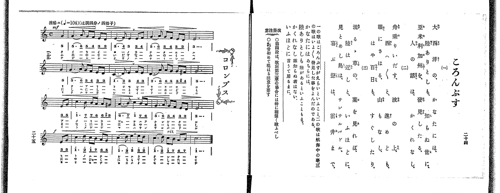

# コロンブス

> Re:Shoka 使用 AI 協助辨識與重建樂譜，可能會有錯誤。歡迎回報。

<audio controls src="koronbusu.mp3"></audio>

- 出處：共益商社樂器店《唱歌教科書 教師用 巻三》第二十四～二十五頁（第二學期第六曲）
- NDL Digital Collections PID 854864（https://dl.ndl.go.jp/pid/854864）掃描 P018.jpg

## 說明

原書資訊與歌詞全文（NDL PID 854864《唱歌教科書 教師用 巻三》第二十四～二十五頁，掃描 P018.jpg）：
調性與拍號：ハ調四分ノ四拍子（C 大調 4/4 拍），♩=104，「流暢ニ」，弱起一拍（四分音符）
註記：單聲部，三節分節歌。目次及左頁樂譜標題為「コロンブス」，右頁歌詞標題印為「ころんぶす」。開頭 mf，第七小節末音為 #4（F#4，4'），第九小節末音為 #5（G#4，5'），第十二小節末拍（第四段弱起）轉 f，第十五小節標 rit.。
原典演奏注意：第四段於歌詞第三章之場合特須稍強歌唱；#5 音首次出現，須加注意。
原典曲意：「一の歌はころんぶすがえらいといふこと、二の歌は航海中の事、三の歌はいよ／＼發見した事をよんだのである。」
原典語釋：「かなたには」：あちらには；「陸ありとしも」：陸があるといふこともまー；「かくれなし」：誰知らぬ者はない；「いふほどに」：言うて居るまに。

## 歌詞

```text
一、
大西洋の、かなたには、
陸ありとしも、知らぬ世に、
亞米利加州を、發見したる、
人の話は、かくれなし。

二、
舟乗りいだす、波の上、
西へ／＼と、進めども、
眼にさへぎる、山もなし、
はや百日も、すぐしたり。

三、
流るゝ草の、葉を見れば、
陸は近しと、いふほどに、
見とめし島は、サンサルバドル、
喜ぶ聲は、雲井まで。
```

## ABC

```abc
X:1
T:コロンブス
M:4/4
L:1/16
Q:1/4=104
K:C
V:V1 name="Voice" snm="Voi"
[V:V1]
!mf! z4 z4 z4 G4 | G6 A2 G2 F2 E2 D2 | E6 F2 E4 E2 F2 | G6 A2 G2 F2 E2 D2 |
E12 G4 | G6 A2 G2 F2 E2 D2 | C6 D2 E4 F2 E2 | D6 A2 A2 G2 G2 ^F2 |
G12 E2 G2 | c6 B2 B2 A2 A2 ^G2 | A6 B2 c4 B2 A2 | G6 A2 G2 F2 E2 D2 |
!f! E12 E2 G2 | c6 d2 c2 B2 A2 G2 | c6 d2 e4 e2 d2 | c6 d2 c2 B2 A2 B2 |
c12 z4 | !mf! z4 z4 z4 G4 | G6 A2 G2 F2 E2 D2 | E6 F2 E4 E2 F2 |
G6 A2 G2 F2 E2 D2 | E12 G4 | G6 A2 G2 F2 E2 D2 | C6 D2 E4 F2 E2 |
D6 A2 A2 G2 G2 ^F2 | G12 E2 G2 | c6 B2 B2 A2 A2 ^G2 | A6 B2 c4 B2 A2 |
G6 A2 G2 F2 E2 D2 | !f! E12 E2 G2 | c6 d2 c2 B2 A2 G2 | c6 d2 e4 e2 d2 |
c6 d2 c2 B2 A2 B2 | c12 z4 | !mf! z4 z4 z4 G4 | G6 A2 G2 F2 E2 D2 |
E6 F2 E4 E2 F2 | G6 A2 G2 F2 E2 D2 | E12 G4 | G6 A2 G2 F2 E2 D2 |
C6 D2 E4 F2 E2 | D6 A2 A2 G2 G2 ^F2 | G12 E2 G2 | c6 B2 B2 A2 A2 ^G2 |
A6 B2 c4 B2 A2 | G6 A2 G2 F2 E2 D2 | !f! E12 E2 G2 | c6 d2 c2 B2 A2 G2 |
c6 d2 e4 e2 d2 | c6 d2 c2 B2 A2 B2 | c12 z4 |
```

## TMD 檔案連結

- [主旋律 TMD 檔案](koronbusu.tmd) [[在 TMD Studio 編輯](https://tmdlang.github.io/Tmd-TS/#tmd=s7IKdvYPcrWy4qpTUCpJTLdSSM7PyUlNLsnMz7PKrsxPzc6ML87Iz05Ugisoy88pzU21yk7MizeOtzA1sTAzQUgW55cWJadaFSdn5OfnxJekVpQk5edno8vHFySmp1oFGBhaIGQKivLLUvMS84C6C4oy80pSU8DaEQpSyzJTUkHSxclAq8tSizLTMlNTkNyVWlQMcjXUipKixLzi5KLMApBXEKrSU_OKUq2SMzJzUopS8-KL8_PSEZJp-UW5VsUlRfkFGZnJCOGSjFSghzMyi0vyiyrRhYH2lKXmoIuWJ5akFmFRmldckF8E9JSWlsLjps2Pm9c-bgaS0x437VTQ0uJStFUwNDDhsrdVcOayMdE3sQMZ8LR914uZU9_vmfW0dePz2V1Pp7Y9X7Lv2YqmpzNXPN01_XFD19MpG5-t7Xk2debz5ROfzd6hAGQ93bH6-ZQVCk-3736yo_NxQ_fzNWue7Op52tv4dPbs93vnQdhPdk15uaDx_Z4OqOzaHc_mzAeyn7aufTZ70_s9nWD3-7n4KLhkpmeWJOYoOMPTRrFCgKeLAiT2gSZklJQUFFvp66fk6OUBcXq-XlaBfkFmij5MReezvuZn_f0KoDgHygHDnEtfS8GWWoBLQUHhad98oO9fbG5_saLrRUc7MEherJz3tHXFs2ntQBeCvIFwMhVCrQfNR0A_AuMI5JAXq_Y_a1gOckJ374uZ84Gij5v7gYJAU552tD1u7gMygFJP104AustZ4emS5UBJBWB0KwBFwcb0PJq50haYEoCsxw09z7Y2Ppu16HFz9-MGoHTP0z0bX2zd_mRHA1h1B8TUl_M3P1-zDKgZ7IAVu1-smAFKMdPWvWjc9LJ5BVAb0EvP1zcAlQJJoMcfNzQ9n73u2ZqFT_u7nm5fBvQSMEm9WDvn2YqZLxf2PG_aBbQYLYVCre_fDFIMDl2I4qe9G6DqGyc_bup93DT5ceO2x40zgeqBtryc1v1ywVqF3DSgXlCA7mh-uqEf5IY5q0GObtqloAxKQW4gssdEHeJ_kMKdczEUmgIVuoMVmiIUguOkB64WEiogcWAor9sKCS2g4hd7OxWgboDEIlTHipkKRZklekCXQhPR09Ydz_ZMebq0_9nmFc9a-oHBCDfs2bQ9EI-DPdL5fPWCJzu7ny7Y8nRCx_POnS8XdDxf0ft0z3agGmDqer9ntrKpAtDpL5dNA4Vz-67n_fuADgAqe9q1AGI4qq2zN0HsAwYlMHofN64DxVPjevRgbQQKdjxu6nzc2PK4cQWY3ApSA2Q3gIICrvFFx6pnoJSyFijyZBcw-TSC0jXC2JbHTR3v9wBt3PN85p4Xy7ofN05_3DgfpLJpElAKbOMCoPrHjcsfNzY9bgKa0ASMVISLX6ya97K9G-Lix41A_auA-h83rgaZDkoss0DaGheC3QoSBAYJUOXLmTvAxnWBXT_9cRPIUKBisDjQHLBNaB4Dqmnc97h5D8QEsF39j5uADKCNwDIQpP3Fqg3P5y8F27XmRUMr2IdA2RaYFohpux83rgQ5BqJlBTCU2x43Lnu6sRVs6T6wVBMXyIugKGhoBHsWmEOX7n-2BahgHVAIw6dgRdh81Qh30JMd08BGg5U-2TXv-cbNTztWAtPB0-3zQKENVIoUBeCghirdBbT0xcqNEIswPA51KjDSIepfdMx_shNoOdAVQP8CIw-YCxufbV4ESgE7umCKlu5_3LgDEvOQVPOyYdPjJqDpKyHOBil6PgcoB_TfVKDSx419ECc93bgRHBUQy8HqQA5rank-c9-z6UC_gnSD0-gEmE-AlsLCE1imgrUACzSQcU1zX_SCkiNQ9MXETmAogPwP8toG5CBd_2L_RLBZIHdixCLEP6BwA6YRoPT0p5uBeQQcVE1bQSUXiFz9uHnC4-ZOEAMaodPmAPMSsGiEKH05e9OTXUB_AmN_OTRHUl4lQYGClj4Xl3d-UX5eUmlxqVVYfmZyqkONQY1CNcgaBRtDMy07MKs6N60WzADWixqQUksT2EbYr1ADJJcoANM-kN4NpSF8oEzzCohIcx9QdDVctAuqbj9Uthsu049kePMqkOtAdtYoGCjogiE6bQqla-AsEDSDypgAsTEQG4FVgFgwCJMBQRAN4pNqBjKEuwMWRo-b1kM9uQjqyVVwT3ZAZbZDZSAqQAEJE1kJpXugNCQYQXq7kUMfohEeSISdb4ikAiQC8w5MVQ1YFNkMmDlgs9QxQgkZggwAySHCoHkhit-RkkDT9sfNS6GSm8Dx_ri5BSyxEcjajAgKaBoBeX01ctqYhOp1wzgkh5hDMdz9EHeDmMhK4HpgailJANVptdgCABTVwLQP9ifIjyAakvqRoxsogxQ0kISjAar2QT5dg0Ubdn8bgThgEZiPwK7BosgYJgJmgIUImgWi0RQhQ1iOrOGq5eLStVOAFyoKeDnKXAA)]

## 分析

```text
================================================================================
📊 TMD Song Profile: [ コロンブス ]
================================================================================
⏱  Duration:       1:57 (117.7s), 51 measures total
🎼 Key & Tempo:    首調基準 C, != 104.0 BPM, <4/4>
   - 分析範圍：      由實際發聲的音符與和弦推測調性；播放脈絡另行呈現
🎤 人聲音域:    C4 (MIDI 60) – E5 (MIDI 76) [跨度: 16 個半音 / 1.3 個八度, 難度: moderate]
   - 最低音:  C4 in [Koronbusu #1 @ m.7, 0:13]
   - 最高音: E5 in [Koronbusu #1 @ m.15, 0:33]
   - 適合: soprano, mezzo-soprano, contralto, tenor, baritone, bass
🏛  結構:      Koronbusu (39.2s) -> Koronbusu (39.2s) -> Koronbusu (39.2s)
⚡ 編曲密度:        Peak 1 軌道同時演奏
🗝  調性診斷：       C 大調（純淨自然大調，未偵測到可信轉調）
   - 風格氣質:    純淨自然大調（陽光明朗、易唱易記，無明顯調外色彩）
   - 轉調歷程:    全曲維持單一推測調性（未偵測到可信轉調）
   - 核心骨幹音:  G, E, C, A, D
   - 調性數值:    C 大調 [相關度: 0.88, 穩定度: Moderate, 自然音純度: 98.4%]
   - 候選調性 (K-S): C 大調 (0.88), E 小調 (0.82), G 大調 (0.73)
   - 五度圈歷程:   +0 -> +0 -> +0
   - 各段落調性細節:
     • [Koronbusu #1]: C 大調 (r: 0.88, 自然音純度: 98.4%, 調外音: F#, G#)
     • [Koronbusu #2]: C 大調 (r: 0.88, 自然音純度: 98.4%, 調外音: F#, G#)
     • [Koronbusu #3]: C 大調 (r: 0.88, 自然音純度: 98.4%, 調外音: F#, G#)

  [ 五度圈游移軌跡 ]
              [C ]*
         F            G  
      Bb               D  
      Eb               A  
         Ab           E  
            Db       B  
               F# 
     (* = active key center)

  [ 十二半音累積音高分佈 ]
     C  : ███████████████████       19.5%
     C# :                            0.0%
     D  : █████████                  9.4%
     D# :                            0.0%
     E  : ███████████████████████   23.4%
     F  : █████                      5.5%
     F# : █                          0.8%
     G  : ████████████████████████  24.2%
     G# : █                          0.8%
     A  : ███████████               10.9%
     A# :                            0.0%
     B  : █████                      5.5%
--------------------------------------------------------------------------------
Assignment 軌道音域：
  - Voice         : C4 – E5 (16 個半音 / 1.3 個八度, 234 個音符)
================================================================================
```


## 原書掃描頁




