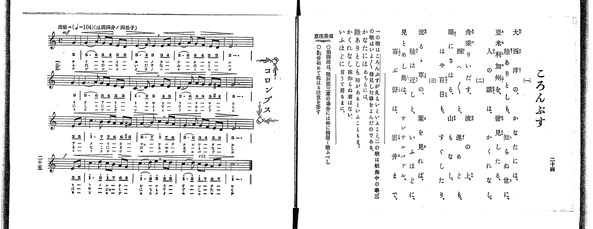

# コロンブス

> Re:Shōka 使用 AI 協助辨識與重建樂譜，可能會有錯誤。歡迎回報。

- **鋼琴伴奏版**：<br><audio controls src="koronbusu.mp3"></audio>
- **NEUTRINO 歌聲合成版**：<br><audio controls src="koronbusu_neutrino.mp3"></audio>

- 出處：共益商社樂器店《唱歌教科書 教師用 巻三》第二十四～二十五頁（第二學期第六曲）
- NDL Digital Collections PID 854864（https://dl.ndl.go.jp/pid/854864）掃描 P018.jpg

## 說明

原書資訊與歌詞全文（NDL PID 854864《唱歌教科書 教師用 巻三》第二十四～二十五頁，掃描 P018.jpg）：
調性與拍號：ハ調四分ノ四拍子（C 大調 4/4 拍），♩=104，「流暢ニ」，弱起一拍（四分音符）
註記：單聲部，三節分節歌。目次及左頁樂譜標題為「コロンブス」，右頁歌詞標題印為「ころんぶす」。開頭 mf，第七小節末音為 #4（F#4，4'），第九小節末音為 #5（G#4，5'），第十二小節末拍（第四段弱起）轉 f，第十五小節標 rit.。
原典演奏注意：第四段於歌詞第三章之場合特須稍強歌唱；#5 音首次出現，須加注意。
原典曲意：「一の歌はころんぶすがえらいといふこと、二の歌は航海中の事、三の歌はいよ／＼發見した事をよんだのである。」
原典語釋：「かなたには」：あちらには；「陸ありとしも」：陸があるといふこともまー；「かくれなし」：誰知らぬ者はない；「いふほどに」：言うて居るまに。


## 歌詞

```text
一、
大西洋の、かなたには、
陸ありとしも、知らぬ世に、
亞米利加州を、發見したる、
人の話は、かくれなし。

二、
舟乗りいだす、波の上、
西へ／＼と、進めども、
眼にさへぎる、山もなし、
はや百日も、すぐしたり。

三、
流るゝ草の、葉を見れば、
陸は近しと、いふほどに、
見とめし島は、サンサルバドル、
喜ぶ聲は、雲井まで。
```

## ABC

```abc
X:1
T:コロンブス
M:4/4
L:1/16
Q:1/4=104
K:C
V:V1 name="Voice" snm="Voi"
[V:V1]
!mf! z4 z4 z4 G4 | G6 A2 G2 F2 E2 D2 | E6 F2 E4 E2 F2 | G6 A2 G2 F2 E2 D2 |
w: 1.~た | い _ せ _ い _ | よ _ の か _ | な _ た _ に _
w: 2.~ふ | ね _ の _ り _ | い _ だ す _ | な _ み _ の う
w: 3.~な | が _ る _ る _ | く _ さ の _ | は _ を _ み れ
E12 G4 | G6 A2 G2 F2 E2 D2 | C6 D2 E4 F2 E2 | D6 A2 A2 G2 G2 ^F2 |
w: 1.~は り | く _ あ _ り _ | と _ し も _ | し _ ら _ ぬ よ
w: 2.~へ に | し _ へ _ に _ | し _ へ と _ | す _ す _ め ど
w: 3.~ば り | く _ は _ ち _ | か _ し と _ | い _ ふ _ ほ ど
G12 E2 G2 | c6 B2 B2 A2 A2 ^G2 | A6 B2 c4 B2 A2 | G6 A2 G2 F2 E2 D2 |
w: 1.~に あ _ | め _ り _ か _ | しゅ _ を は つ | け ん し _ た _
w: 2.~も ま _ | な _ こ _ に _ | さ _ へ ぎ る | や _ ま _ も な
w: 3.~に み _ | と _ め _ し _ | し _ ま は さ | ん _ さ る ば ど
!f! E12 E2 G2 | c6 d2 c2 B2 A2 G2 | c6 d2 e4 e2 d2 | c6 d2 c2 B2 A2 B2 |
w: 1.~る ひ _ | と の は _ な _ | し _ は か _ | く _ れ _ な _
w: 2.~し は _ | や _ ひゃ _ く _ | に _ ち も _ | す ぐ し _ た _
w: 3.~る よ ろ | こ _ ぶ _ こ _ | ゑ _ は く _ | も _ ゐ _ ま _
c12 z4 |
w: 1.~し
w: 2.~り
w: 3.~で
```

## TMD 檔案連結

- [主旋律 TMD 檔案](koronbusu.tmd) [[在 TMD Studio 編輯](https://tmdlang.github.io/Tmd-TS/#tmd=s7IKdvYPcrWy4qpTUCpJTLdSSM7PyUlNLsnMz7PKrsxPzc6ML87Iz05Ugisoy88pzU21yk7MizeOtzA1sTAzQUgW55cWJadaFSdn5OfnxJekVpQk5edno8vHFySmp1oFGBhaIGQKivLLUvMS84C6C4oy80pSU8DaEQpSyzJTUkHSxclAq8tSizLTMlNTkNyVWlQMcjXUipKixLzi5KLMApBXEKrSU_OKUq2SMzJzUopS8-KL8_PSEZJp-UW5VsUlRfkFGZnJCOGSjFSghzMyi0vyiyrRhYH2lKXmoIuWJ5akFmFRmldckF-E5Kn8osz0zDyr3NTMrEwswQWVLk8tBhqXF5-bmpOfAnSBlpbC46bNj5vXPm4GktMeN-1U0NLiUrRVMDQw4bK3VXDmsjHRN7EDGfO0fdeLmVPf75n1tHXj89ldT6e2PV-y79mKpqczVzzdNf1xQ9fTKRufre15NnXm8-UTn83eoQBkPd2x-vmUFQpPt-9-sqPzcUP38zVrnuzqedrb-HT27Pd750HYT3ZNebmg8f2eDqjs2h3P5swHsp-2rn02e9P7PZ1gX_i5-Ci4AP1Qkpij4AxPWcUKAZ4uCpC0AzQho6SkoNhKXz8lRy8PiNPz9bIK9AsyU_RhKjqf9TU_6-9XAKUYoBwwxrj0tRRsqQW4FBQUnvbNB_r-xeb2Fyu6XnS0A4Pkxcp5T1tXPJvWDnQhyBsIJ1Mh1HrQfAT0IzCOQA55sWr_s4blICd0976YOR8o-ri5HygINOVpR9vj5j4gAyj1dO0EoLucFZ4uWQ6UVABGtwJQFGxMz6OZK22BKQHIetzQ82xr47NZix43dz9uAEr3PN2z8cXW7U92NIBVd0BMfTl_8_M1y4CawQ5YsfvFihmgFDNt3YvGTS-bVwC1Ab30fH0DUCmQBHr8cUPT89nrnq1Z-LS_6-n2ZUAvAZPUi7Vznq2Y-XJhz_OmXUCL0VIo1Pr-zSDF4NCFKH7auwGqvnHy46bex02THzdue9w4E6geaMvLad0vF6xVyE0D6gUF6I7mpxv6QW6Ysxrk6KZdCsqgFOQGIntM1CH-ByncORdDoSlQoTtYoSlCIThOeuBqIaECEgeG8rqtkNACKn6xt1MB6gZILEJ1rJipUJRZogd0KTQRPW3d8WzPlKdL-59tXvGspR8YjHDDnk3bA_E42COdz1cveLKz--mCLU8ndDzv3PlyQcfzFb1P92wHqgGmrvd7ZiubKgCd_nLZNFA4t-963r8P6ACgsqddCyCGo9o6exPEPmBQAqP3ceM6UDw1rkcP1kagYMfjps7HjS2PG1eAya0gNUB2Aygo4BpfdKx6Bkopa4EiT3YBk08jKF0jjG153NTxfg_Qxj3PZ-55saz7ceP0x43zQSqbJgGlwDYuAKp_3Lj8cWPT4yagCU3ASEW4-MWqeS_buyEuftwI1L8KqP9x42qQ6aDEMgukrXEh2K0gQWCQAFW-nLkDbFwX2PXTHzeBDAUqBosDzQHbhOYxoJrGfY-b90BMANvV_7gJyADaCCwDQdpfrNrwfP5SsF1rXjS0gn0IlG2BaYGYtvtx40qQYyBaVgBDue1x47KnG1vBlu4DSzVxgbwIioKGRrBngTl06f5nW4AK1gGFMHwKVoTNV41wBz3ZMQ1sNFjpk13znm_c_LRjJTAdPN0-DxTaQKVIUQAOaqjSXUBLX6zcCLEIw-NQpwIjHaL-Rcf8JzuBlgNdAfQvMPKAubDx2eZFoBSwowumaOn-x407IDEPSTUvGzY9bgKavhLibJCi53OAckD_TQUqfdzYB3HS040bwVEBsRysDuSwppbnM_c9mw70K0g3OI1OgPkEaCksPIFlKlgLsEADGdc090UvKDkCRV9M7ASGAsj_IK9tQA7S9S_2TwSbBXInRixC_AMKN2AaAUpPf7oZmEfAQdW0FVRygcjVj5snPG7uBDGgETptDjAvAYtGiNKXszc92QX0JzD2l0NzJOVVEhQoaOlzcXnnF-XnJZUWl1qF5WcmpzrUGNRUg2xRsDE007IDs6pz02rBDGC1qAEptDSBTYT9CjVAcokCMOkD6d1QGsIHyjSvgIg09wFFV8NFu6Dq9kNlu-Ey_UiGN68COQ5kZ42CgYIuGKLTplC6Bs4CQTOojAkQGwOxEVgFiAWDMBkQBNEgPqlmIEO4O8Du9TGsUYiHiqDTwEQHdzMwuaCZ87hxNpwFkwOFcAeGunVwVjeSeasw1MFsAyZHJHXrsfoCqKqpC6YK4hMjfD7ZimTiWtwuRJiJ1ccL4KyZSOowfbIfxWRgwQhVuQOXXxA-hvjFGJ9fYPaBTOxBN6kJFsYIFkhdP4aNU1HcCFOHHtrAsgSuDuQrYKkCVbkBl1_Q4gWYCx83rYdmo0XQbLQKno06oDLboTIQFaCEBBNZCaV7oDQko4L0diPnb4hGeDYknEEMkVSARGAZBqaqBiyKbAbMHLBZ6mAlyNYgQ5ABIDlELsMWB02YYQYUXYGhbjpcHUwHSB1MFBHynXAda8B8UF4EqYSlLoy4grsAkYewmAtPt6g5E586mB9A6mB5BaEOJgKsaMD8lRCVcN9hunMfqjuB-QNbeMJSL7ClhGQ_LB8g1MHDE8WdmPkdVmoAq0lkd-IJT1jOR6T95oUoaR6pcmna_rh5KVRyE7hGedzcApbYCGRtRmQBaO0DSvKrkWudSahJ3jAOySnmUAxPt5D0CmIiK4HrgamlpGqpTqvFlvDBkYwSTPDkjlolAFtbrRhKEeUPKHYfNy6BKp6IomoyWA4Rr0g1F7wcxIytTTBVSKkfszQHmQ1hIad-WPmJUIdI_X1gN4HsBdmPma5gqRmS4iF2YstRCB2wlI2c_jHKCXhAI0zCnk_h9kPDFOQXkEthPkWoBMlAfAIp8RF5FWeogksdYDcL7lpwLgCV88CmFTixgxI6iIY0rpDLeqAMUv6A1BoaoE4lKLmvwaINe-I3AnHAIrBkDU6SWBQZw0TADLAQQbNANJoiZAhr8CEX_chRBWsUIAor5AodM7IQ6vBW6OCKmbB5MAhrTiAlfSwJFdiXaYZzYFZiKwERJS5qHYVc9gO7MmASey6FFQkEHApO-ZjpdBucBZMDmYlcRkBkEYGJ5BuMeudxE8ilEHXwmgfIXk7QjbVcXLp2CvBeigKQo8wFAA)]
- [鋼琴伴奏 TMD 檔案](koronbusu_piano.tmd) [[在 TMD Studio 編輯](https://tmdlang.github.io/Tmd-TS/#tmd=s7IKdvYPcrWy4tLSUnjctPlx89rHzUBy2uOmne_3dLzs3vN8wpYne7Y8Xdr_vLPj_Z5OBS0tLkVbBUMDEy57WwVnLhsTfRM7rjoFpaftu17MnPp-z6ynrRufz-56OrXt-ZJ9z1Y0PZ254umu6Y8bup5O2fhsbc-zqTOfL5_4bPYOBSDr6Y7Vz6esUHi6ffeTHZ2PG7qfr1nzZFfP097Gp7Nnv987D8J-smvKywWNQMdAZdfueDZnPpD9tHXts9mbgE5SAlnv5-Kj4JKZnlmSmKPgnJ-Tk5pckpmfV6wQ4OmiYGFqYmFmAjQho6SkoNhKXz8lRy8PiNPz9bIK9AsyU_RhKjqf9TU_6-9XCDAwtADKpStxcXnnF-XnJZUWl1oFZCbm5Qd5ONQY1FRzKQCBjaGZlh2YVZ2bVgtm6GspaDzds_HF1u2awODcr1ADJJcoPG7eA6R3Q2kIHyjTvAIi0twHFF0NF-2CqtsPle2Gy_QjGd68SkFLH2xnjYKBgi4YotOmULoGzgJBM6iMCRAbA7ERWAWIBYMwGRAE0SA-qWYgQ7g7wO71MaxRiIeKoNOPG-fD3fy4sQXNnMeNs-EsmBwohDsw1K2Ds7qRzFuFoQ5m2-PG1Ujq1mP1BVBVUxdMFcQnRvh8shXJxLW4XYgwE6uPF8BZM5HUYfpkP4rJjxvboCp34PILwscQvxjj8wvMPpCJPegmNcHCGMECqevHsHEqihth6tBD-3HTJLg6kK8eN4FsBKncgMsvaPECzIWPm9ZDs9EiaDZaBc9GHVCZ7VAZiApQQoKJrITSPVAaklFBeruR8zdEIzwbEs4ghkgqQCKwDANTVQMWRTYDZg7YLHWwEmRrkCHIAJAcIpdhi4MmzDADiq7AUDcdrg6mA6QOJooI-U64jjVgPigvglTCUhdGXMFdgMhDWMyFp1vUnIlPHcwPIHWwvIJQBxN53NQI5q-EqIT7DtOd-1DdCcwf2MITlnofNy5Esh-WDxDq4OGJ4k7M_A4rNR437kZ2J57whOV8RNpvXoiS5pEql6btj5uXQiU3gWuUx80tYImNQNZmRBaA1j6gJL8audaZhJrkDeOQnGIOxfB0C0mvICayErgemFpKqpbqtFpsCR8cySjBBE_uqFXC9MdNrRhKEeUPKHYfNy6BKp6IomoyWA4Rr0g1F7wcxIytTTBVSKkfszQHmQ1hIad-WPmJUIdI_X1gN4HsBdmPma5gqRmS4iF2YstRCB2wlI2c_jHKCXhAI0zCnk_h9kPDFOQXkEthPkWoBMlAfAIp8RF5FWeogkudx029cNeCcwGonAc2rcCJHZTQQTSkcYVc1gNlkPIHpNbQKMos0QMl9zVYtGFP_EYgDlgElqzBSRKLImOYCJgBFiJoFohGU4QMYQ0-5KIfOapgjQJEYYVcoWNGFkId3godXDETNg8GYc0JpKSPJaFuetzUDOfArMRWAiJKXNQ6Crnsf9w4AUxiz6WwIoGAQ8EpHzOdboOzYHIgM5HLCIgsIjCRfINR7zxuArkUog5e8wDZywm6sRajk-KD3EkxgfZRgFniRV_Xy_bep607Xs5uhXTqkBJzvEK0YSyMqgFCEyDTJFbBNB5Im8YDxaAqoeJQCp9K4s2ECyCZiiGG01RcKuHiCPtIci0W_XhNxq0eYbYBJMZ07RTgkRbtA5RCFTBCFzAGCyhzAQA)]

## 分析

```text
================================================================================
📊 TMD Song Profile: [ コロンブス ]
================================================================================
⏱  Duration:       0:39 (39.2s), 17 measures total
🎼 Key & Tempo:    首調基準 C, != 104.0 BPM, <4/4>
   - 分析範圍：      由實際發聲的音符與和弦推測調性；播放脈絡另行呈現
🎤 人聲音域:    C4 (MIDI 60) – E5 (MIDI 76) [跨度: 16 個半音 / 1.3 個八度, 難度: moderate]
   - 最低音:  C4 in [Koronbusu #1 @ m.7, 0:13]
   - 最高音: E5 in [Koronbusu #1 @ m.15, 0:33]
   - 適合: soprano, mezzo-soprano, contralto, tenor, baritone, bass
🏛  結構:      Koronbusu (39.2s)
⚡ 編曲密度:        Peak 1 軌道同時演奏
🗝  調性診斷：       C 大調（純淨自然大調，未偵測到可信轉調）
   - 風格氣質:    純淨自然大調（陽光明朗、易唱易記，無明顯調外色彩）
   - 轉調歷程:    全曲維持單一推測調性（未偵測到可信轉調）
   - 核心骨幹音:  G, E, C, A, D
   - 調性數值:    C 大調 [相關度: 0.88, 穩定度: Moderate, 自然音純度: 98.4%]
   - 候選調性 (K-S): C 大調 (0.88), E 小調 (0.82), G 大調 (0.73)
   - 五度圈歷程:   +0
   - 各段落調性細節:
     • [Koronbusu #1]: C 大調 (r: 0.88, 自然音純度: 98.4%, 調外音: F#, G#)

  [ 五度圈游移軌跡 ]
              [C ]*
         F            G  
      Bb               D  
      Eb               A  
         Ab           E  
            Db       B  
               F# 
     (* = active key center)

  [ 十二半音累積音高分佈 ]
     C  : ███████████████████       19.5%
     C# :                            0.0%
     D  : █████████                  9.4%
     D# :                            0.0%
     E  : ███████████████████████   23.4%
     F  : █████                      5.5%
     F# : █                          0.8%
     G  : ████████████████████████  24.2%
     G# : █                          0.8%
     A  : ███████████               10.9%
     A# :                            0.0%
     B  : █████                      5.5%
--------------------------------------------------------------------------------
Assignment 軌道音域：
  - Voice         : C4 – E5 (16 個半音 / 1.3 個八度, 78 個音符)
================================================================================
```


## 原書掃描頁




