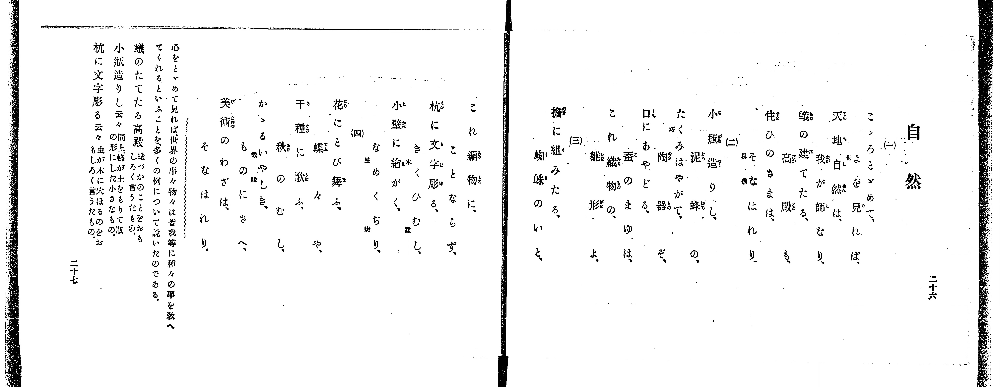

# 自然

> Re:Shōka 使用 AI 協助辨識與重建樂譜，可能會有錯誤。歡迎回報。

- **鋼琴伴奏版**：<br><audio controls src="shizen.mp3"></audio>
- **NEUTRINO 歌聲合成版**：<br><audio controls src="shizen_neutrino.mp3"></audio>

- 出處：共益商社樂器店《唱歌教科書 教師用 巻三》第二十六～二十九頁（第三學期第一曲）
- NDL Digital Collections PID 854864（https://dl.ndl.go.jp/pid/854864）掃描 P019.jpg、P020.jpg

## 說明

原書資訊與歌詞全文（NDL PID 854864《唱歌教科書 教師用 巻三》第二十六～二十九頁，掃描 P019.jpg、P020.jpg）：
調性與拍號：變ホ調四分ノ四拍子（Eb 大調 4/4 拍），♩=104，「溫和ニ」
註記：單聲部，四節分節歌。第二十六～二十七頁（P019.jpg）為四節歌詞、曲意與語釋；第二十九頁（P020.jpg 左頁，註「二十八ページへつゞく」）為前八小節樂譜（開頭 mf），第二十八頁（P020.jpg 右頁，註「二十九ページのつゞき」）為後八小節樂譜（第九小節轉 f）。第八小節五線譜為附點二分音符加四分休止符（1 - . 0），簡譜漏印附點（印作 1 - 0），以五線譜為準。
原典曲意：「心をとゞめて見れば、世界の事々物々は皆我等に種々の事を敎へてくれるといふことを、多くの例について説いたのである。」
原典語釋：「そなはれり」旁註「具備」；「たくみ」旁註「巧」；「きくひむし」旁註「木蠹」；「なめくぢり」旁註「蛞蝓」；「いやしき」旁註「微賤」；「蟻のたてたる高殿」：蟻づかのことをおもしろく言うたもの；「小瓶造りし云々」：同上、蜂が土をもりて瓶の形にした小さなもの；「杭に文字彫る云々」：虫が木に穴ほるのをおもしろく言うたもの。


## 歌詞

```text
一、
こゝろとゞめて、世を見れば、
天地自然は、我が師なり、
蟻の建てたる、高殿も、
住ひのさまは、そなはれり。

二、
小瓶造りし、泥蜂の、
たくみはやがて、陶器ぞ、
口にあやどる、蚕のまゆは、
これ織物の、雛形よ。

三、
檐に組みたる、蜘蛛のいと、
これ編物に、ことならず、
杭に文字彫る、きくひむし、
小壁に繪がく、なめくぢり。

四、
花にとび舞ふ、蝶々や、
千種に歌ふ、秋のむし、
かゝるいやしき、ものにさへ、
美術のわざは、そなはれり。
```

## ABC

```abc
X:1
T:自然
M:4/4
L:1/16
Q:1/4=104
K:Eb
V:V1 name="Voice" snm="Voi"
[V:V1]
!mf! B6 A2 G4 F4 | E4 C4 B,8 | E6 F2 G2 B2 A2 G2 | F12 z4 |
w: 1.~こ こ ろ と | ど め て | よ を み _ れ _ | ば
w: 2.~こ が め つ | く り し | ど ろ ば _ ち _ | の
w: 3.~の き に く | み た る | く も の _ い _ | と
w: 4.~は な に と | び ま ふ | て ふ て _ ふ _ | や
B6 A2 G4 F4 | E4 C4 B,8 | E6 F2 G2 A2 F4 | E12 z4 |
w: 1.~て ん ち し | ぜ ん は | わ が し _ な | り
w: 2.~た く み は | や が て | や き も _ の | ぞ
w: 3.~こ れ あ み | も の に | こ と な _ ら | ず
w: 4.~ち ぐ さ に | う た ふ | あ き の _ む | し
!f! B6 B2 e4 B4 | c4 c4 B8 | c6 B2 A2 G2 F2 E2 | B12 z4 |
w: 1.~あ り の た | て た る | た か ど _ の _ | も
w: 2.~く ち に あ | や ど る | こ の ま _ ゆ _ | は
w: 3.~く ひ に も | じ ほ る | き く ひ _ む _ | し
w: 4.~か か る い | や し き | も の に _ さ _ | へ
B6 B2 e4 B4 | c4 d4 e8 | G6 A2 B4 B4 | E12 z4 |
w: 1.~す ま ひ の | さ ま は | そ な は れ | り
w: 2.~こ れ お り | も の の | ひ な が た | よ
w: 3.~こ か べ に | ゑ が く | な め く ぢ | り
w: 4.~び じゅ つ の | わ ざ は | そ な は れ | り
```

## TMD 檔案連結

- [主旋律 TMD 檔案](shizen.tmd) [[在 TMD Studio 編輯](https://tmdlang.github.io/Tmd-TS/#tmd=s7IKdvYPcrWy4qpTUCpJTLdSSM7PyUlNLsnMz7PKrsxPzc6ML87Iz05Ugisoy88pzU21yk7MizeOtzA1sTAzQUgW55cWJadaFSdn5OfnxJekVpQk5edno8vHFySmp1oFGBhaImQKivLLUvMS84C6C4oy80pSU8DaEQpSyzJTUkHSxclAq8tSizLTMlNTkNyVWlQMcjXUipKixLzi5KLMApBXEKrSU_OKUq2SMzJzUopS8-KL8_PSEZJp-UW5VsUlRfkFGZnJCOGSjFSgh_MSS0qLUtFFE_MycxNz0EULchLzkJyeX5SZnplnlZuamZWJFChaWgov2lc9b9mmoKXFpWirYGhgwmVvq-Cqw2Vjom9iB9L-tH3Xi5lT3--Z9bR14_PZXU-ntj1fsu_ZiqanM1c83TX9cUPX0ykbn63teTZ15vPlE5_N3qEAZD3dsfr5lBUKT7fvfrKj83FD9_M1a57s6nna2_i0de37vfMg7Cc7575c0Ph-TwdIdkfn07U7ns2ZD2Y3PJu96f2eTrDr_Vx8FFyAbi9JzFFwhieMYoUATxcFSNQDTcgoKSkottLXT8nRywPi9Hy9rAL9gswUfZiKzmd9zc_6-xVAEQ6US3_c0BhgYGQAYipxcelrKdhSC3ApKCg87ZsPDIgXm9tfrOh60dEODJ0XK-c9bV3xbFo70LEgHyFcT4UA7MHtOaDPgTEHctOLVfufNSwHuaa798XM-UDRF-u6HjfPBoo_nT37aUfb4-Y-IAMo-3TtBKArXZMUni5ZDpRVACYEBaAw2KieRzNX2gITCZD1uKHn2a7VTyf1PG7uftzQC7Zjxe4XK2aAksq0dS8aN71sXgFUBzT0-foGoAVAEujNxw1N2D2zoxmSGmC-ANr3vGkXRDckBIH-AiaMZy39QF-8WDXvZXv3-z2z4YbBkxPM78DQWwYJH6C7gK6F2bn6cfOsx817HjfteNwIREseN8173NgP9ALUxs5eoJqnG_pB9q5oerF2DtDMl9O6Xy5Yq5CbBgkFJB-sRre0fzOmpUC3IVm6DmZpL8LSfT2YloJs2TkXIvhib6cCyHJI8MHVPtk15fn2WUDlQDNezmx5uRscmh1tL-dvfr5m2dOuBZC4fbJn4rO1i4AiQFMNFXQV9BQMoB7ZsBCo-dme_qe9GyD6gSqA7Cd75yiAFEKVPdm9FNmmZ7umAd0BTelPW3dAYgUY70APP93f_Lhp0uPGFSAfNjU-blz2Yln346aex40bgPH3ZMe051OB7HVPdgETTevzzpVA8nHj-uez2p51THy-tvNx4-rnK9aBBcFqmiY9m9oHjqdloEgCmtPUDTK8seVx49bHjZPBFk0Cmvx0ySyQAqCufUAFq0FBDFKz7MWqNWDGfHC4L3_c2AQyoaEJmmQhHoClJpAHHjfOfdy4CugmsGVdQHXPpjdCIvNp6_anTTPBkTYbrBJoKNDK_Shqti9HUtALVrDpcVPD40ZgWYlQ9mzOihcLdiKpXAUOLKDiRWiWvpg978XcyUgqWx43Af0zHZJ8EPbuW_di8xK4shfzd4M9DHQhMODmA_38cvWMZ-tATgVlfZDs0seNwJACqoEFYmPX46YmkMlNIGe_WAF0cxtYL1BwHcRYUKqbvO1lwwKQIxunP9k1ERRVYDOfTuh5sgPo8sYXc4Dqe57OAWqcBNILUrkMqAtoyNO9i8BxA3T8fKBRjxungj2OMP_Z3LVABcBy8una6U_3rgY6G9mKFzOBekFBB0olK7c8btwNTg3rCDoelFpBsQ2sWoAOBLFAvm6aC1aMSKmQBAo0DTnJglPJkpVP52yA1JSglAEsiDomgjy5A-ggoAdA3gYXgOBQf7p7FzzUgRLQgAc6BKLoyV5wkgCFPND7-yDmYaQ6qIN3AQtMiBNQQx7khM1LwUEN9B3US7DkCDIFmESAHgB56eXMbcC6-nEjqPwEm9S_GBwJwJgBKloJceSLWUC3AF2073ETMNhALoKHUs_znVNAGRVs0UtgeQKMxKYORJACyySw4merJoDiZSvQUKAToJ5_MWfGi9mzwUYDxVegmrt9Bdjc1WD_g1MhKDCBZQAwH0KMxEgOYKVouQoWPk8XA-VWP98JDEag14ElOpCLlq0gbgYWirAI69oIDgugzZtfdACL5K0gN8_dBkpywNCBGt3bDCqTgA4BVl9gFc-XQ5Idkv2gzARKUEAJ5AzaCE2AIEuAIbwDqvr5vr4XC4E-BpoBdNs0nGkAqJTyJgkUKGjpc3EFZ2RWpeZZheVnJqc61BjUVIOsULAxNNOyA7Oqc9NqwQxgm-hx02YIbl4LxB0KNUCyE4gXAnEbmLcCiDcB8Xwg3gPEa8A0SGYCyDaQOTUKpsB6BAZNgNgYyjaC0jXgmgYEzeKhDFMYAwYRamA6QaaATIaZWAM3Dx0awMwAu8fHEOi8xslI8hAesCiA81fAbQXmD5hoUyNcfhmG64AZAtnEpklgdfvh_B4kEzfgcCfMz1B3GmG6E2QKsjuWIJnaD7erCy4_HdOdcP9A1IL8jHDR48aFSCrXEedOY3S1wHQPJlfD-TC3gVTCw6RxPtwV3VjcCdMDUdEE1gGzBZjFkFTCYouAO01AatejuHMVmjuR430zXHQfnLUVizuR0wJEBUIMoQOUQmBuxu9OUL4D5q7HzaB81wjUth2sGZS7QCL94Ny1HigCzGtAOUi-6wKLrqJHngOZhmkKOsSW51BCqgmc5-DpDZFWQSrnoKiCyCPHHFRdE0oageQOuDmQ2IWphOUJdIgtz8HSJcQUkB3IqRbmDuQYhdgNYWErG5BjHpo7wCkawoelapDd84hzJzjPoZQN4BIGWKfDTYW5GGQ_pl2IVI_kTrTSBpQbEKEIrJeRVM4izp3gPAeLY4ipE8DkVAx3gFS2wUXhZQPWPAfzD0RFL5iE-6ypAUklegmI3Z3VyHXeInBOAvaGgez94HwFzI1A1uPm1eDABLKaVkNrQlDeA6qD1nmLsOc_ENswDokDcZwZlAWjkbWgqoDJwjIyKPuBMh6qNcgQW_ZDCTRwhkBODrAAR86ohIpo1IwCUoFUXSIna3gCRIfYsh9qpgYlHuQiGmYSavZDVNLY3ImarEHuQirUm2CJDr16wONOcPZDdecmVHfCfQxSOQOuajded_aimAgpeEDmQnSQnqwh2Q_ZJmgswW1HqUiRwhNRiCK7CaYONftBwhMRQ7CsDbJ7B1HuBGe7ncAMNA-IJ4GzFMiarVARcJXXtBdczYF4oGYmnuqOQHYzh9JwJQifwSpJEATlNZhmhCGkVHczkeQh6Q0pNlEKfURhiGhqYKnuGueimAhpvMDUoTQxSarusFUj8CYk3CRc1Qh6IxFkIsyXyO5EVJBIJQ1KoxmPOzGrO2hpsxPOR6pGmibCRRG2IudWmDthVRvEp6BmNVIzunERkolEhic4v8EajhBTZjxuagUzYG111IIRYd00OIvWUV_LxaVrpwDpCCoAWcpcAA)]
- [鋼琴伴奏 TMD 檔案](shizen_piano.tmd) [[在 TMD Studio 編輯](https://tmdlang.github.io/Tmd-TS/#tmd=s7IKdvYPcrWy4tLSUnjRvup5y7b3ezpedu95PmHLkz1bni7tf97Z8X5Pp4KWFpeirYKhgQmXva2Cqw6XjYm-iR1XnYLS0_ZdL2ZOfb9n1tPWjc9ndz2d2vZ8yb5nK5qezlzxdNf0xw1dT6dsfLa259nUmc-XT3w2e4cCkPV0x-rnU1YoPN2--8mOzscN3c_XrHmyq-dpb-PT1rXv986DsJ_snPtyQSPQNSDZHZ1P1-54Nmc-mN3wbPYmoJuUQNb7ufgouGSmZ5Yk5ig45-fkpCaXZObnFSsEeLooWJiaWJiZAE3IKCkpKLbS10_J0csD4vR8vawC_YLMFH2Yis5nfc3P-vsVAgwMLYFy6Y8bGgMMjAxATCUuruCMzKrUPKuAzMS8_CAPhxqDmmouBSCwMTTTsgOzqnPTasEMfS2Fx02bIbh5LRB3KNQAyU4gXgjEbWDeCiDeBMTzgXgPEK8B0yCZCQpa-mBzahRMFXTh0ASIjaFsIyhdo2AIZZnFQxmmMAYMItTAdIJMAZkMM7EGbh46NICZAXaPjyHQeY2TkeQhvMdNvXD-CritjxtXwkSbGuHyyzBc97ipA9nEpklgdfvh_B4kEzfgcCfMz1B3GmG6E2QKsjuWIJnaD7erCy4_HdOdcP9A1IL8jHDR48aFSCrXEedOY3S1jxshpq6G82FuA6mEh0njfLgrurG4E6YHoqIJrANmy-PGFiSVsNgi4E4TkNr1KO5cheZO5HjfDBfdB2dtxeJO5LQAUYEQQ-gApRCYm_G7E5TvgLnrcTMo3zUCtW0HawblLpBIPzh3rQeKAPMaUA6S77rAoqvokedApmGagg6x5TmUkGoC5zl4ekOkVZDKOSiqIPLIMQdV14SSRiC5A24OJHZhKmF5Ah1iy3OwdAkxBWQHcqqFuQM5RiF2Q1jYygbkmIfmDnCKhvBhqRpk9zzi3AnOcyhlA7iEedyIMBXmYpD9mHYhUj2SO9FKG1BuQITi46ZOJJWziHMnOM_B4hhi6gQwORXDHSCVbXBReNmANc_B_ANR0Qsm4T5rakBSiV4CYndnNXKdtwickx439wHZ-8H5CpgbgazHzavBgQlkNa2G1oSgvAdUB63zFmHPfyC2YRwSB-I4MygLRiNrQVUBk4VlZFD2A2U8VGuQIbbshxJo4AyBnBxgAY6cUQkV0agZBaQCqbpETtbwBIgOsWU_1EwNSjzIRTTMJNTsh6iksbkTNVmD3IVUqDfBEh169YDHneDsh-rOTajuhPsYpHIGXNVuvO7sRTERUvCAzIXoID1ZQ7Ifsk3QWILbjlKRIoUnohBFdhNMHWr2g4QnIoZgWRtk9w6i3AnOdjuBGWgeEE8CZymQNVuhIuAqr2kvuJoD8UDNTDzVHYHsZg6l4UoQPoNVkiAIymswzQhDSKnuZiLJQ9IbUmyiFPqIwhDR1MBS3TXORTER0niBqUNpYpJU3WGrRuBNSLhJuKoR9EYiyESYL5HdiaggkUoalEYzHndiVnfQ0mYnnI9UjTRNhIsibEXOrTB3wqo2iE9BzWqkZnTjIiQTiQxPcH6DNRwhpsx43NQKZsDa6qgFI8K6aXAWraO-FrUf6IPcDzSBdgOBWfJFX9fL9t6nrTtezm6FdKAR-c0kXiHaJBbYZATSpvGxQBFg3gCyDWNhUpAQAeZMmBKYOLIYQj_55mJTC6VgatFEEfagmYnHdmJNxOUjJJUIvQaQyNC1U4DER7QPUByJZ4TCM0bhAc0E8pS5AA)]

## 分析

```text
================================================================================
📊 TMD Song Profile: [ 自然 ]
================================================================================
⏱  Duration:       0:36 (36.9s), 16 measures total
🎼 Key & Tempo:    首調基準 E,, != 104.0 BPM, <4/4>
   - 分析範圍：      由實際發聲的音符與和弦推測調性；播放脈絡另行呈現
🎤 人聲音域:    A#3 (MIDI 58) – D#5 (MIDI 75) [跨度: 17 個半音 / 1.4 個八度, 難度: challenging]
   - 最低音:  A#3 in [Shizen #1 @ m.2, 0:03]
   - 最高音: D#5 in [Shizen #1 @ m.9, 0:19]
   - 適合: soprano, mezzo-soprano, contralto, tenor, baritone, bass
🏛  結構:      Shizen (36.9s)
⚡ 編曲密度:        Peak 1 軌道同時演奏
🗝  調性診斷：       D# 大調（純淨自然大調，未偵測到可信轉調）
   - 風格氣質:    純淨自然大調（陽光明朗、易唱易記，無明顯調外色彩）
   - 轉調歷程:    全曲維持單一推測調性（未偵測到可信轉調）
   - 核心骨幹音:  A#, D#, F, C, G
   - 調性數值:    D# 大調 [相關度: 0.88, 穩定度: Moderate, 自然音純度: 100.0%]
   - 候選調性 (K-S): D# 大調 (0.88), A# 大調 (0.81), A# 小調 (0.56)
   - 五度圈歷程:   -3
   - 各段落調性細節:
     • [Shizen #1]: D# 大調 (r: 0.88, 自然音純度: 100.0%)

  [ 五度圈游移軌跡 ]
               C  
         F            G  
      Bb               D  
     [Eb]*              A  
         Ab           E  
            Db       B  
               F# 
     (* = active key center)

  [ 十二半音累積音高分佈 ]
     C  : ███████                   10.8%
     C# :                            0.0%
     D  : █                          1.7%
     D# : ██████████████████        25.8%
     E  :                            0.0%
     F  : █████████                 12.5%
     F# :                            0.0%
     G  : ██████                     9.2%
     G# : ███                        5.0%
     A  :                            0.0%
     A# : ████████████████████████  35.0%
     B  :                            0.0%
--------------------------------------------------------------------------------
Assignment 軌道音域：
  - Voice         : A#3 – D#5 (17 個半音 / 1.4 個八度, 53 個音符)
================================================================================
```


## 原書掃描頁




