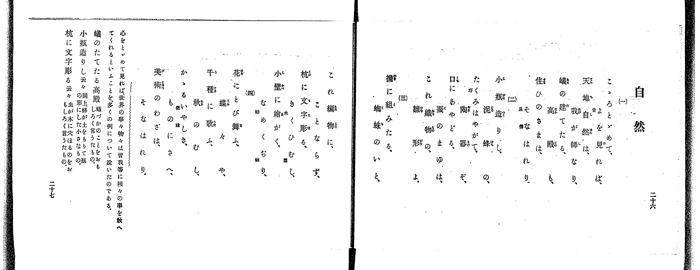

# 自然

> Re:Shōka 使用 AI 協助辨識與重建樂譜，可能會有錯誤。歡迎[回報](https://github.com/TMDLang/reshoka/issues)。

- **鋼琴伴奏版**：<br><audio controls src="shizen.mp3"></audio>
- **NEUTRINO 歌聲合成版**：<br><audio controls src="shizen_neutrino.mp3"></audio>

- 出處：共益商社樂器店《唱歌教科書 教師用 巻三》第二十六～二十九頁（第三學期第一曲）
- NDL Digital Collections PID 854864（https://dl.ndl.go.jp/pid/854864）掃描 P019.jpg、P020.jpg

## 說明

原書資訊與歌詞全文（NDL PID 854864《唱歌教科書 教師用 巻三》第二十六～二十九頁，掃描 P019.jpg、P020.jpg）：
調性與拍號：變ホ調四分ノ四拍子（Eb 大調 4/4 拍），♩=104，「溫和ニ」
註記：單聲部，四節分節歌。第二十六～二十七頁（P019.jpg）為四節歌詞、曲意與語釋；第二十九頁（P020.jpg 左頁，註「二十八ページへつゞく」）為前八小節樂譜（開頭 mf），第二十八頁（P020.jpg 右頁，註「二十九ページのつゞき」）為後八小節樂譜（第九小節轉 f）。第八小節五線譜為附點二分音符加四分休止符（1 - . 0），簡譜漏印附點（印作 1 - 0），以五線譜為準。
原典曲意：「心をとゞめて見れば、世界の事々物々は皆我等に種々の事を敎へてくれるといふことを、多くの例について説いたのである。」
原典語釋：「そなはれり」旁註「具備」；「たくみ」旁註「巧」；「きくひむし」旁註「木蠹」；「なめくぢり」旁註「蛞蝓」；「いやしき」旁註「微賤」；「蟻のたてたる高殿」：蟻づかのことをおもしろく言うたもの；「小瓶造りし云々」：同上、蜂が土をもりて瓶の形にした小さなもの；「杭に文字彫る云々」：虫が木に穴ほるのをおもしろく言うたもの。


## 歌詞

```text
一、
こゝろとゞめて、世を見れば、
天地自然は、我が師なり、
蟻の建てたる、高殿も、
住ひのさまは、そなはれり。

二、
小瓶造りし、泥蜂の、
たくみはやがて、陶器ぞ、
口にあやどる、蚕のまゆは、
これ織物の、雛形よ。

三、
檐に組みたる、蜘蛛のいと、
これ編物に、ことならず、
杭に文字彫る、きくひむし、
小壁に繪がく、なめくぢり。

四、
花にとび舞ふ、蝶々や、
千種に歌ふ、秋のむし、
かゝるいやしき、ものにさへ、
美術のわざは、そなはれり。
```

## ABC

<div class="abc-score" data-abc-src="shizen.abc" aria-label="五線譜載入中"></div>

[下載 ABC 原始檔](shizen.abc)

## TMD 檔案連結

- [主旋律 TMD 檔案](shizen.tmd) [[在 TMD Studio 編輯](https://tmdlang.github.io/Tmd-TS/#tmd=s7IKdvYPcrWy4qpTUCpJTLdSSM7PyUlNLsnMz7PKrsxPzc6ML87Iz05Ugisoy88pzU21yk7MizeOtzA1sTAzQUgW55cWJadaFSdn5OfnxJekVpQk5edno8vHFySmp1oFGBhaImQKivLLUvMS84C6C4oy80pSU8DaEQpSyzJTUkHSxclAq8tSizLTMlNTkNyVWlQMcjXUipKixLzi5KLMApBXEKrSU_OKUq2SMzJzUopS8-KL8_PSEZJp-UW5VsUlRfkFGZnJCOGSjFSgh_MSS0qLUtFFE_MycxNz0EULchLzkJyeX5SZnplnlZuamZWJJVDyi0oy8tOLEgsyKq0yMotLgMqTE3PigSEMDHYtLYUX7auet2xT0NLiUrRVMDQw4bK3VXDV4bIx0TexAxnytH3Xi5lT3--Z9bR14_PZXU-ntj1fsu_ZiqanM1c83TX9cUPX0ykbn63teTZ15vPlE5_N3qEAZD3dsfr5lBUKT7fvfrKj83FD9_M1a57s6nna2_i0de37vfMg7Cc7575c0Ph-TwdIdkfn07U7ns2ZD2Y3PJu96f2eTrAf_Fx8FFyAHixJzFFwhqeeYoUATxcFSPoAmpBRUlJQbKWvn5KjlwfE6fl6WQX6BZkp-jAVnc_6mp_19yuAUgVQLv1xQ2OAgZEBiKnExaWvpWBLLcCloKDwtG8-MCBebG5_saLrRUc7MHRerJz3tHXFs2ntQMeCfIRwPRUCsAe354A-B8YcyE0vVu1_1rAc5Jru3hcz5wNFX6zretw8Gyj-dPbspx1tj5v7gAyg7NO1E4CudE1SeLpkOVBWAZgQFIDCYKN6Hs1caQtMJEDW44aeZ7tWP53U87i5-3FDL9iOFbtfrJgBSirT1r1o3PSyeQVQHdDQ5-sbgBYASaA3Hzc0YffMjmZIaoD5Amjf86ZdEN2QEAT6C5gwnrX0A33xYtW8l-3d7_fMhhsGT04wvwNDbxkkfIDuAroWZufqx82zHjfvedy043EjEC153DTvcWM_0AtQGzt7gWqebugH2bui6cXaOUAzX07rfrlgrUJuGiQUkHywGt3S_s2YlgLdhmTpOpilvQhL9_VgWgqyZedciOCLvZ0KIMshwQdX-2TXlOfbZwGVA814ObPl5W5waHa0vZy_-fmaZU-7FkDi9smeic_WLgKKAE01VNBV0FMwgHpkw0Kg5md7-p_2boDoB6oAsp_snaMAUghV9mT3UmSbnu2aBnQHNKU_bd0BiRVgvAM9_HR_8-OmSY8bV4B82NT4uHHZi2Xdj5t6HjduAMbfkx3Tnk8Fstc92QVMNK3PO1cCyceN65_PanvWMfH52s7Hjaufr1gHFgSraZr0bGofOJ6WgSIJaE5TN8jwxpbHjVsfN04GWzQJaPLTJbNACoC69gEVrAYFMUjNsher1oAZ88HhvvxxYxPIhIYmaJKFeACWmkAeeNw493HjKqCbwJZ1AdU9m94IicynrdufNs0ER9pssEqgoUAr96Oo2b4cSUEvWMGmx00NjxuBZSVC2bM5K14s2ImkchU4sICKF6FZ-mL2vBdzJyOpbHncBPTPdEjyQdi7b92LzUvgyl7M3w32MNCFwICbD_Tzy9Uznq0DORWU9UGySx83AkMKqAYWiI1dj5uaQCY3gZz9YgXQzW1gvUDBdRBjQalu8raXDQtAjmyc_mTXRFBUgc18OqHnyQ6gyxtfzAGq73k6B6hxEkgvSOUyoC6gIU_3LgLHDdDx84FGPW6cCvY4wvxnc9cCFQDLyadrpz_duxrobGQrXswE6gUFHSiVrNzyuHE3ODWsI-h4UGoFxTawagE6EMQC-bppLlgxIqVCEijQNOQkC04lS1Y-nbMBUlOCUgawIOqYCPLkDqCDgB4AeRtcAIJD_enuXfBQB0pAAx7oEIiiJ3vBSQIU8kDv74OYh5HqoA7eBSwwIU5ADXmQEzYvBQc10HdQL8GSI8gUYBIBegDkpZcztwHr6seNoPITbFL_YnAkAGMGqGglxJEvZgHdAnTRvsdNwGADuQgeSj3Pd04BZVSwRS-B5QkwEps6EEEKLJPAip-tmgCKl61AQ4FOgHr-xZwZL2bPBhsNFF-Bau72FWBzV4P9D06FoMAElgHAfAgxEiM5gJWi5SpY-DxdDJRb_XwnMBiBXgeW6EAuWraCuBlYKMIirGsjOCyANm9-0QEskreC3Dx3GyjJAUMHanRvM6hMAjoEWH2BVTxfDkl2SPaDMhMoQQElkDNoIzQBgiwBhvAOqOrn-_peLAT6GGgG0G3TcKYBoFLKmyRQoKClz8UVnJFZlZpnFZafmZzqUGNQUw2yQsHGQssOzKjOTasFM4BNosdNmyG4eS0QdyjUAMlOIF4IxG1g3gog3gTE84F4DxCvAdMgmQkgy0Dm1CiYAqsRXQUTBWMgaQTENeCKxSweSJiCCBCEiIHkjYHqQWprwGph0ACkBmyejyHQ-MbJYFEQDczBYNYKsCnA5AziNTWCxZbBTQemV4iOpklA8f1gVg9UxwYke0DugdpjhGxPD9zMJVBd_WAzusBi0xH2gO0HyfRCTX7cuBAqsw67PcYIOWCCAeLVYBbIfJAM2K2N88FmdiPZA5IHiTVBdQNTHVQGFBJY7DEBya2H2rMKbg8s3DaDefvA5FYkeyBhCBKDsCGyoBAF2YdpDyjdAFPH42ZQumkEKtsOVgxKHSCRfnDqWA8UAaYVoBwk3XSBRVeRn2ZMkFThSjNQnzQB0ww4TiDxBpKZAxUHiUFCCOJDaBiDYh-sFhRuEBlQvONKM6C4gsQgLPZAZsJCDGQaetqEhCQ49oHxCWKBYhRk1jzs9oDTDDRtAtMxsCgH6wLZBjIPYQYklmFxCUvNwGwL9gmwqIXKzMJuDzjNgMIKpGsCEE-FmwmSaQPzwGkTJc2A7IelZrArmhqgMrCcgmpPNXKZswicEoCdESB7PzhdAFMTkPW4eTXYc0BW02poSQRKO0B10DJnEXr6MVUwjANTIMvNgCQIQ6RgIiA-KJkZAZMOTBv25AP1FDDqYUEL8jgsYWHLorCE0A3E4GIJFq3gCMKVfGCJDljKQrMoSDUi-UAKOGR7YNG6DpaBm0ARg8ju2JMPzB5g-Q2xB-wqkMwMsPhuDHt6oTpACXsTWBZ_tEKSD8QEcCiATYMXVFD_QDIWxGzk0IH4BxICoGQHMmsHVnvAyWYnMAHMA2Jg-Q5MEiBjgCUWWARc5DTtBRczIB6omsJa3GAkF3MgBgtBXAYqjECFEkgBRBG-4mYm1Bf7YKEFz9SQTAQpapGKm8a5UB2gwhkkDq-i8BY3yMUAuDoCq0YvBmCVD0gHyDUweyCFETQlQytJ7OkFlspAqXknmAUtBpomgnkQkyCpCmIPqIgBuQdYC0Cqy8ZF-P0DTi-gigikdsbjplYgBapvERkHYsw0ioKulotL104B0g5SALKUuQA)]
- [鋼琴伴奏 TMD 檔案](shizen_piano.tmd) [[在 TMD Studio 編輯](https://tmdlang.github.io/Tmd-TS/#tmd=s7IKdvYPcrWy4qpTUCpJTLdSyC8qychPL0osyKi0ysgsLskvykxOzInPTsxLVOLS0lJ40b7qecu293s6XnbveT5hy5M9W54u7X_e2fF-T6eClhaXoq2CoYEJl72tgqsOl42JvokdyOSn7btezJz6fs-sp60bn8_uejq17fmSfc9WND2dueLprumPG7qeTtn4bG3Ps6kzny-f-Gz2DgUg6-mO1c-nrFB4un33kx2djxu6n69Z82RXz9Pexqeta9_vnQdhP9k59-WCRqBrQLI7Op-u3fFsznwwu-HZ7E1ANymBrPdz8VFwyUzPLEnMUXDOz8lJTS7JzM8rVgjwdFGwMDWxMDMBmpBRUlJQbKWvn5KjlwfE6fl6WQX6BZkp-jAVnc_6mp_19ysEGBhaAuXSHzc0BhgYGYCYSlxcwRmZVal5VgGZiXn5QR4ONQY11VwKQGBjoWUHZlTnptWCGfpaCo-bNkNw81og7lCoAZKdQLwQiNvAvBVAvAmI5wPxHiBeA6ZBMhMUtPTB5tQomCroAqGJgjGQNALiGgVDIGkWDyRMQQQIQsRA8sZA9SC1NWC1MGgAUgM2z8cQaHzjZLAoiH7c1AtmrQCb8rhxJYjX1AgWWwY3_XFTB0RH0ySg-H4wqweqYwOSPSD3QO0xQranB27mEqiufrAZXWCx6Qh7wPaDZHqhJj9uXAiVWYfdHmOE3ONGkK7VYBbIfJAM2K2N88FmdiPZA5IHiTVBdT9ubIHKgEICiz0mILn1UHtWwe2BhdtmMG8fmNyKZA8kDEFiEDZEFhSiIPsw7QGlG2DqeNwMSjeNQGXbwYpBqQMk0g9OHeuBIsC0ApSDpJsusOgq8tOMCZIqXGkG6pMmYJoBxwkk3kAyc6DiIDFICEF8CA1jUOyD1YLCDSIDindcaQYUV5AYhMUeyExYiIFMQ0-bkJAExz4wPkEsUIyCzJqH3R5wmoGmTWA6ftwI0QWyDWQewgxILMPiEpaagdkW7JPHTZ1QmVnY7QGnGVBYgXRNAOKpcDNBMm1gHjhtoqQZkP2w1Ax2RVMDVAaWU1DtqUYucxaBU8Lj5j4gez84XQBTE5D1uHk12HNAVtNqaEkESjtAddAyZxF6-jFVMIwDUyDLzYAkCEOkYCIgPiiZGQGTDkwb9uQD9RQw6mFBC_I4LGFhy6KwhNANxOBiCRat4AjClXxgiQ5YykKzKEg1IvlACjhke2DRug6WgZtAEYPI7tiTD8weYPkNsQfsKpDMDLD4bgx7eqE6QAl7E1gWf7RCkg_EBHAogE2DF1RQ_0AyFsRs5NCB-AcSAqBkBzJrB1Z7wMlmJzABzANiYPkOTBIgY4AlFlgEXOQ07QUXMyAeqJrCWtxgJBdzIAYLQVwGKoxAhRJIAUQRvuJmJtQX-2ChBc_UkEwEKWqRipvGuVAdoMIZJA6vovAWN8jFALg6AqtGLwZglQ9IB8g1MHsghRE0JUMrSezpBZbKQKl5J5gFLQaaJoJ5EJMgqQpiD6iIAbkHWAtAqsvGRfj9A04voIoIpHbG46ZWIAWqbxEZB2LMNIqCrha1GeSD3AwygTaDgEnqRV_Xy_bep607Xs5uhbQfEenFJF4h2iQWWBUBadP4WKAIMC0A2YaxMCmIj4ApC6YEJo4shtBPvrnY1EIpmFo0UYQ9aGbisZ1YE3H5CEklQq8BJDJ07RQg8RHtAxRH4hmh8IxReEAzgTxlLgA)]

## 分析

```text
================================================================================
📊 TMD Song Profile: [ 自然 ]
================================================================================
⏱  Duration:       0:36 (36.9s), 16 measures total
🎼 Key & Tempo:    首調基準 E,, != 104.0 BPM, <4/4>
   - 分析範圍：      由實際發聲的音符與和弦推測調性；播放脈絡另行呈現
🎤 人聲音域:    A#3 (MIDI 58) – D#5 (MIDI 75) [跨度: 17 個半音 / 1.4 個八度, 難度: challenging]
   - 最低音:  A#3 in [Shizen #1 @ m.2, 0:03]
   - 最高音: D#5 in [Shizen #1 @ m.9, 0:19]
   - 適合: soprano, mezzo-soprano, contralto, tenor, baritone, bass
🏛  結構:      Shizen (36.9s)
⚡ 編曲密度:        Peak 1 軌道同時演奏
🗝  調性診斷：       D# 大調（純淨自然大調，未偵測到可信轉調）
   - 風格氣質:    純淨自然大調（陽光明朗、易唱易記，無明顯調外色彩）
   - 轉調歷程:    全曲維持單一推測調性（未偵測到可信轉調）
   - 核心骨幹音:  A#, D#, F, C, G
   - 調性數值:    D# 大調 [相關度: 0.88, 穩定度: Moderate, 自然音純度: 100.0%]
   - 候選調性 (K-S): D# 大調 (0.88), A# 大調 (0.81), A# 小調 (0.56)
   - 五度圈歷程:   -3
   - 各段落調性細節:
     • [Shizen #1]: D# 大調 (r: 0.88, 自然音純度: 100.0%)

  [ 五度圈游移軌跡 ]
               C  
         F            G  
      Bb               D  
     [Eb]*              A  
         Ab           E  
            Db       B  
               F# 
     (* = active key center)

  [ 十二半音累積音高分佈 ]
     C  : ███████                   10.8%
     C# :                            0.0%
     D  : █                          1.7%
     D# : ██████████████████        25.8%
     E  :                            0.0%
     F  : █████████                 12.5%
     F# :                            0.0%
     G  : ██████                     9.2%
     G# : ███                        5.0%
     A  :                            0.0%
     A# : ████████████████████████  35.0%
     B  :                            0.0%
--------------------------------------------------------------------------------
Assignment 軌道音域：
  - Voice         : A#3 – D#5 (17 個半音 / 1.4 個八度, 53 個音符)
================================================================================
```


## 原書掃描頁




