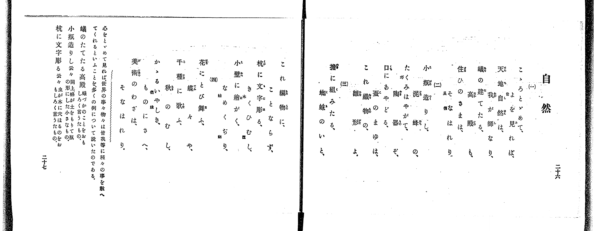

# 自然

> Re:Shoka 使用 AI 協助辨識與重建樂譜，可能會有錯誤。歡迎回報。

<audio controls src="shizen.mp3"></audio>

- 出處：共益商社樂器店《唱歌教科書 教師用 巻三》第二十六～二十九頁（第三學期第一曲）
- NDL Digital Collections PID 854864（https://dl.ndl.go.jp/pid/854864）掃描 P019.jpg、P020.jpg

## 說明

原書資訊與歌詞全文（NDL PID 854864《唱歌教科書 教師用 巻三》第二十六～二十九頁，掃描 P019.jpg、P020.jpg）：
調性與拍號：變ホ調四分ノ四拍子（Eb 大調 4/4 拍），♩=104，「溫和ニ」
註記：單聲部，四節分節歌。第二十六～二十七頁（P019.jpg）為四節歌詞、曲意與語釋；第二十九頁（P020.jpg 左頁，註「二十八ページへつゞく」）為前八小節樂譜（開頭 mf），第二十八頁（P020.jpg 右頁，註「二十九ページのつゞき」）為後八小節樂譜（第九小節轉 f）。第八小節五線譜為附點二分音符加四分休止符（1 - . 0），簡譜漏印附點（印作 1 - 0），以五線譜為準。
原典曲意：「心をとゞめて見れば、世界の事々物々は皆我等に種々の事を敎へてくれるといふことを、多くの例について説いたのである。」
原典語釋：「そなはれり」旁註「具備」；「たくみ」旁註「巧」；「きくひむし」旁註「木蠹」；「なめくぢり」旁註「蛞蝓」；「いやしき」旁註「微賤」；「蟻のたてたる高殿」：蟻づかのことをおもしろく言うたもの；「小瓶造りし云々」：同上、蜂が土をもりて瓶の形にした小さなもの；「杭に文字彫る云々」：虫が木に穴ほるのをおもしろく言うたもの。

## 歌詞

```text
一、
こゝろとゞめて、世を見れば、
天地自然は、我が師なり、
蟻の建てたる、高殿も、
住ひのさまは、そなはれり。

二、
小瓶造りし、泥蜂の、
たくみはやがて、陶器ぞ、
口にあやどる、蚕のまゆは、
これ織物の、雛形よ。

三、
檐に組みたる、蜘蛛のいと、
これ編物に、ことならず、
杭に文字彫る、きくひむし、
小壁に繪がく、なめくぢり。

四、
花にとび舞ふ、蝶々や、
千種に歌ふ、秋のむし、
かゝるいやしき、ものにさへ、
美術のわざは、そなはれり。
```

## ABC

```abc
X:1
T:自然
M:4/4
L:1/16
Q:1/4=104
K:Eb
V:V1 name="Voice" snm="Voi"
[V:V1]
!mf! B6 A2 G4 F4 | E4 C4 B,8 | E6 F2 G2 B2 A2 G2 | F12 z4 |
B6 A2 G4 F4 | E4 C4 B,8 | E6 F2 G2 A2 F4 | E12 z4 |
!f! B6 B2 e4 B4 | c4 c4 B8 | c6 B2 A2 G2 F2 E2 | B12 z4 |
B6 B2 e4 B4 | c4 d4 e8 | G6 A2 B4 B4 | E12 z4 |
```

## TMD 檔案連結

- [主旋律 TMD 檔案](shizen.tmd) [[在 TMD Studio 編輯](https://tmdlang.github.io/Tmd-TS/#tmd=s7IKdvYPcrWy4qpTUCpJTLdSSM7PyUlNLsnMz7PKrsxPzc6ML87Iz05Ugisoy88pzU21yk7MizeOtzA1sTAzQUgW55cWJadaFSdn5OfnxJekVpQk5edno8vHFySmp1oFGBhaImQKivLLUvMS84C6C4oy80pSU8DaEQpSyzJTUkHSxclAq8tSizLTMlNTkNyVWlQMcjXUipKixLzi5KLMApBXEKrSU_OKUq2SMzJzUopS8-KL8_PSEZJp-UW5VsUlRfkFGZnJCOGSjFSgh_MSS0qLUtFFE_MycxNz0EULchLzgE7X0lJ40b7qecs2BS0tLkVbBUMDEy57WwVXHS4bE30TO5Cmp-27Xsyc-n7PrKetG5_P7no6te35kn3PVjQ9nbni6a7pjxu6nk7Z-Gxtz7OpM58vn_hs9g4FIOvpjtXPp6xQeLp995MdnY8bup-vWfNkV8_T3sanrWvf750HYT_ZOfflgsb3ezpAsjs6n67d8WzOfDC74dnsTe_3dILd7Ofio-CSmZ5Zkpij4AyP-WKFAE8XBUjcAk3IKCkpKLbS10_J0csD4vR8vawC_YLMFH2Yis5nfc3P-vsVQDEKlEt_3NAYYGBkAGIqcXHpaynYUgtwKSgoPO2bDwyIF5vbX6zoetHRDgydFyvnPW1d8WxaO9CxIB8hXE-FAOzB7Tmgz4ExB3LTi1X7nzUsB7mmu_fFzPlA0Rfruh43zwaKP509-2lH2-PmPiADKPt07QSgK12TFJ4uWQ6UVQAmBAWgMNionkczV9oCEwmQ9bih59mu1U8n9Txu7n7c0Au2Y8XuFytmgJLKtHUvGje9bF4BVAc09Pn6BqAFQBLozccNTdg9s6MZkhpgvgDa97xpF0Q3JASB_gImjGct_UBfvFg172V79_s9s-GGwZMTzO_A0FsGCR-gu4Cuhdm5-nHzrMfNex437XjcCERLHjfNe9zYD_QC1MbOXqCapxv6QfauaHqxdg7QzJfTul8uWKuQmwYJBSQfrEa3tH8zpqVAtyFZug5maS_C0n09mJaCbNk5FyL4Ym-nAshySPDB1T7ZNeX59llA5UAzXs5sebkbHJodbS_nb36-ZtnTrgWQuH2yZ-KztYuAIkBTDRV0FfQUDKAe2bAQqPnZnv6nvRsg-oEqgOwne-cogBRClT3ZvRTZpme7pgHdAU3pT1t3QGIFGO9ADz_d3_y4adLjxhUgHzY1Pm5c9mJZ9-OmnseNG4Dx92THtOdTgex1T3YBE03r886VQPJx4_rns9qedUx8vrbzcePq5yvWgQXBapomPZvaB46nZaBIAprT1A0yvLHlcePWx42TwRZNApr8dMkskAKgrn1ABatBQQxSs-zFqjVgxnxwuC9_3NgEMqGhCZpkIR6ApSaQBx43zn3cuAroJrBlXUB1z6Y3QiLzaev2p00zwZE2G6wSaCjQyv0oarYvR1LQC1aw6XFTw-NGYFmJUPZszooXC3YiqVwFDiyg4kVolr6YPe_F3MlIKlseNwH9Mx2SfBD27lv3YvMSuLIX83eDPQx0ITDg5gP9_HL1jGfrQE4FZX2Q7NLHjcCQAqqBBWJj1-OmJpDJTSBnv1gBdHMbWC9QcB3EWFCqm7ztZcMCkCMbpz_ZNREUVWAzn07oebID6PLGF3OA6nuezgFqnATSC1K5DKgLaMjTvYvAcQN0_HygUY8bp4I9jjD_2dy1QAXAcvLp2ulP964GOhvZihczgXpBQQdKJSu3PG7cDU4N6wg6HpRaQbENrFqADgSxQL5umgtWjEipkAQKNA05yYJTyZKVT-dsgNSUoJQBLIg6JoI8uQPoIKAHQN4GF4DgUH-6exc81IES0IAHOgSi6MlecJIAhTzQ-_sg5mGkOqiDdwELTIgTUEMe5ITNS8FBDfQd1Euw5AgyBZhEgB4AeenlzG3AuvpxI6j8BJvUvxgcCcCYASpaCXHki1lAtwBdtO9xEzDYQC6Ch1LP851TQBkVbNFLYHkCjMSmDkSQAssksOJnqyaA4mUr0FCgE6CefzFnxovZs8FGA8VXoJq7fQXY3NVg_4NTISgwgWUAMB9CjMRIDmClaLkKFj5PFwPlVj_fCQxGoNeBJTqQi5atIG4GFoqwCOvaCA4LoM2bX3QAi-StIDfP3QZKcsDQgRrd2wwqk4AOAVZfYBXPl0OSHZL9oMwESlBACeQM2ghNgCBLgCG8A6r6-b6-FwuBPgaaAXTbNJxpAKiU8iYJFCho6XNxBWdkVqXmWYXlZyanOtQY1ChUg-xQsDE007IDs6pz02rBDGCj6HHTZghuXgvEHQo1QLITiBcCcRuYtwKINwHxfCDeA8RrwDRIZgLIOpA5NQqmwIoEBk2A2BjKNoLSNeCqBgTN4qEMUxgDBhFqYDpBpoBMhplYAzcPHRrAzID7C-j6x80gfzUC_bcd5N4mkOtBIv1g168HigD9ApSD-KsLLLqKHn4CmYZpCn4_VSPH2SKwS4HNOSB7P9jdQN8CWY-bV4N9CmQ1rYbGJMhvQHXQOFuE3X8gtmEcEgfiNDOYB9FkEN6DycBkYQEF8h7IY6jW4PYe2Fs7gQ6cB8STwE4GeWQrVAQcZU17wdEE4oGSIZ7oIuAdcygNV4LwDyySQRDkF5hmhCGEo6uWi0vXTgGSDRWALGUuAA)]

## 分析

```text
================================================================================
📊 TMD Song Profile: [ 自然 ]
================================================================================
⏱  Duration:       0:36 (36.9s), 16 measures total
🎼 Key & Tempo:    首調基準 E,, != 104.0 BPM, <4/4>
   - 分析範圍：      由實際發聲的音符與和弦推測調性；播放脈絡另行呈現
🎤 人聲音域:    A#3 (MIDI 58) – D#5 (MIDI 75) [跨度: 17 個半音 / 1.4 個八度, 難度: challenging]
   - 最低音:  A#3 in [Shizen #1 @ m.2, 0:03]
   - 最高音: D#5 in [Shizen #1 @ m.9, 0:19]
   - 適合: soprano, mezzo-soprano, contralto, tenor, baritone, bass
🏛  結構:      Shizen (36.9s)
⚡ 編曲密度:        Peak 1 軌道同時演奏
🗝  調性診斷：       D# 大調（純淨自然大調，未偵測到可信轉調）
   - 風格氣質:    純淨自然大調（陽光明朗、易唱易記，無明顯調外色彩）
   - 轉調歷程:    全曲維持單一推測調性（未偵測到可信轉調）
   - 核心骨幹音:  A#, D#, F, C, G
   - 調性數值:    D# 大調 [相關度: 0.88, 穩定度: Moderate, 自然音純度: 100.0%]
   - 候選調性 (K-S): D# 大調 (0.88), A# 大調 (0.81), A# 小調 (0.56)
   - 五度圈歷程:   -3
   - 各段落調性細節:
     • [Shizen #1]: D# 大調 (r: 0.88, 自然音純度: 100.0%)

  [ 五度圈游移軌跡 ]
               C  
         F            G  
      Bb               D  
     [Eb]*              A  
         Ab           E  
            Db       B  
               F# 
     (* = active key center)

  [ 十二半音累積音高分佈 ]
     C  : ███████                   10.8%
     C# :                            0.0%
     D  : █                          1.7%
     D# : ██████████████████        25.8%
     E  :                            0.0%
     F  : █████████                 12.5%
     F# :                            0.0%
     G  : ██████                     9.2%
     G# : ███                        5.0%
     A  :                            0.0%
     A# : ████████████████████████  35.0%
     B  :                            0.0%
--------------------------------------------------------------------------------
Assignment 軌道音域：
  - Voice         : A#3 – D#5 (17 個半音 / 1.4 個八度, 53 個音符)
================================================================================
```


## 原書掃描頁




