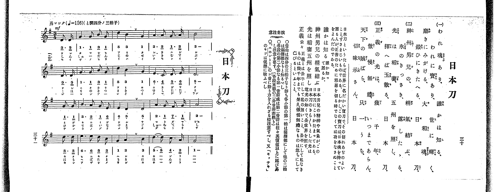

# 和氣清麿

> Re:Shoka 使用 AI 協助辨識與重建樂譜，可能會有錯誤。歡迎回報。

<audio controls src="wake_no_kiyomaro.mp3"></audio>

- 出處：共益商社樂器店《唱歌教科書 教師用 巻三》第三十二～三十三頁（第三學期第三曲）
- NDL Digital Collections PID 854864（https://dl.ndl.go.jp/pid/854864）掃描 P022.jpg

## 說明

原書資訊與歌詞全文（NDL PID 854864《唱歌教科書 教師用 巻三》第三十二～三十三頁，掃描 P022.jpg）：
調性與拍號：ヘ調八分ノ六拍子（F 大調 6/8 拍），♪=116（八分音符=116，折合四分音符 ♩=58），「溫和ニ」，弱起一拍（八分音符）
註記：單聲部，二節分節歌，開頭 mf。第八小節第三拍為 ♮4（B♮4，4'），第四、五拍「5」附延長記號（𝄐）；第十二小節末音「1」附延長記號（𝄐）。
原典演奏注意：復習前出〈螢〉作為預習曲；第二段末節（第八小節）稍放緩速度，第三段再返原速度歌唱。
原典曲意：「これは、清麿公が、宇佐八幡の神の御つげをうけて、無道の僧道鏡をしりぞけ、天子の御位を清め奉った大勳功を稱賛したのである。」
原典語釋：「おもきみこと云々」：天皇陛下の重大なみことのりを御受けして；「うすき氷云々」：詩經に「戰々兢々如臨深淵如履薄氷」とあり、危くして一つちがへば命までも失ふ思ひ；「君のみむね」：天皇陛下のおぼしめし。

## 歌詞

```text
一、
おもきみことを、身に負持ちて、
うすきこほりを、ふむおもひにも、
たわまぬこゝろ、をゝしや清し。

二、
君のみむねに、などそむくべき、
神のみつげを、など矯むべきと、
まげざるこゝろ、きよしやをゝし。
```

## ABC

```abc
X:1
T:和氣清麿
M:6/8
L:1/16
Q:3/8=39
K:F
V:V1 name="Voice" snm="Voi"
[V:V1]
!mf! z2 z2 z2 z2 z2 C2 | F4 F2 A2 G2 F2 | c6 c4 c2 | d4 d2 d2 c2 B2 |
B4 B2 A4 F2 | F4 C2 C4 C2 | A4 G2 F4 F2 | G4 G2 A4 d2 |
c4 =B2 c4 C2 | F4 F2 A2 G2 F2 | c6 c4 c2 | d4 d2 d4 c2 |
c4 c2 F4 z2 | !mf! z2 z2 z2 z2 z2 C2 | F4 F2 A2 G2 F2 | c6 c4 c2 |
d4 d2 d2 c2 B2 | B4 B2 A4 F2 | F4 C2 C4 C2 | A4 G2 F4 F2 |
G4 G2 A4 d2 | c4 =B2 c4 C2 | F4 F2 A2 G2 F2 | c6 c4 c2 |
d4 d2 d4 c2 | c4 c2 F4 z2 |
```

## TMD 檔案連結

- [主旋律 TMD 檔案](wake_no_kiyomaro.tmd) [[在 TMD Studio 編輯](https://tmdlang.github.io/Tmd-TS/#tmd=s7IKdvYPcrWy4qpTUCpJTLdSSM7PyUlNLsnMz7PKrsxPzc6ML87Iz05Ugisoy88pzU21yk7MizeOtzA1sTAzQUgW55cWJadaFSdn5OfnxJekVpQk5edno8vHFySmp1oFGBgZIWQKivLLUvMS84C6C4oy80pSU8DaEQpSyzJTUkHSxclAq8tSizLTMlNTkNyVWlQMcjXUipKixLzi5KLMApBXEKrSU_OKgDYklhRl5pdkJiMk0vKLcq2KS4ryCzKQhUsyUoGezcgsLskvqkQXzswtADojMUeJS0tL4emknmcbFj_b0fpy134FLS0uRVsFUwsue1sFNy4bM30LO5Dep-27Xsyc-n7PrKetG5_P7no6te35kn3PVjQ9nbni6a7pjxu6nk7Z-Gxtz7OpM58vn_hs9g4FIOvpjtXPp6xQeLp995MdnY8bup-vWQNkPO1tfLKr5_3eeVD2js6XCxrf7-mAyq7d8WzOfAj72exN7_d0gp3u5-Kj4JKZnlmSmKPgDI_nYoUATxcFSEwCTcgoKSkottLXT8nRywPi9Hy9rAL9gswUfZiKzmd9zc_6-xVA8QeUS1fi4tLXUrClFuBSUFB42jcf6PsXm9tfrOh60dEODJIXK-c9bV3xbFo70IUgbyCcTIVQ60HzEdCPwDgCOeTFqv3PGpaDnNDd-2LmfKDo4-YZQMGnraufdrQ9bu572roWKPV07QSgu9wUni5ZDpRUAEa3AlAUbEzPo5mrbA0NzYDyEE0v529-vmYZRKjnWdeMpxM6ns6eDZdQeDRzpa2pBUTv44aeZ7tWA1PW4-buxw1AA3ue7tn4Yuv2JzsawOajGAnUAnbyit0vVswApbFp6140bnrZvAKoDejr5-sbgEqBJDCogCIvp3W_XLBWITftcUMTMHBABm3oB8pCE0137_OmXUC3rAMlCScI3WOiDnEWSP3s2Y8bgIE5BagS6EpToOtezmx5unvby6nbgdaDw6rjw9wWYLgAdcwG6QCHPcSSZ3NWA90M1GeITx_QZdDE8LR1x7M9U54u7X-2ecWzln6Q5_atfL5_0tPOXmCWetzQ8WLeoscNnU_2zgG6-uWCCUApcLIH2Qu09Nm6rUAbgfZCMgjcr0A7nq_ofTZl3_PtK182zH-6CxiGIM-BAmDd1qdtvS_2TwHaDpECBhswnaG6afYmiGuAPnncOPlxE5BcDwwWSCHwtHXN40ZgFDY-Xdf-ZO8EkK07Fz5uXPd86Twg-XQfkL3kceOkx02THje2PW6c-LhxGVDx85aFL4FGARU0LwcyXvYvBCuY_rip63EjUONEkIFLVgJTHMSQJ3t7gQqANj5uany6tPNx4-LHjfOB6fBp9-anXfOBUs9XbHyxeTbIhMb5QC2PG5c_bmx63ARMT03AwEd45sWqeS_bu2Ge6Xrc1PS4sfdx436QxxpXPNkFtLgVnAZnAa1_Pqv95czZT3Z0A0182d4LtO9x4yq4YpA1QOc2TQK672k_0GKg34AkMHSBiQZoONC3M4GGP9uwHdnYFytXPt8G1L4alOo7NgDFn7YCY7X16bKmF-0rnm3f-Gz7ViD76calL6a1APUCdYHtAnqmCxQovRsfN_ZDLALmD3DgAoMYaN2Ox40bnk7c-7hxH8jzTU1PlwBVbn3WMPdxIyiNAK17OgEYQMCg2f-4CahxLVZvgsKkcQ84JhpBJDAhgAIPZFVDI4iFGWigmGtofLFrNdBTLzYteNYD1Ah0EiiaIRqgAQFWvRsSZEA5oOPA7oAYtwkUIkAGTA8wToG-BHoFmLqASW7u4yZgBmwE6QSyQa5rASUGJAfuAqVBcDyj-RIU0kDLgPG28nEj0BygINDknSAHQTRAUirYO7CUCtPwfP56sAawaqBPYa4DuguYWqeB0hey64CKmjogrkO4FJKVKK8xoEBBS5-LKzwxO9Uv3zuzMj83sSjfKiw_MznVocagRqEaZJeCjYWWHZhRnZtWC2YAqy4NSKGqqfC4aZVCjcLj5kVA1logPR9IbwbSHWDRTUC8BywK4nVDeEAdENFJMJ3NjUDchmzoMpDLQHbVKBjAoWk8kGuooAvExgpGQLJGwRTI0wWTpkCeGZA2A0JTBRMgzwTIMwGqBKmvgTn8cdNOqCuArgW6FOSC2UAMchPItVPBIgugrgS5bQ9YZBLU_YuQXQlstMBcCXIW0H1ABKZrwPaC3Ai2HcgC8UBiZlBXm6hDnA1UC3db83ogngfEPVA3gt0HDk9Q2G6ChWnTdiC9BOwHkMgKqOrtqM4hFEoQHkQUpN4A6JJaLi5dOwXUFKGAVUSZCwA)]

## 分析

```text
================================================================================
📊 TMD Song Profile: [ 和氣清麿 ]
================================================================================
⏱  Duration:       1:20 (80.7s), 26 measures total
🎼 Key & Tempo:    首調基準 F, != 58.0 BPM, <6/8>
   - 分析範圍：      由實際發聲的音符與和弦推測調性；播放脈絡另行呈現
🎤 人聲音域:    C4 (MIDI 60) – D5 (MIDI 74) [跨度: 14 個半音 / 1.2 個八度, 難度: moderate]
   - 最低音:  C4 in [WakeNoKiyomaro #1 @ m.1, 0:02]
   - 最高音: D5 in [WakeNoKiyomaro #1 @ m.4, 0:09]
   - 適合: soprano, mezzo-soprano, contralto, tenor, baritone, bass
🏛  結構:      WakeNoKiyomaro (40.3s) -> WakeNoKiyomaro (40.3s)
⚡ 編曲密度:        Peak 1 軌道同時演奏
🗝  調性診斷：       F 大調（純淨自然大調，未偵測到可信轉調）
   - 風格氣質:    純淨自然大調（陽光明朗、易唱易記，無明顯調外色彩）
   - 轉調歷程:    全曲維持單一推測調性（未偵測到可信轉調）
   - 核心骨幹音:  C, F, D, A, G
   - 調性數值:    F 大調 [相關度: 0.84, 穩定度: Moderate, 自然音純度: 98.6%]
   - 候選調性 (K-S): F 大調 (0.84), C 大調 (0.77), A 小調 (0.56)
   - 五度圈歷程:   -1 -> -1
   - 各段落調性細節:
     • [WakeNoKiyomaro #1]: F 大調 (r: 0.84, 自然音純度: 98.6%, 調外音: B)
     • [WakeNoKiyomaro #2]: F 大調 (r: 0.84, 自然音純度: 98.6%, 調外音: B)

  [ 五度圈游移軌跡 ]
               C  
        [F ]*          G  
      Bb               D  
      Eb               A  
         Ab           E  
            Db       B  
               F# 
     (* = active key center)

  [ 十二半音累積音高分佈 ]
     C  : ████████████████████████  37.5%
     C# :                            0.0%
     D  : █████████                 13.9%
     D# :                            0.0%
     E  :                            0.0%
     F  : ██████████████            22.2%
     F# :                            0.0%
     G  : █████                      8.3%
     G# :                            0.0%
     A  : ███████                   11.1%
     A# : ████                       5.6%
     B  : █                          1.4%
--------------------------------------------------------------------------------
Assignment 軌道音域：
  - Voice         : C4 – D5 (14 個半音 / 1.2 個八度, 98 個音符)
================================================================================
```


## 原書掃描頁




