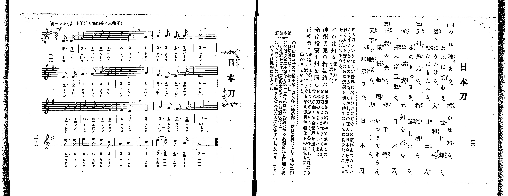

# 和氣清麿

> Re:Shōka 使用 AI 協助辨識與重建樂譜，可能會有錯誤。歡迎回報。

- **鋼琴伴奏版**：<br><audio controls src="wake_no_kiyomaro.mp3"></audio>
- **NEUTRINO 歌聲合成版**：<br><audio controls src="wake_no_kiyomaro_neutrino.mp3"></audio>

- 出處：共益商社樂器店《唱歌教科書 教師用 巻三》第三十二～三十三頁（第三學期第三曲）
- NDL Digital Collections PID 854864（https://dl.ndl.go.jp/pid/854864）掃描 P022.jpg

## 說明

原書資訊與歌詞全文（NDL PID 854864《唱歌教科書 教師用 巻三》第三十二～三十三頁，掃描 P022.jpg）：
調性與拍號：ヘ調八分ノ六拍子（F 大調 6/8 拍），♪=116（八分音符=116，折合四分音符 ♩=58），「溫和ニ」，弱起一拍（八分音符）
註記：單聲部，二節分節歌，開頭 mf。第八小節第三拍為 ♮4（B♮4，4'），第四、五拍「5」附延長記號（𝄐）；第十二小節末音「1」附延長記號（𝄐）。
原典演奏注意：復習前出〈螢〉作為預習曲；第二段末節（第八小節）稍放緩速度，第三段再返原速度歌唱。
原典曲意：「これは、清麿公が、宇佐八幡の神の御つげをうけて、無道の僧道鏡をしりぞけ、天子の御位を清め奉った大勳功を稱賛したのである。」
原典語釋：「おもきみこと云々」：天皇陛下の重大なみことのりを御受けして；「うすき氷云々」：詩經に「戰々兢々如臨深淵如履薄氷」とあり、危くして一つちがへば命までも失ふ思ひ；「君のみむね」：天皇陛下のおぼしめし。


## 歌詞

```text
一、
おもきみことを、身に負持ちて、
うすきこほりを、ふむおもひにも、
たわまぬこゝろ、をゝしや清し。

二、
君のみむねに、などそむくべき、
神のみつげを、など矯むべきと、
まげざるこゝろ、きよしやをゝし。
```

## ABC

<div class="abc-score" data-abc-src="wake_no_kiyomaro.abc" aria-label="五線譜載入中"></div>

[下載 ABC 原始檔](wake_no_kiyomaro.abc)

## TMD 檔案連結

- [主旋律 TMD 檔案](wake_no_kiyomaro.tmd) [[在 TMD Studio 編輯](https://tmdlang.github.io/Tmd-TS/#tmd=s7IKdvYPcrWy4qpTUCpJTLdSSM7PyUlNLsnMz7PKrsxPzc6ML87Iz05Ugisoy88pzU21yk7MizeOtzA1sTAzQUgW55cWJadaFSdn5OfnxJekVpQk5edno8vHFySmp1oFGBgZIWQKivLLUvMS84C6C4oy80pSU8DaEQpSyzJTUkHSxclAq8tSizLTMlNTkNyVWlQMcjXUipKixLzi5KLMApBXEKrSU_OKgDYklhRl5pdkJiMk0vKLcq2KS4ryCzKQhUsyUoGezcgsLskvqkQXzswtADojMQchnl-UmZ6ZZ5WbmpmVicX7-UUlGfnpRYkFGZVQMzOTE3PigWEJDGAtLYWnk3qebVj8bEfry137FbS0uBRtFUwtuOxtFdy4bMz0LexABj1t3_Vi5tT3e2Y9bd34fHbX06ltz5fse7ai6enMFU93TX_c0PV0ysZna3ueTZ35fPnEZ7N3KABZT3esfj5lhcLT7buf7Oh83ND9fM0aIONpb-OTXT3v986Dsnd0vlzQ-H5PB1R27Y5nc-ZD2M9mb3q_pxPsDz8XHwUXoCdLEnMUnOFppVghwNNFAZIagCZklJQUFFvp66fk6OUBcXq-XlaBfkFmij5MReezvuZn_f0KoDQAlEtX4uLS11KwpRbgUlBQeNo3H-j7F5vbX6zoetHRDgySFyvnPW1d8WxaO9CFIG8gnEyFUOtB8xHQj8A4Ajnkxar9zxqWg5zQ3fti5nyg6OPmGUDBp62rn3a0PW7ue9q6Fij1dO0EoLvcFJ4uWQ6UVABGtwJQFGxMz6OZq2wNDc2A8hBNL-dvfr5mGUSo51nXjKcTOp7Ong2XUHg0c6WtqQVE7-OGnme7VgNT1uPm7scNQAN7nu7Z-GLr9ic7GsDmoxgJ1AJ28ordL1bMAKWxaeteNG562bwCqA3o6-frG4BKgSQwqIAiL6d1v1ywViE37XFDEzBwQAZt6AfKQhNNd-_zpl1At6wDJQknCN1jog5xFkj97NmPG4CBOQWoEuhKU6DrXs5sebp728up24HWg8Oq48PcFmC4AHXMBukAhz3EkmdzVgPdDNRniE8f0GXQxPC0dcezPVOeLu1_tnnFs5Z-kOf2rXy-f9LTzl5glnrc0PFi3qLHDZ1P9s4BuvrlgglAKXCyB9kLtPTZuq1AG4H2QjII3K9AO56v6H02Zd_z7StfNsx_ugsYhiDPgQJg3danbb0v9k8B2g6RAgYbMJ2humn2JohrgD553Dj5cROQXA8MFkgh8LR1zeNGYBQ2Pl3X_mTvBJCtOxc-blz3fOk8IPl0H5C95HHjpMdNkx43tj1unPi4cRlQ8fOWhS-BRgEVNC8HMl72LwQrmP64qetxI1DjRJCBS1YCUxzEkCd7e4EKgDY-bmp8urTzcePix43zgenwaffmp13zgVLPV2x8sXk2yITG-UAtjxuXP25setwETE9NwMBHeObFqnkv27thnul63NT0uLH3ceN-kMcaVzzZBbS4FZwGZwGtfz6r_eXM2U92dANNfNneC7TvceMquGKQNUDnNk0Cuu9pP9BioN-AJDB0gYkGaDjQtzOBhj_bsB3Z2BcrVz7fBtS-GpTqOzYAxZ-2AmO19emyphftK55t3_hs-1Yg--nGpS-mtQD1AnWB7QJ6pgsUKL0bHzf2QywC5g9w4AKDGGjdjseNG55O3Pu4cR_I801NT5cAVW591jD3cSMojQCtezoBGEDAoNn_uAmocS1Wb4LCpHEPOCYaQSQwIYACD2RVQyOIhRlooJhraHyxazXQUy82LXjWA9QIdBIomiEaoAEBVr0bEmRAOaDjwO6AGLcJFCJABkwPME6BvgR6BZi6gElu7uMmYAZsBOkEskGuawElBiQH7gKlQXA8o_kSFNJAy4DxtvJxI9AcoCDQ5J0gB0E0QFIq2DuwlArT8Hz-erAGsGqgT2GuA7oLmFqngdIXsuuAipo6IK5DuBSSlSivMaBAQUufiys8MTvVL987szI_N7Eo3yosPzM51aHGoKYaZJWCjYWWHZhRnZtWC2YAay4NSJmqqfC4aZVCjcLj5kVA1logPR9IbwbSHWDRTUC8BywK4nVDeEAdENFJMJ3NjUDchmzoMpDDQHbVKBjAoWk8kGuooAvExgpGQLJGwRTI0wWTpkCeGZA2A0JTBRMgzwTIMwGqBKmvARvmY1ijEA-HwMQCckBTE1AFMLCBeD8QTwbiFWDxSWCzQRAkAxRpXA3ldYHJTUi6FwLxMjCrDWaXEapdvWAT9oPVrIPY1dQApNcimQwxHRygjSuhvLkgEqgSJNYPFtkJNg3E6obaBYyQx01AYXDoAmMBGAOgkJ0NxKCwBsXCVLDIAmjog8J8D1hkEjReFiGHPrAtBgt9UHADwx2IwHQNODxBYQ8OVSALxAOJmUFjw0QdEh1AtfAwB-ZYqG8g7p4M9s1usM-6oCENzMDg8GyAhjAkZHXBKjeBxVbDQxuYnOBhDAlTSKgiYmoJmA30HNRsRJiCdENsgZi9Ex77K8CsfUhh2rweiOcBcQ80bMHhCk7foLQOTgCg0G3aDqSXgMMeJLICqno7ajASSrUQHkQUpN4AOQSbIHG_D4jXIIXhZIjfm8DhCvQrLN0CiwogqwXqN5BoBzSUpgNJeNyAww-ifhpQTTcuk5HMQDIZyT5kk2u5uHTtFFALFQWgiDIXAA)]
- [鋼琴伴奏 TMD 檔案](wake_no_kiyomaro_piano.tmd) [[在 TMD Studio 編輯](https://tmdlang.github.io/Tmd-TS/#tmd=s7IKdvYPcrWy4qpTUCpJTLdSyC8qychPL0osyKi0ysgsLskvykxOzInPTsxLVOLS0lJ4Oqnn2YbFz3a0vty1__2ejpfde55P2PJkz5anS_ufd3a839OpoKXFpWirYGrBZW-r4MZlY6ZvYQcy_Wn7rhczp77fM-tp68bns7ueTm17vmTfsxVNT2eueLpr-uOGrqdTNj5b2_Ns6sznyyc-m71DAch6umP18ykrFJ5u3_1kR-fjhu7na9YAGU97G5_s6nm_dx6UvaPz5YJGoFugsmt3PJszH8J-NnsT0EVKIOv9XHwUXDLTM0sScxSc83NyUpNLMvPzihUCPF0ULExNLMxMgCZklJQUFFvp66fk6OUBcXq-XlaBfkFmij5MReezvuZn_f0KAQZGRkC5dCUurvDE7FS_fO_MyvzcxKJ8q4DMxLz8IA-HGoOaai4FILCx0LIDM6pz02rBDH0tBY2neza-2LpdU-Fx0yqFGoXHzYuArLVAej6Q3gykO8Cim4B4D1gUxOuG8IA6IKKTYDqbG4G4DdnQZQpa-mC7ahQM4NA0Hsg1VNAFYmMFIyBZo2AK5OmCSVMgzwxImwGhqYIJkGcC5JkAVYLU14AN8zGsUYiHw8eNXSAHNDUBVTxu7AXi_UA8GYhXgMUngc0GQZAMUKRxNZTXBSY3IeleCMTLwKw2mF1GqHb1gk3YD1azDmJXUwOQXotkMsR0cIA2roTy5oJIoEqQWD9YZCfYNBCrG2oXMEIeNwGFwaELjAVgDIBCdjYQg8IaFAtTwSILoKEPCvM9YJFJ0HhZhBz6-xGhDwpuYLgDEZiuAYcnKOzBoQpkgXggMTNobJioQ6IDqBYe5o8bZ0J9A3H3ZLBvdoN91gUN6ceNW8Hh2QANYUjI6oJVbgKLrYaHNjA5wcMYEqaQUEXE1BIwG-g5qNmIMAXphtgCMXsnPPZXgFn7kMK0eT0QzwPiHmjYgsMVnL5BaR2cAECh27QdSC8Bhz1IZAVU9XbUYCSUaiE8iChIvQFyCDZB4n4fEK9BCsPJEL83gcMV6FdYun3cOB3IaoH6DSTaAQ2l6UASHjfg8IOonwZU043LZCQzkExGsg_Z5FrsZYoPtjIFGMov-rpetvc-bd3xcnYrpBxGCjZwyos2jEVi1YACKT5ewQjINY1FZkI8hVuXSTwwXKNNUIShWrBJ4TIJqgWHGwi6DodVVPcSihYDUGoHxYyunQJq5ET7AFVgETUCiypzAQA)]

## 分析

```text
================================================================================
📊 TMD Song Profile: [ 和氣清麿 ]
================================================================================
⏱  Duration:       0:40 (40.3s), 13 measures total
🎼 Key & Tempo:    首調基準 F, != 58.0 BPM, <6/8>
   - 分析範圍：      由實際發聲的音符與和弦推測調性；播放脈絡另行呈現
🎤 人聲音域:    C4 (MIDI 60) – D5 (MIDI 74) [跨度: 14 個半音 / 1.2 個八度, 難度: moderate]
   - 最低音:  C4 in [WakeNoKiyomaro #1 @ m.1, 0:02]
   - 最高音: D5 in [WakeNoKiyomaro #1 @ m.4, 0:09]
   - 適合: soprano, mezzo-soprano, contralto, tenor, baritone, bass
🏛  結構:      WakeNoKiyomaro (40.3s)
⚡ 編曲密度:        Peak 1 軌道同時演奏
🗝  調性診斷：       F 大調（純淨自然大調，未偵測到可信轉調）
   - 風格氣質:    純淨自然大調（陽光明朗、易唱易記，無明顯調外色彩）
   - 轉調歷程:    全曲維持單一推測調性（未偵測到可信轉調）
   - 核心骨幹音:  C, F, D, A, G
   - 調性數值:    F 大調 [相關度: 0.84, 穩定度: Moderate, 自然音純度: 98.6%]
   - 候選調性 (K-S): F 大調 (0.84), C 大調 (0.77), A 小調 (0.56)
   - 五度圈歷程:   -1
   - 各段落調性細節:
     • [WakeNoKiyomaro #1]: F 大調 (r: 0.84, 自然音純度: 98.6%, 調外音: B)

  [ 五度圈游移軌跡 ]
               C  
        [F ]*          G  
      Bb               D  
      Eb               A  
         Ab           E  
            Db       B  
               F# 
     (* = active key center)

  [ 十二半音累積音高分佈 ]
     C  : ████████████████████████  37.5%
     C# :                            0.0%
     D  : █████████                 13.9%
     D# :                            0.0%
     E  :                            0.0%
     F  : ██████████████            22.2%
     F# :                            0.0%
     G  : █████                      8.3%
     G# :                            0.0%
     A  : ███████                   11.1%
     A# : ████                       5.6%
     B  : █                          1.4%
--------------------------------------------------------------------------------
Assignment 軌道音域：
  - Voice         : C4 – D5 (14 個半音 / 1.2 個八度, 49 個音符)
================================================================================
```


## 原書掃描頁




