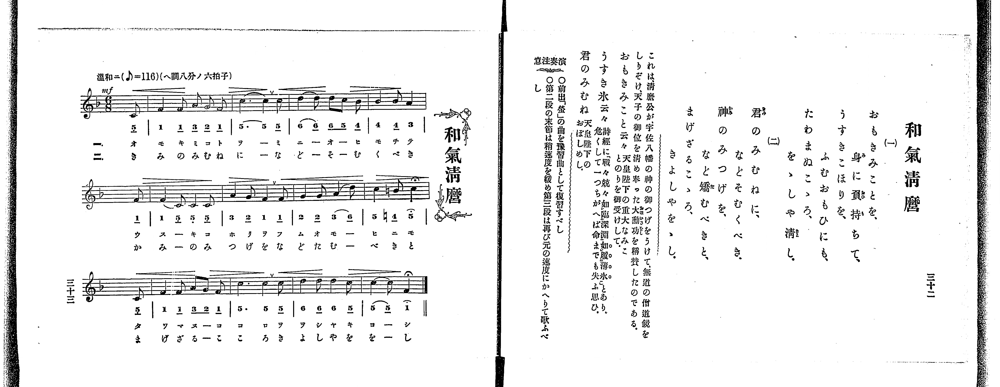

# かちどき

> Re:Shōka 使用 AI 協助辨識與重建樂譜，可能會有錯誤。歡迎回報。

- **鋼琴伴奏版**：<br><audio controls src="kachidoki.mp3"></audio>
- **NEUTRINO 歌聲合成版**：<br><audio controls src="kachidoki_neutrino.mp3"></audio>

- 出處：共益商社樂器店《唱歌教科書 教師用 巻三》第三十四～三十五頁（第三學期第四曲）
- NDL Digital Collections PID 854864（https://dl.ndl.go.jp/pid/854864）掃描 P023.jpg

## 說明

原書資訊與歌詞全文（NDL PID 854864《唱歌教科書 教師用 巻三》第三十四～三十五頁，掃描 P023.jpg）：
調性與拍號：ヘ調四分ノ四拍子（F 大調 4/4 拍），♩=116，「勇マシク」
註記：單聲部，二節分節歌，開頭 f。每小節皆含八分音符三連音，第七小節第二拍三連音第三音為 ♮4（B♮4，4'）。
原典演奏注意：練習前出〈豐年〉（尤以三連音符）作為預習曲；注意各強聲部之強音記號（>）；各三連音符之拍子須極正確歌唱，且注意拍子勿過於急迫。
原典語釋：「かよわさ」：只よわいといふこと。


## 歌詞

```text
一、
勇ましや、鬨のこゑ、
わが兵は、勝ちたるぞ、
突けやいざ、敵營を、
立てよいざ、我が旗を。

二、
海山も、崩れよと、
ふきたつる、喇叭の音、
あれ見よや、逃げてゆく、
敵兵の、かよわさよ。
```

## ABC

<div class="abc-score" data-abc-src="kachidoki.abc" aria-label="五線譜載入中"></div>

[下載 ABC 原始檔](kachidoki.abc)

## TMD 檔案連結

- [主旋律 TMD 檔案](kachidoki.tmd) [[在 TMD Studio 編輯](https://tmdlang.github.io/Tmd-TS/#tmd=s7IKdvYPcrWy4qpTUCpJTLdSSM7PyUlNLsnMz7PKrsxPzc6ML87Iz05Ugisoy88pzU21yk7MizeOtzA1sTAzQUgW55cWJadaFSdn5OfnxJekVpQk5edno8vHFySmp1oFGBgZI2QKivLLUvMS84C6C4oy80pSU8DaEQpSyzJTUkHSxclAq8tSizLTMlNTkNyVWlQMcjXUipKixLzi5KLMApBXEKrSU_OKUq1yE4uSMxCCaflFuVbFJUX5BRmZyQjhkoxUoEdzM3MySxKLKhHi-UWZ6Zl5VrmpmVmZSH7U0lJ43Nj9uHHh48aVjxt7FbS0uBRtFQwNzbjsbRXcuGxM9E3sQGY8bd_1YubU93tmPW3d-Hx219Opbc-X7Hu2ounpzBVPd01_3ND1dMrGZ2t7nk2d-Xz5xGezdygAWU93rH4-ZYXC0-27n-zofNzQ_XzNGiDjaW_j09mz3--dB2E_2TXl5YLG93s6oLJrdzybMx_IBqp5NnvT-z2dYC_4ufgouAA9UJKYo-AMj-xihQBPFwVIdAJNyCgpKSi20tdPydHLA-L0fL2sAv2CzBR9mIrOZ33Nz_r7FUCRCJRLV-Li0tdSsKUW4FJQUHjaNx_o-xeb21-s6HrR0Q4Mkhcr5z1tXfFsWjvQhSBvIJxMhVDrQfMR0I_AOAI55MWq_c8aloOc0N37YuZ8oOjj5hlAQaApTzvaHjf3gQK4u_fp2glAd7kpPF2yHCipAIxuBaAo2JieRzNX2gJTApD1uKHnaXf74-Z5j5u2P25a_7ihF2zFit0vVswApYlp6140bnrZvAKo9MmunufrG4BWAEmg14AiL6d1v1ywViHtcUPTs_X9Tzf0A2Wez2p7OmH109bVQIUv529-vmYZ0F8vGxYD2UAdYC83Q1UC2bt6gG6CK4AECIjRtEvh0cx1oKh3gtA9JupApwMtgkbF09Ydz_ZMebq0_9nmFc9a-oFOfb59y_P9k5529gIT9OOGjhcbJzzdueVxA9C7HU83LHmyeymSNcuAZj3ZOwdozcsFE4C6wOlxNsSopxNanu7ZDvH1k53dQDZQCzA0wEHdYQcOwNlARcjGAdVBQvzlgo5nS7c-W7v4-aJdwDACJgJQwO2YAjEaouZp9_6XjX3Ppu151rD0xf7VKH56sWrey_ZuUJQ29IByb1PH46b-x41TgfECio3-VTCRlseNK8Dk1seNk0FsoCkgY57saHjc0Ag2EBitjfseN05_3NQCFHq5Bqh-HUhx00SoCrBBPU9bgUYAI77xafdccGkx_3ETsNiYB1X0fFXj48aJIDNAtk0Dij6buvV5O1DRJJiK1UDly0AOg6vomAg0-Nl0oNVARVCH7QKmNbD6Z1u3P9248XFTE8jOLSsfN_WA9QK9AHEVyEu9IGc0LgG5BKhoWvvT_rVA1wMDG66oCajvxTJICIH919D8uHES2CFtjxv7YXZN3Qr23zogHyU8gQxIuFNeOECBgpY-F5d3YnJGZkp-dqZVWH5mcqpDjUFNNcgWBRtDMy07MKs6rRZMA8unx01LgHirwuPmPUA8D8jeDqSXKNQAyQ4gby1Upg_I3gzEK8Ay64GsNVCZGRAzmvtBMk2rgaxGIL0fSAPZTftAbgLZVaNgqqALhhqGCkYKxpqqGrpAoAlkQ4RhdI2CIUyheTyQbQRXaQIVN4arhBtpBmSawBXCFKAaaRYPI3QVTONBCCILggYgVWB3-hgCvdHYAjMYGFFACpiKNYHEdKgoMLrhJgNTDUJtL1jtOpDayXC1ExFqm_oRanvAaneA1MJMA2YCJHO7wSILweR8qFndQPY8JHeD_AB1txFITxvC_P0Qh4LM3wd3SxOS-UhuWQqW7AGqbeqAuwXmL5Dareh-nA8ydwncXJBbYX7sBCtYDCY3Qs1aB8RrsboblAabW4DaNkLTEyg9gvA2cEprQ6RBYNqDpLRNYGtAKQwoC9YDlYHqAaZOsHpQCu2HskGqNyGlRVjkawBZwDRhHg9PPLDUB6Nr4MlIA5hs8aYy1OSoDlcJE0ckXA1joDZDuAKgyYbY3ACC6EkTFujAqAClLGgUI5LQNKRoW4YebR0oapsmIamFJDGwWpA2YErAZa4GJB0DkzDQ5ZA0C0kQcPNQoxiSNGFJD6gbkvT3oyQ3lCy1GuEWkJFAF4HUwhI3Iuli9SNallqH5G5IngL5DO6HqciuQLi7lotL104BXpYqADnKXAA)]
- [鋼琴伴奏 TMD 檔案](kachidoki_piano.tmd) [[在 TMD Studio 編輯](https://tmdlang.github.io/Tmd-TS/#tmd=s7IKdvYPcrWy4tLSUnjc2P24ceHjxpWPG3vf7-l42b3n-YQtT_Zsebq0_3lnx_s9nQpaWlyKtgqGhmZc9rYKblw2Jvomdlx1CkpP23e9mDn1_Z5ZT1s3Pp_d9XRq2_Ml-56taHo6c8XTXdMfN3Q9nbLx2dqeZ1NnPl8-8dnsHQpA1tMdq59PWaHwdPvuJzs6Hzd0P1-zBsh42tv4dPbs93vnQdhPdk15uaAR6Bio7Nodz-bMB7KBap7N3gR0khLIej8XHwWXzPTMksQcBef8nJzU5JLM_LxihQBPFwULUxMLMxOgCRklJQXFVvr6KTl6eUCcnq-XVaBfkJmiD1PR-ayv-Vl_v0KAgZExUC5diYvLOzE5IzMlPzvTKiAzMS8_yMOhxqCmmksBCGwMzbTswKzqtFowrQ8MwaYlQLxV4XHzHiCeB2RvB9JLFGqAZAeQtxYq0wdkbwbiFWCZ9UDWGqjMDIgZzf0gmabVQFYjkN4PpIHspn0KWvpgu2oUTBV0wVDDUMFIwVhTVUMXCDSBbIgwjK5RMIQpNI8Hso3gKk2g4sZwlXAjzYBME7hCmAJUI83iYYSugmk8CEFkQdAApArsTh9DoDcaW2AGP26cCqQeN-7TBBLToaKPm2DyILUrEGp7wWrXgdROhqudiFDb1I9Q2wNWuwOkFmba48b1SOZ2g0UWgsn5ULO6gex5SO4G-QHqbiOQnjaE-fshDgWZvw_uliYk85HcshQs2QNU29QBdwvMXyC1W9H9OB9k7hK4uSC3wvzYCVawGExuhJq1DojXYnU3KA02twC1bYSmJ1B6BOFt4JTWhkiDwLQHSWmbwNaAUhhQFqwHKgPVA0ydYPWgFNoPZYNUb0JKi7DI1wCygGnCPB6eeGCpD0bXwJORBjDZ4k1lqMlRHa4SJo5IuBrGQG2GcAVAkw2xuQEE0ZMmLNCBUQFKWdAoRiShaUjRtgw92jpQ1DZNQlILSWJgtSBtwJSAy1wNSDoGJmGgyyFpFpIg4OahRjEkacKSHlA3JOnvR0luKFlqNcItICOBLgKphSVuRNLF6ke0LLUOyd2QPAXyGdwPU5FdgXB3LUZR6oNclJpAS1Jg6n3R1_Wyvfdp646Xs1shVQ9yMotXiDaNj0UwarCLQtWbAPkmaKqhYlAKn0qC5sLMABWIQKZhLIgygPhW104B7uFoH6AUqoARWECZCwA)]

## 分析

```text
================================================================================
📊 TMD Song Profile: [ かちどき ]
================================================================================
⏱  Duration:       0:16 (16.6s), 8 measures total
🎼 Key & Tempo:    首調基準 F, != 116.0 BPM, <4/4>
   - 分析範圍：      由實際發聲的音符與和弦推測調性；播放脈絡另行呈現
🎤 人聲音域:    C4 (MIDI 60) – D5 (MIDI 74) [跨度: 14 個半音 / 1.2 個八度, 難度: moderate]
   - 最低音:  C4 in [Kachidoki #1 @ m.4, 0:07]
   - 最高音: D5 in [Kachidoki #1 @ m.3, 0:04]
   - 適合: soprano, mezzo-soprano, contralto, tenor, baritone, bass
🏛  結構:      Kachidoki (16.6s)
⚡ 編曲密度:        Peak 1 軌道同時演奏
🗝  調性診斷：       C 調性不明確（流行色彩大調，未偵測到可信轉調）
   - 風格氣質:    流行大調（略帶和弦色彩音與裝飾副屬和弦）
   - 轉調歷程:    全曲維持單一推測調性（未偵測到可信轉調）
   - 核心骨幹音:  C, G, F, A, D
   - 調性數值:    C 調性不明確 [相關度: 0.85, 穩定度: Ambiguous, 自然音純度: 94.6%]
   - 候選調性 (K-S): C 大調 (0.85), F 大調 (0.84), A 小調 (0.61)
   - 五度圈歷程:   +0
   - 各段落調性細節:
     • [Kachidoki #1]: C 調性不明確 (r: 0.85, 自然音純度: 94.6%, 調外音: A#)

  [ 五度圈游移軌跡 ]
              [C ]*
         F            G  
      Bb               D  
      Eb               A  
         Ab           E  
            Db       B  
               F# 
     (* = active key center)

  [ 十二半音累積音高分佈 ]
     C  : ████████████████████████  25.0%
     C# :                            0.0%
     D  : ███████                    7.3%
     D# :                            0.0%
     E  : ███                        3.2%
     F  : ████████████████████      20.4%
     F# :                            0.0%
     G  : █████████████████████     21.5%
     G# :                            0.0%
     A  : ███████████████           16.1%
     A# : █████                      5.4%
     B  : █                          1.1%
--------------------------------------------------------------------------------
Assignment 軌道音域：
  - Voice         : C4 – D5 (14 個半音 / 1.2 個八度, 48 個音符)
================================================================================
```


## 原書掃描頁




