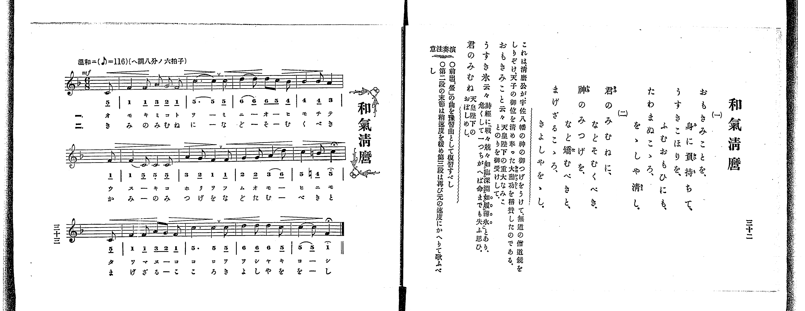

# かちどき

*找不到鋼琴伴奏版 TMD，未產生音訊。*

- 出處：共益商社樂器店《唱歌教科書 教師用 巻三》第三十四～三十五頁（第三學期第四曲）
- NDL Digital Collections PID 854864（https://dl.ndl.go.jp/pid/854864）掃描 P023.jpg

## 說明

原書資訊與歌詞全文（NDL PID 854864《唱歌教科書 教師用 巻三》第三十四～三十五頁，掃描 P023.jpg）：
調性與拍號：ヘ調四分ノ四拍子（F 大調 4/4 拍），♩=116，「勇マシク」
註記：單聲部，二節分節歌，開頭 f。每小節皆含八分音符三連音，第七小節第二拍三連音第三音為 ♮4（B♮4，4'）。
原典演奏注意：練習前出〈豐年〉（尤以三連音符）作為預習曲；注意各強聲部之強音記號（>）；各三連音符之拍子須極正確歌唱，且注意拍子勿過於急迫。
原典語釋：「かよわさ」：只よわいといふこと。

## 歌詞

```text
一、
勇ましや、鬨のこゑ、
わが兵は、勝ちたるぞ、
突けやいざ、敵營を、
立てよいざ、我が旗を。

二、
海山も、崩れよと、
ふきたつる、喇叭の音、
あれ見よや、逃げてゆく、
敵兵の、かよわさよ。
```

## ABC

```abc
X:1
T:かちどき
M:4/4
L:1/16
Q:1/4=116
K:F
V:V1 name="Voice" snm="Voi"
[V:V1]
!f! c4 F4/3 G4/3 A4/3 G4 G4 | F4 E4/3 F4/3 G4/3 B4 A4 | c4 d4/3 c4/3 B4/3 A4 G4 | F2 D2 D3 C C6 z2 |
C4 C4/3 D4/3 E4/3 F4 F4 | G4 G4/3 A4/3 B4/3 A4 G4 | c4 d4/3 c4/3 =B4/3 c4 A4 | A4/3 G4/3 F4/3 G4/3 F4/3 E4/3 F6 z2 |
!f! c4 F4/3 G4/3 A4/3 G4 G4 | F4 E4/3 F4/3 G4/3 B4 A4 | c4 d4/3 c4/3 B4/3 A4 G4 | F2 D2 D3 C C6 z2 |
C4 C4/3 D4/3 E4/3 F4 F4 | G4 G4/3 A4/3 B4/3 A4 G4 | c4 d4/3 c4/3 =B4/3 c4 A4 | A4/3 G4/3 F4/3 G4/3 F4/3 E4/3 F6 z2 |
```

## TMD 檔案連結

- [主旋律 TMD 檔案](kachidoki.tmd) [[在 TMD Studio 編輯](https://tmdlang.github.io/Tmd-TS/#tmd=s7IKdvYPcrWy4qpTUCpJTLdSSM7PyUlNLsnMz7PKrsxPzc6ML87Iz05Ugisoy88pzU21yk7MizeOtzA1sTAzQUgW55cWJadaFSdn5OfnxJekVpQk5edno8vHFySmp1oFGBgZI2QKivLLUvMS84C6C4oy80pSU8DaEQpSyzJTUkHSxclAq8tSizLTMlNTkNyVWlQMcjXUipKixLzi5KLMApBXEKrSU_OKUq1yE4uSMxCCaflFuVbFJUX5BRmZyQjhkoxUoEdzM3MySxKLKpW4tLQUHjd2P25c-Lhx5ePGXgUtLS5FWwVDQzMue1sFNy4bE30TO5Dmp-27Xsyc-n7PrKetG5_P7no6te35kn3PVjQ9nbni6a7pjxu6nk7Z-Gxtz7OpM58vn_hs9g4FIOvpjtXPp6xQeLp995MdnY8bup-vWQNkPO1tfDp79vu98yDsJ7umvFzQ-H5PB1R27Y5nc-YD2UA1z2Zver-nE-x2PxcfBZfMdKCjcxSc4bFZrBDg6aIAiS-gCRklJQXFVvr6KTl6eUCcnq-XVaBfkJmiD1PR-ayv-Vl_vwIoloBy6UpcXPpaCrbUAlwKCgpP--YDff9ic_uLFV0vOtqBQfJi5bynrSueTWsHuhDkDYSTqRBqPWg-AvoRGEcgh7xYtf9Zw3KQE7p7X8ycDxR93DwDKAg05WlH2-PmPlAAd_c-XTsB6C43hadLlgMlFYDRrQAUBRvT82jmSltgSgCyHjf0PO1uf9w873HT9sdN6x839IKtWLH7xYoZoDQxbd2Lxk0vm1cAlT7Z1fN8fQPQCiAJ9BpQ5OW07pcL1iqkPW5oera-_-mGfqDM81ltTyesftq6Gqjw5fzNz9csA_rrZcNiIBuoA-zlZqhKIHtXD9BNcAWQAAExmnYpPJq5DhT1ThC6x0Qd6HSgRdCoeNq649meKU-X9j_bvOJZSz_Qqc-3b3m-f9LTzl5ggn7c0PFi44SnO7c8bgB6t-PphiVPdi9FsmYZ0Kwne-cArXm5YAJQFzg9zoYY9XRCy9M92yG-frKzG8gGagGGBjioO-zAATgbqAjZOKA6SIi_XNDxbOnWZ2sXP1-0CxhGwEQACrgdUyBGQ9Q87d7_srHv2bQ9zxqWvti_GsVPL1bNe9neDYrShh5Q7m3qeNzU_7hxKjBeQLHRvwom0vK4cQWY3Pq4cTKIDTQFZMyTHQ2PGxrBBgKjtXHf48bpj5tagEIv1wDVrwMpbpoIVQE2qOdpK9AIYMQ3Pu2eCy4t5j9uAhYb86CKnq9qfNw4EWQGyLZpQNFnU7c-bwcqmgRTsRqofBnIYXAVHROBBj-bDrQaqAjqsF3AtAZW_2zr9qcbNz5uagLZuWXl46YesF6gFyCuAnmpF-SMxiUglwAVTWt_2r8W6HpgYMMVNQH1vVgGCSGw_xqaHzdOAjuk7XFjP8yuqVvB_lsH5KOEJ5ABCXfKCwcoUNDS5-LyTkzOyEzJz860CsvPTE51qDGoUagGWaNgY2imZQdmVafVgmlgAfW4aQkQb1V43LwHiOcB2duB9BKFGiDZAeSthcr0AdmbgXgFWGY9kLUGKjMDYkZzP0imaTWQ1Qik9wNpILtpH8hRILtqFEwVdMFQw1DBSMFYU1VDFwg0gWyIMIyuUTCEKTSPB7KN4CpNoOLGcJVwI82ATBO4QpgCVCPN4mGEroJpPAhBZEHQAKQKHibNLUCXb4T6DxQ-ILwN7PM2RJgAwwLi801gn4N8DJQF64HKQPUAQwusHhRi_VA2SPUmpLCBOUYDyAK60Twe7hlYaMDoGri3NIDBiNfXqMGjDlcJE0cEpIYxUJshXAHQZENsbkAEVS0Xl66dAjyxKaBzlLkA)]

## 分析

```text
================================================================================
📊 TMD Song Profile: [ かちどき ]
================================================================================
⏱  Duration:       0:33 (33.1s), 16 measures total
🎼 Key & Tempo:    首調基準 F, != 116.0 BPM, <4/4>
   - 分析範圍：      由實際發聲的音符與和弦推測調性；播放脈絡另行呈現
🎤 人聲音域:    C4 (MIDI 60) – D5 (MIDI 74) [跨度: 14 個半音 / 1.2 個八度, 難度: moderate]
   - 最低音:  C4 in [Kachidoki #1 @ m.4, 0:07]
   - 最高音: D5 in [Kachidoki #1 @ m.3, 0:04]
   - 適合: soprano, mezzo-soprano, contralto, tenor, baritone, bass
🏛  結構:      Kachidoki (16.6s) -> Kachidoki (16.6s)
⚡ 編曲密度:        Peak 1 軌道同時演奏
🗝  調性診斷：       C 調性不明確（流行色彩大調，未偵測到可信轉調）
   - 風格氣質:    流行大調（略帶和弦色彩音與裝飾副屬和弦）
   - 轉調歷程:    全曲維持單一推測調性（未偵測到可信轉調）
   - 核心骨幹音:  C, G, F, A, D
   - 調性數值:    C 調性不明確 [相關度: 0.85, 穩定度: Ambiguous, 自然音純度: 94.6%]
   - 候選調性 (K-S): C 大調 (0.85), F 大調 (0.84), A 小調 (0.61)
   - 五度圈歷程:   +0 -> +0
   - 各段落調性細節:
     • [Kachidoki #1]: C 調性不明確 (r: 0.85, 自然音純度: 94.6%, 調外音: A#)
     • [Kachidoki #2]: C 調性不明確 (r: 0.85, 自然音純度: 94.6%, 調外音: A#)

  [ 五度圈游移軌跡 ]
              [C ]*
         F            G  
      Bb               D  
      Eb               A  
         Ab           E  
            Db       B  
               F# 
     (* = active key center)

  [ 十二半音累積音高分佈 ]
     C  : ████████████████████████  25.0%
     C# :                            0.0%
     D  : ███████                    7.3%
     D# :                            0.0%
     E  : ███                        3.2%
     F  : ████████████████████      20.4%
     F# :                            0.0%
     G  : █████████████████████     21.5%
     G# :                            0.0%
     A  : ███████████████           16.1%
     A# : █████                      5.4%
     B  : █                          1.1%
--------------------------------------------------------------------------------
Assignment 軌道音域：
  - Voice         : C4 – D5 (14 個半音 / 1.2 個八度, 96 個音符)
================================================================================
```


## 原書掃描頁




