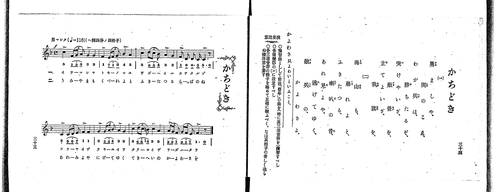
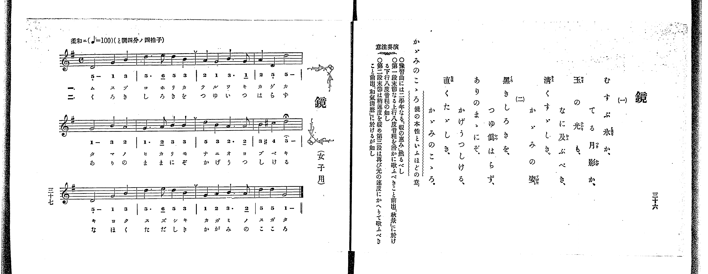

# 鏡

> Re:Shōka 使用 AI 協助辨識與重建樂譜，可能會有錯誤。歡迎回報。

- **鋼琴伴奏版**：<br><audio controls src="kagami.mp3"></audio>
- **NEUTRINO 歌聲合成版**：<br><audio controls src="kagami_neutrino.mp3"></audio>

- 出處：共益商社樂器店《唱歌教科書 教師用 巻三》第三十六～三十七頁（女生徒專用曲第一曲）
- NDL Digital Collections PID 854864（https://dl.ndl.go.jp/pid/854864）掃描 P024.jpg

## 說明

原書資訊與歌詞全文（NDL PID 854864《唱歌教科書 教師用 巻三》第三十六～三十七頁，掃描 P024.jpg）：
調性與拍號：ト調四分ノ四拍子（G 大調 4/4 拍），♩=100，「柔和ニ」
註記：單聲部，二節分節歌，標題下附註「（女子用）」。第八小節第二拍為 #4（C#5，4'），第三、四拍「5」附延長記號（𝄐）。
原典演奏注意：預習曲可用二學年〈親の惠み〉；第一段末節（第四小節）之上行八度音程（5_ - 5 -）須圓滑歌唱，如前出〈秋景〉之下行八度音程；第二段末節（第八小節）稍放緩速度，第三段再返原速度歌唱，如前出〈和氣清麿〉。
原典語釋：「かゞみのこゝろ」：鏡の本性といふほどの意。


## 歌詞

```text
一、
むすぶ氷か、てる月影か、
玉の光も、なに及ぶべき、
清くすゞしき、かゞみの姿。

二、
黒きしろきを、つゆ僞はらず、
ありのまゝにぞ、かげうつしける、
直くたゞしき、かゞみのこゝろ。
```

## ABC

<div class="abc-score" data-abc-src="kagami.abc" aria-label="五線譜載入中"></div>

[下載 ABC 原始檔](kagami.abc)

## TMD 檔案連結

- [主旋律 TMD 檔案](kagami.tmd) [[在 TMD Studio 編輯](https://tmdlang.github.io/Tmd-TS/#tmd=s7IKdvYPcrWy4qpTUCpJTLdSSM7PyUlNLsnMz7PKrsxPzc6ML87Iz05Ugisoy88pzU21yk7MizeOtzA1sTAzQUgW55cWJadaFSdn5OfnxJekVpQk5edno8vHFySmp1oFGBgh6Swoyi9LzUvMA-ouKMrMK0lNAWtHKEgty0xJBUkXJwOtLkstykzLTE1BcldqUTHI1VArSooS84qTizILQF5BqEpPzStKtUrOyMxJKUrNiy_Oz0tHSKblF-VaFZcU5RdkZCYjhEsyUoEeTs3NRzUKIpyWmJuZU4kQzS_KTM_Ms8pNzczKRAoALS2Fl_0LFbS0uBRtFQwNDLjsbRXcuWxM9E3sQFqftu96MXPq-z2znrZufD676-nUtudL9j1b0fR05oqnu6Y_buh6OmXjs7U9z6bOfL584rPZOxSArKc7Vj-fskLh6fbdT3Z0Pm7ofr5mDZDxtLfxaeva93vnQdhPdjS_XND4fk_H06Wbn0-Z_3TfpKcbOoDans3eBFbfAGS839MJdr-fi4-CC9D1JYk5Cs7wZFCsEODpogCJaKA5GSUlBcVW-vopOXp5QJyer5dVoF-QmaIPU9H5rK_5WX-_Aih6gXLA4OXS11KwpRbgUlBQeNo3HxgGLza3v1jR9aKjHRgwL1bOe9q64tm0dqALQd5AOJkKYdeD5iOgH4ExBXLIi1X7nzUsBzmhu_fFzPlA0cfNHUDBp7NnP-1oe9zcB2QApZ6unQB0l7vC0yXLgZIKwEhXAIqCjel5NHOlLTA9AFmPG3qezZ_ydFLP4-buxw29YPNX7H6xYgYoWUxb96Jx08vmFUB1T3b1PF_fADQfSAL9BXLfipkvF_Y82dH9cmYLUAvQIEiEA-0F-hJoD9C4xw1NQE8-bV39dEM_UCPIw7t6gK543rRLQRkUsc7KpkCjTNQhzoIEyOOGRogPgEaaAg0Bmv9097aXU7cDXQX2b8eHuS1AvwEVNkEj5mnrjmd7pjxd2v9s84pnLf1At79cMOH5_knAdPa0fz3QOUBrn67d8XTnlscNHS-WrXrcuO5Z84LHjfsfNwDtnQ1NlOu2PpuzGuhMoA0gVwODE-xqoE1PdnY_2dH1YmEPyCu7lr2cv_n5im6gMtN4BV0FUwVdoJKXCzqezpn8bPdEYOgA4x7om6fLmp529gIzGdDO58u7n81cD7QNbFI3hklgJwCDBs0JsIADmv98Re-zKfueb1_5smE-UCM8tIBanrb1vtg_BRgMECmsDgDG8LMNi5_taH25C-RplKB7sWrey3agI2YBA_xxY_fjpnmgkGlc97hx8uOmuY-bgBEBTDezgEUJKNzmrAGmvseNKx43tjxu3Pq4cffjxpUg8ZZ-kKEgU4FhCYxDEOtxU8PjxpmPG7c927AdZHJD4-PGZY-bup_N6Xi6dyNEBKTueV8n0IinrZ2Pm5rAioAxtPppfxdQ5-PGnY8bgS4AqwO6_3FjP8hIkBunQySQnfx0OdB3UFfsAiZusK6XuyeBVALVA70CZDRNAuta8rip7WkzUOP6x01A64G-h7i5selxE9BmoPf3gbzfuPpx4zyoNY1Ag9pAOkF2TwR6BOb-2VvA7pqPy11IQQkOeMqLJChQ0NLn4vJOTAdWCFZh-ZnJqQ41BjXVICsUbCy07MAMYEn4uHkBMDJ2AulpCjVA1mYgazYQrwKyV4NEmtuAeDUQtwBF1oLVAHlNm8A00A6QOTUK4PQOgoZAbAzEQCEw3wxMQ0SMkORBLIgILKuAYQ3YPB9DkDUNUDFgrILJbWBDgAEGFd0NVNMFZnVDZZaBeE0gHjAqoKp6wTIQsUlw1Uh2GYHk-2F2NfVCdUFMnA4XhYgBkwhUBmQ-MJ2AVbdA7VoCllkPlukEi8xCsQsU3k37gWE5D4j7wKE7CRKeoPBuXgQW6QLibqAoSGQFWGQaEM8Ehz48vEHBCIKgoAQFIkzECCyCiACYPIisAfNM1LEHd-N8eHDvA5ProB7dBBUFuQkc3E1NUJlVYPHVYBIkA5LrAMuAogqYP-FBiR7cIBMg6iERCLMLZDPEBTBz50FlkCMQFOiI4AZFETDPgU1DjVpwcK8FB-PjpvXgpAtM6MAa5nHTdpTEvAaoZj4sSsBqgCLAiCIteYPkQGENSd6g8AbJgTAstpCDGxYsoCADeQCUAkHioLQOSTkwr8HSIiQIesDkfqiqdXA9MBlYNCIHNyiiYHkG2S6I2seNwCKAaLtAuQ9KgvMKxK5aLi5dOwVIcaMAZClzAQA)]
- [鋼琴伴奏 TMD 檔案](kagami_piano.tmd) [[在 TMD Studio 編輯](https://tmdlang.github.io/Tmd-TS/#tmd=s7IKdvYPcrWy4tLSUnjZv_D9no6X3XueT9jyZM-Wp0v7n3d2vN_TqaClxaVoq2BoYMBlb6vgzmVjom9ix1WnoPS0fdeLmVPf75n1tHXj89ldT6e2PV-y79mKpqczVzzdNf1xQ9fTKRufre15NnXm8-UTn83eoQBkPd2x-vmUFQpPt-9-sqPzcUP38zVrgIynvY1PW9e-3zsPwn6yo_nlgkagY54u3fx8yvyn-yY93dAB1PZs9iaw-gYgA-gwJZAj_Fx8FFwy0zNLEnMUnPNzclKTSzLz84oVAjxdFCxMTSzMTIDmZJSUFBRb6eun5OjlAXF6vl5WgX5BZoo-TEXns77mZ_39CgEGRiZAuXQlLi7vxPTE3EyrgMzEvPwgD4cag5pqLgUgsLHQsgMz9LUUHjcvUHjctBNIT1OoAbI2A1mzgXgVkL0aJNLcBsSrgbgFKLIWrAbIa9oEprX0webUKJjGK-iCoSEQGwMxUAjMNwPTEBEjJHkQCyIC1gpRDFQENs_HEGRNA1TsceNMMLkNbMjjxslQ0d1ANV1gVjdUZhmI1wTiPW5cAlXVC5aBiE2Cq0ayywgk3w-zq6kXqgti4nS4KETscRPIDJAMyPzHTW1g1S1Qu5aAZdaDZTrBIrNQ7AKFd9N-YFjOA-I-cOhOgoQnKLybF4FFuoC4GygKElkBFpkGxDPBoQ8Pb1AwgiAoKEGBCBMxAosgIgAmDyJrwDwTdezB3TgfHtz7wOQ6qEc3QUVBbgIHd1MTVGYVWHw1mATJgOQ6wDKgqHrcuBMelOjBDTIBoh4SgTC7QDZDXAAzdx5UBjkCQYGOCG5QFD1unAg2DTVqwcG9FhyMj5vWg5MuMKE37QLi7SiJeQ1QzXxYlIDVAEWAEUVa8gbJgcIakrxB4Q2SA2FYbCEHNyxYQEEG8gAoBYLEQWkdknJgXoOlRUgQ9IDJ_VBV6-B6YDKwaEQOblBEwfIMsl0QtY8bgUUA0XaBch-UBOcViF21qKWND3JpY4IobV70db1s733auuPl7FZIAY2UpOMVog1jYVQNEJoAmSYIEXhcAPmm8SgqMcRQzYRLk6oWKgZ1CJpK4l2KzUwgZQAJOF07BUjYRfsAxZF4RmCeMhcA)]

## 分析

```text
================================================================================
📊 TMD Song Profile: [ 鏡 ]
================================================================================
⏱  Duration:       0:28 (28.8s), 12 measures total
🎼 Key & Tempo:    首調基準 G, != 100.0 BPM, <4/4>
   - 分析範圍：      由實際發聲的音符與和弦推測調性；播放脈絡另行呈現
🎤 人聲音域:    D4 (MIDI 62) – E5 (MIDI 76) [跨度: 14 個半音 / 1.2 個八度, 難度: moderate]
   - 最低音:  D4 in [Kagami #1 @ m.1, 0:00]
   - 最高音: E5 in [Kagami #1 @ m.2, 0:03]
   - 適合: soprano, mezzo-soprano, contralto, tenor, baritone, bass
🏛  結構:      Kagami (28.8s)
⚡ 編曲密度:        Peak 1 軌道同時演奏
🗝  調性診斷：       D 調性不明確（純淨自然大調，未偵測到可信轉調）
   - 風格氣質:    純淨自然大調（陽光明朗、易唱易記，無明顯調外色彩）
   - 轉調歷程:    全曲維持單一推測調性（未偵測到可信轉調）
   - 核心骨幹音:  D, B, G, A, C#
   - 調性數值:    D 調性不明確 [相關度: 0.79, 穩定度: Ambiguous, 自然音純度: 100.0%]
   - 候選調性 (K-S): D 大調 (0.79), G 大調 (0.78), B 小調 (0.75)
   - 五度圈歷程:   +2
   - 各段落調性細節:
     • [Kagami #1]: D 調性不明確 (r: 0.79, 自然音純度: 100.0%)

  [ 五度圈游移軌跡 ]
               C  
         F            G  
      Bb              [D ]*
      Eb               A  
         Ab           E  
            Db       B  
               F# 
     (* = active key center)

  [ 十二半音累積音高分佈 ]
     C  :                            0.0%
     C# : █                          2.1%
     D  : ████████████████████████  35.4%
     D# :                            0.0%
     E  : █                          2.1%
     F  :                            0.0%
     F# :                            0.0%
     G  : ██████████████            20.8%
     G# :                            0.0%
     A  : ██████████                14.6%
     A# :                            0.0%
     B  : █████████████████         25.0%
--------------------------------------------------------------------------------
Assignment 軌道音域：
  - Voice         : D4 – E5 (14 個半音 / 1.2 個八度, 42 個音符)
================================================================================
```


## 原書掃描頁






