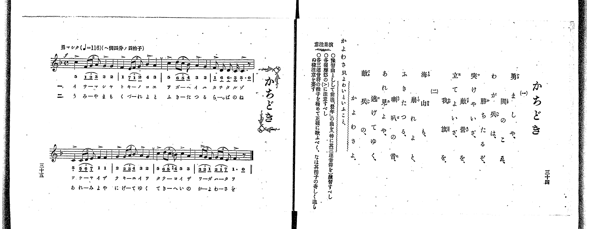
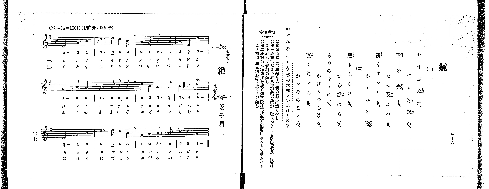

# 鏡

> Re:Shōka 使用 AI 協助辨識與重建樂譜，可能會有錯誤。歡迎[回報](https://github.com/TMDLang/reshoka/issues)。

- **鋼琴伴奏版**：<br><audio controls src="kagami.mp3"></audio>
- **NEUTRINO 歌聲合成版**：<br><audio controls src="kagami_neutrino.mp3"></audio>

- 出處：共益商社樂器店《唱歌教科書 教師用 巻三》第三十六～三十七頁（女生徒專用曲第一曲）
- NDL Digital Collections PID 854864（https://dl.ndl.go.jp/pid/854864）掃描 P024.jpg

## 說明

原書資訊與歌詞全文（NDL PID 854864《唱歌教科書 教師用 巻三》第三十六～三十七頁，掃描 P024.jpg）：
調性與拍號：ト調四分ノ四拍子（G 大調 4/4 拍），♩=100，「柔和ニ」
註記：單聲部，二節分節歌，標題下附註「（女子用）」。第八小節第二拍為 #4（C#5，4'），第三、四拍「5」附延長記號（𝄐）。
原典演奏注意：預習曲可用二學年〈親の惠み〉；第一段末節（第四小節）之上行八度音程（5_ - 5 -）須圓滑歌唱，如前出〈秋景〉之下行八度音程；第二段末節（第八小節）稍放緩速度，第三段再返原速度歌唱，如前出〈和氣清麿〉。
原典語釋：「かゞみのこゝろ」：鏡の本性といふほどの意。


## 歌詞

```text
一、
むすぶ氷か、てる月影か、
玉の光も、なに及ぶべき、
清くすゞしき、かゞみの姿。

二、
黒きしろきを、つゆ僞はらず、
ありのまゝにぞ、かげうつしける、
直くたゞしき、かゞみのこゝろ。
```

## ABC

<div class="abc-score" data-abc-src="kagami.abc" aria-label="五線譜載入中"></div>

[下載 ABC 原始檔](kagami.abc)

## TMD 檔案連結

- [主旋律 TMD 檔案](kagami.tmd) [[在 TMD Studio 編輯](https://tmdlang.github.io/Tmd-TS/#tmd=s7IKdvYPcrWy4qpTUCpJTLdSSM7PyUlNLsnMz7PKrsxPzc6ML87Iz05Ugisoy88pzU21yk7MizeOtzA1sTAzQUgW55cWJadaFSdn5OfnxJekVpQk5edno8vHFySmp1oFGBgh6Swoyi9LzUvMA-ouKMrMK0lNAWtHKEgty0xJBUkXJwOtLkstykzLTE1BcldqUTHI1VArSooS84qTizILQF5BqEpPzStKtUrOyMxJKUrNiy_Oz0tHSKblF-VaFZcU5RdkZCYjhEsyUoEeTs3NRzUKIpyWmJuZU4kQzS_KTM_Ms8pNzczKxBIA-UUlGfnpRYkFGZVWGZnFJUDlyYk58cDQBAaxlpbCy_6FClpaXIq2CoYGBlz2tgruXDYm-iZ2IAOetu96MXPq-z2znrZufD676-nUtudL9j1b0fR05oqnu6Y_buh6OmXjs7U9z6bOfL584rPZOxSArKc7Vj-fskLh6fbdT3Z0Pm7ofr5mDZDxtLfxaeva93vnQdhPdjS_XND4fk_H06Wbn0-Z_3TfpKcbOoDans3eBFbfAGS839MJ9oWfi4-CC9CLJYk5Cs7wtFKsEODpogBJDUBzMkpKCoqt9PVTcvTygDg9Xy-rQL8gM0UfpqLzWV_zs_5-BVAaAMoB44BLX0vBllqAS0FB4WnffGAYvNjc_mJF14uOdmDAvFg572nrimfT2oEuBHkD4WQqhF0Pmo-AfgTGFMghL1btf9awHOSE7t4XM-cDRR83dwAFn86e_bSj7XFzH5ABlHq6dgLQXe4KT5csB0oqACNdASgKNqbn0cyVtsD0AGQ9buh5Nn_K00k9j5u7Hzf0gs1fsfvFihmgZDFt3YvGTS-bVwDVPdnV83x9A9B8IAn0F8h9K2a-XNjzZEf3y5ktQC1AgyARDrQX6EugPUDjHjc0AT35tHX10w39QI0gD-_qAbriedMuBWVQxDormwKNMlGHOAsSII8bGiE-ABppCjQEaP7T3dteTt0OdBXYvx0f5rYA_QZU2ASNmKetO57tmfJ0af-zzSuetfQD3f5ywYTn-ycB09nT_vVA5wCtfbp2x9OdWx43dLxYtupx47pnzQseN-5_3AC0dzY0Ua7b-mzOaqAzgTaAXA0MTrCrgTY92dn9ZEfXi4U9IK_sWvZy_ubnK7qBykzjFXQVTBV0gUpeLuh4Omfys90TgaEDjHugb54ua3ra2QvMZEA7ny_vfjZzPdA2sEndGCaBnQAMGjQnwAIOaP7zFb3Ppux7vn3ly4b5QI3w0AJqedrW-2L_FGAwQKSwOgAYw882LH62o_XlLpCnUYLuxap5L9uBjpgFDPDHjd2Pm-aBQqZx3ePGyY-b5j5uAkYEMN3MAhYloHCbswaY-h43rnjc2PK4cevjxt2PG1eCxFv6QYaCTAWGJTAOQazHTQ2PG2c-btz2bMN2kMkNjY8blz1u6n42p-Pp3o0QEZC6532dQCOetnY-bmoCKwLG0Oqn_V1AnY8bdz5uBLoArA7o_seN_SAjQW6cDpFAdvLT5UDfQV2xC5i4wbpe7p4EUglUD_QKkNE0CaxryeOmtqfNQI3rHzcBrQf6HuLmxqbHTUCbgd7fB_J-4-rHjfOg1jQCDWoD6QTZPRHoEZj7Z28Bu2s-LnchBSU44CkvkqBAQUufi8s7MR1Ya1iF5WcmpzrUGNRUg6xQsLHQsgMzgCXh4-YFwMjYCaSnKdQAWZuBrNlAvArIXg0SaW4D4tVA3AIUWQtWA-Q1bQLTQDtA5tQogNM7CBoCsTEQA4XAfDMwDRExQpIHsSAisKwChjVg83wMQdY0QMWAsQomt4ENAQYYVHQ3UE0XmNUNlVkG4jWBeMCogKrqBctAxCbBVSPZZQSS74fZ1dQL1QUxcTpcFCIGTCJQGZD5wHQCVt0CtWsJWGY9WKYTLDILxS5QeDftB4blPCDuA4fuJEh4gsK7eRFYpAuIu4GiIJEVYJFpQDwTHPrw8AYFIwiCghIUiDARI7AIIgJg8iCyBswzUcce3I3z4cG9D0yug3p0E1QU5CZwcDc1QWVWgcVXg0mQDEiuAywDiipg_oQHJXpwg0yAqIdEIMwukM0QF8DMnQeVQY5AUKAjghsURcA8BzYNNWrBwb0WHIyPm9aDky4woQNrmMdN21ES8xqgmvmwKAGrAYoAI4q05A2SA4U1JHmDwhskB8Kw2EIObliwgIIM5AFQCgSJg9I6JOXAvAZLi5Ag6AGT-6Gq1sH1wGRg0Ygc3KCIguUZZLsgah83AosAou0C5T4oCc4rELtqubh07RQgxY0CkKXMBQA)]
- [鋼琴伴奏 TMD 檔案](kagami_piano.tmd) [[在 TMD Studio 編輯](https://tmdlang.github.io/Tmd-TS/#tmd=s7IKdvYPcrWy4qpTUCpJTLdSyC8qychPL0osyKi0ysgsLskvykxOzInPTsxLVOLS0lJ42b_w_Z6Ol917nk_Y8mTPlqdL-593drzf06mgpcWlaKtgaGDAZW-r4M5lY6JvYgcy9Wn7rhczp77fM-tp68bns7ueTm17vmTfsxVNT2eueLpr-uOGrqdTNj5b2_Ns6sznyyc-m71DAch6umP18ykrFJ5u3_1kR-fjhu7na9YAGU97G5-2rn2_dx6E_WRH88sFjUDHPF26-fmU-U_3TXq6oQOo7dnsTWD1DUAG0GFKIEf4ufgouGSmZ5Yk5ig45-fkpCaXZObnFSsEeLooWJiaWJiZAM3JKCkpKLbS10_J0csD4vR8vawC_YLMFH2Yis5nfc3P-vsVAgyMTIBy6UpcXN6J6Ym5mVYBmYl5-UEeDjUGNdVcCkBgY6FlB2boayk8bl6g8LhpJ5CeplADZG0GsmYD8SogezVIpLkNiFcDcQtQZC1YDZDXtAlMa-mDzalRMI1X0AVDQyA2BmKgEJhvBqYhIkZI8iAWRASsFaIYqAhsno8hyJoGqNjjxplgchvYkMeNk6Giu4FqusCsbqjMMhCvCcR73LgEqqoXLAMRmwRXjWSXEUi-H2ZXUy9UF8TE6XBRiNjjJpAZIBmQ-Y-b2sCqW6B2LQHLrAfLdIJFZqHYBQrvpv3AsJwHxH3g0J0ECU9QeDcvAot0AXE3UBQksgIsMg2IZ4JDHx7eoGAEQVBQggIRJmIEFkFEAEweRNaAeSbq2IO7cT48uPeByXVQj26CioLcBA7upiaozCqw-GowCZIByXWAZUBR9bhxJzwo0YMbZAJEPSQCYXaBbIa4AGbuPKgMcgSCAh0R3KAoetw4EWwaatSCg3stOBgfN60HJ11gQm_aBcTbURLzGqCa-bAoAasBigAjirTkDZIDhTUkeYPCGyQHwrDYQg5uWLCAggzkAVAKBImD0jok5cC8BkuLkCDoAZP7oarWwfXAZGDRiBzcoIiC5RlkuyBqHzcCiwCi7QLlPigJzisQu2pRSxsf5NLGBFHavOjretne-7R1x8vZrZACGilJxytEG8bCqBogNAEyTRAi8LgA8k3jUVRiiKGaCZcmVS1UDOoQNJXEuxSbmUDKABJwunYKkLCL9gGKI_GMwDxlLgA)]

## 分析

```text
================================================================================
📊 TMD Song Profile: [ 鏡 ]
================================================================================
⏱  Duration:       0:28 (28.8s), 12 measures total
🎼 Key & Tempo:    首調基準 G, != 100.0 BPM, <4/4>
   - 分析範圍：      由實際發聲的音符與和弦推測調性；播放脈絡另行呈現
🎤 人聲音域:    D4 (MIDI 62) – E5 (MIDI 76) [跨度: 14 個半音 / 1.2 個八度, 難度: moderate]
   - 最低音:  D4 in [Kagami #1 @ m.1, 0:00]
   - 最高音: E5 in [Kagami #1 @ m.2, 0:03]
   - 適合: soprano, mezzo-soprano, contralto, tenor, baritone, bass
🏛  結構:      Kagami (28.8s)
⚡ 編曲密度:        Peak 1 軌道同時演奏
🗝  調性診斷：       D 調性不明確（純淨自然大調，未偵測到可信轉調）
   - 風格氣質:    純淨自然大調（陽光明朗、易唱易記，無明顯調外色彩）
   - 轉調歷程:    全曲維持單一推測調性（未偵測到可信轉調）
   - 核心骨幹音:  D, B, G, A, C#
   - 調性數值:    D 調性不明確 [相關度: 0.79, 穩定度: Ambiguous, 自然音純度: 100.0%]
   - 候選調性 (K-S): D 大調 (0.79), G 大調 (0.78), B 小調 (0.75)
   - 五度圈歷程:   +2
   - 各段落調性細節:
     • [Kagami #1]: D 調性不明確 (r: 0.79, 自然音純度: 100.0%)

  [ 五度圈游移軌跡 ]
               C  
         F            G  
      Bb              [D ]*
      Eb               A  
         Ab           E  
            Db       B  
               F# 
     (* = active key center)

  [ 十二半音累積音高分佈 ]
     C  :                            0.0%
     C# : █                          2.1%
     D  : ████████████████████████  35.4%
     D# :                            0.0%
     E  : █                          2.1%
     F  :                            0.0%
     F# :                            0.0%
     G  : ██████████████            20.8%
     G# :                            0.0%
     A  : ██████████                14.6%
     A# :                            0.0%
     B  : █████████████████         25.0%
--------------------------------------------------------------------------------
Assignment 軌道音域：
  - Voice         : D4 – E5 (14 個半音 / 1.2 個八度, 42 個音符)
================================================================================
```


## 原書掃描頁






