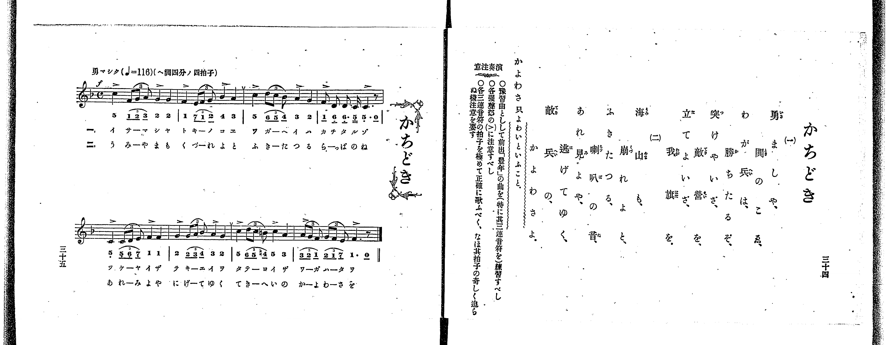
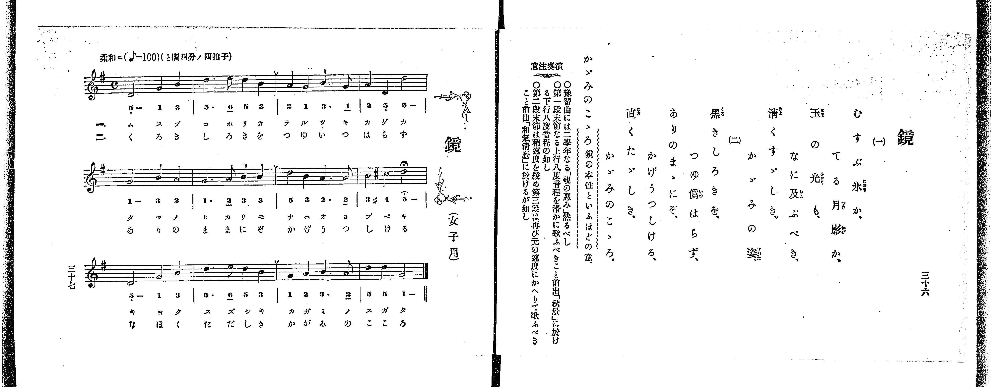

# 鏡

<audio controls src="kagami.mp3"></audio>

- 出處：共益商社樂器店《唱歌教科書 教師用 巻三》第三十六～三十七頁（女生徒專用曲第一曲）
- NDL Digital Collections PID 854864（https://dl.ndl.go.jp/pid/854864）掃描 P024.jpg

## 說明

原書資訊與歌詞全文（NDL PID 854864《唱歌教科書 教師用 巻三》第三十六～三十七頁，掃描 P024.jpg）：
調性與拍號：ト調四分ノ四拍子（G 大調 4/4 拍），♩=100，「柔和ニ」
註記：單聲部，二節分節歌，標題下附註「（女子用）」。第八小節第二拍為 #4（C#5，4'），第三、四拍「5」附延長記號（𝄐）。
原典演奏注意：預習曲可用二學年〈親の惠み〉；第一段末節（第四小節）之上行八度音程（5_ - 5 -）須圓滑歌唱，如前出〈秋景〉之下行八度音程；第二段末節（第八小節）稍放緩速度，第三段再返原速度歌唱，如前出〈和氣清麿〉。
原典語釋：「かゞみのこゝろ」：鏡の本性といふほどの意。

## 歌詞

```text
一、
むすぶ氷か、てる月影か、
玉の光も、なに及ぶべき、
清くすゞしき、かゞみの姿。

二、
黒きしろきを、つゆ僞はらず、
ありのまゝにぞ、かげうつしける、
直くたゞしき、かゞみのこゝろ。
```

## ABC

```abc
X:1
T:鏡
M:4/4
L:1/16
Q:1/4=100
K:G
V:V1 name="Voice" snm="Voi"
[V:V1]
D8 G4 B4 | d6 e2 d4 B4 | A4 G4 B6 G2 | A4 D4 d8 |
G8 B4 A4 | G6 A2 B4 B4 | d4 B4 A6 A2 | B4 ^c4 d8 |
D8 G4 B4 | d6 e2 d4 B4 | G4 A4 B6 A2 | d4 d4 G8 |
D8 G4 B4 | d6 e2 d4 B4 | A4 G4 B6 G2 | A4 D4 d8 |
G8 B4 A4 | G6 A2 B4 B4 | d4 B4 A6 A2 | B4 ^c4 d8 |
D8 G4 B4 | d6 e2 d4 B4 | G4 A4 B6 A2 | d4 d4 G8 |
```

## TMD 檔案連結

- [主旋律 TMD 檔案](kagami.tmd) [[在 TMD Studio 編輯](https://tmdlang.github.io/Tmd-TS/#tmd=s7IKdvYPcrWy4qpTUCpJTLdSSM7PyUlNLsnMz7PKrsxPzc6ML87Iz05Ugisoy88pzU21yk7MizeOtzA1sTAzQUgW55cWJadaFSdn5OfnxJekVpQk5edno8vHFySmp1oFGBgh6Swoyi9LzUvMA-ouKMrMK0lNAWtHKEgty0xJBUkXJwOtLkstykzLTE1BcldqUTHI1VArSooS84qTizILQF5BqEpPzStKtUrOyMxJKUrNiy_Oz0tHSKblF-VaFZcU5RdkZCYjhEsyUoEeTs3NRzUKIpyWmJuZU6nEpaWl8LJ_oYKWFpeirYKhgQGXva2CO5eNib6JHUjH0_ZdL2ZOfb9n1tPWjc9ndz2d2vZ8yb5nK5qezlzxdNf0xw1dT6dsfLa259nUmc-XT3w2e4cCkPV0x-rnU1YoPN2--8mOzscN3c_XrAEynvY2Pm1d-37vPAj7yY7mlwsa3-_peLp08_Mp85_um_R0QwdQ27PZm8DqG4CM93s6wc72c_FRcMlMzyxJzFFwhsdzsUKAp4sCJCaB5mSUlBQUW-nrp-To5QFxer5eVoF-QWaKPkxF57O-5mf9_Qqg-APKAcOPS19LwZZagEtBQeFp33xgGLzY3P5iRdeLjnZgwLxYOe9p64pn09qBLgR5A-FkKoRdD5qPgH4ExhTIIS9W7X_WsBzkhO7eFzPnA0UfN3cABZ_Onv20o-1xcx-QAZR6unYC0F3uCk-XLAdKKgAjXQEoCjam59HMlbbA9ABkPW7oeTZ_ytNJPY-bux839ILNX7H7xYoZoGQxbd2Lxk0vm1cA1T3Z1fN8fQPQfCAJ9BfIfStmvlzY82RH98uZLUAtQIMgEQ60F-hLoD1A4x43NAE9-bR19dMN_UCNIA_v6gG64nnTLgVlUMQ6K5sCjTJRhzgLEiCPGxohPgAaaQo0BGj-093bXk7dDnQV2L8dH-a2AP0GVNgEjZinrTue7ZnydGn_s80rnrX0A93-csGE5_snAdPZ0_71QOcArX26dsfTnVseN3S8WLbqceO6Z80LHjfuf9wAtHc2NFGu2_pszmqgM4E2gFwNDE6wq4E2PdnZ_WRH14uFPSCv7Fr2cv7m5yu6gcpM4xV0FUwVdIFKXi7oeDpn8rPdE4GhA4x7oG-eLmt62tkLzGRAO58v7342cz3QNrBJ3RgmgZ0ADBo0J8ACDmj-8xW9z6bse7595cuG-UCN8NACanna1vti_xRgMECksDoAGMPPNix-tqP15S6Qp1GC7sWqeS_bgY6YBQzwx43dj5vmgUKmcd3jxsmPm-Y-bgJGBDDdzAIWJaBwm7MGmPoeN6543NjyuHHr48bdjxtXgsRb-kGGgkwFhiUwDkGsx00NjxtnPm7c9mzDdpDJDY2PG5c9bup-Nqfj6d6NEBGQuud9nUAjnrZ2Pm5qAisCxtDqp_1dQJ2PG3c-bgS6AKwO6P7Hjf0gI0FunA6RQHby0-VA30FdsQuYuMG6Xu6eBFIJVA_0CpDRNAmsa8njpranzUCN6x83Aa0H-h7i5samx01Am4He3wfyfuPqx43zoNY0Ag1qA-kE2T0R6BGY-2dvAbtrPi53IQUlOOApL5KgQEFLn4vLOzEdWOJbheVnJqc61BjUKFSD7FCwMTTTsgOzgGXh4-YFwOjYCaSnKdQAWZuBrNlAvArIXg0SaW4D4tVA3AIUWQtWA-Q1bQLTQFtA5tQogFM8MjSE0sZQGqgESdYMkj_QVBjh0AsTQ6iAW4dsKNgQuL-a9gPdPA-I-8C-mARxN8hfzYvAIl1A3A0UBYmsAItMA-KZYF_C_QVzCgzCnARzCKoKkChMBabH0fXC2DVwGRN1wt5aC3bu46b14KgARhywzHzctB0lctYA1cyHeR2sBigCDBDqRhdMD8w_yNEF8RdMD4xGD80arlouLl07BUhCVUBhKXMBAA)]

## 分析

```text
================================================================================
📊 TMD Song Profile: [ 鏡 ]
================================================================================
⏱  Duration:       0:57 (57.6s), 24 measures total
🎼 Key & Tempo:    首調基準 G, != 100.0 BPM, <4/4>
   - 分析範圍：      由實際發聲的音符與和弦推測調性；播放脈絡另行呈現
🎤 人聲音域:    D4 (MIDI 62) – E5 (MIDI 76) [跨度: 14 個半音 / 1.2 個八度, 難度: moderate]
   - 最低音:  D4 in [Kagami #1 @ m.1, 0:00]
   - 最高音: E5 in [Kagami #1 @ m.2, 0:03]
   - 適合: soprano, mezzo-soprano, contralto, tenor, baritone, bass
🏛  結構:      Kagami (28.8s) -> Kagami (28.8s)
⚡ 編曲密度:        Peak 1 軌道同時演奏
🗝  調性診斷：       D 調性不明確（純淨自然大調，未偵測到可信轉調）
   - 風格氣質:    純淨自然大調（陽光明朗、易唱易記，無明顯調外色彩）
   - 轉調歷程:    全曲維持單一推測調性（未偵測到可信轉調）
   - 核心骨幹音:  D, B, G, A, C#
   - 調性數值:    D 調性不明確 [相關度: 0.79, 穩定度: Ambiguous, 自然音純度: 100.0%]
   - 候選調性 (K-S): D 大調 (0.79), G 大調 (0.78), B 小調 (0.75)
   - 五度圈歷程:   +2 -> +2
   - 各段落調性細節:
     • [Kagami #1]: D 調性不明確 (r: 0.79, 自然音純度: 100.0%)
     • [Kagami #2]: D 調性不明確 (r: 0.79, 自然音純度: 100.0%)

  [ 五度圈游移軌跡 ]
               C  
         F            G  
      Bb              [D ]*
      Eb               A  
         Ab           E  
            Db       B  
               F# 
     (* = active key center)

  [ 十二半音累積音高分佈 ]
     C  :                            0.0%
     C# : █                          2.1%
     D  : ████████████████████████  35.4%
     D# :                            0.0%
     E  : █                          2.1%
     F  :                            0.0%
     F# :                            0.0%
     G  : ██████████████            20.8%
     G# :                            0.0%
     A  : ██████████                14.6%
     A# :                            0.0%
     B  : █████████████████         25.0%
--------------------------------------------------------------------------------
Assignment 軌道音域：
  - Voice         : D4 – E5 (14 個半音 / 1.2 個八度, 84 個音符)
================================================================================
```


## 原書掃描頁






