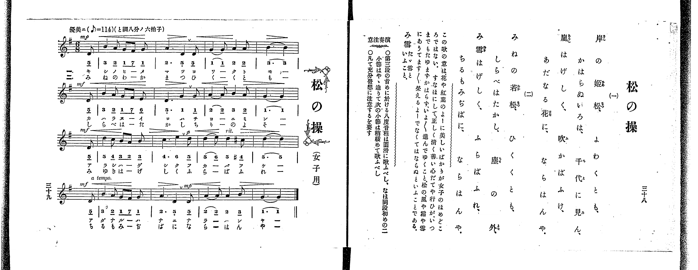

# 松の操

> Re:Shoka 使用 AI 協助辨識與重建樂譜，可能會有錯誤。歡迎回報。

<audio controls src="matsu_no_misao.mp3"></audio>

- 出處：共益商社樂器店《唱歌教科書 教師用 巻三》第三十八～三十九頁（女生徒專用曲第二曲）
- NDL Digital Collections PID 854864（https://dl.ndl.go.jp/pid/854864）掃描 P025.jpg

## 說明

原書資訊與歌詞全文（NDL PID 854864《唱歌教科書 教師用 巻三》第三十八～三十九頁，掃描 P025.jpg）：
調性與拍號：ト調八分ノ六拍子（G 大調 6/8 拍），♪=114（八分音符=114，折合四分音符 ♩=57），「優美ニ」，弱起一拍（八分音符）
註記：單聲部，二節分節歌，標題下附註「（女子用）」。開頭 mp，第四小節末拍（第二段弱起）轉 mf，第八小節末拍（第三段弱起）標 mf，第十小節末拍轉 p，第十一小節標 rit. 並於末拍出現 #4（C#5，4'），第十二小節末拍（第四段弱起）標 mf 及 a tempo.，第十四小節末拍轉 mp。
原典演奏注意：第三段開頭之八度音程（5_ - 5）須圓滑歌唱，且同段前二小節（第九、十小節）稍急迫、次小節（第十一小節）稍放緩歌唱；全曲須充分注意發想。
原典曲意：「この歌の意は、花や紅葉のよーに美しいばかりが女子のほめどころではない。すなほにして、正しく清く善い心だてや行ひが、いつまでもたゆまずかはらず、いよ／＼進んでゆくこと、松の風や霜や雪にあうてます／＼榮えるよーでなくてはならぬといふことである。」
原典語釋：「み雪」：たゞ雪といふこと。

## 歌詞

```text
一、
岸の姫松、よわくとも、
かはらぬいろは、千代に見ん、
嵐はげしく、吹かばふけ、
あだなる花に、ならはんや。

二、
みねの若松、ひくくとも、
しらべはたかし、塵の外、
み雪はげしく、ふらばふれ、
ちるもみぢばに、ならはんや。
```

## ABC

```abc
X:1
T:松の操
M:6/8
L:1/16
Q:3/8=38
K:G
V:V1 name="Voice" snm="Voi"
[V:V1]
!mp! z2 z2 z2 z2 z2 D2 | B4 A2 G2 F2 G2 | A6 D4 D2 | G4 G2 A4 A2 |
!mf! B10 D2 | B4 A2 G2 F2 E2 | D6 G4 G2 | A4 A2 B4 A2 |
!mf! G10 D2 | d4 c2 B2 A2 B2 | !p! c6 e4 d2 | d4 e2 d4 ^c2 |
!mf! d10 D2 | B4 A2 G2 F2 G2 | !mp! A6 D4 D2 | A4 A2 A4 B2 |
G10 z2 |
```

## TMD 檔案連結

- [主旋律 TMD 檔案](matsu_no_misao.tmd) [[在 TMD Studio 編輯](https://tmdlang.github.io/Tmd-TS/#tmd=s7IKdvYPcrWy4qpTUCpJTLdSSM7PyUlNLsnMz7PKrsxPzc6ML87Iz05Ugisoy88pzU21yk7MizeOtzA1sTAzQUgW55cWJadaFSdn5OfnxJekVpQk5edno8vHFySmp1oFGBiZImQKivLLUvMS84C6C4oy80pSU8DaEQpSyzJTUkHSxclAq8tSizLTMlNTkNyVWlQMcjXUipKixLzi5KLMApBXEKrSU_OKUq2SMzJzUopS8-KL8_PSEZJp-UW5VsUlRfkFGZnJCOGSjFSghwtyEvOQnAMRzEssKS1KRRctTk0EGlysxKWlpfBs7r7HjeueTe5V0NLiUrRVMDXnsrdVcOeyMdO3sAPpe9q-68XMqe_3zHrauvH57K6nU9ueL9n3bEXT05krnu6a_rih6-mUjc_W9jybOvP58onPZu9QALKe7lj9fMoKhafbdz_Z0fm4ofv5mjVAxtPexqetq9_vnQdhP9k59-WCxvd7Op4u3fx8yvyn-yY93dAB1PZs9iaQ-l09QMb7PZ1gx_u5-Ci4ZKZnliTmKDjDU0CxQoCniwIkjoHmZJSUFBRb6eun5OjlAXF6vl5WgX5BZoo-TEXns77mZ_39CqCYBcoBQ5ZLX0vBllqAS0FB4WnffGAYvNjc_mJF14uOdmDAvFg572nrimfT2oEuBHkD4WQqhF0Pmo-AfgTGFMghL1btf9awHOSE7t4XM-cDRR83dwAFgaY87Wh73Nz3tHUtUOrp2glAd7krPF2yHCipAIx0BaAo2JieRzNX2RoagkIWounl_M3P1yyDCPU865rxdELH09mz4RIKj2autDU1h-h93NDztGXV8319j5u7HzcADex5umfji63bn-xoAJuPYiRQC9jJK3a_WDEDlNKmrXvRuOll8wqgNmA6eL6-AagUSAKDCmTzipkvF_Y82dH9cmYLUAvQJkgaAnoFGHBAs4D2PW5oejmt--WCtQq5BUAtwDAEuXRDP8iQOashLoAmsnVbIS4Danyxt1MhNw2qHug-TPU7OpHVA12CUA-MICT1IKNgNgOja0cDVBKooyizRE_hyY5lz6btgagF5rDn_fsUlEEh7axsCtRlog4JRajuXT2YTgH6B9MpCk_7uxQSFUpScwvy9RDuQvU62JcFwBCCptenrTue7ZnydGn_s80rnrX0A8Mf7lNIGD7Z2Q0KjV3LQLG1ohtov2m8gq4C0KGdLxd0PJ0z-dnuicCoAaZlUHztmPJ0AjhUO3vhDoeG3s65jxsa4QEF1P58Re-zhqUv9q8Gij9bsxBZMXKoQVVO2fd8-0qYRbNBmWr2JpADWluByQPi-Ocz9zxr3ozqt9mbIL4CJpTHjZNBhd1aIGMdUPBx43qgxS-6Nj5uanm-pfXFxE6g-OOmjsfNex43rgYl3sbpjxtbHjdueNzY_bip63FjDySdgZQ17n7c1Pi4cSXIzKbex43LQaY1rgKpb2h63DgTzN4NNAdsyDKQD9cuBrP7n-1oBZJPpwFNbnm6v_lx4wKQgqaWFwuBDtsEtAWoGGzvkseNwNJ5-eMmoIHzHze1gbmzQI4B2tUEdC3QU2CVTR3v9wD9uOdlw6bHTUA_ArUAFQM9CGSvAFkNLuVfLloBtOXlnDkgcjbQeUC3AU0GqlwGNnkmxJBny4C-63jcBPQyJCiAXgMqBpoGVAb2I8jqNSCTQY7cCrUFpKwJpAvo_YZeRAS8WDXvZTsw1UAiYD_IYlCBAPQG0EvzwO5ANQgYeyDdwOgHuhxszqYdQNc_Xb4a5A2gh4HOagK6BoiA_gFaBlaEFCpApwGDBBgnoOh92tv8ZDcw4Fe_WAb00GSYkVuBkQj0yyRIjIDUTdgJNgIY10CHTISbCgwgYPQA_dwNSijAIAOFOCQIgLYB4x4U3xAH7wJFHETX_seNa4FuftG9FOpmULxicfN0sEFAm4FumQ-2H1ilNj5dCHTCuqdLpiHMA4cTioNB7gRpBju4CWH1QnDMAZ0NdMMisDQONwNVU17pQYGClj4Xl29iSXGpX75vZnFivlVYfmZyqkONQY1CNcgmBRsLLTswozq3oBbMANa9GpACTFPhcdNahRoguV0BWDUB8SQg3gPEC0GizfOAuAWIV4B56yFyTSC6AyyyCCyCZNhqkHtAdtQoGMAhsNSqUTAGllxGCoYK5vFAogbI1AUVZeDyDCRtCGQYgkWNoIohsDo3rRasAubyx839QLwSiHugzlkCdspaqEwjmLcC6o1uIJ4PFtmM7tRFCKciuc0M5Biws0DuAWGIW42giiAuxek2oLvAQQlyCchtm2CBCww0jQKgtc1TwSKroe6boKABqpYQEhshzoTVJQpY3WsKtNwE6CCQo2qALJBjzEAOKgC6BypvBlGlDuXidHEDEHcBMcxF_eDQAol0K2jkgp3cBRYCBTlEASgwQSJLwCLYQhEthkEpDxLNkKAEkSCXI4LSAOikWi4uXTsF5LSsAOQrcwEA)]
- [鋼琴伴奏 TMD 檔案](matsu_no_misao_piano.tmd) [[在 TMD Studio 編輯](https://tmdlang.github.io/Tmd-TS/#tmd=s7IKdvYPcrWy4tLSUng2d9_jxnXPJve-39PxsnvP8wlbnuzZ8nRp__POjvd7OhW0tLgUbRVMzbnsbRXcuWzM9C3suOoUlJ6273oxc-r7PbOetm58Prvr6dS250v2PVvR9HTmiqe7pj9u6Ho6ZeOztT3Pps58vnzis9k7FICspztWP5-yQuHp9t1PdnQ-buh-vmYNkPG0t_Fp6-r3e-dB2E92zn25oBHolqdLNz-fMv_pvklPN3QAtT2bvQmkflcPkAF0lxLIEX4uPgoumemZJYk5Cs75OTmpySWZ-XnFCgGeLgoWpiYWZiZAczJKSgqKrfT1U3L08oA4PV8vq0C_IDNFH6ai81lf87P-foUAAyNToFy6EheXb2JJcalfvm9mcWK-VUBmYl5-kIdDjUGNQjWXjYWWHZcCEFTnFtSCGfpaChpP92x8sXW7psLjprUKNUByu8Lj5j4gngTEe4B4IUi0eR4QtwDxCjBvPUSuCUR3gEUWgUWQDFutoKUPtqNGwQAOTeOBXGMFXQUjBUMF83ggUQNk6gIhUAZM1ADFdIEYJGoEVQyB1blptWAVMJc_bu4H4pVA3AN1zhKwU9ZCZRrBvBVQb3QD8XywyGZ0py5COBXJbWYgx4CdBXIPCEPcagRVBHEpTrcB3QUOSpBLQG7bBAtcYKBpFACtbZ4KFlkNdd8EBY2izBI9hMRGiDMTFUpScwvy9RSwutcUaLkJ0EEgR9UAWSDHmIEcVAB0D1TeDKJKHcrF6eIGIO4CYpiL-sGhBRLpVtDIBTu5CywECnKIAlBggkSWgEWwhSJaDINSHiSaIUEJIkEuRwSlAdBJtdiSsQ8sGYPsgCdloMtf9HW9bO992rrj5exWSP5HuMQwHmRbtGEsEqsGHK_xCkZArmksMhMSGDhlCeojzzYidRkAAweHA8FSBO0xAcVGtAm6NdiEBz70IL4FJgRdOwXktKAA5CtzAQA)]

## 分析

```text
================================================================================
📊 TMD Song Profile: [ 松の操 ]
================================================================================
⏱  Duration:       0:53 (53.7s), 17 measures total
🎼 Key & Tempo:    首調基準 G, != 57.0 BPM, <6/8>
   - 分析範圍：      由實際發聲的音符與和弦推測調性；播放脈絡另行呈現
🎤 人聲音域:    D4 (MIDI 62) – E5 (MIDI 76) [跨度: 14 個半音 / 1.2 個八度, 難度: moderate]
   - 最低音:  D4 in [MatsuNoMisao #1 @ m.1, 0:02]
   - 最高音: E5 in [MatsuNoMisao #1 @ m.11, 0:33]
   - 適合: soprano, mezzo-soprano, contralto, tenor, baritone, bass
🏛  結構:      MatsuNoMisao (53.7s)
⚡ 編曲密度:        Peak 1 軌道同時演奏
🗝  調性診斷：       D 大調（純淨自然大調，未偵測到可信轉調）
   - 風格氣質:    純淨自然大調（陽光明朗、易唱易記，無明顯調外色彩）
   - 轉調歷程:    全曲維持單一推測調性（未偵測到可信轉調）
   - 核心骨幹音:  D, A, G, B, C
   - 調性數值:    D 大調 [相關度: 0.85, 穩定度: Moderate, 自然音純度: 95.8%]
   - 候選調性 (K-S): D 大調 (0.85), G 大調 (0.82), B 小調 (0.60)
   - 五度圈歷程:   +2
   - 各段落調性細節:
     • [MatsuNoMisao #1]: D 大調 (r: 0.85, 自然音純度: 95.8%, 調外音: C)

  [ 五度圈游移軌跡 ]
               C  
         F            G  
      Bb              [D ]*
      Eb               A  
         Ab           E  
            Db       B  
               F# 
     (* = active key center)

  [ 十二半音累積音高分佈 ]
     C  : ████                       4.2%
     C# : █                          1.0%
     D  : ████████████████████████  26.0%
     D# :                            0.0%
     E  : ████                       4.2%
     F  :                            0.0%
     F# : ███                        3.1%
     G  : ████████████████████      21.9%
     G# :                            0.0%
     A  : █████████████████████     22.9%
     A# :                            0.0%
     B  : ███████████████           16.7%
--------------------------------------------------------------------------------
Assignment 軌道音域：
  - Voice         : D4 – E5 (14 個半音 / 1.2 個八度, 56 個音符)
================================================================================
```


## 原書掃描頁





