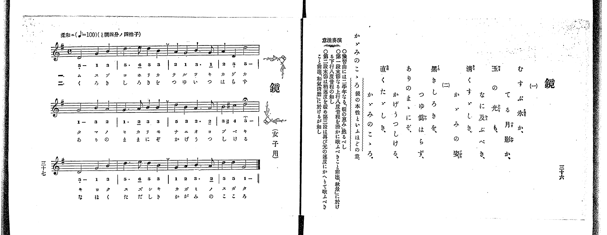
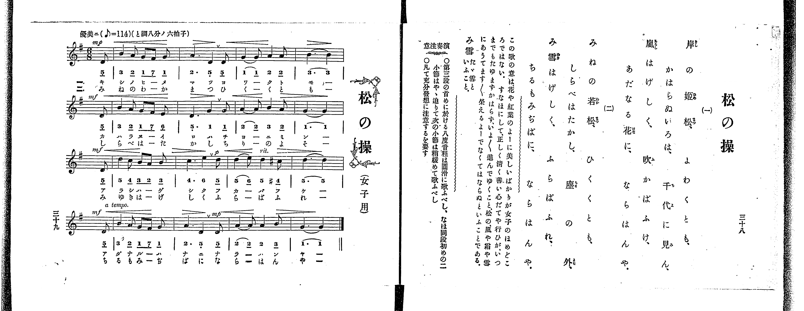

# 松の操

> Re:Shōka 使用 AI 協助辨識與重建樂譜，可能會有錯誤。歡迎回報。

- **鋼琴伴奏版**：<br><audio controls src="matsu_no_misao.mp3"></audio>
- **NEUTRINO 歌聲合成版**：<br><audio controls src="matsu_no_misao_neutrino.mp3"></audio>

- 出處：共益商社樂器店《唱歌教科書 教師用 巻三》第三十八～三十九頁（女生徒專用曲第二曲）
- NDL Digital Collections PID 854864（https://dl.ndl.go.jp/pid/854864）掃描 P025.jpg

## 說明

原書資訊與歌詞全文（NDL PID 854864《唱歌教科書 教師用 巻三》第三十八～三十九頁，掃描 P025.jpg）：
調性與拍號：ト調八分ノ六拍子（G 大調 6/8 拍），♪=114（八分音符=114，折合四分音符 ♩=57），「優美ニ」，弱起一拍（八分音符）
註記：單聲部，二節分節歌，標題下附註「（女子用）」。開頭 mp，第四小節末拍（第二段弱起）轉 mf，第八小節末拍（第三段弱起）標 mf，第十小節末拍轉 p，第十一小節標 rit. 並於末拍出現 #4（C#5，4'），第十二小節末拍（第四段弱起）標 mf 及 a tempo.，第十四小節末拍轉 mp。
原典演奏注意：第三段開頭之八度音程（5_ - 5）須圓滑歌唱，且同段前二小節（第九、十小節）稍急迫、次小節（第十一小節）稍放緩歌唱；全曲須充分注意發想。
原典曲意：「この歌の意は、花や紅葉のよーに美しいばかりが女子のほめどころではない。すなほにして、正しく清く善い心だてや行ひが、いつまでもたゆまずかはらず、いよ／＼進んでゆくこと、松の風や霜や雪にあうてます／＼榮えるよーでなくてはならぬといふことである。」
原典語釋：「み雪」：たゞ雪といふこと。


## 歌詞

```text
一、
岸の姫松、よわくとも、
かはらぬいろは、千代に見ん、
嵐はげしく、吹かばふけ、
あだなる花に、ならはんや。

二、
みねの若松、ひくくとも、
しらべはたかし、塵の外、
み雪はげしく、ふらばふれ、
ちるもみぢばに、ならはんや。
```

## ABC

<div class="abc-score" data-abc-src="matsu_no_misao.abc" aria-label="五線譜載入中"></div>

[下載 ABC 原始檔](matsu_no_misao.abc)

## TMD 檔案連結

- [主旋律 TMD 檔案](matsu_no_misao.tmd) [[在 TMD Studio 編輯](https://tmdlang.github.io/Tmd-TS/#tmd=s7IKdvYPcrWy4qpTUCpJTLdSSM7PyUlNLsnMz7PKrsxPzc6ML87Iz05Ugisoy88pzU21yk7MizeOtzA1sTAzQUgW55cWJadaFSdn5OfnxJekVpQk5edno8vHFySmp1oFGBiZImQKivLLUvMS84C6C4oy80pSU8DaEQpSyzJTUkHSxclAq8tSizLTMlNTkNyVWlQMcjXUipKixLzi5KLMApBXEKrSU_OKUq2SMzJzUopS8-KL8_PSEZJp-UW5VsUlRfkFGZnJCOGSjFSghwtyEvOQnAMRzEssKS1KRRctTk0EGlyMEM4vykzPzLPKTc3MykQKFS0thWdz9z1uXPdscq-ClhaXoq2CqTmXva2CO5eNmb6FHUj_0_ZdL2ZOfb9n1tPWjc9ndz2d2vZ8yb5nK5qezlzxdNf0xw1dT6dsfLa259nUmc-XT3w2e4cCkPV0x-rnU1YoPN2--8mOzscN3c_XrAEynvY2Pm1d_X7vPAj7yc65Lxc0vt_T8XTp5udT5j_dN-nphg6gtmezN4HU7-oBMt7v6QR7ws_FR8EF6IWSxBwFZ3gCKVYI8HRRgCQBoDkZJSUFxVb6-ik5enlAnJ6vl1WgX5CZog9T0fmsr_lZf78CKOKBcsCA59LXUrClFuBSUFB42jcfGAYvNre_WNH1oqMdGDAvVs572rri2bR2oAtB3kA4mQph14PmI6AfgTEFcsiLVfufNSwHOaG798XM-UDRx80dQEGgKU872h439z1tXQuUerp2AtBd7gpPlywHSioAI10BKAo2pufRzFW2hoagkIVoejl_8_M1yyBCPc-6Zjyd0PF09my4hMKjmSttTc0heh839DxtWfV8X9_j5u7HDUADe57u2fhi6_YnOxrA5qMYCdQCdvKK3S9WzACltGnrXjRuetm8AqgNmA6er28AKgWSwKAC2bxi5suFPU92dL-c2QLUArQJkoaAXgEGHNAsoH2PG5peTut-uWCtQm4BUAswDEEu3dAPMmTOaogLoIls3VaIy4AaX-ztVMhNg6oHug9T_Y5OZPVAlyDUAyMIST3IKJjNwOja0QCVBOooyizRU3iyY9mzaXsgaoE57Hn_PgVlUEg7K5sCdZmoQ0IRqntXD6ZTgP7BdIrC0_4uhUSFktTcgnw9hLtQvQ72ZQEwhKDp9Wnrjmd7pjxd2v9s84pnLf3A8If7FBKGT3Z2g0Jj1zJQbK3oBtpvGq-gqwB0aOfLBR1P50x-tnsiMGqAaRkUXzumPJ0ADtXOXrjDoaG3c-7jhkZ4QAG1P1_R-6xh6Yv9q4Hiz9YsRFaMHGpQlVP2Pd--EmbRbFCmmr0J5IDWVmDygDj--cw9z5o3o_pt9iaIr4AJ5XHjZFBhtxbIWAcUfNy4Hmjxi66Nj5tanm9pfTGxEyj-uKnjcfOex42rQYm3cfrjxpbHjRseN3Y_bup63NgDSWcgZY27Hzc1Pm5cCTKzqfdx43KQaY2rQOobmh43zgSzdwPNARuyDOTDtYvB7P5nO1qB5NNpQJNbnu5vfty4AKSgqeXFQqDDNgFtASoG27vkcSOwdF7-uAlo4PzHTW1g7iyQY4B2NQFdC_QUWGVTx_s9QD_uedmw6XET0I9ALUDFQA8C2StAVoNL-ZeLVgBteTlnDoicDXQe0G1Ak4Eql4FNngkx5NkyoO86HjcBvQwJCqDXgIqBpgGVgf0IsnoNyGSQI7dCbQEpawLpAnq_oRcRAS9WzXvZDkw1kAjYD7IYVCAAvQH00jywO1ANAsYeSDcw-oEuB5uzaQfQ9U-XrwZ5A-hhoLOagK4BIqB_gJaBFSGFCtBpwCABxgkoep_2Nj_ZDQz41S-WAT00GWbkVmAkAv0yCRIjIHUTdoKNAMY10CET4aYCAwgYPUA_d4MSCjDIQCEOCQKgbcC4B8U3xMG7QBEH0bX_ceNaoJtfdC-FuhkUr1jcPB1sENBmoFvmg-0HVqmNTxcCnbDu6ZJpCPPA4YTiYJA7QZrBDm5CWL0QHHNAZwPdsAgsjcPNQNWUV3pQoKClz8Xlm1hSXOqX75tZnJhvFZafmZzqUKNrWFMNsknBxkLLDsyozi2oBTOAda8GpADTVHjctFahBkhuVwBWTUA8CYj3APFCkGjzPCBuAeIVYN56iFwTiO4AiywCiyAZthrkHpAdNQoGcAgstWoUjIEll5GCoYJ5PJCoATJ1QUUZuDwDSRsCGYZgUSOoYgiszk2rBasAm-pjWKMQD4ePG3tBrmicDlQHjDYg3gRiNTWCRfeB9QPzMlgM7N6mfqgYiAYmCLBYE9wuYDKA2WOEas9-sIlrYfaAzQGrRrcH6AKQGCF7pkPtAcbE4-Z-IF4JxD3Q4F0CDtq1UBmwZ4ARAImWbiCeDxbZjB70ixBBjxTWZqDABQczKHxBGBL2RlBFkJDHFdbAZAsOvU4gaw3Y5S1gv_RC_QGWbQSnFWAIQ8RWg0lwiDVNRvJzE1LYgkwEie2EmwH2FDBEYeGDMLcLKrYOTM4Fq1uBZC7QJkRYAsMRnJRBIQcKS3B0gESAiVajABhMzVPBIquh4TlBQQPULEBIbIQEK6wuV8AavqZAi02AAQgKxBogC-QQM1AAFgDDDypvBlGlDuXiDGFoSEyHh8QkeJpGpKCtKKGzAUlsIs4QbgOL9RI2F-wCNHObepDMBcYDIoQbgLgLiGEh2A9OjSCRbgWNXHAQd4GFQEkaogCUWEEiS8Ai2FIpWokAKqkgxQIkqYJIUEgjkqoBSiJdAHbmKqCzQUEE8jBIdBXU-ZAEuQrFq5BkPRks1gI3FR4x4AAEmwXMtqAkBtKzCGwqKJBIN7WWi0vXTgG5nFYA8pW5AA)]
- [鋼琴伴奏 TMD 檔案](matsu_no_misao_piano.tmd) [[在 TMD Studio 編輯](https://tmdlang.github.io/Tmd-TS/#tmd=s7IKdvYPcrWy4tLSUng2d9_jxnXPJve-39PxsnvP8wlbnuzZ8nRp__POjvd7OhW0tLgUbRVMzbnsbRXcuWzM9C3suOoUlJ6273oxc-r7PbOetm58Prvr6dS250v2PVvR9HTmiqe7pj9u6Ho6ZeOztT3Pps58vnzis9k7FICspztWP5-yQuHp9t1PdnQ-buh-vmYNkPG0t_Fp6-r3e-dB2E92zn25oBHolqdLNz-fMv_pvklPN3QAtT2bvQmkflcPkAF0lxLIEX4uPgoumemZJYk5Cs75OTmpySWZ-XnFCgGeLgoWpiYWZiZAczJKSgqKrfT1U3L08oA4PV8vq0C_IDNFH6ai81lf87P-foUAAyNToFy6EheXb2JJcalfvm9mcWK-VUBmYl5-kIdDja5hTTWXAhDYWGjZgRnVuQW1YIa-loLG0z0bX2zdrqnwuGmtQg2Q3K7wuLkPiCcB8R4gXggSbZ4HxC1AvALMWw-RawLRHWCRRWARJMNWK2jpg-2oUTCAQ9N4INdYQVfBSMFQwTweSNQAmbpACJQBEzVAMV0gBokaQRVDYHVuWi1YBdhUH8MahXg4fNzYC3JF43SgOmCqAOJNIFZTI1h0H1j_48YlYDGwe5v6oWIg-nEj2FdNTXC7Hjd2w-wxQrVnP9jEtTB7wOaAVaPbA3QBSIyQPdOh9gBj4nFzPxCvBOIeaPAuAQftWqgM2DPACIBESzcQzweLbEYP-kWIoEcKazNQ4IKDGRS-IAwJeyOoIkjI4wrrx43rwaHXCWStAbu8BeyXXqg_wLKN4LQCDGGI2GowCQ6xpslIfm5CCluQiSCxnXAzwJ4ChigsfBDmdkHF1oHJuWB1K5DMBdqECEtgOIKTMijkQGEJjg6QCDDRahQAg6l5KlhkNTQ8JyhoFGWW6CEkNkKCNVGhJDW3IF9PAWv4mgItNgEGICgQa4AskEPMQAFYAAw_qLwZRJU6lIszhKEhMR0eEpPgaRqRgraihM4GJLGJOEO4DSzWS9hcsAvQzG3qQTIXGA-IEG4A4i4ghoVgPzg1gkS6FTRywUHcBRYCJWmIAlBiBYksAYtgS6VoJQKopIIUC5CkCiJBIY1IqgYoiXQB2JmrgM4GBRHIwyDRVVDnQxLkKhSvQpL1ZLBYC9xUeMSAAxBsFjDbgpIYSM8isKmgQCLd1FpsxbQP1mIaGMov-rpetvc-bd3xcnYrpH5DhJphPChkog1jkVg14Dwer2AE5JrGIjMh_sEpS1AfebYRqcsAGDg4HAiWImiPCSjlRJugW4NNeOBDD-JbYELQtVNATgvRPkB5DDEjsJgyFwA)]

## 分析

```text
================================================================================
📊 TMD Song Profile: [ 松の操 ]
================================================================================
⏱  Duration:       0:50 (50.5s), 16 measures total
🎼 Key & Tempo:    首調基準 G, != 57.0 BPM, <6/8>
   - 分析範圍：      由實際發聲的音符與和弦推測調性；播放脈絡另行呈現
🎤 人聲音域:    D4 (MIDI 62) – E5 (MIDI 76) [跨度: 14 個半音 / 1.2 個八度, 難度: moderate]
   - 最低音:  D4 in [MatsuNoMisao #1 @ m.1, 0:02]
   - 最高音: E5 in [MatsuNoMisao #1 @ m.11, 0:33]
   - 適合: soprano, mezzo-soprano, contralto, tenor, baritone, bass
🏛  結構:      MatsuNoMisao (50.5s)
⚡ 編曲密度:        Peak 1 軌道同時演奏
🗝  調性診斷：       D 大調（純淨自然大調，未偵測到可信轉調）
   - 風格氣質:    純淨自然大調（陽光明朗、易唱易記，無明顯調外色彩）
   - 轉調歷程:    全曲維持單一推測調性（未偵測到可信轉調）
   - 核心骨幹音:  D, A, G, B, C
   - 調性數值:    D 大調 [相關度: 0.85, 穩定度: Moderate, 自然音純度: 95.8%]
   - 候選調性 (K-S): D 大調 (0.85), G 大調 (0.82), B 小調 (0.60)
   - 五度圈歷程:   +2
   - 各段落調性細節:
     • [MatsuNoMisao #1]: D 大調 (r: 0.87, 自然音純度: 95.6%, 調外音: C)

  [ 五度圈游移軌跡 ]
               C  
         F            G  
      Bb              [D ]*
      Eb               A  
         Ab           E  
            Db       B  
               F# 
     (* = active key center)

  [ 十二半音累積音高分佈 ]
     C  : ████                       4.2%
     C# : █                          1.0%
     D  : ████████████████████████  26.0%
     D# :                            0.0%
     E  : ████                       4.2%
     F  :                            0.0%
     F# : ███                        3.1%
     G  : ████████████████████      21.9%
     G# :                            0.0%
     A  : █████████████████████     22.9%
     A# :                            0.0%
     B  : ███████████████           16.7%
--------------------------------------------------------------------------------
Assignment 軌道音域：
  - Voice         : D4 – E5 (14 個半音 / 1.2 個八度, 56 個音符)
================================================================================
```


## 原書掃描頁






