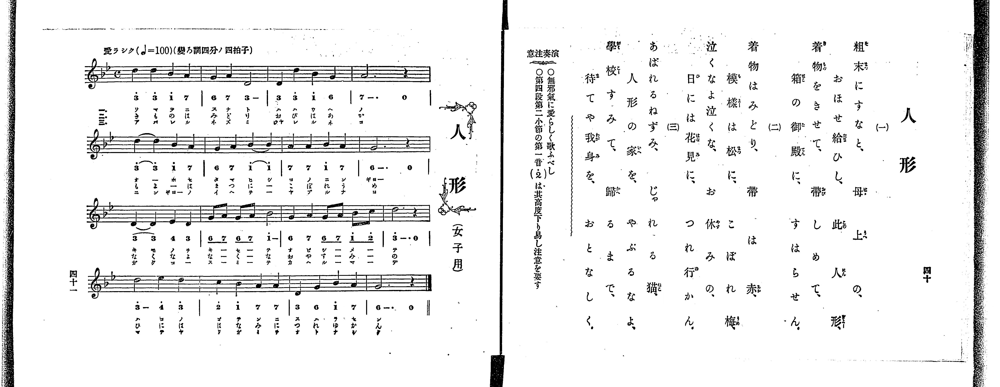

# 人形

> Re:Shōka 使用 AI 協助辨識與重建樂譜，可能會有錯誤。歡迎[回報](https://github.com/TMDLang/reshoka/issues)。

- **鋼琴伴奏版**：<br><audio controls src="ningyo.mp3"></audio>
- **NEUTRINO 歌聲合成版**：<br><audio controls src="ningyo_neutrino.mp3"></audio>

- 出處：共益商社樂器店《唱歌教科書 教師用 巻三》第四十～四十一頁（女生徒專用曲第三曲）
- NDL Digital Collections PID 854864（https://dl.ndl.go.jp/pid/854864）掃描 P026.jpg

## 說明

原書資訊與歌詞全文（NDL PID 854864《唱歌教科書 教師用 巻三》第四十～四十一頁，掃描 P026.jpg）：
調性與拍號：標「變ろ調四分ノ四拍子」（譜號二降記號，實為關係小調ト短調／G 小調 4/4 拍），♩=100，「愛ラシク」
註記：單聲部，三節分節歌，標題下附註「（女子用）」。五線譜第一小節音高為 D5–D5–Bb4–A4（於 TMD ?= B, 記為 3–3–1–7_），原書簡譜以 Bb3 為「1」、Bb4 為「1^」而印作「3^ 3^ 1^ 7」，本檔依五線譜實際八度音高轉寫。
原典演奏注意：當無邪氣且愛らしく歌唱；第四段第二小節（第十四小節）之第一音（C5，簡譜印 2^）音高易偏低，須加注意。


## 歌詞

```text
一、
粗末にすなと、母上の、
おほせ給ひし、此人形、
着物をきせて、帶しめて、
箱の御殿に、すはらせん。

二、
着物はみどり、帶は赤、
模樣は松に、こぼれ梅、
泣くなよ泣くな、お休みの、
日には花見に、つれ行かん。

三、
あばれるねずみ、じゃれる猫、
人形の家を、やぶるなよ、
學校すみて、歸るまで、
待てや我身を、おとなしく。
```

## ABC

<div class="abc-score" data-abc-src="ningyo.abc" aria-label="五線譜載入中"></div>

[下載 ABC 原始檔](ningyo.abc)

## TMD 檔案連結

- [主旋律 TMD 檔案](ningyo.tmd) [[在 TMD Studio 編輯](https://tmdlang.github.io/Tmd-TS/#tmd=s7IKdvYPcrWy4qpTUCpJTLdSSM7PyUlNLsnMz7PKrsxPzc6ML87Iz05Ugisoy88pzU21yk7MizeOtzA1sTAzQUgW55cWJadaFSdn5OfnxJekVpQk5edno8vHFySmp1oFGBiZIWQKivLLUvMS84C6C4oy80pSU8DaEQpSyzJTUkHSxclAq8tSizLTMlNTkNyVWlQMcjXUipKixLzi5KLMApBXEKrSU_OKUq2SMzJzUopS8-KL8_PSEZJp-UW5VsUlRfkFGZnJCOGSjFSgh9MSczNzKtFFoT7NyUxLRUjlF2WmZ-ZZ5aZmZmViCYT8opKM_PSixIKMSquMzOISoPLkxJx4YIgCg1lLS-HJrl1P9y5S0NLiUrRVMDQw4LK3VXDS4cpOrbRVcM_lsjHRN7EDGfa0fdeLmVPf75n1tHXj89ldT6e2PV-y79mKpqczVzzdNf1xQ9fTKRufre15NnXm8-UTn83eoQBkPd2x-vmUFQpPt-9-sqPzcUP38zVrns6e_bS38f3eeRDGkx0NLxc0vt_T8XTp5udT5j_dN-nphg6gnmezNwEVA3UBGe_3dIK94-fio-AC9GtJYo6CMzzhFCsEeLooQJIG0JyMkpKCYit9_ZQcvTwgTs_XyyrQL8hM0Yep6HzW1_ysv18BlCCAcsAI4dLXUrClFuBSUFB42jcfGAAvNre_WNH1oqMdGCovVs572rri2bR2oAtB3kA4mdKA60HzDtCDwDgCueLFqv3PGpaD7O_ufTFzPlD02YqZjxt6XqzretzUC5QFGdTR9ri5D8gAqnm6dsLjhl6gA1-snQNU_2RXz8uZvS9WzADr7Xm6ftnzpl0vp895sr_p6YZ-oPbHzR3P568FMt7v6XdXgIgpAFOLAtAssCt6Hs1caQtMUUAW0NpnLbMfN6983LT9cdN6oD1gF67YDTQflKSmrXvRuOll8wqgUqCHn69vADoMSAKDBeTDFTNfLgSKd7-c2QLUAjQLkl6ADgYGEtAqoHGPG5qe7JryfPssoOPBCacB6CCgCS_nb365egbQ5Qoupo8aJoMJpyQTIOkISi3Ppu1RCPF1UQCneaB7wCqNgbIgbAjE5vEQr0Ci9PmGhUDzn-xequCUZKwAVAt0iyHY9kagoTCBOKDIi4aep70bnuydAxQwjlMAIsM4BXNw-PY8m7Pm2aopT_bNhbsYGLgvZ81-2rr66a5lEBe_2Nv5dP1qoK-g6elp645ne6Y8Xdr_bPOKZy39wDB7PnXb85aFL5tWPduw-MmOKaDgbep83Dj9cWM_MNiAaer9ntmQZPNs3VZQkOzqgQQJ0Nsg8d5GUPxDRTqf7ASlMVCimr8ZqMDZFOhOiG-B3lAwigMqgTjs2YzJTxv7n-ztAyp4uaDjadcCiItATgW5FWgEMDRArOebpj-bs_pxIxDNfNy46nHjCqDEs_W9T3Z0PW5cB1X0uBHI2f24cfbzrcseN24CuR-oaO0SSKkEM2luw_NOYNKZ9LixF6j0ceMyoMTTHdtAqpsaIVywunUbgSY_3bfw2br9IHsbgHJAq9eDAwYYPJPhjtwFTJHIRgPVNAK1AO3oghm9_sXWJVBFz1YsfLZiMVDo2dx9MHMnP27c87ip59miVpiizUAV_SCPNnUg2CClXU_2TAQbD_P0s-lLwcGy_kXXxhfLumFGLgGa92Jhz-PGbmSngvI_NKiaHjduAKp53ATUsvZx4yyQoSCNMx43NUPEn_eAjIJ4ERyAwOBYtw0UckB1TS2PG4FsoGaQG6Hqnq7d8WzBQnA4AV0ICslna3eAFQG9uhymaF8rSK6p5VnHxBe7VkPNA0XdCnDMghIdNK1SXoJCgYKWPheXX2ZeemW-VVh-ZnKqQ41BTTXICgUbCy07MANYcD9u2qvwuHkeELcAcbdCDVBkJ5DVBcQdIF5zPwQ3LQPSM8AifSCzQfprFIwVdMHYEIjN44FEjYIZiAKzjUEECALVgflQhWAVNRA1MGgAEgIb6mMItKNxLpAPDEMwuQRMrgZrAoY0mLcKTK6AWwBMDWARCNkGJndAZdYh2QO2GmKPEUiuF6SyqQmsHqQOYgJIZj-YtxIs34VkD4j9uHEzkm0g3SCZbuz2GIPkIDZsAJvWAyZBqkEya8Eys8AkyE6YPaBUiaYcohgkORmrVeD4XAWModlAejcQ7wfHFyh2JwF528Gxuxkcg6C4fty8GSyy7nHzciBnD5HRChIEYWgMwsWQFeKKVlhAAgstMDkb6p_5YB4kujeByelIPoVFDSgJAPM2VKbvcVM79hAHxSwkTps64BbC4hU9TcHCG2LRHkSQg1MRyKRG7LaA4xXhJLiDIK4FSbaAeaBkCMzyCKuaIOLbwOKQeAUlZ5AMzLlY4nUtMIoWQeNuE1gxSGQPJKZBdHMbWBQU_5PBsQ0RXQimQemgDSmC4fnTBM4CRx0wEiEkKEYh7kXEPEzGCJpEcMUyRqYC-x4uA451YIGIFPjImQoU85BAB8nAVGHLvJBCoB8egpDwwyaDYg80_CEFCSjL4SkkwJEMSQ6LwSQs5yGKIkhBgewbSJxC4h3CBiU6kMxyrLaA4hdcxkLyJigWt4DjC5RDkUtlUFm8EhzjoPjcjJphQdAEiEHsGmAcIeVKaNYERzM4OonNr6BMA8k-iHwIEp8C9zMs8aMWz-CCsakTzIbmcbA6XDEJyvMQe8AZCp5ZIQUsJDYh4QyzB5yBoWUjpLiHFqi47AHHJCgeIPZA3A5KCSA9kJQCiWewPfAUC0mZoIoG5g5YyQTSg2pPLReXrp0CpNJVALKUuQA)]
- [鋼琴伴奏 TMD 檔案](ningyo_piano.tmd) [[在 TMD Studio 編輯](https://tmdlang.github.io/Tmd-TS/#tmd=s7IKdvYPcrWy4qpTUCpJTLdSyC8qychPL0osyKi0ysgsLskvykxOzInPTsxLVOLS0lJ4smvX072L3u_peNm95_mELU_2bHm6tP95Z8f7PZ0KWlpcirYKhgYGXPa2Ck46XDYm-iZ2IJOftu96MXPq-z2znrZufD676-nUtudL9j1b0fR05oqnu6Y_buh6OmXjs7U9z6bOfL584rPZOxSArKc7Vj-fskLh6fbdT3Z0Pm7ofr5mzdPZs5_2Nr7fOw_CeLKj4eWCRqBTni7d_HzK_Kf7Jj3d0AHU82z2JqBioC4gA-gsJZAL_Fx8FFwy0zNLEnMUnPNzclKTSzLz84oVAjxdFCxMTSzMTIDmZJSUFBRb6eun5OjlAXF6vl5WgX5BZoo-TEXns77mZ_39CgEGRmZAuXQlLi6_zLz0ynyrgMzEvPwgD4cag5pqLgUgsLHQsgMz9LUUHjftVXjcPA-IW4C4W6EGKLITyOoC4g4Qr7kfgpuWAekZYJE-BS19sP4aBWMFXTA2BGLzeCBRo2AGosBsYxABgkB1YD5UIVhFDUQNDBqAhMCG-hgC7WicC-Q_btwHJpeAydVgTY8bZ4J5q8DkCrgFjxvXg0UgZBuY3AGVWYdkD9hqiD1GILlekMqmJrB6kDqICSCZ_WDeSrB8F5I9IPbjxs1ItoF0g2S6sdtjDJKD2LABbFoPmASpBsmsBcvMApMgO2H2zHjc1IymHKIYJDkZq1Xg-FwFjKHZQHo3EO8HxxcodicBedvBsbsZHIOguH7cvBkssu5x83IgZw-R0QoSBGFoDMLFkBXiilZYQD5u3A0mZ0P9Mx_Mg0T3JjA5HcmnsKgBJYHHTSARkEzf46Z27CEOillInDZ1wC2ExSt6moKFN8SiPYggB6cikEmN2G0BxyvCSXAHQVwLkmwB80DJ8HHTJIRVTRDxbWBxSLyCkjNIBuZcLPG6FhhFi6BxtwmsGCSyBxLTILq5DSwKiv_J4NiGiC4E06B00IYUwfD8aQJngaMOGIkQEhSjEPciYh4mYwRNIrhiGSNTgX0PlwHH-uPGZUiBj5ypQDEPCXSQDEwVtswLKQT64SEICT9sMij2QMMfUpCAshyeQgIcyZDksBhMwnIeoiiCFBTIvoHEKSTeIWxQogPJLMdqCyh-wWUsJG-CYnELOL5AORS5VAaVxSvBMQ6Kz82oGRYETYAYxK4BxhFSroRmTXA0g6OT2PwKyjSQ7IPIhyDxKXA_wxI_avEMLhibOsFsaB4Hq8MVk6A8D7EHnKHgmRVSwEJiExLOMHvAGRhaNkKKe2iBissecEyC4gFiD8TtoJQA0gNJKZB4BtsDT7GQlAmqaGDugJVMID2o9tSi1rk-yHWuCaLOfdHX9bK992nrjpezWyGNFEREGsYrRBvGKpjGA2nT-FigSA0oi0abIIuhqoVKg1TCleBSi2IunAOVhKnFYgrCFTDbyHADdnOhJqC5gRRzMcIHxVQDSMTo2ilA4ibaByiOxDNC4RmDecpcAA)]

## 分析

```text
================================================================================
📊 TMD Song Profile: [ 人形 ]
================================================================================
⏱  Duration:       0:38 (38.4s), 16 measures total
🎼 Key & Tempo:    首調基準 B,, != 100.0 BPM, <4/4>
   - 分析範圍：      由實際發聲的音符與和弦推測調性；播放脈絡另行呈現
🎤 人聲音域:    D4 (MIDI 62) – D#5 (MIDI 75) [跨度: 13 個半音 / 1.1 個八度, 難度: moderate]
   - 最低音:  D4 in [Ningyo #1 @ m.2, 0:03]
   - 最高音: D#5 in [Ningyo #1 @ m.13, 0:30]
   - 適合: soprano, mezzo-soprano, contralto, tenor, baritone, bass
🏛  結構:      Ningyo (38.4s)
⚡ 編曲密度:        Peak 1 軌道同時演奏
🗝  調性診斷：       G 調性不明確（純淨自然大調，未偵測到可信轉調）
   - 風格氣質:    純淨自然大調（陽光明朗、易唱易記，無明顯調外色彩）
   - 轉調歷程:    全曲維持單一推測調性（未偵測到可信轉調）
   - 核心骨幹音:  D, A, G, A#, D#
   - 調性數值:    G 調性不明確 [相關度: 0.72, 穩定度: Ambiguous, 自然音純度: 100.0%]
   - 候選調性 (K-S): G 小調 (0.72), D 大調 (0.69), D 小調 (0.66)
   - 五度圈歷程:   +1
   - 各段落調性細節:
     • [Ningyo #1]: G 調性不明確 (r: 0.72, 自然音純度: 100.0%)

  [ 五度圈游移軌跡 ]
               C  
         F           [G ]*
      Bb               D  
      Eb               A  
         Ab           E  
            Db       B  
               F# 
     (* = active key center)

  [ 十二半音累積音高分佈 ]
     C  : ██                         2.5%
     C# :                            0.0%
     D  : ████████████████████████  30.0%
     D# : ███                        3.3%
     E  :                            0.0%
     F  :                            0.0%
     F# :                            0.0%
     G  : █████████████████         20.8%
     G# :                            0.0%
     A  : █████████████████████     25.8%
     A# : ██████████████            17.5%
     B  :                            0.0%
--------------------------------------------------------------------------------
Assignment 軌道音域：
  - Voice         : D4 – D#5 (13 個半音 / 1.1 個八度, 53 個音符)
================================================================================
```


## 原書掃描頁




