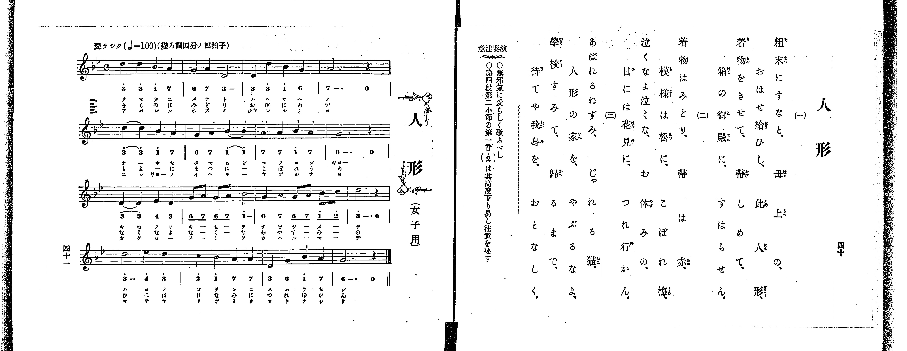

# 人形

> Re:Shoka 使用 AI 辨識樂譜，可能會有錯誤。歡迎回報。

<audio controls src="ningyo.mp3"></audio>

- 出處：共益商社樂器店《唱歌教科書 教師用 巻三》第四十～四十一頁（女生徒專用曲第三曲）
- NDL Digital Collections PID 854864（https://dl.ndl.go.jp/pid/854864）掃描 P026.jpg

## 說明

原書資訊與歌詞全文（NDL PID 854864《唱歌教科書 教師用 巻三》第四十～四十一頁，掃描 P026.jpg）：
調性與拍號：標「變ろ調四分ノ四拍子」（譜號二降記號，實為關係小調ト短調／G 小調 4/4 拍），♩=100，「愛ラシク」
註記：單聲部，三節分節歌，標題下附註「（女子用）」。五線譜第一小節音高為 D5–D5–Bb4–A4（於 TMD ?= B, 記為 3–3–1–7_），原書簡譜以 Bb3 為「1」、Bb4 為「1^」而印作「3^ 3^ 1^ 7」，本檔依五線譜實際八度音高轉寫。
原典演奏注意：當無邪氣且愛らしく歌唱；第四段第二小節（第十四小節）之第一音（C5，簡譜印 2^）音高易偏低，須加注意。

## 歌詞

```text
一、
粗末にすなと、母上の、
おほせ給ひし、此人形、
着物をきせて、帶しめて、
箱の御殿に、すはらせん。

二、
着物はみどり、帶は赤、
模樣は松に、こぼれ梅、
泣くなよ泣くな、お休みの、
日には花見に、つれ行かん。

三、
あばれるねずみ、じゃれる猫、
人形の家を、やぶるなよ、
學校すみて、歸るまで、
待てや我身を、おとなしく。
```

## ABC

```abc
X:1
T:人形
M:4/4
L:1/16
Q:1/4=100
K:Gm
V:V1 name="Voice" snm="Voi"
[V:V1]
d4 d4 B4 A4 | G4 A4 D8 | D4 d4 B4 G4 | A12 z4 |
d4 d4 B4 A4 | G4 A4 B4 B4 | A4 A4 B4 A4 | G12 z4 |
D4 D4 E4 D4 | G2 A2 G2 A2 B8 | G4 A4 G2 A2 B2 c2 | d12 z4 |
d8 e4 d4 | c4 B4 A4 A4 | D4 G4 B4 A4 | G12 z4 |
d4 d4 B4 A4 | G4 A4 D8 | D4 d4 B4 G4 | A12 z4 |
d4 d4 B4 A4 | G4 A4 B4 B4 | A4 A4 B4 A4 | G12 z4 |
D4 D4 E4 D4 | G2 A2 G2 A2 B8 | G4 A4 G2 A2 B2 c2 | d12 z4 |
d8 e4 d4 | c4 B4 A4 A4 | D4 G4 B4 A4 | G12 z4 |
d4 d4 B4 A4 | G4 A4 D8 | D4 d4 B4 G4 | A12 z4 |
d4 d4 B4 A4 | G4 A4 B4 B4 | A4 A4 B4 A4 | G12 z4 |
D4 D4 E4 D4 | G2 A2 G2 A2 B8 | G4 A4 G2 A2 B2 c2 | d12 z4 |
d8 e4 d4 | c4 B4 A4 A4 | D4 G4 B4 A4 | G12 z4 |
```

## TMD 檔案連結

- [主旋律 TMD 檔案](ningyo.tmd) [[在 TMD Studio 編輯](https://tmdlang.github.io/Tmd-TS/#tmd=s7IKdvYPcrWy4qpTUCpJTLdSSM7PyUlNLsnMz7PKrsxPzc6ML87Iz05Ugisoy88pzU21yk7MizeOtzA1sTAzQUgW55cWJadaFSdn5OfnxJekVpQk5edno8vHFySmp1oFGBiZIWQKivLLUvMS84C6C4oy80pSU8DaEQpSyzJTUkHSxclAq8tSizLTMlNTkNyVWlQMcjXUipKixLzi5KLMApBXEKrSU_OKUq2SMzJzUopS8-KL8_PSEZJp-UW5VsUlRfkFGZnJCOGSjFSgh9MSczNzKtFFoT7NyUxLVeLS0lJ4smvX072LFLS0uBRtFQwNDLjsbRWcdLiyUyttFdxzuWxM9E3sQEY8bd_1YubU93tmPW3d-Hx219Opbc-X7Hu2ounpzBVPd01_3ND1dMrGZ2t7nk2d-Xz5xGezdygAWU93rH4-ZYXC0-27n-zofNzQ_XzNmqezZz_tbXy_dx6E8WRHw8sFje_3dDxduvn5lPlP9016uqEDqOfZ7E1AxUBdQMb7PZ1gT_i5-Ci4ZKZnliTmKDjDI71YIcDTRQESrUBzMkpKCoqt9PVTcvTygDg9Xy-rQL8gM0UfpqLzWV_zs_5-BVBkAuWAgcmlr6VgSy3ApaCg8LRvPjAAXmxuf7Gi60VHOzBUXqyc97R1xbNp7UAXgryBcDKlAdeD5h2gB4FxBHLFi1X7nzUsB9nf3fti5nyg6LMVMx839LxY1_W4qRcoCzKoo-1xcx-QAVTzdO2Exw29QAe-WDsHqP7Jrp6XM3tfrJgB1tvzdP2y5027Xk6f82R_09MN_UDtj5s7ns9fC2S839PvrgARUwCmFgWgWWBX9DyaudIWmKKALKC1z1pmP25e-bhp--Om9UB7wC5csRtoPihJTVv3onHTy-YVQKVADz9f3wB0GJAEBgvIhytmvlwIFO9-ObMFqAVoFiS9AB0MDCSgVUDjHjc0Pdk15fn2WUDHgxNOA9BBQBNezt_8cvUMoMsVXEwfNUwGE05JJkDSEZRank3boxDi66IATvNA94BVGgNlQdgQiM3jIV6BROnzDQuB5j_ZvVTBKclYAagW6BZDsO2NQENhAnFAkRcNPU97NzzZOwcoYBynAESGcQrm4PDteTZnzbNVU57smwt3MTBwX86a_bR19dNdyyAufrG38-n61UBfQdPT09Ydz_ZMebq0_9nmFc9a-oFh9nzqtuctC182rXq2YfGTHVNAwdvU-bhx-uPGfmCwAdPU-z2zIcnm2bqtoCDZ1QMJEqC3QeK9jaD4h4p0PtkJSmOgRDV_M1CBsynQnRDfAr2hYBQHVAJx2LMZk5829j_Z2wdU8HJBx9OuBRAXgZwKcivQCGBogFjPN01_Nmf140Ygmvm4cdXjxhVAiWfre5_s6HrcuA6q6HEjkLP7cePs51uXPW7cBHI_UNHaJZBSCWbS3IbnncCkM-lxYy9Q6ePGZUCJpzu2gVQ3NUK4YHXrNgJNfrpv4bN1-0H2NgDlgFavBwcMMHgmwx25C5gikY0GqmkEagHa0QUzev2LrUugip6tWPhsxWKg0LO5-2DmTn7cuOdxU8-zRa0wRZuBKvpBHm3qQLBBSrue7JkINh7m6WfTl4KDZf2Lro0vlnXDjFwCNO_Fwp7Hjd3ITgXlf2hQNT1u3ABU87gJqGXt48ZZIENBGmc8bmqGiD_vARkF8SI4AIHBsW4bKOSA6ppaHjcC2UDNIDdC1T1du-PZgoXgcAK6EBSSz9buACsCenU5TNG-VpBcU8uzjokvdq2GmgeKuhXgmAUlOmhapbwEhQIFLX0uLr_MvPTKfKuw_MzkVIcagxqFapAdCjaGZlp2YBaw6H7ctFfhcfM8IG4B4m6FGqDITiCrC4g7QLzmfghuWgakZ4BF-kCmg_TXKBgr6IIhjDaE0ubxUEaNghmMCRczhjFgEGgOXA7NILjuGoR-dGgAU4Lw1CqgM2cD6d1AvB_saJAXJwF528Fe3Az2BsjDj5s3g0XWPW5eDuTsodBvMEUwGsnZGGqwGUSE39YCnbkI6v5NYLeDRPZAfAuim9vAoqAwmAz2MUR0IZgGhUUbkicxIsUEQwTqPLBzESyYL2AQW2igqjYCq4IFJ2GfgpMdJKZA_tkCdjkovpATKih5rgT7HeSzzZjRB4MmMG_B3QtyD9b4QIoYeCDAPUde7NVycenaKUBypAIOljIXAA)]

## 分析

```text
================================================================================
📊 TMD Song Profile: [ 人形 ]
================================================================================
⏱  Duration:       1:55 (115.2s), 48 measures total
🎼 Key & Tempo:    首調基準 B,, != 100.0 BPM, <4/4>
   - 分析範圍：      由實際發聲的音符與和弦推測調性；播放脈絡另行呈現
🎤 人聲音域:    D4 (MIDI 62) – D#5 (MIDI 75) [跨度: 13 個半音 / 1.1 個八度, 難度: moderate]
   - 最低音:  D4 in [Ningyo #1 @ m.2, 0:03]
   - 最高音: D#5 in [Ningyo #1 @ m.13, 0:30]
   - 適合: soprano, mezzo-soprano, contralto, tenor, baritone, bass
🏛  結構:      Ningyo (38.4s) -> Ningyo (38.4s) -> Ningyo (38.4s)
⚡ 編曲密度:        Peak 1 軌道同時演奏
🗝  調性診斷：       G 調性不明確（純淨自然大調，未偵測到可信轉調）
   - 風格氣質:    純淨自然大調（陽光明朗、易唱易記，無明顯調外色彩）
   - 轉調歷程:    全曲維持單一推測調性（未偵測到可信轉調）
   - 核心骨幹音:  D, A, G, A#, D#
   - 調性數值:    G 調性不明確 [相關度: 0.72, 穩定度: Ambiguous, 自然音純度: 100.0%]
   - 候選調性 (K-S): G 小調 (0.72), D 大調 (0.69), D 小調 (0.66)
   - 五度圈歷程:   +1 -> +1 -> +1
   - 各段落調性細節:
     • [Ningyo #1]: G 調性不明確 (r: 0.72, 自然音純度: 100.0%)
     • [Ningyo #2]: G 調性不明確 (r: 0.72, 自然音純度: 100.0%)
     • [Ningyo #3]: G 調性不明確 (r: 0.72, 自然音純度: 100.0%)

  [ 五度圈游移軌跡 ]
               C  
         F           [G ]*
      Bb               D  
      Eb               A  
         Ab           E  
            Db       B  
               F# 
     (* = active key center)

  [ 十二半音累積音高分佈 ]
     C  : ██                         2.5%
     C# :                            0.0%
     D  : ████████████████████████  30.0%
     D# : ███                        3.3%
     E  :                            0.0%
     F  :                            0.0%
     F# :                            0.0%
     G  : █████████████████         20.8%
     G# :                            0.0%
     A  : █████████████████████     25.8%
     A# : ██████████████            17.5%
     B  :                            0.0%
--------------------------------------------------------------------------------
Assignment 軌道音域：
  - Voice         : D4 – D#5 (13 個半音 / 1.1 個八度, 159 個音符)
================================================================================
```


## 原書掃描頁




