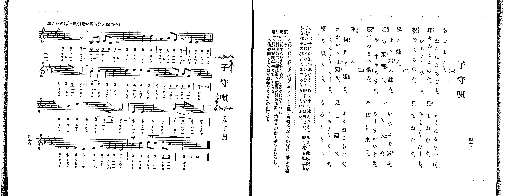

# 子守唄

*找不到鋼琴伴奏版 TMD，未產生音訊。*

- 出處：共益商社樂器店《唱歌教科書 教師用 巻三》第四十二～四十三頁（女生徒專用曲第四曲）
- NDL Digital Collections PID 854864（https://dl.ndl.go.jp/pid/854864）掃描 P027.jpg

## 說明

原書資訊與歌詞全文（NDL PID 854864《唱歌教科書 教師用 巻三》第四十二～四十三頁，掃描 P027.jpg）：
調性與拍號：標「變い調四分ノ四拍子」（譜號四降記號，實為關係小調ヘ短調／F 小調 4/4 拍），♩=69，「愛ラシク」
註記：單聲部，三節分節歌，標題下附註「（女子用）」。開頭 p，第十七小節轉 pp（首次出現最弱記號 pp）並標 rit.。第一小節第三、四拍五線譜為 G4（7_ -），簡譜「7」下方漏印低音點，以五線譜為準。
原典演奏注意：注意發想，速度緩慢（ユッタリと）且可憐、寧以微聲歌唱；凡八分音符勿急，須圓滑歌唱；最後二小節漸漸放緩速度，如消入微聲般唱畢；最弱記號（pp）首次使用；預習曲可用前學年〈月〉之曲。
原典曲意：「これは子供の無邪氣なのにあはせて詠んだのである。此歌聞いては、いかにせわしいちごも眠らずには居まい。蝶も花も風車も、みな稚子の夢に入るであらうといふ意。」

## 歌詞

```text
一、
ちごよ／＼、よくねるちごは、
ねむれよちごよ、てねむる、
蝶々のとぶのを、見てねむる、
ひら／＼ひーら、ひら／＼ひーら、
櫻のちるのを、見てねむる。

二、
蝶々蝶々、いつまで遊ぶ、
よく飛ぶ蝶々、て休め、
畑の菜種に、來てやすめ、
やーすめやすめ、やーすめやすめ、
寐てゐる子供の、そばに來て。

三、
車々、よくねるちごの、
何見て廻る、て廻る、
かわいゝ寐顔を、見て廻る、
くる／＼くーる、くる／＼くーる、
櫻や蝶々と、もろともに。
```

## ABC

```abc
X:1
T:子守唄
M:4/4
L:1/16
Q:1/4=69
K:Fm
V:V1 name="Voice" snm="Voi"
[V:V1]
!p! F4 F4 G8 | B,2 C2 D2 B,2 C8 | A4 A4 c4 c4 | G4 A2 F2 G8 |
D4 D4 F4 F4 | A4 c2 F2 G8 | B4 B4 B4 c4 | d4 d4 d4 c4 |
F4 G4 A2 G2 A2 F2 | G12 z4 | B4 B4 d4 d4 | c4 d2 F2 G8 |
D4 D4 F4 F4 | A4 c2 F2 G8 | D4 D4 D4 C4 | D4 F4 D2 C2 B,4 |
!pp! B4 c4 d2 c2 d2 B2 | c12 z4 | !p! F4 F4 G8 | B,2 C2 D2 B,2 C8 |
A4 A4 c4 c4 | G4 A2 F2 G8 | D4 D4 F4 F4 | A4 c2 F2 G8 |
B4 B4 B4 c4 | d4 d4 d4 c4 | F4 G4 A2 G2 A2 F2 | G12 z4 |
B4 B4 d4 d4 | c4 d2 F2 G8 | D4 D4 F4 F4 | A4 c2 F2 G8 |
D4 D4 D4 C4 | D4 F4 D2 C2 B,4 | !pp! B4 c4 d2 c2 d2 B2 | c12 z4 |
!p! F4 F4 G8 | B,2 C2 D2 B,2 C8 | A4 A4 c4 c4 | G4 A2 F2 G8 |
D4 D4 F4 F4 | A4 c2 F2 G8 | B4 B4 B4 c4 | d4 d4 d4 c4 |
F4 G4 A2 G2 A2 F2 | G12 z4 | B4 B4 d4 d4 | c4 d2 F2 G8 |
D4 D4 F4 F4 | A4 c2 F2 G8 | D4 D4 D4 C4 | D4 F4 D2 C2 B,4 |
!pp! B4 c4 d2 c2 d2 B2 | c12 z4 |
```

## TMD 檔案連結

- [主旋律 TMD 檔案](komoriuta.tmd) [[在 TMD Studio 編輯](https://tmdlang.github.io/Tmd-TS/#tmd=s7IKdvYPcrWy4qpTUCpJTLdSSM7PyUlNLsnMz7PKrsxPzc6ML87Iz05Ugisoy88pzU21yk7MizeOtzA1sTAzQUgW55cWJadaFSdn5OfnxJekVpQk5edno8vHFySmp1oFGBiZI2QKivLLUvMS84C6C4oy80pSU8DaEQpSyzJTUkHSxclAq8tSizLTMlNTkNyVWlQMcjXUipKixLzi5KLMApBXEKrSU_OKUq1ySnNyEpMqEcJp-UW5VsUlRfkFGZnJCOGSjFSgV9MSczNzkBRDRBPzMnMTc9BFC3IS84CO1tJSeLp2wtN1HU-ntChoaXEp2iqYWXLZ2yo46nBlp1baKrjlctmY6JvYgbQ_bd_1YubU93tmPW3d-Hx219Opbc-X7Hu2ounpzBVPd01_3ND1dMrGZ2t7nk2d-Xz5xGezdygAWU93rH4-ZYXC0-27n-zofNzQ_XzNmqezZz_tbXyyq-f93nlQ9o7Olwsa3-_peLp08_Mp85_um_R0QwdQ27PZmyDqgYz3ezrBfvBz8VFwyUzPLEnMUXCGp4FihQBPFwVILAPNySgpKSi20tdPydHLA-L0fL2sAv2CzBR9mIrOZ33Nz_r7FUBxC5RLV-Li0tdSsKUW4FJQUHjaNx8YBi82t79Y0fWiox0YMC9WznvauuLZtHagC0HeQDiZCmHXg-YjoB-BMQVyyItV-581LAc5obv3xcz5QNFnK2Y-buh5sa7rcWMLUBZkUEfb4-Y-UEh39wITxOOGXqAbX6ydA1QPFHw5s_fFihlgvT1P1y973rTr5fQ5T_Y3Pd3QD9T-uHnG8_lrgYz3e_rdFCBiCsA0owA0C-yKnkczV9qaWQIZQFuftcx-3LzycdP2x03rgdaAHbhiN9B4ULqatu5F46aXzSuASoH-er6-AeguIAkMGJAHV8x8uRAo3v1yZgtQC9AsSIoBuhcYTECbgMY9bmh6Oa375YK1CgVAHaAAA4VQM9BRQGNe7O1UKACKd7xcNu3ZmoXA5Py8f9-zOQ1P92yEeA8s2_lkxzKgVQpFmSV6QOOAZjzZ0QAxAMwGWtMICagnu6Y83z4LGErAAFFwB6U783gFXYiXn29YCJQAutEc6Cqgm59N2_lsT__T3g1P9va9nL_55e55ID_uXopsxrNd04AWQtPO09Ydz_ZMebq0_9nmFc9a-kGxBmY8n7nnWfNmoOaXDfOf7lr2fPvKZ62LgFY_bl72uLn5cRMwOlY9bgQFx5MdU572r3_WBozNxqfrlwMte7oPFL7A0AQmtvd7Zj9tX_i0dTUwiIEOer5m2dNuYDpZCjJ5QcfTOZOf7Z4IVwkKpH09wGQHCYdne4Bu2_Fsyj6g7RBngBLGsqZn2zqetkJtedGxBqj3-VSg28DaYWEMdCo4lCFx8GTvfnDczX65YMLz_ZOA-RzoZKDI005gMtzxdOeWxw0dz-Z0PG7ofLKzGyiLGj6zN0FCBhjMjxsnP24CkuuBqeHJvtmPG9c9b1n4smnVsw2LHzcCA2Td48bVjxubgAoeNwJll71YueBx0-THjQvAUstBUk3dQNOfrV0CyqmN84BZA6gMpL6hEczuBpsw-3FT_-PG6WCRhY8bpzxuano-B2hU5-PGWWAF659ubH3cuA-koKHpxdxtQAUvujYCyZeLVrzY3QVkgA3cD3TV8xWzQHmtcd3TJYuAeoFBB3ID1DFAA9uA8Qi2aCvQm0DTQNkF5HtgegSaAWLB3NABzHrv9-wBmdzU8bgR6MK1YKPAsmAvQFQDRRtAwQRSBNUJdg3QnxApYBCAlYIc3gD0BzBsgE7YBmI0TQLKvVgGNBVD9ePGTUAHQ90AZDfvAbkfZDB2cZCeZ6t3g41fCHYoLuObIB7eBSw5kNwFdR00YpaAg3v5y0ZgcQYUh7gIHAwvFwOjehuS6mVP9kx83NQIVfR86kSgzS_65zxfAU4eDY1P9gHDfNnjJqCpMxHqQHyg0yFCSHK4xMEpdD0wYoEmTQB6A54kwW6Y-7hxA9A2qFUwH4KLFbAPgWkE4losMQkyAax871RIUD3dvRsSDchsSJR0g1Nqy-OmuUC3vFwIjGtECKMp7QdyYLHUD44liJHYxWGx19QCSyUrwM4FJtpeEBvIAAUmOKNSXpVCgYKWPheXd35uflFmaUmiVVh-ZnKqQ41BjUI1yBoFG0MzLTswq7qgFkwDq_PHzY3AuNsCpFco1EB4zXugIkAaKtoLxAuAeA2yOjQ1K4Ai66FqV4OcArKhRsEMWNyDIZwBqgBQYI2CEUjIGESYgAgEF1WZIZQFo43R6BqE2SAlYBux2Aa2AwThDExH1mAGEMir_WCvtkF5U6HsqWDRPiDuAOJpYDZIZBMQz4eqgQQhSBQpcJA9gsu1RlAWOo3wtAnMO2g0QgVm2INsBnPgAYUUeOjQADNQJgHxSjgN8haIBQoUBA-XPNz76F5C90AN3AsgEYqik5ighvuuaSs0LYN8AIlKUL5YDY1kkC82gUUhkasBagZpQuMYJAnKKnvQ4xrTmXAGPKkjqYI7HSwCVgHOFhBl1QUFtRgpARRIIDaIBskhgg93hNZycenaKcALDQW8HGUuAA)]

## 分析

```text
================================================================================
📊 TMD Song Profile: [ 子守唄 ]
================================================================================
⏱  Duration:       3:07 (187.8s), 54 measures total
🎼 Key & Tempo:    首調基準 A,, != 69.0 BPM, <4/4>
   - 分析範圍：      由實際發聲的音符與和弦推測調性；播放脈絡另行呈現
🎤 人聲音域:    A#3 (MIDI 58) – C#5 (MIDI 73) [跨度: 15 個半音 / 1.2 個八度, 難度: moderate]
   - 最低音:  A#3 in [Komoriuta #1 @ m.2, 0:03]
   - 最高音: C#5 in [Komoriuta #1 @ m.8, 0:24]
   - 適合: soprano, mezzo-soprano, contralto, tenor, baritone, bass
🏛  結構:      Komoriuta (62.6s) -> Komoriuta (62.6s) -> Komoriuta (62.6s)
⚡ 編曲密度:        Peak 1 軌道同時演奏
🗝  調性診斷：       F 小調（純淨自然小調，未偵測到可信轉調）
   - 風格氣質:    純淨自然小調（陰鬱抒情、旋律集中，無明顯調外色彩）
   - 轉調歷程:    全曲維持單一推測調性（未偵測到可信轉調）
   - 核心骨幹音:  C#, G, C, F, A#
   - 調性數值:    F 小調 [相關度: 0.58, 穩定度: Moderate, 自然音純度: 100.0%]
   - 候選調性 (K-S): F 小調 (0.58), A# 小調 (0.43), C# 大調 (0.42)
   - 五度圈歷程:   -1 -> -1 -> -1
   - 各段落調性細節:
     • [Komoriuta #1]: F 小調 (r: 0.58, 自然音純度: 100.0%)
     • [Komoriuta #2]: F 小調 (r: 0.58, 自然音純度: 100.0%)
     • [Komoriuta #3]: F 小調 (r: 0.58, 自然音純度: 100.0%)

  [ 五度圈游移軌跡 ]
               C  
        [F ]*          G  
      Bb               D  
      Eb               A  
         Ab           E  
            Db       B  
               F# 
     (* = active key center)

  [ 十二半音累積音高分佈 ]
     C  : ██████████████████████    20.7%
     C# : ████████████████████████  22.1%
     D  :                            0.0%
     D# :                            0.0%
     E  :                            0.0%
     F  : ████████████████          15.0%
     F# :                            0.0%
     G  : ████████████████████████  22.1%
     G# : █████████                  7.9%
     A  :                            0.0%
     A# : █████████████             12.1%
     B  :                            0.0%
--------------------------------------------------------------------------------
Assignment 軌道音域：
  - Voice         : A#3 – C#5 (15 個半音 / 1.2 個八度, 213 個音符)
================================================================================
```


## 原書掃描頁




