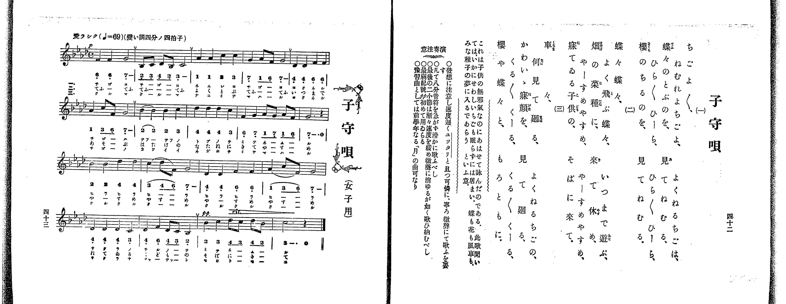

# 子守唄

> Re:Shōka 使用 AI 協助辨識與重建樂譜，可能會有錯誤。歡迎回報。

- **鋼琴伴奏版**：<br><audio controls src="komoriuta.mp3"></audio>
- **NEUTRINO 歌聲合成版**：<br><audio controls src="komoriuta_neutrino.mp3"></audio>

- 出處：共益商社樂器店《唱歌教科書 教師用 巻三》第四十二～四十三頁（女生徒專用曲第四曲）
- NDL Digital Collections PID 854864（https://dl.ndl.go.jp/pid/854864）掃描 P027.jpg

## 說明

原書資訊與歌詞全文（NDL PID 854864《唱歌教科書 教師用 巻三》第四十二～四十三頁，掃描 P027.jpg）：
調性與拍號：標「變い調四分ノ四拍子」（譜號四降記號，實為關係小調ヘ短調／F 小調 4/4 拍），♩=69，「愛ラシク」
註記：單聲部，三節分節歌，標題下附註「（女子用）」。開頭 p，第十七小節轉 pp（首次出現最弱記號 pp）並標 rit.。第一小節第三、四拍五線譜為 G4（7_ -），簡譜「7」下方漏印低音點，以五線譜為準。
原典演奏注意：注意發想，速度緩慢（ユッタリと）且可憐、寧以微聲歌唱；凡八分音符勿急，須圓滑歌唱；最後二小節漸漸放緩速度，如消入微聲般唱畢；最弱記號（pp）首次使用；預習曲可用前學年〈月〉之曲。
原典曲意：「これは子供の無邪氣なのにあはせて詠んだのである。此歌聞いては、いかにせわしいちごも眠らずには居まい。蝶も花も風車も、みな稚子の夢に入るであらうといふ意。」


## 歌詞

```text
一、
ちごよ／＼、よくねるちごは、
ねむれよちごよ、てねむる、
蝶々のとぶのを、見てねむる、
ひら／＼ひーら、ひら／＼ひーら、
櫻のちるのを、見てねむる。

二、
蝶々蝶々、いつまで遊ぶ、
よく飛ぶ蝶々、て休め、
畑の菜種に、來てやすめ、
やーすめやすめ、やーすめやすめ、
寐てゐる子供の、そばに來て。

三、
車々、よくねるちごの、
何見て廻る、て廻る、
かわいゝ寐顔を、見て廻る、
くる／＼くーる、くる／＼くーる、
櫻や蝶々と、もろともに。
```

## ABC

<div class="abc-score" data-abc-src="komoriuta.abc" aria-label="五線譜載入中"></div>

[下載 ABC 原始檔](komoriuta.abc)

## TMD 檔案連結

- [主旋律 TMD 檔案](komoriuta.tmd) [[在 TMD Studio 編輯](https://tmdlang.github.io/Tmd-TS/#tmd=s7IKdvYPcrWy4qpTUCpJTLdSSM7PyUlNLsnMz7PKrsxPzc6ML87Iz05Ugisoy88pzU21yk7MizeOtzA1sTAzQUgW55cWJadaFSdn5OfnxJekVpQk5edno8vHFySmp1oFGBiZI2QKivLLUvMS84C6C4oy80pSU8DaEQpSyzJTUkHSxclAq8tSizLTMlNTkNyVWlQMcjXUipKixLzi5KLMApBXEKrSU_OKUq1ySnNyEpMqEcJp-UW5VsUlRfkFGZnJCOGSjFSgV9MSczNzkBRDRBPzMnMTc9BFC3IS85AcnV-UmZ6ZZ5WbmpmViSU48otKMvLTixILMiqtMjKLS4DKkxNz4oFhCwxwLS2Fp2snPF3X8XRKi4KWFpeirYKZJZe9rYKjDld2aqWtglsul42JvokdyLin7btezJz6fs-sp60bn8_uejq17fmSfc9WND2dueLprumPG7qeTtn4bG3Ps6kzny-f-Gz2DgUg6-mO1c-nrFB4un33kx2djxu6n69Z83T27Ke9jU929bzfOw_K3tH5ckHj-z0dT5dufj5l_tN9k55u6ABqezZ7E0Q9kPF-TyfYT34uPgouQA-XJOYoOMPTUbFCgKeLAiSlAM3JKCkpKLbS10_J0csD4vR8vawC_YLMFH2Yis5nfc3P-vsVQOkDKJeuxMWlr6VgSy3ApaCg8LRvPjAMXmxuf7Gi60VHOzBgXqyc97R1xbNp7UAXgryBcDIVwq4HzUdAPwJjCuSQF6v2P2tYDnJCd--LmfOBos9WzHzc0PNiXdfjxhagLMigjrbHzX2gkO7uBSaIxw29QDe-WDsHqB4o-HJm74sVM8B6e56uX_a8adfL6XOe7G96uqEfqP1x84zn89cCGe_39LspQMQUgGlGAWgW2BU9j2autDWzBDKAtj5rmf24eeXjpu2Pm9YDrQE7cMVuoPGgdDVt3YvGTS-bVwCVAv31fH0D0F1AEhgwIA-umPlyIVC8--XMFqAWoFmQFAN0LzCYgDYBjXvc0PRyWvfLBWsVCoA6QAEGCqFmoKOAxrzY26lQABTveLls2rM1C4HJ-Xn_vmdzGp7u2QjxHli288mOZUCrFIoyS_SAxgHNeLKjAWIAmA20phESUE92TXm-fRYwlIABouAOSnfm8Qq6EC8_37AQKAF0oznQVUA3P5u289me_qe9G57s7Xs5f_PL3fNAfty9FNmMZ7umAS2Epp2nrTue7ZnydGn_s80rnrX0g2INzHg-c8-z5s1AzS8b5j_dtez59pXPWhcBrX7cvOxxc_PjJmB0rHrcCAqOJzumPO1f_6wNGJuNT9cvB1r2dB8ofIGhCUxs7_fMftq-8GnramAQAx30fM2yp93AdLIUZPKCjqdzJj_bPRGuEhRI-3qAyQ4SDs_2AN2249mUfUDbIc4AJYxlTc-2dTxthdryomMNUO_zqUC3gbXDwhjoVHAoQ-Lgyd794Lib_XLBhOf7JwHzOdDJQJGnncBkuOPpzi2PGzqezel43ND5ZGc3UBY1fGZvgoQMMJgfN05-3AQk1wNTw5N9sx83rnvesvBl06pnGxY_bgQGyLrHjasfNzYBFTxuBMoue7FyweOmyY8bF4ClloOkmrqBpj9buwSUUxvnAbMGUBlIfUMjmN0NNmH246b-x43TwSILHzdOedzU9HwO0KjOx42zwArWP93Y-rhxH0hBQ9OLuduACl50bQSSLxeteLG7C8gAG7gf6KrnK2aB8lrjuqdLFgH1AoMO5AaoY4AGtgHjEWzRVqA3gaaBsgvI98D0CDQDxIK5oQOY9d7v2QMyuanjcSPQhWvBRoFlwV6AqAaKNoCCCaQIqhPsGqA_IVLAIAArBTm8AegPYNgAnbANxGiaBJR7sQxoKobqx42bgA6GugHIbt4Dcj_IYOziID3PVu8GG78Q7FBcxjdBPLwLWHIguQvqOmjELAEH9_KXjcDiDCgOcRE4GF4uBkb1NiTVy57smfi4qRGq6PnUiUCbX_TPeb4CnDwaGp_sA4b5ssdNQFNnItSB-ECnQ4SQ5HCJg1PoemDEAk2aAPQGPEmC3TD3ceMGoG1Qq2A-BBcrYB8C0wjEtVhiEmQCWPneqZCgerp7NyQakNmQKOkGp9SWx01zgW55uRAY14gQRlPaD-TAYqkfHEsQI7GLw2KvqQWWSlaAnQtMtL0gNpABCkxwRqW8KoUCBS19Li7v_Fxg66W0JNEqLD8zOdWhxqCmGmSLgo2hmZYdmFVdUAumgbX54-ZGYNRtAdIrFGogvOY9UBEgDRXtBeIFQLwGWR2amhVAkfVQtatBLgHZUKNgBiztwRDOAJX_KLBGwQhIGgOxCRDD2KgqDKEsGA1TAaNrEMaClIAtw2KRCUwIzsB0Xw3Y5T6GQE81LoSKARMWjNXUgWEq8erWwmUb4KweDB0kmAgXAyY-OAthSzeqn4xAJgOLjq1oBmEVJFEtVpesgLO2kWdqYwtcwRI4ax-ctRymEuI_Y5AOuO1w3yN0IJtMrLpVcNnVcNZ-hLORVCLctR7DbCQTSYozlDwKym394NzWBuVNhbKngkX7gLgDiKeB2SCRTUA8H6oGkotBokj5EzlD4co1oCwJgug0IvOBMi4IotMIFZjZH2QzmAPPsEiZGB0aoAQKzswJD3ik4CaY3IBVBpJqzCSLkAdWD0gqMRMBtgwOinD0RACDaEUOOHs2wc2ai-ESZF_Bk1jjfDhrIlYfIRIwQiXcnfBEDVLZi-mjJkQGnInko0bifATOkNjiCeY-ZB_Bs2ETIlsgbIexUIrRRnjh2bgbrptQHGFmU-LjCJwdJwHxSjgNylAgFig7Ini45OEZDz0zoWedGnjmAYlQVKERk8mR8tUmqBiwHQpjYRFDVgmDCFmEC6lsHiKnwFMmXDU8hSLSJ7I6bPJI7qSueQQqJEwxZJUI_2OpPqhrHjxVN22FNuBAKRdSeYAag6uh1Qoo9W4Ci0KqEw1Q118TWquAJEHtwz3otQtm8oQzjBHJEzPtgkXAKowQyqoLCmox6h5Q5kBuOiKyDTrEVoVMhQUMUgAiEilyIQovxJACnZ7VAtwEpKJ5AoabQConw1WuhMsjKhVkPyEqmA1wFqKN04ukEmYnAZeCkzveMIVnHuIqZlhlDAotuB-aYC5DqqzhsiBzYX7A7dpaLi5dOwV4V0kByFHmAgA)]
- [鋼琴伴奏 TMD 檔案](komoriuta_piano.tmd) [[在 TMD Studio 編輯](https://tmdlang.github.io/Tmd-TS/#tmd=s7IKdvYPcrWy4qpTUCpJTLdSyC8qychPL0osyKi0ysgsLskvykxOzInPTsxLVOLS0lJ4unbC03UdT6e0vN_T8bJ7z_MJW57s2fJ0af_zzo73ezoVtLS4FG0VzCy57G0VHHW4bEz0TexAZj9t3_Vi5tT3e2Y9bd34fHbX06ltz5fse7ai6enMFU93TX_c0PV0ysZna3ueTZ35fPnEZ7N3KABZT3esfj5lhcLT7buf7Oh83ND9fM2ap7NnP-1tfLKr5_3eeVD2js6XCxqBjnm6dPPzKfOf7pv0dEMHUNuz2Zsg6oEMoMOUQI7wc_FRcMlMzyxJzFFwzs_JSU0uyczPK1YI8HRRsDA1sTAzAZqTUVJSUGylr5-So5cHxOn5elkF-gWZKfowFZ3P-pqf9fcrBBgYmQPl0pW4uLzzc4HhVFqSaBWQmZiXH-ThUGNQU82lAAQ2hmZadmBWdUEtmNbXUnjc3KjwuGkLkF6hUAPhNe-BigBpqGgvEC8A4jXI6tDUrACKrIeqXa2gpQ-2oUbBLF5BFwzhDHMYAwZrFIyApDEQmwAxjI2qwhDKgtEwFTC6BmEsSAnYMiwWmcCE4AxM99WAXe5jCPRU40Ko2OPGKTBWUweGqcSrWwuXbYCzejB0kGAiXOxxYz-chbClG9VPRiCTlz1u3IpmEFZBEtVidckKOGsbeaY2tsAVLIGz9sFZy2EqIf4zBumA2w73PUIHssnEqlsFl10NZ-1HOBtJJcJd6zHMRjKRpDhDyaOg3NYPzm1tUN5UKHsqWLQPiDuAeBqYDRLZBMTzoWoguRgkipQ_kTMUrlwDypIgiE4jMh8o44IgOo1QgZn9QTaDOfAMi5SJ0aEBSqDgzJzwgEcKboLJ7XHjOiTVmEkWIf-4aRKSSsxEgC2DgyIcPRHAIFqRA86eTXCz5mK4BNlX8CTWOB_OmojVR4gEjFAJdyc8UYNU9mL6qAmRAWci-aiROB-BMyS2eIK5D9lH8GzYhMgWCNthLJRitBFeeDbuhusmFEeY2ZT4OAJnx0lAvBJOgzIUiAXKjggeLnl4xkPPTOhZpwaeeUAiFFVoxGRypHy1CSr2uKkTxsIihqwSBhGyCBdS2TxEToGnTLhqeApFpE9kddjkkdxJXfMIVEiYYsgqEf7HUn1Q1zx4qm7aCm3AgVIupPIANQZXQ6sVUOrdBBaFVCcaRZkleprQWgUkCWof7kGvXTCTJ5xhjEiemGkXLAJWYYRQVl1QUItR94AyB3LTEZFt0CG2KmQqLGCQAhCRSJELUXghhhTo9KwW4CYgFc0TMNwEUjkZrnIlXB5RqSD7CVHBbICzEG2cXiSVMDsJuBSc3PGGKTzzEFcxwypjUGjB_dAEcxlSZQ2XBZkL8wNu19Zi9JR8kHtKJtCOEjBfvOjretne-7R1x8vZrZD-JUrqjjaJVTCNB9Km8bFAkRoEByEKa2kB-YaxMAqm1gBTIdRYKAVSCNWDoRKLZSj6DeAqzYAKQIpANFAUr0PhAkguMAaKAbkUuBXFVQi-EdRh-L2ECDuQl4Cxp2unAI_AaB-gFKqAEbqAMVhAmQsA)]

## 分析

```text
================================================================================
📊 TMD Song Profile: [ 子守唄 ]
================================================================================
⏱  Duration:       1:02 (62.6s), 18 measures total
🎼 Key & Tempo:    首調基準 A,, != 69.0 BPM, <4/4>
   - 分析範圍：      由實際發聲的音符與和弦推測調性；播放脈絡另行呈現
🎤 人聲音域:    A#3 (MIDI 58) – C#5 (MIDI 73) [跨度: 15 個半音 / 1.2 個八度, 難度: moderate]
   - 最低音:  A#3 in [Komoriuta #1 @ m.16, 0:54]
   - 最高音: C#5 in [Komoriuta #1 @ m.2, 0:04]
   - 適合: soprano, mezzo-soprano, contralto, tenor, baritone, bass
🏛  結構:      Komoriuta (62.6s)
⚡ 編曲密度:        Peak 1 軌道同時演奏
🗝  調性診斷：       F 小調（純淨自然小調，未偵測到可信轉調）
   - 風格氣質:    純淨自然小調（陰鬱抒情、旋律集中，無明顯調外色彩）
   - 轉調歷程:    全曲維持單一推測調性（未偵測到可信轉調）
   - 核心骨幹音:  C#, G, C, F, A#
   - 調性數值:    F 小調 [相關度: 0.58, 穩定度: Moderate, 自然音純度: 100.0%]
   - 候選調性 (K-S): F 小調 (0.58), A# 小調 (0.43), C# 大調 (0.42)
   - 五度圈歷程:   -1
   - 各段落調性細節:
     • [Komoriuta #1]: F 小調 (r: 0.58, 自然音純度: 100.0%)

  [ 五度圈游移軌跡 ]
               C  
        [F ]*          G  
      Bb               D  
      Eb               A  
         Ab           E  
            Db       B  
               F# 
     (* = active key center)

  [ 十二半音累積音高分佈 ]
     C  : ██████████████████████    20.7%
     C# : ████████████████████████  22.1%
     D  :                            0.0%
     D# :                            0.0%
     E  :                            0.0%
     F  : ████████████████          15.0%
     F# :                            0.0%
     G  : ████████████████████████  22.1%
     G# : █████████                  7.9%
     A  :                            0.0%
     A# : █████████████             12.1%
     B  :                            0.0%
--------------------------------------------------------------------------------
Assignment 軌道音域：
  - Voice         : A#3 – C#5 (15 個半音 / 1.2 個八度, 71 個音符)
================================================================================
```


## 原書掃描頁




