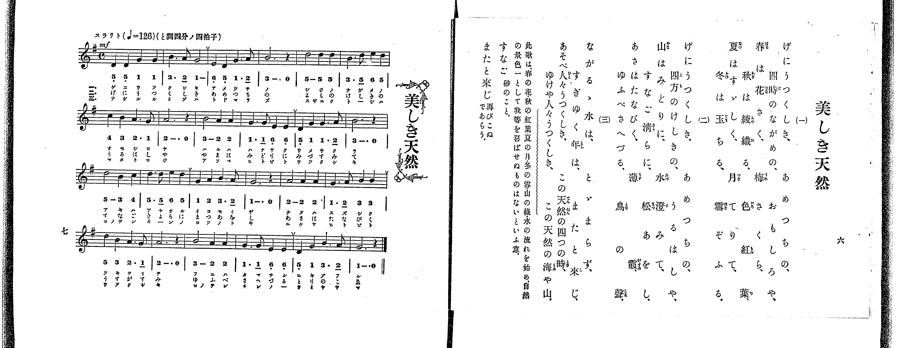

# 美しき天然

*找不到鋼琴伴奏版 TMD，未產生音訊。*

- 出處：共益商社樂器店《唱歌教科書 教師用 巻三》第六～七頁（第一學期第三曲）
- NDL Digital Collections PID 854864（https://dl.ndl.go.jp/pid/854864）掃描 P009.jpg

## 說明

原書資訊與歌詞全文（NDL PID 854864《唱歌教科書 教師用 巻三》第六～七頁，掃描 P009.jpg）：
調性與拍號：標「と調四分ノ四拍子」（譜號一升記號，五線譜實為關係小調ホ短調／E 小調 4/4 拍），♩=126，「スラリト」
註記：單聲部，三節分節歌，開頭 mf。五線譜為 E 小調（起音 B3–B3–E4–E4，即關係大調 G 大調之 3_–3_–6_–6_），而原書下方簡譜以小調主音 E4 為「1」記作「5_ 5_ 1 1 | 3. 2 1 - ...」；本檔依五線譜實際音高（?= G, key= Em）轉寫。
原典曲意：「此歌は、春の花、秋の紅葉、夏の月、冬の雪、山の綠、水の流れを始め、自然の景色一として我等を喜ばせぬものはないといふ意。」
原典語釋：「すなご」：砂のこと；「またと來じ」：再びこぬであらう。

## 歌詞

```text
一、
げにうつくしき、あめつちの、
四時のながめの、おもしろや、
春は花さく、梅さくら、
秋は綾織る、色紅葉、
夏はすゞしく、月てりて、
冬は玉ちる、雪ぞふる。

二、
げにうつくしき、あめつちの、
四方のけしきの、うるはしや、
山はみどりに、水澄みて、
すなご清らに、松あをし、
あさはたなびく、薄霞、
ゆふべさへづる、鳥の聲。

三、
ながるゝ水は、とゞまらず、
すぎゆく年は、またと來じ、
あそべ人々うつくしき、この天然の四つの時、
ゆけや人々うつくしき、この天然の海や山。
```

## ABC

```abc
X:1
T:美しき天然
M:4/4
L:1/16
Q:1/4=126
K:Em
V:V1 name="Voice" snm="Voi"
[V:V1]
!mf! B,4 B,4 E4 E4 | G6 F2 E8 | C4 B,4 E6 F2 | G12 z4 |
B8 B4 B4 | G6 B2 c4 B4 | A4 G4 F6 E2 | F12 z4 |
G8 F4 F4 | E6 E2 C4 C4 | B,4 E4 E6 F2 | G12 z4 |
B8 G4 A4 | B6 B2 c4 B4 | E4 F4 G6 F2 | E12 z4 |
F8 F4 F4 | E6 F2 G4 G4 | B4 G4 F6 E2 | F12 z4 |
G8 F4 F4 | E6 E2 C4 C4 | B,4 E4 G6 F2 | E12 z4 |
!mf! B,4 B,4 E4 E4 | G6 F2 E8 | C4 B,4 E6 F2 | G12 z4 |
B8 B4 B4 | G6 B2 c4 B4 | A4 G4 F6 E2 | F12 z4 |
G8 F4 F4 | E6 E2 C4 C4 | B,4 E4 E6 F2 | G12 z4 |
B8 G4 A4 | B6 B2 c4 B4 | E4 F4 G6 F2 | E12 z4 |
F8 F4 F4 | E6 F2 G4 G4 | B4 G4 F6 E2 | F12 z4 |
G8 F4 F4 | E6 E2 C4 C4 | B,4 E4 G6 F2 | E12 z4 |
!mf! B,4 B,4 E4 E4 | G6 F2 E8 | C4 B,4 E6 F2 | G12 z4 |
B8 B4 B4 | G6 B2 c4 B4 | A4 G4 F6 E2 | F12 z4 |
G8 F4 F4 | E6 E2 C4 C4 | B,4 E4 E6 F2 | G12 z4 |
B8 G4 A4 | B6 B2 c4 B4 | E4 F4 G6 F2 | E12 z4 |
F8 F4 F4 | E6 F2 G4 G4 | B4 G4 F6 E2 | F12 z4 |
G8 F4 F4 | E6 E2 C4 C4 | B,4 E4 G6 F2 | E12 z4 |
```

## TMD 檔案連結

- [主旋律 TMD 檔案](utsukushiki_tennen.tmd) [[在 TMD Studio 編輯](https://tmdlang.github.io/Tmd-TS/#tmd=s7IKdvYPcrWy4qpTUCpJTLdSSM7PyUlNLsnMz7PKrsxPzc6ML87Iz05Ugisoy88pzU21yk7MizeOtzA1sTAzQUgW55cWJadaFSdn5OfnxJekVpQk5edno8vHFySmp1oFGBhYImQKivLLUvMS84C6C4oy80pSU8DaEQpSyzJTUkHSxclAq8tSizLTMlNTkNyVWlQMcjXUipKixLzi5KLMApBXEKrSU_OKUq2SMzJzUopS8-KL8_PSEZJp-UW5VsUlRfkFGZnJCOGSjFSgh_MSS0qLUtFFcxLzUoAOKsCQKE5NBBperMSlpaXwfF_f48bpjxt7ny5Z-bxlm4KWFpeirYKhkRmXva2CO1d2aqWtgmsul42JvokdyJin7btezJz6fs-sp60bn8_uejq17fmSfc9WND2dueLprumPG7qeTtn4bG3Ps6kzny-f-Gz2DgUg6-mO1c-nrFB4un33kx2djxu6n69Z87R17fu9857saH65oPH9ng6gyJMdDU_X7ng2Zz6Y3fls9qb3ezrBLvdz8VFwyUzPLEnMUXCGJ4FihQBPFwVIJANNyCgpKSi20tdPydHLA-L0fL2sAv2CzBR9mIrOZ33Nz_r7FUBRC5QDBi2XvpaCLbUAl4KCwtO--UAfv9jc_mJF14uOdmAwvFg572nrimfT2oEuBHkD4WQyQ6oHzRdAfwHjAmT5i1X7nzUsB1nb3fti5nyg6LMVMx839DxuXAGUejp79tOOtsfNfUAGUMHTtRMeN_QCHfVi7RygYlDY9wJdPQOssefJrinPt88CSj1dv-x5066X0-c82d_0dEM_0JzHzbOfz18LZLzf0--qABFTAKYNBaChYLf0PJq50haYfIAskOVNOx83r3zcvOpxcwfQQrA7V-wGWgRKQNPWvWjc9LJ5BcjGHZ3P1zcAXQgkgWECFHk5rfvlgrUKuWmPG5rg7gE6RgFmK8jxW7e_nL9Zwcn4UcNkMOFqAiaA2p_2boY6e8lykBPdFSCMJzu7FYzjgarAhBmEgDj8RUMPJAKf7Oh-Nm3n8w0LgTY-2b0UYt2THbtBdrmaKAAdAfSZIdA7QH882TsHyDGNVwAiQyCsUTDWUzACMnQV9PT0wGE8-9mcNc9WTXmyby5yuL6cNRto3svVwJDoAOU0HQVoVgM65sXezqfrVwM9Dk1UT1t3ALPDs5Z-YKgBbXu2dgkwjB43rn_c0PhsxtLHjetedG0Esp8v7wayn29pfTERmHYany7pB3KfzQEGfOPTtjVA9svZq0DsjRtByrYtAGnfsAWkZmvj4yZgXE16CjShqREo_qJ9FbAwAEnNXP-icxMwfQCTEbicWPasY-LztZ0gxdPmPG7c8Lhx9uPGNY-bmoCKQU5qXPW4sQWsGEhuBboZ6A1ozEN88mLVvJft3RCfPG6cCdYwBRxQs54vgJgyGagfGG5gBfseN84Hcp_sa3vcOAOi7Glb7-PGzWBlQF8tf9zY9Lip83FjGyjAQPaAXNvQCGI9bpz0uHE1SKpxyeNGYHCACjqgHFgLkAQKLgTZCFENyhozIS4AugkYHkAVILnHjV1g_01_3NT7uKkFqhoc8utBId84FWQ2MDAXtULZQOdAFIGjZP3zbfue75zyuKkbFLKdm-AxBLYUFEvAYJv5uGke2H1gk4CR1rjscVMXiISqA8Xg-ud9QI8uhJgEis1GoJ6tYC7U67uAuY5Mr0_bCfb6RKhSqNfbQKaDHAj0Pczr4BQEFNr_uHEl2JHAtApKSs_2AeMcKAhzMzx6n-1oBUcRWN1cYJQC3QB0HrC6gKoDhi4w4IBGAuMaqAEYuaBgeDGt5eWceTBFTUCvbH3cCHQlUOmOx41LocGwGZwDGjchoh8WtrB4BCbqueCUDsoxoLQJCup9YBcBUyHCqX1gO_qf7oQrRUt9CNfOBTrkyS5gQQCMcswgBqbMdZD6FMSYDcwhQAXAvATMCQi_TAQGKJFGPNu6HagYFOyQMoHy6goKFLT0ubhCS4pLs0uLMzKzM0NS8_JS86zC8jOTUx1qDGoUqkHWKdgYmmnZgVnVuWm1YAaw7nzctEnhcXM3kF4GpFuAZd_jpvVAvB2I14J5i4DiC8Fyj5sbQSLNfWBxkIodYB7QfpBpwGIzHlhkgiCcYYbBqAGXqzBoDhKGy8FgjYIJbpPg2lBNQoYGcHOM0WRgfBhdAw-H5i6gf9ZA_Qrx4SogC-h7kE-bwWHRvARM9gPxajAN44H0bgWHHDwskN0Gss0E3WZgDQNhwVSCPQWDYO_WoIph9yJ6IMC1wBk1qIEH5sADGM5ABAU4KQCDoWkb2EsgT66EJQVgooB6HJwwlkCDaTWWRIAZ93BXkRN1MB2wYENVgTWIET4CuhMYheDobJ4P9lETmARGHDhhQ3y0E4h3QZM2UlTC3Q8PUYwkjBbE2H2EEZkEowosDrMMRiOlWaDTwRHSBsSrwB5qA5NTgRgUiRBv7Qey5oFzL2pEoZk7aNIfyOkgbzXtA3sF5CG86Yus2OCq5eLStVPAKDcVSBJU5gIA)]

## 分析

```text
================================================================================
📊 TMD Song Profile: [ 美しき天然 ]
================================================================================
⏱  Duration:       2:17 (137.1s), 72 measures total
🎼 Key & Tempo:    首調基準 G, != 126.0 BPM, <4/4>
   - 分析範圍：      由實際發聲的音符與和弦推測調性；播放脈絡另行呈現
🎤 人聲音域:    B3 (MIDI 59) – C5 (MIDI 72) [跨度: 13 個半音 / 1.1 個八度, 難度: moderate]
   - 最低音:  B3 in [UtsukushikiTennen #1 @ m.1, 0:00]
   - 最高音: C5 in [UtsukushikiTennen #1 @ m.6, 0:10]
   - 適合: soprano, mezzo-soprano, contralto, tenor, baritone, bass
🏛  結構:      UtsukushikiTennen (45.7s) -> UtsukushikiTennen (45.7s) -> UtsukushikiTennen (45.7s)
⚡ 編曲密度:        Peak 1 軌道同時演奏
🗝  調性診斷：       E 小調（純淨自然小調，未偵測到可信轉調）
   - 風格氣質:    純淨自然小調（陰鬱抒情、旋律集中，無明顯調外色彩）
   - 轉調歷程:    全曲維持單一推測調性（未偵測到可信轉調）
   - 核心骨幹音:  E, F#, G, B, C
   - 調性數值:    E 小調 [相關度: 0.84, 穩定度: High, 自然音純度: 100.0%]
   - 候選調性 (K-S): E 小調 (0.84), G 大調 (0.50), B 小調 (0.46)
   - 五度圈歷程:   +4 -> +4 -> +4
   - 各段落調性細節:
     • [UtsukushikiTennen #1]: E 小調 (r: 0.84, 自然音純度: 100.0%)
     • [UtsukushikiTennen #2]: E 小調 (r: 0.84, 自然音純度: 100.0%)
     • [UtsukushikiTennen #3]: E 小調 (r: 0.84, 自然音純度: 100.0%)

  [ 五度圈游移軌跡 ]
               C  
         F            G  
      Bb               D  
      Eb               A  
         Ab          [E ]*
            Db       B  
               F# 
     (* = active key center)

  [ 十二半音累積音高分佈 ]
     C  : ███████                    7.8%
     C# :                            0.0%
     D  :                            0.0%
     D# :                            0.0%
     E  : ████████████████████████  25.0%
     F  :                            0.0%
     F# : ██████████████████████    23.3%
     G  : ██████████████████████    23.3%
     G# :                            0.0%
     A  : ██                         2.2%
     A# :                            0.0%
     B  : ██████████████████        18.3%
--------------------------------------------------------------------------------
Assignment 軌道音域：
  - Voice         : B3 – C5 (13 個半音 / 1.1 個八度, 216 個音符)
================================================================================
```


## 原書掃描頁




