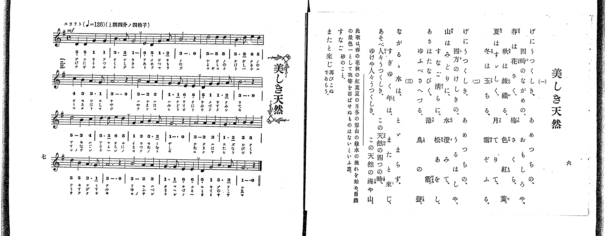

# 美しき天然

> Re:Shōka 使用 AI 協助辨識與重建樂譜，可能會有錯誤。歡迎[回報](https://github.com/TMDLang/reshoka/issues)。

- **鋼琴伴奏版**：<br><audio controls src="utsukushiki_tennen.mp3"></audio>
- **NEUTRINO 歌聲合成版**：<br><audio controls src="utsukushiki_tennen_neutrino.mp3"></audio>

- 出處：共益商社樂器店《唱歌教科書 教師用 巻三》第六～七頁（第一學期第三曲）
- NDL Digital Collections PID 854864（https://dl.ndl.go.jp/pid/854864）掃描 P009.jpg

## 說明

原書資訊與歌詞全文（NDL PID 854864《唱歌教科書 教師用 巻三》第六～七頁，掃描 P009.jpg）：
調性與拍號：と調四分ノ四拍子（G 大調 4/4 拍），♩=126，「スラリト」
註記：單聲部，三節分節歌，開頭 mf。五線譜與下方簡譜一致為 G 大調（起音 D4–D4–G4–G4，即 5_–5_–1–1，音域 D4–E5）。
原典曲意：「此歌は、春の花、秋の紅葉、夏の月、冬の雪、山の綠、水の流れを始め、自然の景色一として我等を喜ばせぬものはないといふ意。」
原典語釋：「すなご」：砂のこと；「またと來じ」：再びこぬであらう。


## 歌詞

```text
一、
げにうつくしき、あめつちの、
四時のながめの、おもしろや、
春は花さく、梅さくら、
秋は綾織る、色紅葉、
夏はすゞしく、月てりて、
冬は玉ちる、雪ぞふる。

二、
げにうつくしき、あめつちの、
四方のけしきの、うるはしや、
山はみどりに、水澄みて、
すなご清らに、松あをし、
あさはたなびく、薄霞、
ゆふべさへづる、鳥の聲。

三、
ながるゝ水は、とゞまらず、
すぎゆく年は、またと來じ、
あそべ人々うつくしき、この天然の四つの時、
ゆけや人々うつくしき、この天然の海や山。
```

## ABC

<div class="abc-score" data-abc-src="utsukushiki_tennen.abc" aria-label="五線譜載入中"></div>

[下載 ABC 原始檔](utsukushiki_tennen.abc)

## TMD 檔案連結

- [主旋律 TMD 檔案](utsukushiki_tennen.tmd) [[在 TMD Studio 編輯](https://tmdlang.github.io/Tmd-TS/#tmd=s7IKdvYPcrWy4qpTUCpJTLdSSM7PyUlNLsnMz7PKrsxPzc6ML87Iz05Ugisoy88pzU21yk7MizeOtzA1sTAzQUgW55cWJadaFSdn5OfnxJekVpQk5edno8vHFySmp1oFGBhYImQKivLLUvMS84C6C4oy80pSU8DaEQpSyzJTUkHSxclAq8tSizLTMlNTkNyVWlQMcjXUipKixLzi5KLMApBXEKrSU_OKUq2SMzJzUopS8-KL8_PSEZJp-UW5VsUlRfkFGZnJCOGSjFSgh_MSS0qLUtFFcxLzUoAOKsCQKE5NBBpejBDOL8pMz8yzyk3NzMrEEjL5RSUZ-elFiQUZlVYZmcUlQOXJiTnxwGAGhr2WlsLzfX2PG6c_bux9umTl85ZtClpaXIq2CoZGZlz2tgruXDYm-iZ2IMOetu96MXPq-z2znrZufD676-nUtudL9j1b0fR05oqnu6Y_buh6OmXjs7U9z6bOfL584rPZOxSArKc7Vj-fskLh6fbdT3Z0Pm7ofr5mzdPWte_3znuyo_nlgsb3ezqAIk92NDxdu-PZnPlgduez2Zve7-kEu9_PxUfBBei5ksQcBWd48ilWCPB0UYAkEKAJGSUlBcVW-vopOXp5QJyer5dVoF-QmaIPU9H5rK_5WX-_AihZAOWA0cKlr6VgSy3ApaCg8LRvPtDHLza3v1jR9aKjHRgML1bOe9q64tm0dqALQd5AOJnMkOpB8wXQX8C4AFn-YtX-Zw3LQdZ2976YOR8o-rhxBVDw6ezZTzvaHjf3ARlAqadrJwDd4q7wdMlyoKQCMFoVgKJgY3oezVxpC4xxIOtxQ8_jpp2Pm1c-bl71uLnjcUMv2IoVu1-smAGK-2nrXjRuetm8AqgU6NDn6xuAVgBJoHeAIi-ndb9csFYhN-1xQ9OTXVOeb5_1Yu0coMOe7Oh-Nm3n8w0LgVxgbL9o3_K8aZcCzClAV73Yuv3l_M0KLiaPGiaDCXcIATTzae9mBdN4IA9MGIIwyKb5m5_Onw_R4GoK9ATQRmhEPG3dAUxCz1r6QQHR0PNs7RKg4x43rn_c0PhsxtLHjetedG0Esp8v7wayn29pfTERqLnx6ZJ-IPfZHKCPG5-2rQGyX85eBWJv3AhStm0BSPuGLSA1WxsfNwEDadJToAlNjUDxF-2rgBkHJDVz_YvOTUAfAiMAnKeWPeuY-HxtJ0jxtDmPGzc8bpz9uHHN46YmoGKQkxpXPW5sASsGkluBbgZ6AxrkEJ-8WDXvZXs3xCePG2eCNUwBqgCKPF8AMWUyUP_7PbPBCvY9bpwP5D7Z1_a4cQZE2dO23seNm8HKgL5a_rix6XFT5-PGNlCAgewBubahEcR63DjpceNqkFTjkseNwOAAFQpAObAWIAkUXAiyEaIalKhmQlwAdBMwPIAqQHKPG7vA_pv-uKn3cVMLVDU45NeDQr5xKshsYGAuaoWygc6BKAJHyfrn2_Y93znlcVM3KGQ7N8FjCGwpKJaAwTbzcdM8sPvAJgEjrXHZ46YuEAlVB4rB9c_7gB5dCDEJFJuNQD1bwVyo13cBkzuZXp-2E-z1iVClUK-3gUwHORDoe5jXwSkIKLT_ceNKsCNXQ5LSs33AOAcKwtwMj95nO1rBUQRWNxcYpUA3AJ0HLGKh6oChCww4oJHAuAZqAEYuKBheTGt5OWceTFET0CtbHzcCXQlUuuNx41JoMGwG54DGTYjoh4UtLB6BiXouOKWDcgwobYKCeh_YRcBUiHBqH9iO_qc74UrRUh_CtXOBDnmya9fjBmCUYwYxMGWug9Q9IMZsYA4BKgDmJWBOQPhlIjBAiTTi2dbtQMWgYIeUCZQX8VCgoKXPxRVaUlyaXVqckZmdGZKal5eaZxWWn5mc6lBjUFMNsk3BxkLLDsyozk2rBTOAtc3jpk0Kj5u7gfQyIN2iUANkrQfi7UC8FsxbBBRfCJZ73NwIEmnuA4uDVOwA84C2g0yrARaHCroQwhCKaxSMgaSughGYB4I1CmYoqkByMFUQaABWZQrlgWgQrgHb4WMItLpxEpAPTIZgsg1MLgHrAYY9WA8wAoC4F24jMK5Bok2NcLUgeiFYZh2SzSA3gcSmQ_nA1AImQWqg9hvRwf6mDpj9TWB9yPYbg_SsAov2gFV0w0mQzH6o2UuBeD2S_SvAoivB5D6o2Z1gmVlY_A_KRHAnQDwI8hjECaBE09wFlFgDTRiQ5LAKyAImFVCyaAYnnOYlYLIfiFeDaRgPpHcrOJnBEw4k-k0VzMAkyBEmQBIkagSWMQSKQFjISQSWaEAyIFwDTVCGkCQGJpCTDSjYIAEHiwpwwALpLqTAhkQ-sJIAe6sFS_DAAhYa-GA-QhxkD7BwQws1SMKZCFUBSx4IF4BDGck8iCocLoCLQSIT4QJY9K8EqgH7CZxIkZMOKCEAxZv3QH2K0AsxaT6YhKpqnAyWAWUC9DAAhRVEzVwwuRMqvgkqugKIN8PNQqQccDEDTDVN28ApAJQmVsKKGWCBA00n4EJnCTRVrUYrYGBlC6GSAyQDSkYwEaTkhZQoIAEPSQ7ToI6HuKETr7ch0QcLPIg4KGJgiQmcI5GiHhQ1oHwJImdCzdgP1rsMiz0QFZDEBCKnQMVBtoJM74C6DzOCEeURcmmE0ItqD6h-glsFcsjjpslQqbUQUVBKAYshF0PgmATGDzCng3N983xwTDaBSWD-BlcWkFDcCcS7oNUFUo4HRSAoz8KqB1jeRY5IWI5Hz99GYF0gjByRoDwByrWwnIwI4EVYPA4pCxBBBYtIWNTMgucP9DwMyScQXbBon4RSbWBPMJASAWYPKJ_BygpIPkGyBxSR4EoAZg8kjkB5CUdEgktpiBpQGQMpIYjJj6CYAue7NiBeBY6_NjA5FYhBeRUSi_uBrHngBgBqfoTGAzVLaYiPIdkLkjVAZRmujLIV5m9oPYUevvuAeCFYHj1DQtSD4htSlUJ4iFIUV_iCbESUd6BYBfGBLSFI5ka2h74ZEhRdoKhsAvoZGH2gSMRWdOLJcYhYgIYmJBbmwX0OkgH5D8XVSGEKbmZAax5YmgXXIU2Qmg9DF1IIgQtIaM0GomF5DVVXLReXrp0CRltXASiozAUA)]
- [鋼琴伴奏 TMD 檔案](utsukushiki_tennen_piano.tmd) [[在 TMD Studio 編輯](https://tmdlang.github.io/Tmd-TS/#tmd=s7IKdvYPcrWy4qpTUCpJTLdSyC8qychPL0osyKi0ysgsLskvykxOzInPTsxLVOLS0lJ4vq_vceP0x429T5esfN6y7f2ejpfde55P2PJkz5anS_ufd3a839OpoKXFpWirYGhkxmVvq-DOZWOib2IHsuFp-64XM6e-3zPraevG57O7nk5te75k37MVTU9nrni6a_rjhq6nUzY-W9vzbOrM58snPpu9QwHIerpj9fMpKxSebt_9ZEfn44bu52vWPG1d-37vvCc7ml8uaAQ6ACjyZEfD07U7ns2ZD2Z3Ppu9CegMJZCVfi4-Ci6Z6ZkliTkKzvk5OanJJZn5ecUKAZ4uChamJhZmJkATMkpKCoqt9PVTcvTygDg9Xy-rQL8gM0UfpqLzWV_zs_5-hQADA0ugXLoSF1doSXFpdmlxRmZ2ZkhqXl5qnlVAZmJefpCHQ41BTTWXAhDYWGjZgRnVuWm1YIa-lsLjpk0Kj5u7gfQyIN2iUANkrQfi7UC8FsxbBBRfCJZ73NwIEmnuA4uDVOwA87T0wabVKJjGK-hCCEMorlEwBpK6CkZgHgjWKJihqALJwVRBoAFYlSmUB6JBuAZsh48h0OrGSUD-48bVYLINTC4B63nc2A_WA0wSQNwLt_FxYxNItKkRrhZELwTLrEOyGeQmkNh0KP9x4wwwCVIDtd-IDvY3dcDsbwLrQ7bfGKRnFVi0B6yiG06CZPZDzV4KxOuR7F8BFl0JJvdBze4Ey8zC4v-Zjxv74E6AeBDkMYgTQImmuQsosQaaMCDJYRWQBUwqoGTRDE44zUvAZD8QrwbTMB5I71ZwMoMnHEj0myqYgUmQI0yAJEjUCCxjCBSBsJCTCCzRgGRAuAaaoAwhSQxMICcbULBBAg4WFeCABdJdSIENifzHTb1gb7VgCR5YwEIDH8xHiIPsedw4FS3UIAlnIlQFLHkgXAAOZSTzIKpwuAAuBolMhAtg0b8SqAbsJ3AiRU46oIQAFG_eA_UpQi_EpPlgEqqqcTJYBpQJ0MMAFFYQNXPB5E6o-Cao6Aog3gw3C5FywMUMMNU0bQOnAFCaWAkrZoAFDjSdgAudJdBUtRqtgIGVLYRKDpAMKBnBRJCSF1KigAQ8JDlMgzoe4oZOvN6GRB8s8CDioIiBJSZwjkSKelDUgPIliJwJNWM_WO8yLPZAVEASE4icAhUH2QoyvQPqPswIRpRHyKURQi-qPZMRBRDEIY-bJkOl1kJEQSkFLIZcDIFjEhg_wJwOzvXN88Ex2QQmgfkbXFlAQnEnEO-CVhdIOR4UgaA8C6seYHkXOSJhOR49fxuBdYEwckSC8gQo18JyMiKAF2HxOKQsQAQVLCJhUTMLnj_Q8zAkn0B0waJ9Ekq1gT3BQEoEmD2gfAYrKyD5BMkeUESCKwGYPZA4AuUlHBEJLqUhakBlDKSEICY_gmIKnO_agHgVOP7awORUIAblVUgs7gey5oEbAKj5ERoP1CylIT6GZC9I1gCVZbgyylaYv6H1FHr47gPihWB59AwJUQ-Kb0hVCuEhSlFc4QuyEVHegWIVxAe2hCCZG9ke-mZIUHSBorIJ6Gdg9IEiEVvRiSfHIWIBGpqQWJgH9zlIBuQ_FFcjhSm4mQGteWBpFlyHNEFqPgxdSCEELiChNRuIhuU1VF21OJu6PshNXRNoUxcYLi_6ul629z5t3fFydiukW4BUCsUrRBvGwqgaTBGoOhMg14QIdTjNgxqAZJ4BsirTeCDbND4WwUAzESGO00xi_YIkCtJNyDxsNqOZiMX1JIQQFf2Ow34DSLrRtVPASDrRPkAl2CWMcEkYgyWUuQA)]

## 分析

```text
================================================================================
📊 TMD Song Profile: [ 美しき天然 ]
================================================================================
⏱  Duration:       0:45 (45.7s), 24 measures total
🎼 Key & Tempo:    首調基準 G, != 126.0 BPM, <4/4>
   - 分析範圍：      由實際發聲的音符與和弦推測調性；播放脈絡另行呈現
🎤 人聲音域:    D4 (MIDI 62) – E5 (MIDI 76) [跨度: 14 個半音 / 1.2 個八度, 難度: moderate]
   - 最低音:  D4 in [UtsukushikiTennen #1 @ m.1, 0:00]
   - 最高音: E5 in [UtsukushikiTennen #1 @ m.6, 0:10]
   - 適合: soprano, mezzo-soprano, contralto, tenor, baritone, bass
🏛  結構:      UtsukushikiTennen (45.7s)
⚡ 編曲密度:        Peak 1 軌道同時演奏
🗝  調性診斷：       G 大調（純淨自然大調，未偵測到可信轉調）
   - 風格氣質:    純淨自然大調（陽光明朗、易唱易記，無明顯調外色彩）
   - 轉調歷程:    全曲維持單一推測調性（未偵測到可信轉調）
   - 核心骨幹音:  G, A, B, D, E
   - 調性數值:    G 大調 [相關度: 0.81, 穩定度: Moderate, 自然音純度: 100.0%]
   - 候選調性 (K-S): G 大調 (0.81), D 大調 (0.70), B 小調 (0.60)
   - 五度圈歷程:   +1
   - 各段落調性細節:
     • [UtsukushikiTennen #1]: G 大調 (r: 0.81, 自然音純度: 100.0%)

  [ 五度圈游移軌跡 ]
               C  
         F           [G ]*
      Bb               D  
      Eb               A  
         Ab           E  
            Db       B  
               F# 
     (* = active key center)

  [ 十二半音累積音高分佈 ]
     C  : ██                         2.2%
     C# :                            0.0%
     D  : ██████████████████        18.3%
     D# :                            0.0%
     E  : ███████                    7.8%
     F  :                            0.0%
     F# :                            0.0%
     G  : ████████████████████████  25.0%
     G# :                            0.0%
     A  : ██████████████████████    23.3%
     A# :                            0.0%
     B  : ██████████████████████    23.3%
--------------------------------------------------------------------------------
Assignment 軌道音域：
  - Voice         : D4 – E5 (14 個半音 / 1.2 個八度, 72 個音符)
================================================================================
```


## 原書掃描頁




