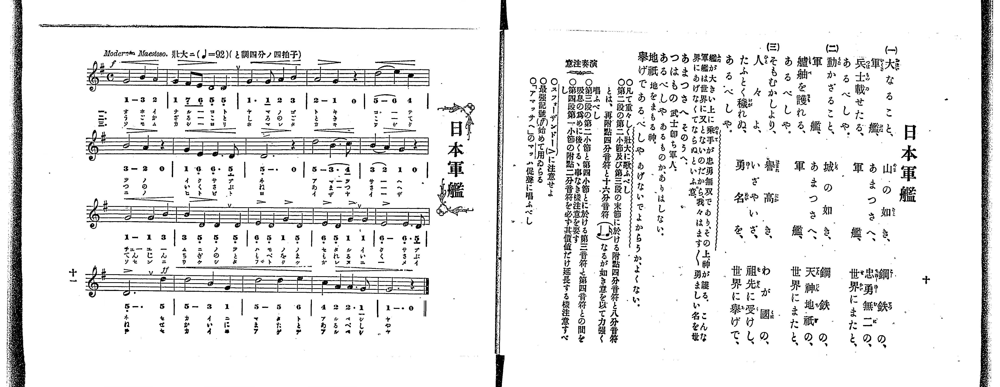

# 日本軍艦

> Re:Shōka 使用 AI 協助辨識與重建樂譜，可能會有錯誤。歡迎[回報](https://github.com/TMDLang/reshoka/issues)。

- **鋼琴伴奏版**：<br><audio controls src="nihon_gunkan.mp3"></audio>
- **NEUTRINO 歌聲合成版**：<br><audio controls src="nihon_gunkan_neutrino.mp3"></audio>

- 出處：共益商社樂器店《唱歌教科書 教師用 巻三》第十～十一頁（第一學期第五曲）
- NDL Digital Collections PID 854864（https://dl.ndl.go.jp/pid/854864）掃描 P011.jpg

## 說明

原書資訊與歌詞全文（NDL PID 854864《唱歌教科書 教師用 巻三》第十～十一頁，掃描 P011.jpg）：
調性與拍號：ト調四分ノ四拍子（G 大調 4/4 拍），♩=92，Moderato Maestoso.「壯大ニ」
註記：單聲部，三節分節歌。開頭 f，第十六小節第四拍轉 ff（首次出現最強記號 ff）。
原典演奏注意：全曲須重厚壯大歌唱；第二段第二小節（第七小節）及第三段末節（第十五小節）之附點四分音符與八分音符，須以雙附點四分音符與十六分音符（♩.. ♬）之意力強唱出；第三段第二小節與第四小節之第三音符與第四音符間，注意勿因吸氣而遲後；第四段第一小節之附點二分音符必延長足其時值；注意強音記號（>）；最強記號（ff）首次使用；「アマツサヘ」之「マッ」須以促聲唱之。
原典曲意：「艦が大きい上に、乘手が忠勇無双であり、その上、神が護る。こんな軍艦は世界に又とないのだから、我々はます／＼勇ましい名を世界にあげなくてならぬといふ意。」
原典語釋：「あまつさへ」：そのうへ；「つはもの」：武士即ち軍人；「あるべしや」：あるものか、ありはしない；「地祇」：地をまもる神；「擧げであるべしや」：あげないでよからうか、よくない。


## 歌詞

```text
一、
大なること、山の如き、
鋼鉄の、軍艦、
あまつさへ、忠勇無二の、
兵士載せたる、軍艦、
世界にまたと、あるべしや。

二、
動かざること、城の如き、
鋼鉄の、軍艦、
あまつさへ、天神地祇の、
艫舳を護れる、軍艦、
世界にまたと、あるべしや。

三、
そもむかしより、譽高き、
わが國の、軍艦、
いざやいざ、祖先に受けし、
人々よ、たふとく穢れぬ、
勇名を、世界に擧げで、あるべしや。
```

## ABC

<div class="abc-score" data-abc-src="nihon_gunkan.abc" aria-label="五線譜載入中"></div>

[下載 ABC 原始檔](nihon_gunkan.abc)

## TMD 檔案連結

- [主旋律 TMD 檔案](nihon_gunkan.tmd) [[在 TMD Studio 編輯](https://tmdlang.github.io/Tmd-TS/#tmd=s7IKdvYPcrWy4qpTUCpJTLdSSM7PyUlNLsnMz7PKrsxPzc6ML87Iz05Ugisoy88pzU21yk7MizeOtzA1sTAzQUgW55cWJadaFSdn5OfnxJekVpQk5edno8vHFySmp1oFGBgaImQKivLLUvMS84C6C4oy80pSU8DaEQpSyzJTUkHSxclAq8tSizLTMlNTkNyVWlQMcjXUipKixLzi5KLMApBXEKrSU_OKgDYklhRl5pdkJiMk0vKLcq2KS4ryCzKQhUsyUoGezc3MySxJLKpEFwdbUpBfhORMiER5YklqEUIwvygzPTPPKjc1MysTS6gADcjITy9KLMiotMrILC4BKk9OzIkHBjEw3LW0FJ5NX_pszpoXu3tfdC5T0NLiUrRVsDTisrdVcOeyMdE3sQMZ9LR914uZU9_vmfW0dePz2V1Pp7Y9X7Lv2YqmpzNXPN01_XFD19MpG5-t7Xk2debz5ROfzd6hAGQ93bH6-ZQVCk-3736yo_NxQ_fzNWue9ja-3zsPSD7Z0fByQeP7PR1AQSD76dodz-bMB7F3TXk2e9P7PZ1g5_u5-Ci4AP1Wkpij4AxPOcUKAZ4uCpC0ATQho6SkoNhKXz8lRy8PiNPz9bIK9AsyU_RhKjqf9TU_6-9XAKUIoFy6EheXvpaCLbUAl4KCwtO--UBPv9jc_mJF14uOdmBIvFg572nrimfT2oEuBHkD4WTyA6sHzSNArwFjBGT_i1X7nzUsB9nc3fti5nyg6OPmDqDg09mzn3a0PW7uAzKAUk_XTgA6x13h6ZLlQEkFYOQqAEXBxvQ8mrnS1tIIyPDNT0ktSizJV_BNTAUmluJ8vccNPU8Xrwdqetzc_bihF2zhit0vVswApYdp6140bnrZvAKoE-jy5-sbgBYCSaD_Hjc0vZzW_XLBWoU0oCTEQ09b1z7d0A-UB3HBbnqxt1MhDaig4-Wyac_WLAQmtOf9-57NaXi6ZzvQBqBnwLLAIGmCBvTT1h3P9kx5urT_2eYVz1r6wWlyBTDRvFzQ8bK992nfLIhbgQ4ABvP7PbPBqarn2bqtEAbEeljKa4ZxO5_2d4FFOoEqn81ZDVcDCv9dU-DKnuzsfjmz5eXueZCgfTl_8_M1y4AB_7R1NZwL9C3QMU92L305eyZ2xZCAQKjvAIa-np7Co5lrIFYA_fW0azYwCIBeAIYI1BdgtyH7AmgUJBwhXKBGiDK4RRBZCPfltMmgJAQOtKfdwKSx4OmEHc82LH7R0POycdPTfT0QW0CxArEFmC1hxkJ8AbIX5uan-1uf7t72cur2F9s2P23d9mxm09OGPUAToObv2Q5UBok_oO_swElsNnKsAkXB8QqJ9Sd79wNTP1AJMKk9blr0uHne4-aWx01bHzfPACY4oANA4iDBZiAXErZP9jcDEx4wfMCyyIlj9iZIsgDqAZZojxt7QCm3sfdxY8uTHV2PG1c_bmh8snPGs85ukNT-BU-725-3LHza3_O4Eais6XFTF1DB48a5jxvXgdQ3ND5fOg-o8sXa7Y-bQDY9bpz8uGny48ZVkBLzceP6JzumPZ8K1L76aX_H48YVQCmgXUDtjxsXPG7sftwETLyNzzomPm5oBSp-3LjvcePM93uALtwDtBrMnQ5U_3RC7-OmSXCjQC5pnAQ2qv9xI9CWVSBzGteAzQcavhXoR5BjINkR4vMXq-a9bO-G-BysH2j0kseNUx837gCqA4mDffW4sQ0oAg1skIL1j5uAitdB1Dxbu-zp4tVPezc_blwI9OGTXaDUBzUQ6P_GnSDnNrXADAQLQrQDvQoKOHAIgvwJ9BUoICDan87Z8HxpO0QXkA30Ksh5QI1N3cDwhah5NhkYAUBxSDRgswsaIkD_L3_cBAxrcOCCvAO2GiQCDCywAmCKAAUMMBEDZcBBBEoEwEAEGguMvBVA0acbNwKd_XQZ0NheqKKX3XtedoKjrqERGr0QCYzgbISnHGCugGgA29K6FRh6L4DlVePsx43zwSkG1SSkGAaaNx_iFAwPQ10PNBpqbjfQWqCCaSgemN9HiQeWrASGPDRe4B540bn6RcdmYPSA0zswM1LmAVBdBrV_Lji2G8DeAKrpgGS0F2v3vlw9A-GBx03AGASmFqAiLH4A-gwYAkASzABlzWlPW4GxDsx5wNQ2EWQw1JG7doGyG9AWkNuAjtwKzjj9z1cuAvkKmI9g4doOyXigQgHmMUQ6xOoxoDbKWw1QoKClz8Xll5mRn-demgdskVmF5WcmpzrUGNRUg-xRsLHQsgMzqtNqwTSw5fK4aZXC4-bZQHqJQg2Q1QXEq4F4D1BkM5DuAIsuAeJ5QNwHFN0CFukAstaCWGBVQNXNbSDrQabWKBgq6IKhMRAbATFExDxewSxewTQeyAQTMHWGYDUgtTVgFkRMV8EALGIKFTEDYhOQCNgOH0Og1Y1dULnHjbvBZAtYBzBngnhN3WCxyWByBUSmCaQCxN8HxOvArClQPSAVELleIAlxH0Q3DAJLToT9RiDZNrgMyBRgYoTqmobL_sbpEPVNvZTabwySBeUCmGRTA4oTIBaBxDvAJCioQOKggIIGQFMPmDUfKgPSieGApn64KEQ1iA9xAijxNLeAEwVIITCJNK0H4q1AkWngJNILFl8ETTqgJNICFgGpAPFmIBIMKPJBEBT9kGgHJQBgagHHPDTRANMCRAACUZMHxAQTqFkgc-BJCCnBLIH7BhT4sEAGJQqIz0D0VCDeBpVZi2QfTDU8xIFhCKHBOQeoDya-A6YaKakMiM3gRLIaq82bwCKQRPe4EZiH4VkElF7QbYZkG5BKUNIGpSdwVKKJI2wGp43Gx81LoVG9DEyDEsUCIO6GlCSQ5NDcD8SgRAISgSSl3UC8H1IOQUolUMICl0iQxIVRzoBoSPkBIhElDDTZgNMRmA1SiFUQhKFi0CQHooDSyKln4eOmVpiHm2B5H-Q8SNYDBTQsV4OiG6RlPVgtKOJgMiASJDMbzANlPlhJASu9EFkOErGgRIGclJYBW4xwJTPABoD4YBeCxfqQrIPFKsQJO8GqJ4HZoDQEl4GUBcQ7BFr8gH0BCQ9IOQcKA1jJCKxDwSSoKEIUM1vhzoJYAFEFkoE4AVLMrIGHcQ3UBhC_EeoMYMJBJLNecIoB-QSSXkDpC5SugIUOOBWBazBwMQSq12YC2dvB8ksQ6QilXKlOS6sFFyuohQskhcBEQDSoRqoB10mg4gZScxkipUoQRC-AkLM1JPRQi15IgQALRUg2h6cTeC0CiTJIZIGiFBLKiPoNKfMipZsBshuUVMBJjni7EQUdJKkuJ8PuWi4uXTsFpNaQApCrzAUA)]
- [鋼琴伴奏 TMD 檔案](nihon_gunkan_piano.tmd) [[在 TMD Studio 編輯](https://tmdlang.github.io/Tmd-TS/#tmd=s7IKdvYPcrWy4qpTUCpJTLdSyC8qychPL0osyKi0ysgsLskvykxOzInPTsxLVOLS0lJ4Nn3pszlrXuzufdG57P2ejpfde55P2PJkz5anS_ufd3a839OpoKXFpWirYGnEZW-r4M5lY6JvYgcy_Wn7rhczp77fM-tp68bns7ueTm17vmTfsxVNT2eueLpr-uOGrqdTNj5b2_Ns6sznyyc-m71DAch6umP18ykrFJ5u3_1kR-fjhu7na9Y87W18v3cekHyyo-HlgkagE4CCQPbTtTuezZkPYu-a8mz2JqBDlEC2-rn4KLhkpmeWJOYoOOfn5KQml2Tm5xUrBHi6KFiYmliYmQBNyCgpKSi20tdPydHLA-L0fL2sAv2CzBR9mIrOZ33Nz_r7FQIMDA2BculKXFx-mRn5ee6lecCAsQrITMzLD_JwqDGoqeZSAAIbCy07MKM6rRZM62spPG5apfC4eTaQXqJQA2R1AfFqIN4DFNkMpDvAokuAeB4Q9wFFt4BFOoCstSAWWBVQdXObgpY-2NQaBUMFXTA0BmIjIIaImMcrmMUrmMYDmWACps4QrAaktgbMgojpKhiARUyhImZAbAISAdvhYwi0urELKve4cTeYbAHreNy4CsRr6gaLTQaTKyAyTSAVIP4-IF4HZk2B6gGpgMj1AkmI-yC6YfBx4zKE_UYg2Ta4DMiUx40gG0Hi03DZ3zgdor6pl1L7jUGycx83NcEkmxpQnACxCCTeASZBQQUSBwUUNACaesCs-VAZkE4MBzT1w0UhqkF8iBNAiae5BZwoQAqBSaRpPRBvBYpMAyeRXrD4ImjSASWRFrAISAWINwORYECRD4Kg6IdEOygBAFMLOOahiQaYFiACEIiaPCAmmEDNApkDT0JICWYJ3DegwIcFMihRQHwGoqcC8TaozFok-2Cq4SEODEMIDc45QH0w8R0w1UhJZUBsBieS1Vht3gQWgSS6x43APAzPIqD0gm4zJNuAVIKSNig9gaMSTRxhMzhtND5uXgqN6mVgGpQoFgBxN6QkgSSH5n4gBiUSkAgkKe0G4v2QcghSKoESFrhEgiQujHIGREPKDxCJKGGgyQacjsBskEKsgiAMFYMmORAFlEZOPQsfN7XCPNwEy_sg50GyHiigYbkaFN0gLevBakERB5MBkSCZ2WAeKPPBSgpY6YXIcpCIBSUK5KS07HETrFh43DgDbACID3YhWKwPyTpYrEKcsBOsehKYDUpDcBlIWUC8Q6DFD9gXkPCAlHOgMICVjI8bJ4JJUFGEKGa2wp0FsQCiCiQDcQKkmFkDD-MaqA0gfiPUGcCEg0hmveAUA_IJJL2A0hcoXQELHXAqAtdg4GIIVK_NBLK3g-WXINIRSrlSnZZWCy5WUAsXSAqBiYBoUI1UA66TQMUNpOYyREqVIIheACFna0jooRa9kAIBFoqQbA5PJ_BaBBJlkMgCRSkklBH1G1LmRUo3A2Q3KKmAkxzxdiMKOkhSXU6G3bVYGkM-yI0hE2hjCJiIXvR1vWzvfdq64-XsVkijEamMiVeINowFJhEgbRofCxQBpRcoxwRImwDFiFELlURTCzMBm26oSqgSTJVkm4imH6eJUKOQ1KGJkOdCTHvRwhHuYJSQROg2gMSvrp0CUhRH-wAl0YWMMIWMwULKXAA)]

## 分析

```text
================================================================================
📊 TMD Song Profile: [ 日本軍艦 ]
================================================================================
⏱  Duration:       0:52 (52.2s), 20 measures total
🎼 Key & Tempo:    首調基準 G, != 92.0 BPM, <4/4>
   - 分析範圍：      由實際發聲的音符與和弦推測調性；播放脈絡另行呈現
🎤 人聲音域:    D4 (MIDI 62) – E5 (MIDI 76) [跨度: 14 個半音 / 1.2 個八度, 難度: moderate]
   - 最低音:  D4 in [NihonGunkan #1 @ m.2, 0:03]
   - 最高音: E5 in [NihonGunkan #1 @ m.5, 0:11]
   - 適合: soprano, mezzo-soprano, contralto, tenor, baritone, bass
🏛  結構:      NihonGunkan (52.2s)
⚡ 編曲密度:        Peak 1 軌道同時演奏
🗝  調性診斷：       G 大調（純淨自然大調，未偵測到可信轉調）
   - 風格氣質:    純淨自然大調（陽光明朗、易唱易記，無明顯調外色彩）
   - 轉調歷程:    全曲維持單一推測調性（未偵測到可信轉調）
   - 核心骨幹音:  D, G, E, B, A
   - 調性數值:    G 大調 [相關度: 0.88, 穩定度: Moderate, 自然音純度: 100.0%]
   - 候選調性 (K-S): G 大調 (0.88), D 大調 (0.80), B 小調 (0.58)
   - 五度圈歷程:   +1
   - 各段落調性細節:
     • [NihonGunkan #1]: G 大調 (r: 0.88, 自然音純度: 100.0%)

  [ 五度圈游移軌跡 ]
               C  
         F           [G ]*
      Bb               D  
      Eb               A  
         Ab           E  
            Db       B  
               F# 
     (* = active key center)

  [ 十二半音累積音高分佈 ]
     C  : ██                         3.3%
     C# :                            0.0%
     D  : ████████████████████████  34.0%
     D# :                            0.0%
     E  : █████████                 13.3%
     F  :                            0.0%
     F# :                            0.7%
     G  : █████████████████         24.7%
     G# :                            0.0%
     A  : ████████                  11.3%
     A# :                            0.0%
     B  : █████████                 12.7%
--------------------------------------------------------------------------------
Assignment 軌道音域：
  - Voice         : D4 – E5 (14 個半音 / 1.2 個八度, 61 個音符)
================================================================================
```


## 原書掃描頁




