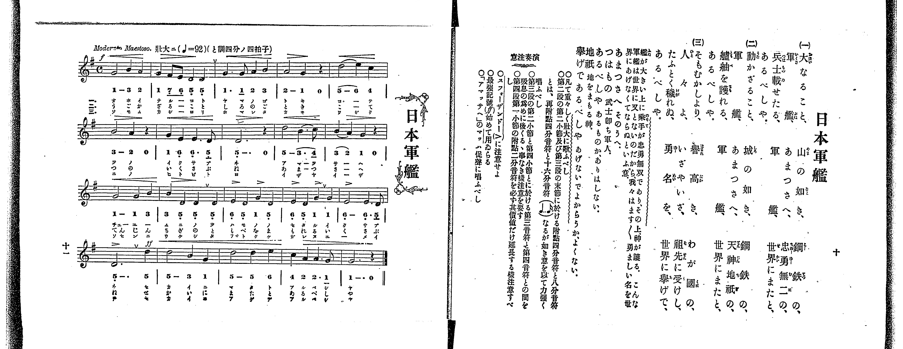

# 日本軍艦

> Re:Shoka 使用 AI 協助辨識與重建樂譜，可能會有錯誤。歡迎回報。

<audio controls src="nihon_gunkan.mp3"></audio>

- 出處：共益商社樂器店《唱歌教科書 教師用 巻三》第十～十一頁（第一學期第五曲）
- NDL Digital Collections PID 854864（https://dl.ndl.go.jp/pid/854864）掃描 P011.jpg

## 說明

原書資訊與歌詞全文（NDL PID 854864《唱歌教科書 教師用 巻三》第十～十一頁，掃描 P011.jpg）：
調性與拍號：ト調四分ノ四拍子（G 大調 4/4 拍），♩=92，Moderato Maestoso.「壯大ニ」
註記：單聲部，三節分節歌。開頭 f，第十六小節第四拍轉 ff（首次出現最強記號 ff）。
原典演奏注意：全曲須重厚壯大歌唱；第二段第二小節（第七小節）及第三段末節（第十五小節）之附點四分音符與八分音符，須以雙附點四分音符與十六分音符（♩.. ♬）之意力強唱出；第三段第二小節與第四小節之第三音符與第四音符間，注意勿因吸氣而遲後；第四段第一小節之附點二分音符必延長足其時值；注意強音記號（>）；最強記號（ff）首次使用；「アマツサヘ」之「マッ」須以促聲唱之。
原典曲意：「艦が大きい上に、乘手が忠勇無双であり、その上、神が護る。こんな軍艦は世界に又とないのだから、我々はます／＼勇ましい名を世界にあげなくてならぬといふ意。」
原典語釋：「あまつさへ」：そのうへ；「つはもの」：武士即ち軍人；「あるべしや」：あるものか、ありはしない；「地祇」：地をまもる神；「擧げであるべしや」：あげないでよからうか、よくない。

## 歌詞

```text
一、
大なること、山の如き、
鋼鉄の、軍艦、
あまつさへ、忠勇無二の、
兵士載せたる、軍艦、
世界にまたと、あるべしや。

二、
動かざること、城の如き、
鋼鉄の、軍艦、
あまつさへ、天神地祇の、
艫舳を護れる、軍艦、
世界にまたと、あるべしや。

三、
そもむかしより、譽高き、
わが國の、軍艦、
いざやいざ、祖先に受けし、
人々よ、たふとく穢れぬ、
勇名を、世界に擧げで、あるべしや。
```

## ABC

```abc
X:1
T:日本軍艦
M:4/4
L:1/16
Q:1/4=92
K:G
V:V1 name="Voice" snm="Voi"
[V:V1]
!f! G8 B4 A4 | G4 F2 E2 D4 D4 | G6 G2 A4 B4 | A8 G4 z4 |
d8 e4 c4 | B8 A4 z4 | G4 E6 E2 D4 | D12 z4 |
d8 B6 c2 | B4 A4 G4 z4 | G8 G4 B4 | B4 D4 D4 D4 |
E4 D4 G4 D4 | E4 D4 G4 G4 | E8 E6 D2 | !ff! D12 d4 |
d8 B4 G4 | d8 d4 e4 | c4 A4 A6 G2 | G12 z4 |
```

## TMD 檔案連結

- [主旋律 TMD 檔案](nihon_gunkan.tmd) [[在 TMD Studio 編輯](https://tmdlang.github.io/Tmd-TS/#tmd=s7IKdvYPcrWy4qpTUCpJTLdSSM7PyUlNLsnMz7PKrsxPzc6ML87Iz05Ugisoy88pzU21yk7MizeOtzA1sTAzQUgW55cWJadaFSdn5OfnxJekVpQk5edno8vHFySmp1oFGBgaImQKivLLUvMS84C6C4oy80pSU8DaEQpSyzJTUkHSxclAq8tSizLTMlNTkNyVWlQMcjXUipKixLzi5KLMApBXEKrSU_OKgDYklhRl5pdkJiMk0vKLcq2KS4ryCzKQhUsyUoGezc3MySxJLKpEFwdbUpBfhORMiER5YklqkRKXlpbCs-lLn81Z82J374vOZQpaWlyKtgqWRlz2tgruXDYm-iZ2II1P23e9mDn1_Z5ZT1s3Pp_d9XRq2_Ml-56taHo6c8XTXdMfN3Q9nbLx2dqeZ1NnPl8-8dnsHQpA1tMdq59PWaHwdPvuJzs6Hzd0P1-z5mlv4_u984Dkkx0NLxc0vt_TARQEsp-u3fFsznwQe9eUZ7M3vd_TCXaun4uPgktmOtBjOQrO8FgvVgjwdFGAxCvQhIySkoJiK339lBy9PCBOz9fLKtAvyEzRh6nofNbX_Ky_XwEUm0C5dCUuLn0tBVtqAS4FBYWnffOBnn6xuf3Fiq4XHe3AkHixct7T1hXPprUDXQjyBsLJ5AdWD5pHgF4DxgjI_her9j9rWA6yubv3xcz5QNHHzR1AwaezZz_taHvc3AdkAKWerp0AdI67wtMly4GSCsDIVQCKgo3peTRzpa2lEZDhm5-SWpRYkq_gm5haXJJfnK_3uKHn6eL1QE2Pm7sfN_SCLVyx-8WKGaD0MG3di8ZNL5tXAHUCXf58fQPQQiAJ9N_jhqaX07pfLlirkAaUhHjoaevapxv6gfIgLthNL_Z2KqQBFXS8XDbt2ZqFwIT2vH_fszkNT_dsB9oA9AxYFhgkTdCAftq649meKU-X9j_bvOJZSz84Ta4AJpqXCzpetvc-7ZsFcSvQAcBgfr9nNjhV9TxbtxXCgFgPS3nNMG7n0_4usEgnUOWzOavhakDhv2sKXNmTnd0vZ7a83D0PErQv529-vmYZMOCftq6Gc4G-BTrmye6lL2fPxK4YEhAI9R3A0NfTU3g0cw3ECqC_nnbNBgYB0AvAEIH6Auw2ZF8AjYKEI4QL1AhRBrcIIgvhvpw2GZSEwIH2tBuYNBY8nbDj2YbFLxp6XjZuerqvB2ILKFYgtgCzJcxYiC9A9sLc_HR_69Pd215O3f5i2-anrduezWx62rAHaALU_D3bgcog8Qf0nR04ic1GjlWgKDheIbH-ZO9-YOoHKgEmtcdNix43z3vc3PK4aevj5hnABAd0AEgcJNgM5ELC9sn-ZmDCA4YPWBY5cczeBEkWQD3AEu1xYw8o5Tb2Pm5sebKj63Hj6scNjU92znjW2Q2S2r_gaXf785aFT_t7HjcClTU9buoCKnjcOPdx4zqQ-obG50vnAVW-WLv9cRPIpseNkx83TX7cuApSYj5uXP9kx7TnU4HaVz_t73jcuAIoBbQLqP1x44LHjd2Pm4CJt_FZx8THDa1AxY8b9z1unPl-D9CFe4BWg7nTgeqfTuh93DQJbhTIJY2TwEb1P24E2rIKZE7jGrD5QMO3Av0IcgwkO0J8_mLVvJft3RCfg_UDjV7yuHHq48YdQHUgcbCvHje2AUWggQ1SsP5xE1DxOoiaZ2uXPV28-mnv5seNC4E-fLILlPqgBgL937gT5NymFpiBYEGIdqBXQQEHDkGQP4G-AgUERPvTORueL22H6AKygV4FOQ-osakbGL4QNc8mAyMAKA6JBmx2QUME6P_lj5uAYQ0OXJB3wFaDRICBBVYATBGggAEmYqAMOIhAiQAYiEBjgZG3Aij6dONGoLOfLgMa2wtV9LJ7z8tOcNQ1NEKjFyKBEZyN8JQDzBUQDWBbWrcCQ-8FsLxqnP24cT44xaCahBTDQPPmQ5yC4WGo64FGQ83tBloLVDANxQPz-yjxwJKVwJCHxgvcAy86V7_o2AyMHnB6B2ZGyjwAqsug9s8Fx3YD2BtANR2QjPZi7d6Xq2cgPPC4CRiDwNQCVITFD0CfAUMASIIZoKw57WkrMNaBOQ-Y2iaCDIY6ctcuUHYD2gJyG9CRW8EZp__5ykUgXwHzESxc2yEZD1QowDyGSIdYPQbURnmrAQoUtPS5uPwyM_Lz3EvzgA1Wq7D8zORUhxqDGoVqkEUKNoZmWnZgVnVaLZgGtl0eN61SeNw8G0gvUagBsrqAeDUQ7wGKbAbSHWDRJUA8D4j7gKJbwCIdQNZaEAusCqi6uQ3kAJCpNQqGCroo0BhKG0FphArzeCBhBiJMQQQIwhmo5oDYMP0w82rgIsiqQNAArsIUTYUZlDaBqYCHRHML2IcgPwH927QeiLcCRaaB_dsLFl8EDQeQf1vAIiAVIN4MhO9hroNBmBsRboK5EuxxuMNQQgHocGRJZIjbb8g2g_yHcAvMDRjhg_B94-PmpVDPLAPTIG8vAOJuSMRDPNzcD8SgYACJQAJrN5DVAEk2kEQECjpwAoIEH85kAeMjohPGwkwMSAEDDzW4GMwgohTBaCQ1MIgiANaIFD69YK-CvAfxKChgQAECTA9N-2E5BZxCQPlnJpC9HZp34AGAM0qr09Jq4bGJO14RTkdXAePDUncNPH3DYh45p4DMwYwOGESkjVouLl07BaQyRQHIVeYCAA)]
- [鋼琴伴奏 TMD 檔案](nihon_gunkan_piano.tmd) [[在 TMD Studio 編輯](https://tmdlang.github.io/Tmd-TS/#tmd=s7IKdvYPcrWy4tLSUng2femzOWte7O590bns_Z6Ol917nk_Y8mTPlqdL-593drzf06mgpcWlaKtgacRlb6vgzmVjom9ix1WnoPS0fdeLmVPf75n1tHXj89ldT6e2PV-y79mKpqczVzzdNf1xQ9fTKRufre15NnXm8-UTn83eoQBkPd2x-vmUFQpPt-9-sqPzcUP38zVrnvY2vt87D0g-2dHwckEj0AlAQSD76dodz-bMB7F3TXk2exPQIUogW_1cfBRcMtMzSxJzFJzzc3JSk0sy8_OKFQI8XRQsTE0szEyAJmSUlBQUW-nrp-To5QFxer5eVoF-QWaKPkxF57O-5mf9_QoBBoaGQLl0JS4uv8yM_Dz30rzsxDyrgMzEvPwgD4cagxqFai4bQzMtOy4FIKhOqwXT-loKj5tWKTxung2klyjUAFldQLwaiPcARTYD6Q6w6BIgngfEfUDRLWCRDiBrLYgFVgVU3dymoKUPNrVGwVBBFwUaQ2kjKI1QYR4PJMxAhCmIAEE4A9UcEBumH2ZeDVwEWRUIGsBVmKKpMIPSJjAV8JBobgH7EOQnoH-b1gPxVqDINLB_e8Hii6DhAPJvC1gEpALEm4HwPcx1MAhzI8JNMFeCPQ53GEooAB2OLIkMcfsN2WaQ_xBugbkBI3wQvm983LwU6pllYBrk7QVA3A2JeIiHm_uBGBQMIBFIYO0GshogyQaSiEBBB05AkODDmSxgfER0wliYiQEpYOChBheDGUSUIhiNpAYGUQTAGpHCpxfsVZD3IB4FBQwoQIDpoWk_LKeAUwgo_8wEsrdD8w48AHBGaXVaWi08NnHHK8Lp6CpgfFjqroGnb1jMI-cUkDmY0QGDiLRRi6U48YEVJyAv2ZhASxRgCL3o63rZ3vu0dcfL2a2Qchcp5uMVog1jgf4H0qbxsUARUGBAOSZA2gQoRoxaqCSaWpgJ2HRDVUKVYKok20Q0_ThNhBqFpA5NhDwXYtqLFo5wB6OEJEK3ASSCde0UkOJYAchV5gIA)]

## 分析

```text
================================================================================
📊 TMD Song Profile: [ 日本軍艦 ]
================================================================================
⏱  Duration:       0:52 (52.2s), 20 measures total
🎼 Key & Tempo:    首調基準 G, != 92.0 BPM, <4/4>
   - 分析範圍：      由實際發聲的音符與和弦推測調性；播放脈絡另行呈現
🎤 人聲音域:    D4 (MIDI 62) – E5 (MIDI 76) [跨度: 14 個半音 / 1.2 個八度, 難度: moderate]
   - 最低音:  D4 in [NihonGunkan #1 @ m.2, 0:03]
   - 最高音: E5 in [NihonGunkan #1 @ m.5, 0:11]
   - 適合: soprano, mezzo-soprano, contralto, tenor, baritone, bass
🏛  結構:      NihonGunkan (52.2s)
⚡ 編曲密度:        Peak 1 軌道同時演奏
🗝  調性診斷：       G 大調（純淨自然大調，未偵測到可信轉調）
   - 風格氣質:    純淨自然大調（陽光明朗、易唱易記，無明顯調外色彩）
   - 轉調歷程:    全曲維持單一推測調性（未偵測到可信轉調）
   - 核心骨幹音:  D, G, E, B, A
   - 調性數值:    G 大調 [相關度: 0.88, 穩定度: Moderate, 自然音純度: 100.0%]
   - 候選調性 (K-S): G 大調 (0.88), D 大調 (0.80), B 小調 (0.58)
   - 五度圈歷程:   +1
   - 各段落調性細節:
     • [NihonGunkan #1]: G 大調 (r: 0.88, 自然音純度: 100.0%)

  [ 五度圈游移軌跡 ]
               C  
         F           [G ]*
      Bb               D  
      Eb               A  
         Ab           E  
            Db       B  
               F# 
     (* = active key center)

  [ 十二半音累積音高分佈 ]
     C  : ██                         3.3%
     C# :                            0.0%
     D  : ████████████████████████  34.0%
     D# :                            0.0%
     E  : █████████                 13.3%
     F  :                            0.0%
     F# :                            0.7%
     G  : █████████████████         24.7%
     G# :                            0.0%
     A  : ████████                  11.3%
     A# :                            0.0%
     B  : █████████                 12.7%
--------------------------------------------------------------------------------
Assignment 軌道音域：
  - Voice         : D4 – E5 (14 個半音 / 1.2 個八度, 61 個音符)
================================================================================
```


## 原書掃描頁




