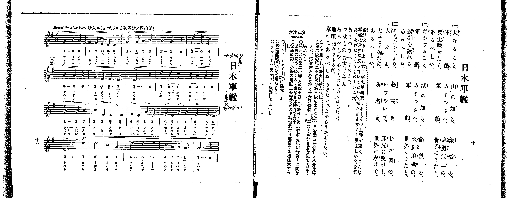

# 日本軍艦

> Re:Shōka 使用 AI 協助辨識與重建樂譜，可能會有錯誤。歡迎回報。

- **鋼琴伴奏版**：<br><audio controls src="nihon_gunkan.mp3"></audio>
- **NEUTRINO 歌聲合成版**：<br><audio controls src="nihon_gunkan_neutrino.mp3"></audio>

- 出處：共益商社樂器店《唱歌教科書 教師用 巻三》第十～十一頁（第一學期第五曲）
- NDL Digital Collections PID 854864（https://dl.ndl.go.jp/pid/854864）掃描 P011.jpg

## 說明

原書資訊與歌詞全文（NDL PID 854864《唱歌教科書 教師用 巻三》第十～十一頁，掃描 P011.jpg）：
調性與拍號：ト調四分ノ四拍子（G 大調 4/4 拍），♩=92，Moderato Maestoso.「壯大ニ」
註記：單聲部，三節分節歌。開頭 f，第十六小節第四拍轉 ff（首次出現最強記號 ff）。
原典演奏注意：全曲須重厚壯大歌唱；第二段第二小節（第七小節）及第三段末節（第十五小節）之附點四分音符與八分音符，須以雙附點四分音符與十六分音符（♩.. ♬）之意力強唱出；第三段第二小節與第四小節之第三音符與第四音符間，注意勿因吸氣而遲後；第四段第一小節之附點二分音符必延長足其時值；注意強音記號（>）；最強記號（ff）首次使用；「アマツサヘ」之「マッ」須以促聲唱之。
原典曲意：「艦が大きい上に、乘手が忠勇無双であり、その上、神が護る。こんな軍艦は世界に又とないのだから、我々はます／＼勇ましい名を世界にあげなくてならぬといふ意。」
原典語釋：「あまつさへ」：そのうへ；「つはもの」：武士即ち軍人；「あるべしや」：あるものか、ありはしない；「地祇」：地をまもる神；「擧げであるべしや」：あげないでよからうか、よくない。


## 歌詞

```text
一、
大なること、山の如き、
鋼鉄の、軍艦、
あまつさへ、忠勇無二の、
兵士載せたる、軍艦、
世界にまたと、あるべしや。

二、
動かざること、城の如き、
鋼鉄の、軍艦、
あまつさへ、天神地祇の、
艫舳を護れる、軍艦、
世界にまたと、あるべしや。

三、
そもむかしより、譽高き、
わが國の、軍艦、
いざやいざ、祖先に受けし、
人々よ、たふとく穢れぬ、
勇名を、世界に擧げで、あるべしや。
```

## ABC

<div class="abc-score" data-abc-src="nihon_gunkan.abc" aria-label="五線譜載入中"></div>

[下載 ABC 原始檔](nihon_gunkan.abc)

## TMD 檔案連結

- [主旋律 TMD 檔案](nihon_gunkan.tmd) [[在 TMD Studio 編輯](https://tmdlang.github.io/Tmd-TS/#tmd=s7IKdvYPcrWy4qpTUCpJTLdSSM7PyUlNLsnMz7PKrsxPzc6ML87Iz05Ugisoy88pzU21yk7MizeOtzA1sTAzQUgW55cWJadaFSdn5OfnxJekVpQk5edno8vHFySmp1oFGBgaImQKivLLUvMS84C6C4oy80pSU8DaEQpSyzJTUkHSxclAq8tSizLTMlNTkNyVWlQMcjXUipKixLzi5KLMApBXEKrSU_OKgDYklhRl5pdkJiMk0vKLcq2KS4ryCzKQhUsyUoGezc3MySxJLKpEFwdbUpBfhORMiER5YklqEUIwvygzPTPPKjc1MysTKVS0tBSeTV_6bM6aF7t7X3QuU9DS4lK0VbA04rK3VXDnsjHRN7EDGfG0fdeLmVPf75n1tHXj89ldT6e2PV-y79mKpqczVzzdNf1xQ9fTKRufre15NnXm8-UTn83eoQBkPd2x-vmUFQpPt-9-sqPzcUP38zVrnvY2vt87D0g-2dHwckHj-z0dQEEg--naHc_mzAexd015NnvT-z2dYIf7ufgouACdXZKYo-AMTxTFCgGeLgqQaAeakFFSUlBspa-fkqOXB8Tp-XpZBfoFmSn6MBWdz_qan_X3K4AiGyiXrsTFpa-lYEstwKWgoPC0bz7Q0y82t79Y0fWiox0YEi9WznvauuLZtHagC0HeQDiZ_MDqQfMI0GvAGAHZ_2LV_mcNy0E2d_e-mDkfKPq4uQMo-HT27KcdbY-b-4AMoNTTtROAznFXeLpkOVBSARi5CkBRsDE9j2autLU0AjJ881NSixJL8hV8E1OLS_KL8_UeN_Q8XbweqOlxc_fjhl6whSt2v1gxA5Qepq170bjpZfMKoE6gy5-vbwBaCCSB_nvc0PRyWvfLBWsV0oCSEA89bV37dEM_UB7EBbvpxd5OhTSggo6Xy6Y9W7MQmNCe9-97Nqfh6Z7tQBuAngHLAoOkCRrQT1t3PNsz5enS_mebVzxr6QenyRXARPNyQcfL9t6nfbMgbgU6ABjM7_fMBqeqnmfrtkIYEOthKa8Zxu182t8FFukEqnw2ZzVcDSj8d02BK3uys_vlzJaXu-dBgvbl_M3P1ywDBvzT1tVwLtC3QMc82b305eyZ2BVDAgKhvgMY-np6Co9mroFYAfTX067ZwCAAegEYIlBfgN2G7AugUZBwhHCBGiHK4BZBZCHcl9Mmg5IQONCedgOTxoKnE3Y827D4RUPPy8ZNT_f1QGwBxQrEFmC2hBkL8QXIXpibn-5vfbp728up219s2_y0dduzmU1PG_YATYCav2c7UBkk_oC-swMnsdnIsQoUBccrJNaf7N0PTP1AJcCk9rhp0ePmeY-bWx43bX3cPAOY4IAOAImDBJuBXEjYPtnfDEx4wPAByyInjtmbIMkCqAdYoj1u7AGl3Mbex40tT3Z0PW5c_bih8cnOGc86u0FS-xc87W5_3rLwaX_P40agsqbHTV1ABY8b5z5uXAdS39D4fOk8oMoXa7c_bgLZ9Lhx8uOmyY8bV0FKzMeN65_smPZ8KlD76qf9HY8bVwClgHYBtT9uXPC4sftxEzDxNj7rmPi4oRWo-HHjvseNM9_vAbpwD9BqMHc6UP3TCb2PmybBjQK5pHES2Kj-x41AW1aBzGlcAzYfaPhWoB9BjoFkR4jPX6ya97K9G-JzsH6g0UseN0593LgDqA4kDvbV48Y2oAg0sEEK1j9uAipeB1HzbO2yp4tXP-3d_LhxIdCHT3aBUh_UQKD_G3eCnNvUAjMQLAjRDvQqKODAIQjyJ9BXoICAaH86Z8Pzpe0QXUA20Ksg5wE1NnUDwxei5tlkYAQAxSHRgM0uaIgA_b_8cRMwrMGBC_IO2GqQCDCwwAqAKQIUMMBEDJQBBxEoEQADEWgsMPJWAEWfbtwIdPbTZUBje6GKXnbvedkJjrqGRmj0QiQwgrMRnnKAuQKiAWxL61Zg6L0AlleNsx83zgenGFSTkGIYaN58iFMwPAx1PdBoqLndQGuBCqaheGB-HyUeWLISGPLQeIF74EXn6hcdm4HRA07vwMxImQdAdRnU_rng2G4AewOopgOS0V6s3fty9QyEBx43AWMQmFqAirD4AegzYAgASTADlDWnPW0Fxjow5wFT20SQwVBH7toFym5AW0BuAzpyKzjj9D9fuQjkK2A-goVrOyTjgQoFmMcQ6RCrx4DaKG81QIGClj4Xl19mRn6ee2kesD1rFZafmZzqUGNQUw2yR8HGQssOzKhOqwXTwJbL46ZVCo-bZwPpJQo1QFYXEK8G4j1Akc1AugMsugSI5wFxH1B0C1ikA8haC2KBVQFVN7eBrAeZWqNgqKALhsZAbATEEBHzeAWzeAXTeCATTMDUGYLVgNTWgFkQMV0FA7CIKVTEDIhNQCJgO3wMgVY3dkHlHjfuBpMtYB3AnAniNXWDxSaDyRUQmSaQChB_HxCvA7OmQPWAVEDkeoEkxH0Q3TAILDkR9huBZNvgMiBTgIkRqmsaLvsbp0PUN_VSar8xSBaUC2CSTQ0oToBYBBLvAJOgoAKJgwIKGgBNPWDWfKgMSCeGA5r64aIQ1SA-xAmgxNPcAk4UIIXAJNK0Hoi3AkWmgZNIL1h8ETTpgJJIC1gEpALEm4FIMKDIB0FQ9EOiHZQAgKkFHPPQRANMCxABCERNHhATTKBmgcyBJyGkBLME7htQ4MMCGZQoID4D0VOBeBtUZi2SfTDV8BAHhiGEBuccoD6Y-A6YaqSkMiA2gxPJaqw2bwKLQBLd40ZgHoZnEVB6QbcZkm1AKkFJG5SewFGJJo6wGZw2Gh83L4VG9TIwDUoUC4C4G1KSQJJDcz8QgxIJSASSlHYD8X5IOQQplUAJC1wiQRIXRjkDoiHlB4hElDDQZANOR2A2SCFWQRCGikGTHIgCSiOnnoWPm1phHm6C5X2Q8yBZDxTQsFwNim6QlvVgtaCIg8mASJDMbDAPlPlgJQWs9EJkOUjEghIFclJaBmwxwpXMABsA4oNdCBbrQ7IOFqsQJ-wEq54EZoPSEFwGUhYQ7xBo8QP2BSQ8IOUcKAxgJSOwDgWToKIIUcxshTsLYgFEFUgG4gRIMbMGHsY1UBtA_EaoM4AJB5HMesEpBuQTSHoBpS9QugIWOuBUBK7BwMUQqF6bCWRvB8svQaQjlHKlOi2tFlysoBYukBQCEwHRoBqpBlwngYobSM1liJQqQRC9AELO1pDQQy16IQUCLBQh2RyeTuC1CCTKIJEFilJIKCPqN6TMi5RuBshuUFIBJzni7UYUdJCkupwMu2u5uHTtFJBaQwpArjIXAA)]
- [鋼琴伴奏 TMD 檔案](nihon_gunkan_piano.tmd) [[在 TMD Studio 編輯](https://tmdlang.github.io/Tmd-TS/#tmd=s7IKdvYPcrWy4tLSUng2femzOWte7O590bns_Z6Ol917nk_Y8mTPlqdL-593drzf06mgpcWlaKtgacRlb6vgzmVjom9ix1WnoPS0fdeLmVPf75n1tHXj89ldT6e2PV-y79mKpqczVzzdNf1xQ9fTKRufre15NnXm8-UTn83eoQBkPd2x-vmUFQpPt-9-sqPzcUP38zVrnvY2vt87D0g-2dHwckEj0AlAQSD76dodz-bMB7F3TXk2exPQIUogW_1cfBRcMtMzSxJzFJzzc3JSk0sy8_OKFQI8XRQsTE0szEyAJmSUlBQUW-nrp-To5QFxer5eVoF-QWaKPkxF57O-5mf9_QoBBoaGQLl0JS4uv8yM_Dz30rzsxDyrgMzEvPwgD4cag5pqLgUgsLHQsgMzqtNqwbS-lsLjplUKj5tnA-klCjVAVhcQrwbiPUCRzUC6Ayy6BIjnAXEfUHQLWKQDyFoLYoFVAVU3tylo6YNNrVEwVNAFQ2MgNgJiiIh5vIJZvIJpPJAJJmDqDMFqQGprwCyImK6CAVjEFCpiBsQmIBGwHT6GQKsbu6Byjxt3g8kWsI7HjatAvKZusNhkMLkCItMEUgHi7wPidWDWFKgekAqIXC-QhLgPohsGHzcuQ9hvBJJtg8uATHncCLIRJD4Nl_2N0yHqm3optd8YJDv3cVMTTLKpAcUJEItA4h1gEhRUIHFQQEEDoKkHzJoPlQHpxHBAUz9cFKIaxIc4AZR4mlvAiQKkEJhEmtYD8VagyDRwEukFiy-CJh1QEmkBi4BUgHgzEAkGFPkgCIp-SLSDEgAwtYBjHppogGkBIgCBqMkDYoIJ1CyQOfAkhJRglsB9Awp8WCCDEgXEZyB6KhBvg8qsRbIPphoe4sAwhNDgnAPUBxPfAVONlFQGxGZwIlmN1eZNYBFIonvcCMzD8CwCSi_oNkOyDUglKGmD0hM4KtHEETaD00bj4-al0KheBqZBiWIBEHdDShJIcmjuB2JQIgGJQJLSbiDeDymHIKUSKGGBSyRI4sIoZ0A0pPwAkYgSBppswOkIzAYpxCoIwlAxaJIDUUBp5NSz8HFTK8zDTbC8D3IeJOuBAhqWq0HRDdKyHqwWFHEwGRAJkpkN5oEyH6ykgJVeiCwHiVhQokBOSsseN8GKhceNM8AGgPhgF4LF-pCsg8UqxAk7waongdmgNASXgZQFxDsEWvyAfQEJD0g5BwoDWMn4uHEimAQVRYhiZivcWRALIKpAMhAnQIqZNfAwroHaAOI3Qp0BTDiIZNYLTjEgn0DSCyh9gdIVsNABpyJwDQYuhkD12kwgeztYfgkiHaGUK9VpabXgYgW1cIGkEJgIiAbVSDXgOglU3EBqLkOkVAmC6AUQcraGhB5q0QspEGChCMnm8HQCr0UgUQaJLFCUQkIZUb8hZV6kdDNAdoOSCjjJEW83oqCDJNXlZNhdi6Ux5IPcGDKBNoaAiehFX9fL9t6nrTtezm6FNBqRyph4hWjDWGASAdKm8bFAEVB6gXJMgLQJUIwYtVBJNLUwE7DphqqEKsFUSbaJaPpxmgg1Ckkdmgh5LsS0Fy0c4Q5GCUmEbgNI_OraKSBFcbQPUBJdyAhTyBgspMwFAA)]

## 分析

```text
================================================================================
📊 TMD Song Profile: [ 日本軍艦 ]
================================================================================
⏱  Duration:       0:52 (52.2s), 20 measures total
🎼 Key & Tempo:    首調基準 G, != 92.0 BPM, <4/4>
   - 分析範圍：      由實際發聲的音符與和弦推測調性；播放脈絡另行呈現
🎤 人聲音域:    D4 (MIDI 62) – E5 (MIDI 76) [跨度: 14 個半音 / 1.2 個八度, 難度: moderate]
   - 最低音:  D4 in [NihonGunkan #1 @ m.2, 0:03]
   - 最高音: E5 in [NihonGunkan #1 @ m.5, 0:11]
   - 適合: soprano, mezzo-soprano, contralto, tenor, baritone, bass
🏛  結構:      NihonGunkan (52.2s)
⚡ 編曲密度:        Peak 1 軌道同時演奏
🗝  調性診斷：       G 大調（純淨自然大調，未偵測到可信轉調）
   - 風格氣質:    純淨自然大調（陽光明朗、易唱易記，無明顯調外色彩）
   - 轉調歷程:    全曲維持單一推測調性（未偵測到可信轉調）
   - 核心骨幹音:  D, G, E, B, A
   - 調性數值:    G 大調 [相關度: 0.88, 穩定度: Moderate, 自然音純度: 100.0%]
   - 候選調性 (K-S): G 大調 (0.88), D 大調 (0.80), B 小調 (0.58)
   - 五度圈歷程:   +1
   - 各段落調性細節:
     • [NihonGunkan #1]: G 大調 (r: 0.88, 自然音純度: 100.0%)

  [ 五度圈游移軌跡 ]
               C  
         F           [G ]*
      Bb               D  
      Eb               A  
         Ab           E  
            Db       B  
               F# 
     (* = active key center)

  [ 十二半音累積音高分佈 ]
     C  : ██                         3.3%
     C# :                            0.0%
     D  : ████████████████████████  34.0%
     D# :                            0.0%
     E  : █████████                 13.3%
     F  :                            0.0%
     F# :                            0.7%
     G  : █████████████████         24.7%
     G# :                            0.0%
     A  : ████████                  11.3%
     A# :                            0.0%
     B  : █████████                 12.7%
--------------------------------------------------------------------------------
Assignment 軌道音域：
  - Voice         : D4 – E5 (14 個半音 / 1.2 個八度, 61 個音符)
================================================================================
```


## 原書掃描頁




