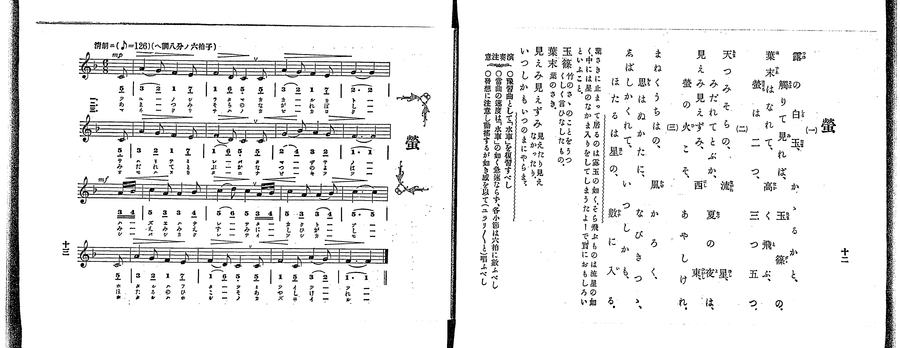

# 螢

> Re:Shōka 使用 AI 協助辨識與重建樂譜，可能會有錯誤。歡迎回報。

- **鋼琴伴奏版**：<br><audio controls src="hotaru.mp3"></audio>
- **NEUTRINO 歌聲合成版**：<br><audio controls src="hotaru_neutrino.mp3"></audio>

- 出處：共益商社樂器店《唱歌教科書 教師用 巻三》第十二～十三頁（第二學期第一曲）
- NDL Digital Collections PID 854864（https://dl.ndl.go.jp/pid/854864）掃描 P012.jpg

## 說明

原書資訊與歌詞全文（NDL PID 854864《唱歌教科書 教師用 巻三》第十二～十三頁，掃描 P012.jpg）：
調性與拍號：ヘ調八分ノ六拍子（F 大調 6/8 拍），♪=126（八分音符=126，折合四分音符 ♩=63），「清朗ニ」，弱起一拍（八分音符）
註記：單聲部，三節分節歌。開頭 mp，第八小節末拍（第三段弱起兩個十六分音符）轉 mf。
原典演奏注意：預習曲可復習〈水車〉；當曲速度不若〈水車〉急速，各小節須數足六拍；注意發想，以動搖之感（ユラリ／＼と）歌唱。
原典曲意：「葉さきに止まって居るのは露玉の如く、そら飛ぶものは流星の如く、中には星のなかま入りをしてしまうたよーで實におもしろいといふこと。」
原典語釋：「玉篠」：竹のさゝのことをうつくしく言ひなしたもの；「葉末」：葉のさき；「見えみ見えずみ」：見えたり見えなかつたり；「いつしかも」：いつのまにやらまー。


## 歌詞

```text
一、
露の白玉、かゝるかと、
觸りて見れば、玉篠の、
葉末はなれて、高く飛ぶ、
螢は二つ、三つ五つ。

二、
天つみそらの、流星、
みだれてとぶか、夏の夜は、
見えみ見えずみ、西東、
螢の火こそ、あやしけれ。

三、
まねくうちはの、風かろく、
思はぬかたに、なびきつゝ、
しばしかくれて、いつしかも、
ほたるは星の、數に入る。
```

## ABC

```abc
X:1
T:螢
M:6/8
L:1/16
Q:3/8=42
K:F
V:V1 name="Voice" snm="Voi"
[V:V1]
!mp! z2 z2 z2 z2 z2 C2 | A4 G2 F4 E2 | F4 D2 C4 C2 | A4 G2 F4 E2 |
w: 1.~つ | ゆ _ の し | ら た ま か | か _ る か
w: 2.~あ | ま _ つ み | そ ら の な | が _ れ ぼ
w: 3.~ま | ね _ く う | ち は の か | ぜ _ か ろ
G10 C2 | A4 G2 F4 E2 | F4 D2 C4 C2 | G4 B2 A4 G2 |
w: 1.~と さ | は り て み | れ _ ば た | ま _ ざ さ
w: 2.~し み | だ れ て と | ぶ か な つ | の _ よ る
w: 3.~く お | も は ぬ か | た _ に な | び _ き つ
!mf! F10 A B | c4 A2 A4 B2 | c4 d2 c4 A B | c4 A2 A4 B2 |
w: 1.~の は _ | ず え は な | れ _ て た _ | か く と _
w: 2.~は み _ | え み み え | ず _ み に _ | し ひ が _
w: 3.~つ し _ | ば し か く | れ _ て い _ | つ し か _
c10 C2 | A4 G2 F4 E2 | F4 D2 C4 C2 | F4 C2 A4 G2 |
w: 1.~ぶ ほ | た る は ふ | た _ つ み | つ い つ _
w: 2.~し ほ | た る の ひ | こ _ そ あ | や し け _
w: 3.~も ほ | た る は ほ | し _ の か | ず に い _
F10 z2 |
w: 1.~つ
w: 2.~れ
w: 3.~る
```

## TMD 檔案連結

- [主旋律 TMD 檔案](hotaru.tmd) [[在 TMD Studio 編輯](https://tmdlang.github.io/Tmd-TS/#tmd=s7IKdvYPcrWy4qpTUCpJTLdSSM7PyUlNLsnMz7PKrsxPzc6ML87Iz05Ugisoy88pzU21yk7MizeOtzA1sTAzQUgW55cWJadaFSdn5OfnxJekVpQk5edno8vHFySmp1oFGBgaIWQKivLLUvMS84C6C4oy80pSU8DaEQpSyzJTUkHSxclAq8tSizLTMlNTkNyVWlQMcjXUipKixLzi5KLMApBXEKrSU_OKUq2SMzJzUopS8-KL8_PSEZJp-UW5VsUlRfkFGZnJCOGSjFSghxPzMnMTc9BF8xJLSotS0UWLUxOBJhejC5dk5qbG56fFpyRWIqTyizLTM_OsclMzszKRQkxLS-HFvEUKWlpcirYKZsZc9rYKblw2ZvoWdiCdT9t3vZg59f2eWU9bNz6f3fV0atvzJfuerWh6OnPF013THzd0PZ2y8dnanmdTZz5fPvHZ7B0KQNbTHaufT1mh8HT77ic7Oh83dD9fs-Zpb-OTXT3v984DMXZ0vlzQ-H5PB1AcKPh07Y5nc-aD2Dsans3e9H5PJ9jJfi4-Ci5AB5ck5ig4w5NKsUKAp4sCJDEATcgoKSkottLXT8nRywPi9Hy9rAL9gswUfZiKzmd9zc_6-xVASQAoB4wCLn0tBVtqAS4FBYWnffOB_n6xuf3Fiq4XHe3AwHixct7T1hXPprUDXQjyBsLJFIVXD5pfgL4DxgvICS9W7X_WsBxkeXfvi5nzgaKPm2cABZ-2rn7a0fa4ue9p61qg1NO1E4AuclN4umQ5UFIBGMUKQFGwMT2PZq6yNTQyA8pDNL2cv_n5mmUQoZ5nXTOeTuh4Ons2XELh0cyVtmbGEL2PG3qe7Wh9Nmf64-buxw1AA3ue7tn4Yut2UISCzEcxEqgF7OQVu1-smAFKV9PWvWjc9LJ5BVAb0KfP1zcAlQJJYCA9bmh6Oa375YK1CrkFQFlQsAAN2tAPkp2zGmI0ON10Plu3FWLl09aVTxu6gYEG9DGylS_2dirkpgENhMbY09Ydz_ZMebq0_9nmFc9a-oHueLlgwvP9k4AJ8Gn_-qf7VgLZjxs6nm3Y8mJ31-MGoC9nP5-6DSj7smH-013LnuzofdG9FFnBs4alQCmQ1ye0QJz4ckHHs6k7XmzbDAl8oAkQu57P3POseTPIt7uXPu2e-mzCtCc7u5-1APV2PG5e9rh55ePmVe_3AJ2053EjMFA6gQEBTDOoTp-9CeJoYMi_mNj5uHHq48bex42rn61d9Lhx3-PGxY8blz3d2Pq4qftx47rHjetfztn0vA-obN3TZU2PG_sfNzQ-bpz7uKnz5eLZjxu3PW4CCoKUPdva-GzGfGRlT3asBRoLkgKLP25c9bgRaOa-p61LHzd1PW6a9LhxOtAuMAm0t-1x4_zHTUBvAJ2-_Ol6oDhQL1AZ0LTpj5uALmwBeglMbn3cOBnEbmgCJhiEx16smveyvRviMaCLn69fAE5Ps56v3gm2furjprlgBlgzyHqglUtAbgW5oP_FiobHjZvArgRygU4BeQwY8JBgAqYZiGngIAOb1giKFpDsMqCvOh437ocxZgHZUMVQEaBpXTA2JBSA9oIEISaAfQUUAdrbDbIXrBcmCLQLGDqrHze1AAMdxAYGEDA-Qf4G5hFgOINYwEgCqnw-cy8oqkAxBDQHGElAi4AIGFJgRS-W7wAFfOMykFOagLZuAEpAQwpoDVQRxK-N60EuBSlaBpR4uXoGMISgMQ5VNw-YXNYDyxmQI0GRDXTbkie7poC5UOcBJSGKny5ZCfbLfkjSgdgGTTEQFWC5BVALQfG8DeT0hsanS4DRs-7pkjkgF0Ftxh7ejS-W7n82F5jWEc5b9xyUhoDRPRccJk2gMAQF8kSQPfAwBAUYxAnAcAYmWaCFwISxEBwEIHe-XAR0DjDAgEkQlKxBSp81AFMSUHoNOHyBqRuYOIAWAKN2MzgzLQGFPsxUoIUboHELNAAWpBhxDlW9G5wwgEph2QYYUFN3AG0AZxtgkICzMuW1DxQoaOlzcXnklyQWlVqF5WcmpzrUGNRUg6xQsDE007IDs6pzC2rBDGD1pwEpKzUVHje3KNQAyWVAvAeI-xQeN20Hi6wEsvYD6XlAejVIBEhC1ABpiEhzB5BEGNW0FeQOkA01CgYKuhjYNB5I1CgYA0kQNAJiQyjbHCIF45qBuGDlIEhYH0gIHUJ0gZ3jY1ijAOKhY2DUgbU_bmpD0giMLjhrOlS-Ey4yH0zug_O7ISrANNyEJhgPIb8CixOB5Q_CjUa43NgENQFmJ0QnyOUQ1n6o_Fy47SDXIvtiFVRFD4obYbzHjXug8iDfYroRbD7Ejca43AhyG8iEtSg6--EsUPiC5BfCRdajuREWTnNQTICHY1MvVB5mJqobu-BuBCbux839QLwKiNuAeD44pa6Bpt0J4FQNEgGma5BI0zZwwgWJ9KGkZrAhexApmtxkC0ubJkCMbAZCGzKszk2rBSozQUq5kLCChALIn8CSB-5vaNzD4xIiugHOAqVWzLQzDc4Cpz-keEANVZC9iNQJLNnh7gDZh-wOUOoGqdgGFwHFHCTlQfjQnIZiE7ChAGfB4h_mV1SXoKZBYEmL4kZgEY5iL8gckM8R-lfDWbC8sBlFvhfDnbD8heoOcHkAT2dNu4B4BTSpdKGkM2DKA5eee2AlZ9N6cHkJFWmehprWZiPSmSnUMlBagaUXUNpByJgBMUIVMKkQoQcZopWMwKoX7j9QfCClN1hooaUvRLzD0heivAPlT9TSDjldoIbmboQ7wOkLnhrA8Q0hEe5CdilCFYQFil_kEgzYBgSTyO7GXcIhuQOUupDyD0g9uu_whUcL1B5E6YxqAtQd8PSLyx3g1AVKP6A6F5S6poK1QVIUqM6GlWtAVtMSqAgkZbVQXmTBJMFcwmUWqG5HTk6wrAfJ1MjJaSs0eFAzJ2ZVhhABBShqZsSVOZESNTgxobsCUdWAkgZIxWQUV8CrT1iF2wSyGyICicSJqK5ASQRYXAFOSrjDAhzZaEkSW4WIyJygRA4JEWRXICctVFfUcnHp2ilAmoUKQJYyFwA)]
- [鋼琴伴奏 TMD 檔案](hotaru_piano.tmd) [[在 TMD Studio 編輯](https://tmdlang.github.io/Tmd-TS/#tmd=s7IKdvYPcrWy4tLSUngxb9H7PR0vu_c8n7DlyZ4tT5f2P-_seL-nU0FLi0vRVsHMmMveVsGNy8ZM38KOq05B6Wn7rhczp77fM-tp68bns7ueTm17vmTfsxVNT2eueLpr-uOGrqdTNj5b2_Ns6sznyyc-m71DAch6umP18ykrFJ5u3_1kR-fjhu7na9Y87W18sqvn_d55IMaOzpcLGoGuAIoDBZ-u3fFsznwQe0fDs9mbgG5RAlns5-Kj4JKZnlmSmKPgnJ-Tk5pckpmfV6wQ4OmiYGFqYmFmAjQho6SkoNhKXz8lRy8PiNPz9bIK9AsyU_RhKjqf9TU_6-9XCDAwNALKpStxcXnklyQWlVoFZCbm5Qd5ONToGtZUcykAgY2hmZYdmFWdW1ALZuhrKWg83bPxxdbtmgqPm1sUaoDkMiDeA8R9Co-btoNFVgJZ-4H0PCC9GiQCJCFqgDREpLkDSCKMatqqoKUPtqFGwUBBFwObxgOJGgVjIAmCRkBsCGWbQ6RgXDMQF6wcBAnrAwmhQ4gusHN8DGsUQDx0_LhxCVj746Y2JI2PG9fBWdOh8p1wkflgch-c3w1RAabhJjTBeAj5FVic-LhxKsKNRrjc2AQ1AWYnRCfI5RDWfqj8XLjtINci-2IVVEUPihthvMeNe6DyIN9iuhFsPsSNxrjcCHIbyIS1KDr74SxQ-ILkF8JF1qO5ERZOc1BMgIdjUy9UHmYmqhu74G4EJu7Hzf1AvAqI24B4PjilroGm3QngVA0SAaZrkEjTNnDCBYn0oaRmsCF7ECma3GQLS5smQIxsBkIbMqzOTasFKjNBSrmQsIKEAsifjxuXwf0NjXt4XEJEN8BZoNSKmXamwVng9IcUD6ihCrIXkTofNy6AuwNkH7I7QKkbpGIbXAQUc5CUB-FDcxqKTY-bOuAsWPzD_IrqEtQ0-LgJlCcQbnzcuAbFXpA5IJ8j9K-Gs2B5YTOKfC-GO2H5C9Ud4PIAns6adgHxCmhS6UJJZ8CUBy4998BKzqb14PISKtI8DTWtzUakM1OoZaC0AksvoLSDkDEDYoQqYFIhQg8yRCsZHzfOgvsPFB9I6Q0WWmjpCxHvsPSFKO9A-RO1tENOF6ihuRvhDnD6gqcGcHxDSIS7kF2KUAVhgeIXuQR73LgJTCK7G3cJh-QOUOpCyj8g9ei-wxceLVB7EKUzqglQd8DTLy53gFMXKP2A6lxQ6poK1gZJUaA6G1auAVlNS6AikJTVQnmRBZMEcwmXWaC6HTk5wbIeJFMjJ6et0OBBzZyYVRlCBBSgqJkRV-ZEStTgxITuCkRVA0oaIBWTUVwBrz5hFW4TyG6ICCQSJ6K6AiURYHEFOCnhDgtwZKMlSWwVIiJzghI5JESQXYGctFBdUYvaLPRBaRZaQFuFwJT2oq_rZXvv09YdL2e3QlrPiCRkGA9KBdGGsUisGlC5Eh-vYATkmsYiMyE-r1EwiQcmlGgT0jThkKWNZTg0YRMmWwcdww7FKkh-BMa-rp0CJAFE-wBlkHhGKDxjME-ZCwA)]

## 分析

```text
================================================================================
📊 TMD Song Profile: [ 螢 ]
================================================================================
⏱  Duration:       0:48 (48.6s), 17 measures total
🎼 Key & Tempo:    首調基準 F, != 63.0 BPM, <6/8>
   - 分析範圍：      由實際發聲的音符與和弦推測調性；播放脈絡另行呈現
🎤 人聲音域:    C4 (MIDI 60) – D5 (MIDI 74) [跨度: 14 個半音 / 1.2 個八度, 難度: moderate]
   - 最低音:  C4 in [Hotaru #1 @ m.1, 0:02]
   - 最高音: D5 in [Hotaru #1 @ m.11, 0:29]
   - 適合: soprano, mezzo-soprano, contralto, tenor, baritone, bass
🏛  結構:      Hotaru (48.6s)
⚡ 編曲密度:        Peak 1 軌道同時演奏
🗝  調性診斷：       F 大調（純淨自然大調，未偵測到可信轉調）
   - 風格氣質:    純淨自然大調（陽光明朗、易唱易記，無明顯調外色彩）
   - 轉調歷程:    全曲維持單一推測調性（未偵測到可信轉調）
   - 核心骨幹音:  C, F, A, G, D
   - 調性數值:    F 大調 [相關度: 0.92, 穩定度: High, 自然音純度: 100.0%]
   - 候選調性 (K-S): F 大調 (0.92), C 大調 (0.77), A 小調 (0.70)
   - 五度圈歷程:   -1
   - 各段落調性細節:
     • [Hotaru #1]: F 大調 (r: 0.92, 自然音純度: 100.0%)

  [ 五度圈游移軌跡 ]
               C  
        [F ]*          G  
      Bb               D  
      Eb               A  
         Ab           E  
            Db       B  
               F# 
     (* = active key center)

  [ 十二半音累積音高分佈 ]
     C  : ████████████████████████  27.1%
     C# :                            0.0%
     D  : ████                       4.2%
     D# :                            0.0%
     E  : ████                       4.2%
     F  : ████████████████████████  27.1%
     F# :                            0.0%
     G  : ████████████              13.5%
     G# :                            0.0%
     A  : ██████████████████        19.8%
     A# : ████                       4.2%
     B  :                            0.0%
--------------------------------------------------------------------------------
Assignment 軌道音域：
  - Voice         : C4 – D5 (14 個半音 / 1.2 個八度, 58 個音符)
================================================================================
```


## 原書掃描頁




