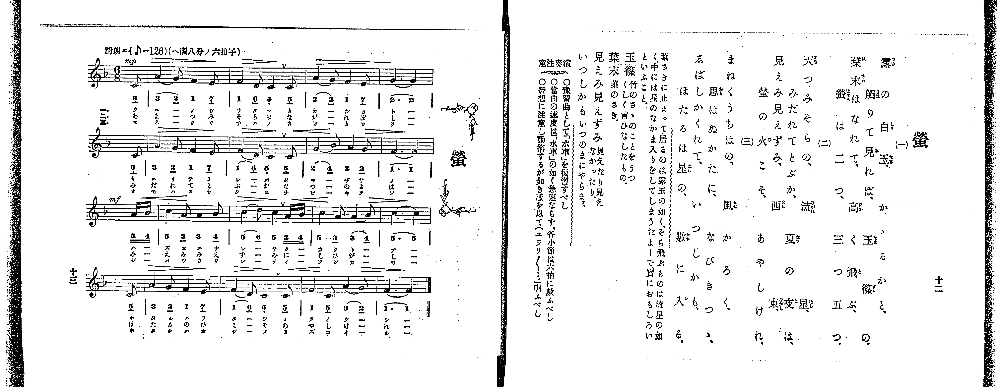

# 螢

> Re:Shōka 使用 AI 協助辨識與重建樂譜，可能會有錯誤。歡迎[回報](https://github.com/TMDLang/reshoka/issues)。

- **鋼琴伴奏版**：<br><audio controls src="hotaru.mp3"></audio>
- **NEUTRINO 歌聲合成版**：<br><audio controls src="hotaru_neutrino.mp3"></audio>

- 出處：共益商社樂器店《唱歌教科書 教師用 巻三》第十二～十三頁（第二學期第一曲）
- NDL Digital Collections PID 854864（https://dl.ndl.go.jp/pid/854864）掃描 P012.jpg

## 說明

原書資訊與歌詞全文（NDL PID 854864《唱歌教科書 教師用 巻三》第十二～十三頁，掃描 P012.jpg）：
調性與拍號：ヘ調八分ノ六拍子（F 大調 6/8 拍），♪=126（八分音符=126，折合四分音符 ♩=63），「清朗ニ」，弱起一拍（八分音符）
註記：單聲部，三節分節歌。開頭 mp，第八小節末拍（第三段弱起兩個十六分音符）轉 mf。
原典演奏注意：預習曲可復習〈水車〉；當曲速度不若〈水車〉急速，各小節須數足六拍；注意發想，以動搖之感（ユラリ／＼と）歌唱。
原典曲意：「葉さきに止まって居るのは露玉の如く、そら飛ぶものは流星の如く、中には星のなかま入りをしてしまうたよーで實におもしろいといふこと。」
原典語釋：「玉篠」：竹のさゝのことをうつくしく言ひなしたもの；「葉末」：葉のさき；「見えみ見えずみ」：見えたり見えなかつたり；「いつしかも」：いつのまにやらまー。


## 歌詞

```text
一、
露の白玉、かゝるかと、
觸りて見れば、玉篠の、
葉末はなれて、高く飛ぶ、
螢は二つ、三つ五つ。

二、
天つみそらの、流星、
みだれてとぶか、夏の夜は、
見えみ見えずみ、西東、
螢の火こそ、あやしけれ。

三、
まねくうちはの、風かろく、
思はぬかたに、なびきつゝ、
しばしかくれて、いつしかも、
ほたるは星の、數に入る。
```

## ABC

<div class="abc-score" data-abc-src="hotaru.abc" aria-label="五線譜載入中"></div>

[下載 ABC 原始檔](hotaru.abc)

## TMD 檔案連結

- [主旋律 TMD 檔案](hotaru.tmd) [[在 TMD Studio 編輯](https://tmdlang.github.io/Tmd-TS/#tmd=s7IKdvYPcrWy4qpTUCpJTLdSSM7PyUlNLsnMz7PKrsxPzc6ML87Iz05Ugisoy88pzU21yk7MizeOtzA1sTAzQUgW55cWJadaFSdn5OfnxJekVpQk5edno8vHFySmp1oFGBgaIWQKivLLUvMS84C6C4oy80pSU8DaEQpSyzJTUkHSxclAq8tSizLTMlNTkNyVWlQMcjXUipKixLzi5KLMApBXEKrSU_OKUq2SMzJzUopS8-KL8_PSEZJp-UW5VsUlRfkFGZnJCOGSjFSghxPzMnMTc9BF8xJLSotS0UWLUxOBJhejC5dk5qbG56fFpyRWIqTyizLTM_OsclMzszKxhFh-UUlGfnpRYkFGpVVGZnEJUHlyYk48MPiBcaKlpfBi3iIFLS0uRVsFM2Mue1sFNy4bM30LO5D-p-27Xsyc-n7PrKetG5_P7no6te35kn3PVjQ9nbni6a7pjxu6nk7Z-Gxtz7OpM58vn_hs9g4FIOvpjtXPp6xQeLp995MdnY8bup-vWfO0t_HJrp73e-eBGDs6Xy5ofL-nAygOFHy6dsezOfNB7B0Nz2Zver-nE-xwPxcfBRegr0oScxSc4empWCHA00UBkmKAJmSUlBQUW-nrp-To5QFxer5eVoF-QWaKPkxF57O-5mf9_QqgdAKUA8YTl76Wgi21AJeCgsLTvvlAf7_Y3P5iRdeLjnZgYLxYOe9p64pn09qBLgR5A-FkisKrB80vQN8B4wXkhBer9j9rWA6yvLv3xcz5QNHHzTOAgk9bVz_taHvc3Pe0dS1Q6unaCUAXuSk8XbIcKKkAjGIFoCjYmJ5HM1fZGhqZAeUhml7O3_x8zTKIUM-zrhlPJ3Q8nT0bLqHwaOZKWzNjiN7HDT3PdrQ-mzP9cXP34waggT1P92x8sXU7KEJB5qMYCdQCdvKK3S9WzAClq2nrXjRuetm8AqgN6NPn6xuASoEkMJAeNzS9nNb9csFahdwCoCwoWIAGbegHyc5ZDTEanG46n63bCrHyaevKpw3dwEAD-hjZyhd7OxVy04AGQmPsaeuOZ3umPF3a_2zzimct_UB3vFww4fn-ScAE-LR__dN9K4Hsxw0dzzZsebG763ED0Jezn0_dBpR92TD_6a5lT3b0vuheiqzgWcNSoBTI6xNaIE58uaDj2dQdL7ZthgQ-0ASIXc9n7nnWvBnk291Ln3ZPfTZh2pOd3c9agHo7Hjcve9y88nHzqvd7gE7a87gRGCidwIAAphlUp8_eBHE0MORfTOx83Dj1cWPv48bVz9Yuety473Hj4seNy55ubH3c1P24cd3jxvUv52x63gdUtu7psqbHjf2PGxofN8593NT5cvHsx43bHjcBBUHKnm1tfDZjPrKyJzvWAo0FSYHFHzeuetwINHPf09alj5u6HjdNetw4HWgXmATa2_a4cf7jJqA3gE5f_nQ9UByoF6gMaNr0x01AF7YAvQQmtz5unAxiNzQBEwzCYy9WzXvZ3g3xGNDFz9cvAKenWc9X7wRbP_Vx01wwA6wZZD3QyiUgt4Jc0P9iRcPjxk1gVwK5QKeAPAYMeEgwAdMMxDRwkIFNawRFC0h2GdBXHY8b98MYs4BsqGKoCNC0LhgbEgpAe0GCEBPAvgKKAO3tBtkL1gsTBNoFDJ3Vj5tagIEOYgMDCBifIH8D8wgwnEEsYCQBVT6fuRcUVaAYApoDjCSgRUAEDCmwohfLd4ACvnEZyClNQFs3ACWgIQW0BqoI4tfG9SCXghQtA0q8XD0DGELQGIeqmwdMLuuB5QzIkaDIBrptyZNdU8BcqPOAkhDFT5esBPtlPyTpQGyDphiICrDcAqiFoHjeBnJ6Q-PTJcDoWfd0yRyQi6A2Yw_vxhdL9z-bC0zrCOetew5KQ8DongsOkyZQGIICeSLIHngYggIM4gRgOAOTLNBCYMJYCA4CkDtfLgI6BxhgwCQIStYgpc8agCkJKL0GHL7A1A1MHEALgFG7GZyZloBCH2Yq0MIN0LgFGgALUow4h6reDU4YQKWwbAMMqKk7gDaAsw0wSMBZmfLaBwoUtPS5uDzySxKLSq3C8jOTUx1qDGqqQVYo2BiaadmBWdW5BbVgBrD604CUlZoKj5tbFGqA5DIg3gPEfQqPm7aDRVYCWfuB9DwgvRokAiQhaoA0RKS5A0gijGraCnIHyIYaBQMFXQxsGg8kahSMgSQIGgGxIZRtDpGCcc1AXLByECSsDySEDiG6wM7xMaxRAPHQMTDqwNofN7UhaQRGF5w1HSrfCReZDyb3wfndEBVgGm5CE4yHkF-BxYnA8gfhRiNcbmyCmgCzE6IT5HIIaz9Ufi7cdpBrkX2xCqqiB8WNMN7jxj1QeZBvMd0INh_iRmNcbgS5DWTCWhSd_XAWKHxB8gvhIuvR3AgLpzkoJsDDsakXKg8zE9WNXXA3AhP34-Z-IF4FxG1APB-cUtdA0-4EcKoGiQDTNUikaRs44YJE-lBSM9iQPYgUTW6yhaVNEyBGNgOhDRlW56bVApWZIKVcSFhBQgHkT2DJA_c3NO7hcQkR3QBngVIrZtqZBmeB0x9SPKCGKsheROoEluxwd4DsQ3YHKHWDVGyDi4BiDpLyIHxoTkOxCdhQgLNg8Q_zK6pLUNMgsKRFcSOwCEexF2QOyOcI_avhLFhe2Iwi34vhTlj-QnUHuDyAp7OmXUC8AppUulDSGTDlgUvPPbCSs2k9uLyEijRPQ01rsxHpzBRqGSitwNILKO0gZMyAGKEKmFSI0IMM0UpGYNUL9x8oPpDSGyy00NIXIt5h6QtR3oHyJ2pph5wuUENzN8Id4PQFTw3g-IaQCHchuxShCsICxS9yCQZsA4JJZHfjLuGQ3AFKXUj5B6Qe3Xf4wqMFag-idEY1AeoOePrF5Q5w6gKlH1CdC0pdU8HaICkKVGfDyjUgq2kJVASSslooL7JgkmAu4TILVLcjJydY1oNkauTktBUaPKiZE7MqQ4iAAhQ1M-LKnEiJGpyY0F2BqGpASQOkYjKKK-DVJ6zCbQLZDRGBROJEVFegJAIsrgAnJdxhAY5stCSJrUJEZE5QIoeECLIrkJMWqitqubh07RQgzUIFIEuZCwA)]
- [鋼琴伴奏 TMD 檔案](hotaru_piano.tmd) [[在 TMD Studio 編輯](https://tmdlang.github.io/Tmd-TS/#tmd=s7IKdvYPcrWy4qpTUCpJTLdSyC8qychPL0osyKi0ysgsLskvykxOzInPTsxLVOLS0lJ4MW_R-z0dL7v3PJ-w5cmeLU-X9j_v7Hi_p1NBS4tL0VbBzJjL3lbBjcvGTN_CDmTo0_ZdL2ZOfb9n1tPWjc9ndz2d2vZ8yb5nK5qezlzxdNf0xw1dT6dsfLa259nUmc-XT3w2e4cCkPV0x-rnU1YoPN2--8mOzscN3c_XrHna2_hkV8_7vfNAjB2dLxc0Al0BFAcKPl2749mc-SD2joZnszcB3aIEstjPxUfBJTM9syQxR8E5PycnNbkkMz-vWCHA00XBwtTEwswEaEJGSUlBsZW-fkqOXh4Qp-frZRXoF2Sm6MNUdD7ra37W368QYGBoBJRLV-Li8sgvSSwqtQrITMzLD_JwqNE1rKnmUgACG0MzLTswqzq3oBbM0NdS0Hi6Z-OLrds1FR43tyjUAMllQLwHiPsUHjdtB4usBLL2A-l5QHo1SARIQtQAaYhIcweQRBjVtFVBSx9sQ42CgYIuBjaNBxI1CsZAEgSNgNgQyjaHSMG4ZiAuWDkIEtYHEkKHEF1g5_gY1iiAeOj4ceMSsPbHTW1IGh83roOzpkPlO-Ei88HkPji_G6ICTMNNaILxEPIrsDjxceNUhBuNcLmxCWoCzE6ITpDLIaz9UPm5cNtBrkX2xSqoih4UN8J4jxv3QOVBvsV0I9h8iBuNcbkR5DaQCWtRdPbDWaDwBckvhIusR3MjLJzmoJgAD8emXqg8zExUN3bB3QhM3I-b-4F4FRC3AfF8cEpdA027E8CpGiQCTNcgkaZt4IQLEulDSc1gQ_YgUjS5yRaWNk2AGNkMhDZkWJ2bVgtUZoKUciFhBQkFkD8fNy6D-xsa9_C4hIhugLNAqRUz7UyDs8DpDykeUEMVZC8idT5uXAB3B8g-ZHeAUjdIxTa4CCjmICkPwofmNBSbHjd1wFmw-If5FdUlqGnwcRMoTyDc-LhxDYq9IHNAPkfoXw1nwfLCZhT5Xgx3wvIXqjvA5QE8nTXtAuIV0KTShZLOgCkPXHrugZWcTevB5SVUpHkaalqbjUhnplDLQGkFll5AaQchYwbECFXApEKEHmSIVjI-bpwF9x8oPpDSGyy00NIXIt5h6QtR3oHyJ2pph5wuUENzN8Id4PQFTw3g-IaQCHchuxShCsICxS9yCfa4cROYRHY37hIOyR2g1IWUf0Dq0X2HLzxaoPYgSmdUE6DugKdfXO4Apy5Q-gHVuaDUNRWsDZKiQHU2rFwDspqWQEUgKauF8iILJgnmEi6zQHU7cnKCZT1IpkZOTluhwYOaOTGrMoQIKEBRMyOuzImUqMGJCd0ViKoGlDRAKiajuAJefcIq3CaQ3RARSCRORHUFSiLA4gpwUsIdFuDIRkuS2CpEROYEJXJIiCC7AjlpobqiFrVZ6IPSLLSAtgqBKe1FX9fL9t6nrTtezm6FtJ4RScgwHpQKog1jkVg1oHIlPl7BCMg1jUVmQnxeo2ASD0wo0SakacIhSxvLcGjCJky2DjqGHYpVkPwIjH1dOwVIAoj2Acog8YxQeMZgnjIXAA)]

## 分析

```text
================================================================================
📊 TMD Song Profile: [ 螢 ]
================================================================================
⏱  Duration:       0:48 (48.6s), 17 measures total
🎼 Key & Tempo:    首調基準 F, != 63.0 BPM, <6/8>
   - 分析範圍：      由實際發聲的音符與和弦推測調性；播放脈絡另行呈現
🎤 人聲音域:    C4 (MIDI 60) – D5 (MIDI 74) [跨度: 14 個半音 / 1.2 個八度, 難度: moderate]
   - 最低音:  C4 in [Hotaru #1 @ m.1, 0:02]
   - 最高音: D5 in [Hotaru #1 @ m.11, 0:29]
   - 適合: soprano, mezzo-soprano, contralto, tenor, baritone, bass
🏛  結構:      Hotaru (48.6s)
⚡ 編曲密度:        Peak 1 軌道同時演奏
🗝  調性診斷：       F 大調（純淨自然大調，未偵測到可信轉調）
   - 風格氣質:    純淨自然大調（陽光明朗、易唱易記，無明顯調外色彩）
   - 轉調歷程:    全曲維持單一推測調性（未偵測到可信轉調）
   - 核心骨幹音:  C, F, A, G, D
   - 調性數值:    F 大調 [相關度: 0.92, 穩定度: High, 自然音純度: 100.0%]
   - 候選調性 (K-S): F 大調 (0.92), C 大調 (0.77), A 小調 (0.70)
   - 五度圈歷程:   -1
   - 各段落調性細節:
     • [Hotaru #1]: F 大調 (r: 0.92, 自然音純度: 100.0%)

  [ 五度圈游移軌跡 ]
               C  
        [F ]*          G  
      Bb               D  
      Eb               A  
         Ab           E  
            Db       B  
               F# 
     (* = active key center)

  [ 十二半音累積音高分佈 ]
     C  : ████████████████████████  27.1%
     C# :                            0.0%
     D  : ████                       4.2%
     D# :                            0.0%
     E  : ████                       4.2%
     F  : ████████████████████████  27.1%
     F# :                            0.0%
     G  : ████████████              13.5%
     G# :                            0.0%
     A  : ██████████████████        19.8%
     A# : ████                       4.2%
     B  :                            0.0%
--------------------------------------------------------------------------------
Assignment 軌道音域：
  - Voice         : C4 – D5 (14 個半音 / 1.2 個八度, 58 個音符)
================================================================================
```


## 原書掃描頁




