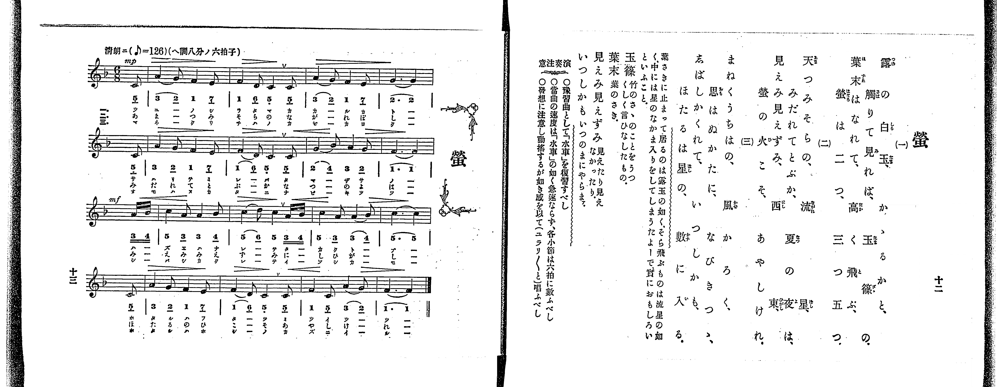

# 螢

> Re:Shoka 使用 AI 協助辨識與重建樂譜，可能會有錯誤。歡迎回報。

<audio controls src="hotaru.mp3"></audio>

- 出處：共益商社樂器店《唱歌教科書 教師用 巻三》第十二～十三頁（第二學期第一曲）
- NDL Digital Collections PID 854864（https://dl.ndl.go.jp/pid/854864）掃描 P012.jpg

## 說明

原書資訊與歌詞全文（NDL PID 854864《唱歌教科書 教師用 巻三》第十二～十三頁，掃描 P012.jpg）：
調性與拍號：ヘ調八分ノ六拍子（F 大調 6/8 拍），♪=126（八分音符=126，折合四分音符 ♩=63），「清朗ニ」，弱起一拍（八分音符）
註記：單聲部，三節分節歌。開頭 mp，第八小節末拍（第三段弱起兩個十六分音符）轉 mf。
原典演奏注意：預習曲可復習〈水車〉；當曲速度不若〈水車〉急速，各小節須數足六拍；注意發想，以動搖之感（ユラリ／＼と）歌唱。
原典曲意：「葉さきに止まって居るのは露玉の如く、そら飛ぶものは流星の如く、中には星のなかま入りをしてしまうたよーで實におもしろいといふこと。」
原典語釋：「玉篠」：竹のさゝのことをうつくしく言ひなしたもの；「葉末」：葉のさき；「見えみ見えずみ」：見えたり見えなかつたり；「いつしかも」：いつのまにやらまー。

## 歌詞

```text
一、
露の白玉、かゝるかと、
觸りて見れば、玉篠の、
葉末はなれて、高く飛ぶ、
螢は二つ、三つ五つ。

二、
天つみそらの、流星、
みだれてとぶか、夏の夜は、
見えみ見えずみ、西東、
螢の火こそ、あやしけれ。

三、
まねくうちはの、風かろく、
思はぬかたに、なびきつゝ、
しばしかくれて、いつしかも、
ほたるは星の、數に入る。
```

## ABC

```abc
X:1
T:螢
M:6/8
L:1/16
Q:3/8=42
K:F
V:V1 name="Voice" snm="Voi"
[V:V1]
!mp! z2 z2 z2 z2 z2 C2 | A4 G2 F4 E2 | F4 D2 C4 C2 | A4 G2 F4 E2 |
G10 C2 | A4 G2 F4 E2 | F4 D2 C4 C2 | G4 B2 A4 G2 |
!mf! F10 A B | c4 A2 A4 B2 | c4 d2 c4 A B | c4 A2 A4 B2 |
c10 C2 | A4 G2 F4 E2 | F4 D2 C4 C2 | F4 C2 A4 G2 |
F10 z2 |
```

## TMD 檔案連結

- [主旋律 TMD 檔案](hotaru.tmd) [[在 TMD Studio 編輯](https://tmdlang.github.io/Tmd-TS/#tmd=s7IKdvYPcrWy4qpTUCpJTLdSSM7PyUlNLsnMz7PKrsxPzc6ML87Iz05Ugisoy88pzU21yk7MizeOtzA1sTAzQUgW55cWJadaFSdn5OfnxJekVpQk5edno8vHFySmp1oFGBgaIWQKivLLUvMS84C6C4oy80pSU8DaEQpSyzJTUkHSxclAq8tSizLTMlNTkNyVWlQMcjXUipKixLzi5KLMApBXEKrSU_OKUq2SMzJzUopS8-KL8_PSEZJp-UW5VsUlRfkFGZnJCOGSjFSghxPzMnMTc9BF8xJLSotS0UWLUxOBJhejC5dk5qbG56fFpyRWKnFpaSm8mLdIQUuLS9FWwcyYy95WwY3Lxkzfwg6k62n7rhczp77fM-tp68bns7ueTm17vmTfsxVNT2eueLpr-uOGrqdTNj5b2_Ns6sznyyc-m71DAch6umP18ykrFJ5u3_1kR-fjhu7na9Y87W18sqvn_d55IMaOzpcLGt_v6QCKAwWfrt3xbM58EHtHw7PZm97v6QQ718_FR8ElMz2zJDFHwRmeFooVAjxdFCCxDTQho6SkoNhKXz8lRy8PiNPz9bIK9AsyU_RhKjqf9TU_6-9XAMUxUA4Yxlz6Wgq21AJcCgoKT_vmA_39YnP7ixVdLzragYHxYuW8p60rnk1rB7oQ5A2EkykKrx40vwB9B4wXkBNerNr_rGE5yPLu3hcz5wNFHzfPAAo-bV39tKPtcXPf09a1QKmnaycAXeSm8HTJcqCkAjCKFYCiYGN6Hs1cZWtoZAaUh2h6OX_z8zXLIEI9z7pmPJ3Q8XT2bLiEwqOZK23NjCF6Hzf0PNvR-mzO9MfN3Y8bgAb2PN2z8cXW7aAIBZmPYiRQC9jJK3a_WDEDlK6mrXvRuOll8wqgNqBPn69vACoFksBAetzQ9HJa98sFaxVyC4CyoGABGrShHyQ7ZzXEaHC66Xy2bivEyqetK582dAMDDehjZCtf7O1UyE0DGgiNsaetO57tmfJ0af-zzSuetfQD3fFywYTn-ycBE-DT_vVP960Esh83dDzbsOXF7q7HDUBfzn4-dRtQ9mXD_Ke7lj3Z0fuieymygmcNS4FSIK9PaIE48eWCjmdTd7zYthkS-EATIHY9n7nnWfNmkG93L33aPfXZhGlPdnY_awHq7XjcvOxx88rHzave7wE6ac_jRmCgdAIDAphmUJ0-exPE0cCQfzGx83Hj1MeNvY8bVz9bu-hx477HjYsfNy57urH1cVP348Z1jxvXv5yz6XkfUNm6p8uaHjf2P25ofNw493FT58vFsx83bnvcBBQEKXu2tfHZjPnIyp7sWAs0FiQFFn_cuOpxI9DMfU9blz5u6nrcNOlx43SgXWASaG_b48b5j5uA3gA6ffnT9UBxoF6gMqBp0x83AV3YAvQSmNz6uHEyiN3QBEwwCI-9WDXvZXs3xGNAFz9fvwCcnmY9X70TbP3Ux01zwQywZpD1QCuXgNwKckH_ixUNjxs3gV0J5AKdAvIYMOAhwQRMMxDTwEEGNq0RFC0g2WVAX3U8btwPY8wCsqGKoSJA07pgbEgoAO0FCUJMAPsKKAK0txtkL1gvTBBoFzB0Vj9uagEGOogNDCBgfIL8DcwjwHAGsYCRBFT5fOZeUFSBYghoDjCSgBYBETCkwIpeLN8BCvjGZSCnNAFt3QCUgIYU0BqoIohfG9eDXApStAwo8XL1DGAIQWMcqm4eMLmsB5YzIEeCIhvotiVPdk0Bc6HOA0pCFD9dshLsl_2QpAOxDZpiICrAcgugFoLieRvI6Q2NT5cAo2fd0yVzQC6C2ow9vBtfLN3_bC4wrSOct-45KA0Bo3suOEyaQGEICuSJIHvgYQgKMIgTgOEMTLJAC4EJYyE4CEDufLkI6BxggAGTIChZg5Q-awCmJKD0GnD4AlM3MHEALQBG7WZwZloCCn2YqUALN0DjFmgALEgx4hyqejc4YQCVwrINMKCm7gDaAM42wCABZ2XKax8oUNDS5-LyyC9JLCq1CsvPTE51qDGoUagG2aFgY2imZQdmVecW1IIZwPpPA1JYaio8bm5RqAGSy4B4DxD3KTxu2g4WWQlk7QfS84D0apAIkISoAdIQkeYOIIkwqmkryCEgG2oUDBR0MbBpPJCoUTAGkiBoBMSGULY5RArGNQNxwcpBkLA-kBA6hOiCefhxcz8QrwLiNiCeD3b9Gqh_JoB9ChIB-hUk0rQN7BmQSB-KD8GG7EH4klyvwNxrAsTIZiC0IcPq3LRaoDITJN807QLiFVAHdaH4Bug_cLx1w-KsaT04pkCyIHXTUH00G-EbU6h9IBfBXAVyIULGDOQFuCqgg4jQgydOwO4EpSqQL6aC3QsSAfmiBR5LQFbTEqgIxActlEcATBLMJRwDoNRbw1XLxaVrpwDJZwpAljIXAA)]

## 分析

```text
================================================================================
📊 TMD Song Profile: [ 螢 ]
================================================================================
⏱  Duration:       0:48 (48.6s), 17 measures total
🎼 Key & Tempo:    首調基準 F, != 63.0 BPM, <6/8>
   - 分析範圍：      由實際發聲的音符與和弦推測調性；播放脈絡另行呈現
🎤 人聲音域:    C4 (MIDI 60) – D5 (MIDI 74) [跨度: 14 個半音 / 1.2 個八度, 難度: moderate]
   - 最低音:  C4 in [Hotaru #1 @ m.1, 0:02]
   - 最高音: D5 in [Hotaru #1 @ m.11, 0:29]
   - 適合: soprano, mezzo-soprano, contralto, tenor, baritone, bass
🏛  結構:      Hotaru (48.6s)
⚡ 編曲密度:        Peak 1 軌道同時演奏
🗝  調性診斷：       F 大調（純淨自然大調，未偵測到可信轉調）
   - 風格氣質:    純淨自然大調（陽光明朗、易唱易記，無明顯調外色彩）
   - 轉調歷程:    全曲維持單一推測調性（未偵測到可信轉調）
   - 核心骨幹音:  C, F, A, G, D
   - 調性數值:    F 大調 [相關度: 0.92, 穩定度: High, 自然音純度: 100.0%]
   - 候選調性 (K-S): F 大調 (0.92), C 大調 (0.77), A 小調 (0.70)
   - 五度圈歷程:   -1
   - 各段落調性細節:
     • [Hotaru #1]: F 大調 (r: 0.92, 自然音純度: 100.0%)

  [ 五度圈游移軌跡 ]
               C  
        [F ]*          G  
      Bb               D  
      Eb               A  
         Ab           E  
            Db       B  
               F# 
     (* = active key center)

  [ 十二半音累積音高分佈 ]
     C  : ████████████████████████  27.1%
     C# :                            0.0%
     D  : ████                       4.2%
     D# :                            0.0%
     E  : ████                       4.2%
     F  : ████████████████████████  27.1%
     F# :                            0.0%
     G  : ████████████              13.5%
     G# :                            0.0%
     A  : ██████████████████        19.8%
     A# : ████                       4.2%
     B  :                            0.0%
--------------------------------------------------------------------------------
Assignment 軌道音域：
  - Voice         : C4 – D5 (14 個半音 / 1.2 個八度, 58 個音符)
================================================================================
```


## 原書掃描頁




