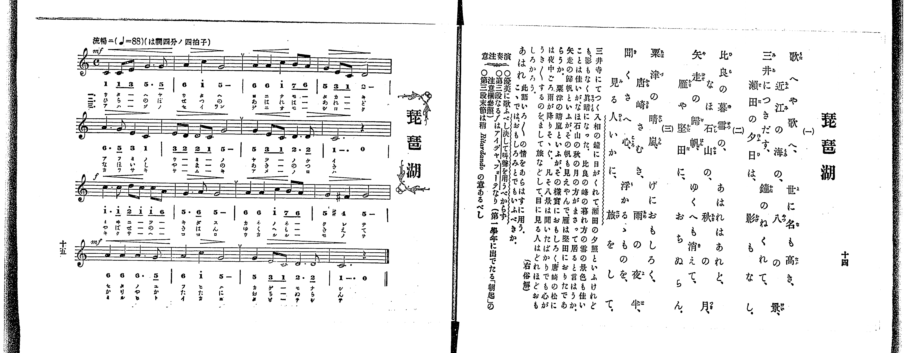

# 琵琶湖

> Re:Shoka 使用 AI 協助辨識與重建樂譜，可能會有錯誤。歡迎回報。

<audio controls src="biwako.mp3"></audio>

- 出處：共益商社樂器店《唱歌教科書 教師用 巻三》第十四～十五頁（第二學期第二曲）
- NDL Digital Collections PID 854864（https://dl.ndl.go.jp/pid/854864）掃描 P013.jpg

## 說明

原書資訊與歌詞全文（NDL PID 854864《唱歌教科書 教師用 巻三》第十四～十五頁，掃描 P013.jpg）：
調性與拍號：ハ調四分ノ四拍子（C 大調 4/4 拍），♩=88，「流暢ニ」
註記：單聲部，三節分節歌。開頭 mf，第三段（第九小節）轉 f，第四段（第十三小節）轉 mf。第十二小節第二拍出現 #4（F#4，4'）。第十五小節第三、四拍（2. 2̲）五線譜下附印小音符，供第三節「旅をして」多一音節時分唱。
原典演奏注意：當優美歌唱，決不可用叫聲；第三段之 f 為「アイデア、フォーテ」（理念上之強音，參照第一學年〈朝起〉注意欄）；第三段末節（第十二小節）當稍帶 Ritardando 之意。
原典曲意：「三井寺にてつく入相の鐘に日がくれて、瀨田の夕照といふけれども、影もなく眞暗になつた。比良の峰の暮れ方の雪の景色も佳いことは佳いが、なほ石山の秋の月の方がまさつて居ると言はうか。矢走の歸帆といふが、その帆も見えやんで、雁は堅田におりたであらうか。粟津の晴嵐といふが、その樣實におもしろく、唐崎の松には夜中ごろ、雨が降りそゝぐ。凡そ八景は聞いたばかりでも心がうき／＼するのを、まして旅などして、目に見る人はどれほどおもしろからう。（右俗解）」
原典語釋：「あはれ」：此語いろ／＼の情をあらはすに用う。こゝでは、おもしろみとでもいふべきか。

## 歌詞

```text
一、
歌へや歌へ、世に名も高き、
近江の海の、八つの景、
三井につきだす、鐘のねくれて、
瀨田の夕日は、影もなし。

二、
比良の暮雪の、あはれはあれど、
なほ石山の、秋の月、
矢走の歸帆、ゆくへも消えて、
雁や堅田に、おちぬらん。

三、
粟津の晴嵐、げにおもしろく、
唐崎さむき、雨の夜半、
聞くさへ心、浮かるゝものを、
見る人いかに、旅をして。
```

## ABC

```abc
X:1
T:琵琶湖
M:4/4
L:1/16
Q:1/4=88
K:C
V:V1 name="Voice" snm="Voi"
[V:V1]
!mf! C4 C2 E2 G6 G2 | A4 c4 G8 | A4 A4 c4 B2 A2 | G4 E2 C2 D8 |
A6 G2 E4 C4 | E2 D2 D2 C2 G8 | G4 E2 C2 D6 D2 | C12 z4 |
!f! c6 c2 d2 c2 c2 A2 | G6 A2 G8 | A4 A4 c4 B2 A2 | G4 ^F4 G8 |
!mf! A4 A4 A6 G2 | A4 c4 G8 | G4 E2 C2 D6 D2 | C12 z4 |
!mf! C4 C2 E2 G6 G2 | A4 c4 G8 | A4 A4 c4 B2 A2 | G4 E2 C2 D8 |
A6 G2 E4 C4 | E2 D2 D2 C2 G8 | G4 E2 C2 D6 D2 | C12 z4 |
!f! c6 c2 d2 c2 c2 A2 | G6 A2 G8 | A4 A4 c4 B2 A2 | G4 ^F4 G8 |
!mf! A4 A4 A6 G2 | A4 c4 G8 | G4 E2 C2 D6 D2 | C12 z4 |
!mf! C4 C2 E2 G6 G2 | A4 c4 G8 | A4 A4 c4 B2 A2 | G4 E2 C2 D8 |
A6 G2 E4 C4 | E2 D2 D2 C2 G8 | G4 E2 C2 D6 D2 | C12 z4 |
!f! c6 c2 d2 c2 c2 A2 | G6 A2 G8 | A4 A4 c4 B2 A2 | G4 ^F4 G8 |
!mf! A4 A4 A6 G2 | A4 c4 G8 | G4 E2 C2 D6 D2 | C12 z4 |
```

## TMD 檔案連結

- [主旋律 TMD 檔案](biwako.tmd) [[在 TMD Studio 編輯](https://tmdlang.github.io/Tmd-TS/#tmd=s7IKdvYPcrWy4qpTUCpJTLdSSM7PyUlNLsnMz7PKrsxPzc6ML87Iz05Ugisoy88pzU21yk7MizeOtzA1sTAzQUgW55cWJadaFSdn5OfnxJekVpQk5edno8vHFySmp1oFGBgaI2QKivLLUvMS84C6C4oy80pSU8DaEQpSyzJTUkHSxclAq8tSizLTMlNTkNyVWlQMcjXUipKixLzi5KLMApBXEKrSU_OKUq2SMzJzUopS8-KL8_PSEZJp-UW5VsUlRfkFGZnJCOGSjFSgh3MS81KAVhekokuUJ5akFqELFuQkJmOoBLqpLDVHiUtLS-H5hK3PJ2x7tnOagpYWl6KtgoUFl72tgjOXjYm-iR1I29P2XS9mTn2_Z9bT1o3PZ3c9ndr2fMm-Zyuans5c8XTX9McNXU-nbHy2tufZ1JnPl098NnuHApD1dMfq51NWKDzdvvvJjs7HDd3P16x52tv4dPbs93vnARlPdk15uaDx_Z4OoPiTXT1P1-54Nmc-hP1s9qb3ezrB7vVz8VFwyUzPLEnMUXCGJ4ZihQBPFwVIdANNyCgpKSi20tdPydHLA-L0fL2sAv2CzBR9mIrOZ33Nz_r7FUCRDJQDBjKXvpaCLbUAl4KCwtO--UB_v9jc_mJF14uOdmBgvFg572nrimfT2oEuBHkD4WSKwqsHzS9A3wHjBeSEF6v2P2tYDrK8u_fFzPlA0cfN_UBBoBFPO9oeN_cBGUCpp2snAF3krPB0yXKgpAIwihWAomBjeh7NXGlrYQFkPG7oeba18dmsRY-bux839IKNX7H7xYoZoDQwbd2Lxk0vm1cA1QGd-nx9A9B4IAn00OOGppfTul8uWKuQmwaUBUXnjs5n67ZCo3nn3Kcb-oEqgZa92NupAFUCchZMCcijOzpRVOWmAU2FSgHTCVgKmk6Anmnf9bx_n4IyKBm4gcgeE3WgPiQdUxA6QMEKClCwdzuM9BSMzoASGlDN8-2zXqyd82RH98uZLU97NwC1vJy_-fmaZSAf7psN0Qs0BBQq01sfN0163Dj9ceMyYMA8XTLryY4GkGKg_2c2AQMCGLNA26FJ4mnrjmd7pjxd2v9s84pnLf3AwHs-ddvTllXP9_UBQwuoFBSfG3c92dH7tH89MPaf9q8GBu37PVArgcHyZGe3QprC86ZdQLsfNy163LTkcXM7iNHQ-Lh56uOmlY-b9zxubgM6BRSAE9qe7t_6ZEcXUNfTPduBzgKa_7S_-XnrcrCBDcBc9nTnlscNHc_mzH2xdfvjhk6Iw56taQEnAIS9z-asBkcBLFJgIQ9UBvTC8xW9T3dsUwgC5suiFGBRlK8AtBFoDqrPZ2-C-BnodKChT3ZNfbp-1-PG1aCQa1zyuLH_aevS57N3PG5c93LCDKD4s-lLHzf2AMUfNwFJYOg2Pm9Y8XzKBqCCp0umAv3wuHHF48aWx41bHzdOBKtZ-bipCRSlezeCGI2rgHqfz5n3bBYwcoC2ALlAW-YD3fRs_ZQXnetB5mwGmfZs1jqg9mfTdoKsng1Utu7ZzPUvOjcBDXmydzPYislgu9bDuMCE3Qg2cPfz-ZufbtwI1PJ8eTdI45wOEAkyCuiefY8bp4ItXfZ0IzCZABWseLGiAWjO48a2x43AjNT0fP6iF1vBbgDGxA6gINxHECvmghwJFG9qerEMqL3jcVPL4yagY5YDZV_OBipY_3RBKzhMgB7setzUBfIgULax6XFTJ8KWTfOfbQEGJtBfW55unYDVlmcrFj9dD4wIiDnA0Jv-uKkXFPjA8Jwy4emWPpCauUAfARWsf7oEmDnWPm6cAlIDcgnQwJ6XM3vBDpj7uAlo4ASgvU_bFwK5T1tXA8MTqOtF4zywvUAXAh3cDVa8HGjX0_3N4OACuhaYaoEpZM_jxpng4ALGyySwC4H2gnIYKLeBgn0lLMM1Pp-9DugkUOA0dT_ZBUxOQIuAyQBo2m6wMmS_ANWAw6ShCZiOn_ZvfrJ_-ovli8HFA7hEgyTTF6vmvWzvhiRTUDgCTQQaB8pPs56tXQKUBfmhCe7Qdc-aISUAJMSB1s8EOgiYdyE2gZIOKDiAUbIe7BNkB-0HxwQoCGDxAUw3YIcC8w3IRcAsCtQEYoEK08YdwOiHMhqA5eI0oEVPJwADvenlamCGAcUEuGDeP_HZRmAYr3sGzNHAIARGYCsw0oDJEJSuoYogGRAcm0AJoJ0LQA4HRiUo6wGDFBi5iHwH0oCc98A5E2QSUk4D1vpQN-8CJSqwm2HZDJjBIPkKHAKwIAWFFTDQwPkWogEtS4GiF56roK5Ayy9A85qAyaYfHDZNz7YBcx8QwdwMyiFNLYgcAgn_RmCiXAOKLGBGgoczqCoAW4CWVUBagJGLJVeAUww0ZwALXmC2hmcFYBjNedrbBYsPULIHuhAY2jtASb2h8dlWYAiDUiwoaYBMhaZzsGpEUgYmCaDvQc5GrWXAZSrlzRQoUNDS5-JyyixPzM63CsvPTE51qDGoUagG2aFgY2imZQdmVeem1YIZwIbS46ZlQLxfAVjVAPEMIF6iUIMkOgPEa14BxN1A3AXEi8BqQWqA8k2rITqb1oKsBplZo2CooAuGINoYiE2hfBAEsWsUzGAq4pCEkSFCCYZSc6hgDVwTyA6QXUbohiD8CHLzVCCeD8R9MP-BfQwSAdFgUaDfHze3wEUeN20Eq12C8BvMOTBHg-yG-RXicJAIyCUgDBLF9Bo-d4PYiBBEhwYoPqtGikWwPzZAYwnkeogvQK5fC2Q1AOmdYB4ovnohvgPTEDXrgaw1QNyGFIuwAIeHvhGIALPABGokwOKKopg0UYcyMEzBkm53Q1MoyCfLwLEHiuFJQNwP82nTJmhogOK_Cyy6HTMu0WmYA4hKp9SIzFouLl07BUi2VcDBUuYCAA)]

## 分析

```text
================================================================================
📊 TMD Song Profile: [ 琵琶湖 ]
================================================================================
⏱  Duration:       2:10 (130.9s), 48 measures total
🎼 Key & Tempo:    首調基準 C, != 88.0 BPM, <4/4>
   - 分析範圍：      由實際發聲的音符與和弦推測調性；播放脈絡另行呈現
🎤 人聲音域:    C4 (MIDI 60) – D5 (MIDI 74) [跨度: 14 個半音 / 1.2 個八度, 難度: moderate]
   - 最低音:  C4 in [Biwako #1 @ m.1, 0:00]
   - 最高音: D5 in [Biwako #1 @ m.9, 0:23]
   - 適合: soprano, mezzo-soprano, contralto, tenor, baritone, bass
🏛  結構:      Biwako (43.6s) -> Biwako (43.6s) -> Biwako (43.6s)
⚡ 編曲密度:        Peak 1 軌道同時演奏
🗝  調性診斷：       C 大調（純淨自然大調，未偵測到可信轉調）
   - 風格氣質:    純淨自然大調（陽光明朗、易唱易記，無明顯調外色彩）
   - 轉調歷程:    全曲維持單一推測調性（未偵測到可信轉調）
   - 核心骨幹音:  G, C, A, D, E
   - 調性數值:    C 大調 [相關度: 0.82, 穩定度: Moderate, 自然音純度: 98.4%]
   - 候選調性 (K-S): C 大調 (0.82), G 大調 (0.74), A 小調 (0.60)
   - 五度圈歷程:   +0 -> +0 -> +0
   - 各段落調性細節:
     • [Biwako #1]: C 大調 (r: 0.82, 自然音純度: 98.4%, 調外音: F#)
     • [Biwako #2]: C 大調 (r: 0.82, 自然音純度: 98.4%, 調外音: F#)
     • [Biwako #3]: C 大調 (r: 0.82, 自然音純度: 98.4%, 調外音: F#)

  [ 五度圈游移軌跡 ]
              [C ]*
         F            G  
      Bb               D  
      Eb               A  
         Ab           E  
            Db       B  
               F# 
     (* = active key center)

  [ 十二半音累積音高分佈 ]
     C  : ███████████████████████   28.2%
     C# :                            0.0%
     D  : ██████████                12.1%
     D# :                            0.0%
     E  : █████                      5.6%
     F  :                            0.0%
     F# : █                          1.6%
     G  : ████████████████████████  29.8%
     G# :                            0.0%
     A  : █████████████████         21.0%
     A# :                            0.0%
     B  : █                          1.6%
--------------------------------------------------------------------------------
Assignment 軌道音域：
  - Voice         : C4 – D5 (14 個半音 / 1.2 個八度, 186 個音符)
================================================================================
```


## 原書掃描頁




