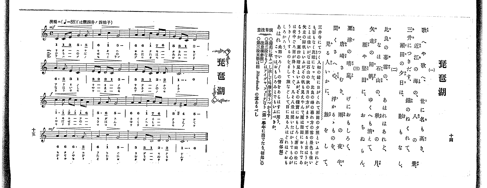

# 琵琶湖

> Re:Shōka 使用 AI 協助辨識與重建樂譜，可能會有錯誤。歡迎回報。

- **NEUTRINO 歌聲合成版**：<br><audio controls src="biwako_neutrino.mp3"></audio>
- **鋼琴伴奏版**：<br><audio controls src="biwako.mp3"></audio>


- 出處：共益商社樂器店《唱歌教科書 教師用 巻三》第十四～十五頁（第二學期第二曲）
- NDL Digital Collections PID 854864（https://dl.ndl.go.jp/pid/854864）掃描 P013.jpg

## 說明

原書資訊與歌詞全文（NDL PID 854864《唱歌教科書 教師用 巻三》第十四～十五頁，掃描 P013.jpg）：
調性與拍號：ハ調四分ノ四拍子（C 大調 4/4 拍），♩=88，「流暢ニ」
註記：單聲部，三節分節歌。開頭 mf，第三段（第九小節）轉 f，第四段（第十三小節）轉 mf。第十二小節第二拍出現 #4（F#4，4'）。第十五小節第三、四拍（2. 2̲）五線譜下附印小音符，供第三節「旅をして」多一音節時分唱。
原典演奏注意：當優美歌唱，決不可用叫聲；第三段之 f 為「アイデア、フォーテ」（理念上之強音，參照第一學年〈朝起〉注意欄）；第三段末節（第十二小節）當稍帶 Ritardando 之意。
原典曲意：「三井寺にてつく入相の鐘に日がくれて、瀨田の夕照といふけれども、影もなく眞暗になつた。比良の峰の暮れ方の雪の景色も佳いことは佳いが、なほ石山の秋の月の方がまさつて居ると言はうか。矢走の歸帆といふが、その帆も見えやんで、雁は堅田におりたであらうか。粟津の晴嵐といふが、その樣實におもしろく、唐崎の松には夜中ごろ、雨が降りそゝぐ。凡そ八景は聞いたばかりでも心がうき／＼するのを、まして旅などして、目に見る人はどれほどおもしろからう。（右俗解）」
原典語釋：「あはれ」：此語いろ／＼の情をあらはすに用う。こゝでは、おもしろみとでもいふべきか。


## 跨冊／重複收錄參照

> 同曲（《共益商社唱歌教科書》、《新編 小學校・公學校 唱歌教材集》、《楊金土手抄唱歌帖》共同收錄教材）

- **[同曲]** 《新編小公學校唱歌教材集》第三、四學年（大正12年／1923，國臺圖 0725-41）：[**〈琵琶湖〉**](../../../shoka_kyozai_shu_1923/grade_3_4/43_biwako/index.md)（`C` / `4/4` — [原始 TMD](../../../shoka_kyozai_shu_1923/grade_3_4/43_biwako/biwako.tmd)）
- **[同曲]** 楊金土手抄《唱歌帖》第 10 冊・X（2020.006.0843）：[**〈琵琶湖 (琵琶湖)〉**](../../../shokacho/vol_10/p220_biwako/index.md)（`C` / `4/4` — [原始 TMD](../../../shokacho/vol_10/p220_biwako/biwako.tmd)）
- 總表：[跨冊重複與同名歌曲總索引](../../../duplicate_songs.md)

## 歌詞

```text
一、
歌へや歌へ、世に名も高き、
近江の海の、八つの景、
三井につきだす、鐘のねくれて、
瀨田の夕日は、影もなし。

二、
比良の暮雪の、あはれはあれど、
なほ石山の、秋の月、
矢走の歸帆、ゆくへも消えて、
雁や堅田に、おちぬらん。

三、
粟津の晴嵐、げにおもしろく、
唐崎さむき、雨の夜半、
聞くさへ心、浮かるゝものを、
見る人いかに、旅をして。
```

## ABC

```abc
X:1
T:琵琶湖
M:4/4
L:1/16
Q:1/4=88
K:C
V:V1 name="Voice" snm="Voi"
[V:V1]
!mf! C4 C2 E2 G6 G2 | A4 c4 G8 | A4 A4 c4 B2 A2 | G4 E2 C2 D8 |
w: 1.~う た _ へ や | う た へ | よ に な も _ | た か _ き
w: 2.~ひ ら _ の ぼ | せ つ の | あ は れ は _ | あ れ _ ど
w: 3.~あ は _ づ の | せ い らん | げ に お も _ | し ろ _ く
A6 G2 E4 C4 | E2 D2 D2 C2 G8 | G4 E2 C2 D6 D2 | C12 z4 |
w: 1.~あ ふ み の | う _ み _ の | や つ _ の け | い
w: 2.~な ほ い し | や _ ま _ の | あ き _ の つ | き
w: 3.~か ら さ き | さ _ む _ き | あ め _ の よ | は
!f! c6 c2 d2 c2 c2 A2 | G6 A2 G8 | A4 A4 c4 B2 A2 | G4 ^F4 G8 |
w: 1.~み ゐ に _ つ _ | き だ す | か ね の ね _ | く れ て
w: 2.~や ば せ _ の _ | き は ん | ゆ く へ も _ | き え て
w: 3.~き く さ _ へ _ | こ こ ろ | う か る る _ | も の を
!mf! A4 A4 A6 G2 | A4 c4 G8 | G4 E2 C2 D6 D2 | C12 z4 |
w: 1.~せ た の ゆ | ふ ひ は | か げ _ も な | し
w: 2.~か り や か | た た に | お ち _ ぬ ら | ん
w: 3.~み る ひ と | い か に | た び _ を し | て
```

## TMD 檔案連結

- [主旋律 TMD 檔案](biwako.tmd) [[在 TMD Studio 編輯](https://tmdlang.github.io/Tmd-TS/#tmd=s7IKdvYPcrWy4qpTUCpJTLdSSM7PyUlNLsnMz7PKrsxPzc6ML87Iz05Ugisoy88pzU21yk7MizeOtzA1sTAzQUgW55cWJadaFSdn5OfnxJekVpQk5edno8vHFySmp1oFGBgaI2QKivLLUvMS84C6C4oy80pSU8DaEQpSyzJTUkHSxclAq8tSizLTMlNTkNyVWlQMcjXUipKixLzi5KLMApBXEKrSU_OKUq2SMzJzUopS8-KL8_PSEZJp-UW5VsUlRfkFGZnJCOGSjFSgh3MS81KAVhekokuUJ5akFqELFuQkJmOoBLqpLDVHiUtLS-H5hK3PJ2x7tnOagpYWl6KtgoUFl72tgjOXjYm-iR1I29P2XS9mTn2_Z9bT1o3PZ3c9ndr2fMm-Zyuans5c8XTX9McNXU-nbHy2tufZ1JnPl098NnuHApD1dMfq51NWKDzdvvvJjs7HDd3P16x52tv4dPbs93vnARlPdk15uaDx_Z4OoPiTXT1P1-54Nmc-hP1s9qb3ezrB7vVz8VFwyUzPLEnMUXCGJ4ZihQBPFwVIdANNyCgpKSi20tdPydHLA-L0fL2sAv2CzBR9mIrOZ33Nz_r7FUCRDJQDBjKXvpaCLbUAl4KCwtO--UB_v9jc_mJF14uOdmBgvFg572nrimfT2oEuBHkD4WSKwqsHzS9A3wHjBeSEF6v2P2tYDrK8u_fFzPlA0cfN_UBBoBFPO9oeN_cBGUCpp2snAF3krPB0yXKgpAIwihWAomBjeh7NXGlrYQFkPG7oeba18dmsRY-bux839IKNX7H7xYoZoDQwbd2Lxk0vm1cA1QGd-nx9A9B4IAn00OOGppfTul8uWKuQmwaUBUXnjs5n67ZCo3nn3Kcb-oEqgZa92NupAFUCchZMCcijOzpRVOWmAU2FSgHTCVgKmk6Anmnf9bx_n4IyKBm4gcgeE3WgPiQdUxA6QMEKClCwdzuM9BSMzoASGlDN8-2zXqyd82RH98uZLU97NwC1vJy_-fmaZSAf7psN0Qs0BBQq01sfN0163Dj9ceMyYMA8XTLryY4GkGKg_2c2AQMCGLNA26FJ4mnrjmd7pjxd2v9s84pnLf3AwHs-ddvTllXP9_UBQwuoFBSfG3c92dH7tH89MPaf9q8GBu37PVArgcHyZGe3QprC86ZdQLsfNy163LTkcXM7iNHQ-Lh56uOmlY-b9zxubgM6BRSAE9qe7t_6ZEcXUNfTPduBzgKa_7S_-XnrcrCBDcBc9nTnlscNHc_mzH2xdfvjhk6Iw56taQEnAIS9z-asBkcBLFJgIQ9UBvTC8xW9T3dsUwgC5suiFGBRlK8AtBFoDqrPZ2-C-BnodKChT3ZNfbp-1-PG1aCQa1zyuLH_aevS57N3PG5c93LCDKD4s-lLHzf2AMUfNwFJYOg2Pm9Y8XzKBqCCp0umAv3wuHHF48aWx41bHzdOBKtZ-bipCRSlezeCGI2rgHqfz5n3bBYwcoC2ALlAW-YD3fRs_ZQXnetB5mwGmfZs1jqg9mfTdoKsng1Utu7ZzPUvOjcBDXmydzPYislgu9bDuMCE3Qg2cPfz-ZufbtwI1PJ8eTdI45wOEAkyCuiefY8bp4ItXfZ0IzCZABWseLGiAWjO48a2x43AjNT0fP6iF1vBbgDGxA6gINxHECvmghwJFG9qerEMqL3jcVPL4yagY5YDZV_OBipY_3RBKzhMgB7setzUBfIgULax6XFTJ8KWTfOfbQEGJtBfW55unYDVlmcrFj9dD4wIiDnA0Jv-uKkXFPjA8Jwy4emWPpCauUAfARWsf7oEmDnWPm6cAlIDcgnQwJ6XM3vBDpj7uAlo4ASgvU_bFwK5T1tXA8MTqOtF4zywvUAXAh3cDVa8HGjX0_3N4OACuhaYaoEpZM_jxpng4ALGyySwC4H2gnIYKLeBgn0lLMM1Pp-9DugkUOA0dT_ZBUxOQIuAyQBo2m6wMmS_ANWAw6ShCZiOn_ZvfrJ_-ovli8HFA7hEgyTTF6vmvWzvhiRTUDgCTQQaB8pPs56tXQKUBfmhCe7Qdc-aISUAJMSB1s8EOgiYdyE2gZIOKDiAUbIe7BNkB-0HxwQoCGDxAUw3YIcC8w3IRcAsCtQEYoEK08YdwOiHMhqA5eI0oEVPJwADvenlamCGAcUEuGDeP_HZRmAYr3sGzNHAIARGYCsw0oDJEJSuoYogGRAcm0AJoJ0LQA4HRiUo6wGDFBi5iHwH0oCc98A5E2QSUk4D1vpQN-8CJSqwm2HZDJjBIPkKHAKwIAWFFTDQwPkWogEtS4GiF56roK5Ayy9A85qAyaYfHDZNz7YBcx8QwdwMyiFNLYgcAgn_RmCiXAOKLGBGgoczqCoAW4CWVUBagJGLJVeAUww0ZwALXmC2hmcFYBjNedrbBYsPULIHuhAY2jtASb2h8dlWYAiDUiwoaYBMhaZzsGpEUgYmCaDvQc5GrWXAZSrlzRQoUNDS5-JyyixPzM63CsvPTE51qDGoqQZZoWBjaKZlB2ZV56bVghnAdtLjpmVAvF8BWNMA8QwgXqJQgyQ6A8RrXgHE3UDcBcSLwGpBaoDyTashOpvWgmwGmVmjYKigC4Yg2hiITaF8EASxaxTMYCrikISRIUIJhlJzqGANXBPIDpBdRuiGgN3jYwh0amMbVAxYXsFZO5DUAlMW2EzCKiHOe9zUAZddDWetgpvWhFCJZE43nNWL3a1GIPWb4KZ0wtWvQ3Zr4x6oybPhIkuwqoS5AOYaYC6Fm92DIYaiEkl-JXa3GuMwuXEpiltB7kF1Kyikof4D5loszp0EV4oI2i64JuSgnQ4X7YWr7MfqXHBSByXdqUA8H4j7YMkcnPBBIiAaLArMAo-bW-Aij5s2gtUuQSRxWKoEQVAyBCVBEIQl_RqwCChBgjBIFDOF40u-IDYiI6FDAxSfQRI4LFQgYbAVTO6H82GJAjWBY8ojXAfJEBBZ7IkL2E6DmghTiQ7jUd0JTtywLAIxYTeYRNgEi09U-_fhcydSEuzF4U6Q-0EqYfIE3AlO2LCsCjYBnBGBZT6GTSCVcNGmBgx5rO5sasTuTnCRAlIJy0r43VmNVIiD0-8GaCENSrWQ1AsKxrVAVgOQ3gnmgYrrXkiqBtMQNeuBrDVA3IZUiMPKWxAEc4xABJgFJlDLYBAEiVBUkJuoQxkYpiAldFiihQTZBBCJVEzAkip6dAObRGByJob7kEvltXAWLGIQYiCVsKIFuXRcht2toMQOT8IQlRvAJKIcRM6UqG4FJQCsRWMTIvPC3QKvnVCLRpiJwDYUIbeCEzyqC0CmIyd4mB0glcjugvAQxS-SW5EKGngIN2GyQL5CZGF4uDfBKgFUt6I2XXZDGymg1LwMXHKDSvdJQNwPS-1Nm6A5AlT2d4FFt2OW4-g0CBLdVKFuQY5IH4h2A2oxAQpXkEpQIQ-Rh7cYMIoO1PQNr1jhIQ4RBxXKyNUpOsRWkCNiElE1o6Z3kArU9g-CBcuxyO6Em9O4EM5ag2wiuBgGxSB6zsDhTnC6hldyiLQHDy8IbwXUfkSFg1CJzZ0IX2yGm42cWiHhCFKJnt8w3VnLxaVrpwBpsCsAWcpcAA)]
- [鋼琴伴奏 TMD 檔案](biwako_piano.tmd) [[在 TMD Studio 編輯](https://tmdlang.github.io/Tmd-TS/#tmd=s7IKdvYPcrWy4tLSUng-YevzCdue7Zz2fk_Hy-49zydsebJny9Ol_c87O97v6VTQ0uJStFWwsOCyt1Vw5rIx0Tex46pTUHravuvFzKnv98x62rrx-eyup1Pbni_Z92xF09OZK57umv64oevplI3P1vY8mzrz-fKJz2bvUACynu5Y_XzKCoWn23c_2dH5uKH7-Zo1T3sbn86e_X7vPCDjya4pLxc0Al0BFH-yq-fp2h3P5syHsJ_N3gR0ixLIYj8XHwWXzPTMksQcBef8nJzU5JLM_LxihQBPFwULUxMLMxOgCRklJQXFVvr6KTl6eUCcnq-XVaBfkJmiD1PR-ayv-Vl_v0KAgaExUC5diYvLKbM8MTvfKiAzMS8_yMOhxqCmmksBCGwMzbTswKzq3LRaMENfS-Fx0zIg3q_wuHkPEM8A4iUKNUiiM0C85hVA3A3EXUC8CKwWpAYo37QaorNprYKWPtjMGgVDBV0wBNHGQGwK5YMgiF2jYAZTEYckjAwRSjCUmkMFa-CaQHaA7DJCNwTsHh9DoFMb26Bijxvnw1k7kNQ-bmoBm0lYJcR5j5s64LKr4axVcNOaECqRzOmGs3qxu9UIpH4T3JROuPp1yG5t3AM1eTZcZAlWlTAXwFzzuHE93OweDDEUlUjyK7G71RiHyY1LUdwKcg-qW0EhDfXf46bJWJw7Ca4UEbRdcE3IQTsdLtoLV9mP1bngpA5KulOBeD4Q98GSOTjhg0RANFgUmAUeN7fARR43bQSrXYJI4rBUCYKgZAhKgiAIS_o1YBFQggRhkChmCseXfEFsREZChwYoPoMkcFioQMJgK5jcD-fDEgVqAseUR7gOkiEgstgT1-PGiVATYSrRYTyqO8GJG5ZFICbsBpMIm2DxiWr_PnzuREqCvTjcCXI_SCVMnoA7wQkbllXBJoAz4uPGqRg2gVTCRZsaMOSxurOpEbs7wUUKSCUsK-F3ZzVSIQ5OvxughTQo1UJSLygY1wJZDUB6J5gHKq57IakaTEPUrAey1gBxG1IhDitvQRDMMQIRYBaYQC2DQRAkQlFBbqIOZWCYgpTQYYkWEmQTQCRSMQFLqujR_bhxAZicieE-5FJ5LZwFixiEGEglrGhBLh2XYXcrKLHDkzBE5QYwiSgHkTMlqltBCQBr0diEyLxwt8BrJ9SiEWbi40ZETYXDreAEj-oCkOnICR5mB0glsrsgPETxi-RWpIIGHsJNmCyQrxBZGB7uTbBKANWtqE2X3dBGCig1LwOX3KDSfRIQ98NSe9MmaI4Alf1dYNHtmOU4Og2CRDdVqFuQI9IHot2AWkyAwhWkElTIQ-ThLQaMogM1fcMrVniIQ8RBhTJydYoOsRXkiJhEVM2o6R2kArX9g2DBciyyO-HmNC6Es9YgmwguhkExiJ4zcLgTnK7hlRwi7cHDC8JbAbUfUeEgVGJzJ8IXm-FmI6dWSDiCVKLnN0x31qK2132Q2-sm0OY6MKm_6Ot62d77tHXHy9mtkF4NUkkdrxBtGAujaoDQBMg0QYhA1UFFTeOBtGk8RCVUCUIMVS2SmXAlGGoxzMB0E1QlXAnUeCSVMBHCbsWuEslE7L7H70oDSFTo2ilAYiPaByiOxDNC4RmDecpcAA)]

## 分析

```text
================================================================================
📊 TMD Song Profile: [ 琵琶湖 ]
================================================================================
⏱  Duration:       0:43 (43.6s), 16 measures total
🎼 Key & Tempo:    首調基準 C, != 88.0 BPM, <4/4>
   - 分析範圍：      由實際發聲的音符與和弦推測調性；播放脈絡另行呈現
🎤 人聲音域:    C4 (MIDI 60) – D5 (MIDI 74) [跨度: 14 個半音 / 1.2 個八度, 難度: moderate]
   - 最低音:  C4 in [Biwako #1 @ m.1, 0:00]
   - 最高音: D5 in [Biwako #1 @ m.9, 0:23]
   - 適合: soprano, mezzo-soprano, contralto, tenor, baritone, bass
🏛  結構:      Biwako (43.6s)
⚡ 編曲密度:        Peak 1 軌道同時演奏
🗝  調性診斷：       C 大調（純淨自然大調，未偵測到可信轉調）
   - 風格氣質:    純淨自然大調（陽光明朗、易唱易記，無明顯調外色彩）
   - 轉調歷程:    全曲維持單一推測調性（未偵測到可信轉調）
   - 核心骨幹音:  G, C, A, D, E
   - 調性數值:    C 大調 [相關度: 0.82, 穩定度: Moderate, 自然音純度: 98.4%]
   - 候選調性 (K-S): C 大調 (0.82), G 大調 (0.74), A 小調 (0.60)
   - 五度圈歷程:   +0
   - 各段落調性細節:
     • [Biwako #1]: C 大調 (r: 0.82, 自然音純度: 98.4%, 調外音: F#)

  [ 五度圈游移軌跡 ]
              [C ]*
         F            G  
      Bb               D  
      Eb               A  
         Ab           E  
            Db       B  
               F# 
     (* = active key center)

  [ 十二半音累積音高分佈 ]
     C  : ███████████████████████   28.2%
     C# :                            0.0%
     D  : ██████████                12.1%
     D# :                            0.0%
     E  : █████                      5.6%
     F  :                            0.0%
     F# : █                          1.6%
     G  : ████████████████████████  29.8%
     G# :                            0.0%
     A  : █████████████████         21.0%
     A# :                            0.0%
     B  : █                          1.6%
--------------------------------------------------------------------------------
Assignment 軌道音域：
  - Voice         : C4 – D5 (14 個半音 / 1.2 個八度, 62 個音符)
================================================================================
```


## 原書掃描頁




