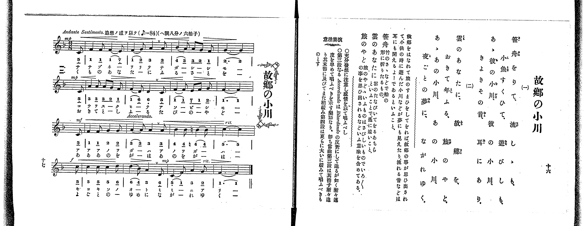

# 故郷の小川

> Re:Shōka 使用 AI 協助辨識與重建樂譜，可能會有錯誤。歡迎[回報](https://github.com/TMDLang/reshoka/issues)。

- **鋼琴伴奏版**：<br><audio controls src="furusato_no_ogawa.mp3"></audio>
- **NEUTRINO 歌聲合成版**：<br><audio controls src="furusato_no_ogawa_neutrino.mp3"></audio>

- 出處：共益商社樂器店《唱歌教科書 教師用 巻三》第十六～十七頁（第二學期第三曲）
- NDL Digital Collections PID 854864（https://dl.ndl.go.jp/pid/854864）掃描 P014.jpg

## 說明

原書資訊與歌詞全文（NDL PID 854864《唱歌教科書 教師用 巻三》第十六～十七頁，掃描 P014.jpg）：
調性與拍號：ヘ調八分ノ六拍子（F 大調 6/8 拍），♪=84（八分音符=84，折合四分音符 ♩=42），Andante Sentimento.「追想ノ感ヲ以テ」，弱起一拍（八分音符）
註記：單聲部，二節分節歌。開頭 mp，第八小節末拍（第三段弱起）轉 mf，第十小節標 Accelerando.，第十一小節第四至六拍為 ♮4（B♮4，4'），第十二小節標 rit.、末拍（第四段弱起）轉 f，第十四小節末拍轉 mp，第十五小節標 rit.。第七小節第四至六拍五線譜為三個八分音符（7_̲ 1̲ 2̲），簡譜中間「1」漏印底線，以五線譜為準。
原典演奏注意：充分注意發想、富感情歌唱；第三段之 Accelerando 為 Ritardando 之反對，示如迫近般漸快之樂語，即當曲第三段拍子漸迫，至其末節稍緩，第四段更大大放緩歌唱。
原典曲意：「故郷をはなれて旅のすまひをしてをれば、故郷の事が思ひ出されて、小供の時に遊んだ小川などが夢にも見えたり、流れる音などは耳にも聞えるよーであるといふこと。」
原典語釋：「笹舟」：竹のさゝなどで船の形に折りたるもの；「雲のあなたに」：雲のたなびいてをるあちらといふことで、遙に遠いこと；「旅のやど」：旅のやどゝいふものはさびしいものでいろ／＼の事を思ひ出されるなどいふ意味を含めてある。


## 歌詞

```text
一、
笹舟をりて、流しゝも、
小魚すくひて、遊びしも、
あゝ彼の小川、彼の小川、
きよきその音、耳にあり。

二、
雲のあなたに、故郷を、
おきて年ふる、旅のやど、
あゝあの小川、あの小川、
夜ごとの夢に、ながれゆく。
```

## ABC

<div class="abc-score" data-abc-src="furusato_no_ogawa.abc" aria-label="五線譜載入中"></div>

[下載 ABC 原始檔](furusato_no_ogawa.abc)

## TMD 檔案連結

- [主旋律 TMD 檔案](furusato_no_ogawa.tmd) [[在 TMD Studio 編輯](https://tmdlang.github.io/Tmd-TS/#tmd=s7IKdvYPcrWy4qpTUCpJTLdSSM7PyUlNLsnMz7PKrsxPzc6ML87Iz05Ugisoy88pzU21yk7MizeOtzA1sTAzQUgW55cWJadaFSdn5OfnxJekVpQk5edno8vHFySmp1oFGBgi6Swoyi9LzUvMA-ouKMrMK0lNAWtHKEgty0xJBUkXJwOtLkstykzLTE1BcldqUTHI1VArSooS84qTizILQF5BqEpPzStKtUrOyMxJKUrNiy_Oz0tHSKblF-VaFZcU5RdkZCYjhEsyUoEeLk8sSS1CF0xLzM3MqUQXTc3NR7UVIgx0UllqDkI0vygzPTPPKjc1MysTS1jlF5Vk5KcXJRZkVFplZBaXAJUnJ-bEAwMeGBtaWgrPpra-bN7-uHHd0w39T7fPVdDS4lK0VTAx4rK3VXDjsjHTt7ADmfW0fdeLmVPf75n1tHXj89ldT6e2PV-y79mKpqczVzzdNf1xQ9fTKRufre15NnXm8-UTn83eATR35tMdq59PWaHwdPvuJzs6Hzd0P1-z5mlv49PWte_3zgMynuxofrmg8f2eDqD4k109T9fueDZnPoi9o_PZ7E3v93SCPeHn4qPgAvRhSWKOgjM8VRUrBHi6KEDSDdCEjJKSgmIrff2UHL08IE7P18sq0C_ITNGHqeh81tf8rL9fAZRagHLA2OLS11KwpRbgUlBQeNo3H-jvF5vbX6zoetHRDgyMFyvnPW1d8WxaO9CFIG8gnExRePWg-QXoO2C8gJzwYtX-Zw3LQZZ3976YOR8o-rh5BlDwaevqpx1tj5v7gGYBpZ6unQB0kZvC0yXLgZIKwChWAIqCjel5NHOVrQUoSCF6Xs7f_HzNMrBIz7OuGU8ndDydPRsurvBo5kpbEyOITse8lERghlMITs0rycwFEvl6jxt6Xuzf-6x5M9DqZy3zHzdverJ76ePmtscNQNt6nu7Z-GLr9ic7GsCWo1gINBHsnxW7X6yYAUp009a9aNz0snkFUBswqTxf3wBUCiSBIfi4oenltO6XC9Yq5BYAZUFhBjRoQz9Ids5qiNHQRLVuK8RKoOkv9nYq5KZB1QPDGKJ-xUwFx-Tk1JxUYK5PydeDSwPdCFEB4s6e_aJ9MyQgnzftAgbBOlBwOUHoHhN1SGhANQKTNdzooswSYIg0IrsKaBi6q5AcBQxpJH-AnQzzIsjoKehGN4H92YzVqUDlz7fPerF2DtDNwLB42tCNGt4d5vFnNikYArHRGVDeA9mzYSFQ_ZMda19OmwyMSUNgrD3b0_-0d8PTXVOBZoGiYvdSZHOf7ZoGdAQ0Lzxt3fFsz5SnS_ufbV7xrKUfXHK0Ai2EcJ_P3ANKFg2NT9f3AFPGs-ZWYFQCs8T7PbPhkfVkZzdydCiAQjsIWA4UAdMZkAuUftrf-3QDKCk9X7Lr6bKmF_tXv9g_8UXHmmd7djzdvxqoAFhAvVg1D5TWejc_n7oNWKzATYfkA6BKoC6gAnBAbQOGNCjoVvQ-374SGtLgGHo2ewswswDRsyn7gFIQt6L6dfYmiC-BIQUtUpsmPW5c_7hx1eOmnseNy55NbwUWso8bZz5u3Pe4cRNYdjpQHMQAKdgAShqwsvjJru7HjT3PGuYCVQJL3seNUyGGgAJsQ_-TfbOBap7NbHrcuPplY9fjpsmPGxdAim-QdY0rgXqfLlkElH3c1PRiGdCojseN8x83dYGs2NoIMqqpGxjxMMXrXzQA2WDFjfNAipu6Hzd1PG7e87hx-ePGJhC3ccXjxpbHjVsfNwLtWgH0OTAxIDwPDOOX7d0Qzz9fs_NFx3xwDp_1fPVOsJ-Broe7DFg8gQSf7gW5D1ikgJwFchzQSqB_1gETANCQl7M3gTUCRYC65oMcBzYQJg4UAYoDHQ10EyQEgU4EKl74uKkT3a1APzQ0vgSFOzCwFoClQOIQi6Cx0gQUXAmxAkUE5GywUWC3gaNzKtheYMy1wASBYQRkA_UCox8YZODIa5qEHnkgF0JCAGQgMK08nbgZqOzpBGC4N4J8AQloYJoChSuwxAG6GsSChifIj8CAAqUAUBQCHQB0G9ABEEXAyH-5dhY4cfWDEhdYHShpQNwKVwe2ZO7TvSBnQhMMMEWhciHqekEpAEg2An2xDpRWGhqhqQRkBDAlQd25C1gAg7VgizJYggY6HmYu0ElAQ5c93bkFHKxADzeixgGSO8GGIRyGxgX7e8mcx41TwLG8DpriQeqADgAGOBC1gcIDkk0pr-ShQEFLn4vLrbSotDixJN8v3z89sTzRKiw_MznVoUbXsKYaZJmCjYWWHZhRnVtQC2YAmxsakIJeU-Fx01aFGjD5uHkaEPcC8R6QSPMmIF4FxG1A3AVWswYs97hpO5wGqVsE1YFk5GaQw0A21SgYwKFpPJBrqKALxCDSHMY1UjAGksZAngmYNgaKGAJ5RkAeBIJ0go3zMaxRiIdDYGoGOQBI6gLJbUC8Fqwc5NRJILGmLqDYMrDsKrDKHrA8MBlCSZDKJrg1wMwIs8cI1Z5-uEpg5IJSBJKZ86F6V4NJSGB2Q8UgLlsBdxHMHmBwwiLicdMySFg37YSG6npwqE6C8ECh37QIbMBeqMhkQqG_CBH6kJCFhSgotM3iQQgSptDYAMaEIVAFhAuB1blptajB_rixDRykQHc1zgR7AhwojZugXoIEcxNYbC5UbDOOYAaqggczMA9C9YMCCq4eGJBgteCgBAUySAxkHiQKQDItYLGVWMwFByswYEC4uQ8cvMAAQm5OgYIJmpqb-2EhDFUKkwFqAbVlgEpBStADeS0ikCGhCEquoECEBTkiSZsomKiDKHUg3xQRxKAQRglgSKpqgntwEkqaXY8UwDB5mCxIDCQPC4helACmmrlNHUgB3LwCHAqQdNkHjmNQaQEK0Q4FjdwCULiBow1IQoS74QEKDW-Ieng4gsLGFEyaAXlm4JADhSOo3AIlWqAKUMo1BAuiplcD5IAEOhMSCJCUCPIWyCNdUA9DUtl-sNh-qBgk84IDAVhowEyFp39wME6B6oYEE6SYgeSJRrgJKMVME4gGqQGJ9aOYWsvFpWungFZyKwCFlLkA)]
- [鋼琴伴奏 TMD 檔案](furusato_no_ogawa_piano.tmd) [[在 TMD Studio 編輯](https://tmdlang.github.io/Tmd-TS/#tmd=s7IKdvYPcrWy4qpTUCpJTLdSyC8qychPL0osyKi0ysgsLskvykxOzInPTsxLVOLS0lJ4NrX1ZfP2x43rnm7of7p97vs9HS-79zyfsOXJni1Pl_Y_7-x4v6dTQUuLS9FWwcSIy95WwY3Lxkzfwg5kwdP2XS9mTn2_Z9bT1o3PZ3c9ndr2fMm-Zyuans5c8XTX9McNXU-nbHy2tufZ1JnPl098NnsH0LKZT3esfj5lhcLT7buf7Oh83ND9fM2ap72NT1vXvt87D8h4sqP55YJGoCuA4k929Txdu-PZnPkg9o7OZ7M3Ad2iBLLYz8VHwSUzPbMkMUfBOT8nJzW5JDM_r1ghwNNFwcLUxMLMBGhCRklJQbGVvn5Kjl4eEKfn62UV6BdkpujDVHQ-62t-1t-vEGBgaAKUS1fi4nIrLSotTizJ98v3T08sT7QKyEzMyw_ycKjRNayp5lIAAhsLLTswozq3oBbM0NdS0Hi6Z-OLrds1FR43bVWoAZOPm6cBcS8Q7wGJNG8C4lVA3AbEXWA1a8Byj5u2w2mQukVQHUhGblbQ0gfbVKNgAIem8UCuoYIuEINIcxjXSMEYSBoDeSZg2hgoYgjkGQF5EAjSCTbOx7BGIR4OHzdOBTkASOoCyW1AvBasHOTUSSCxpi6g2DKw7Cqwyh6w_OPG6VASpLIJbs3jxskwe4xQ7emHqwQmOyCGsCBmzofqXQ0mIYHZDRWDuGwF3EUwe4DBCYuIx03LIGHdtBMaquvBoToJwgOFftMisAF7oSKTCYX-IkToQ0IWFqKg0DaLByFImEJjAxgThkAVEC4EVuem1aIG--PGNnCQAt3VOBPsCXCgNG6CegkSzE1gsblQsc04ghmoCh7Mjxt7ofpBAQVXDwxIsFpwUIICGSQGMg8SBSCZFrDYSizmgoMVGDAg3NwHDl5gADkmJ6fmpBYl5qXk64GCCZqam_thIQxVCpMBainKLAEpBSlBD-S1iECGhCIouYICERbkiCRtomCiDqLUgXxTRBCDQhglgCGpqgnuwUkoaXY9UgDD5GGyIDGQPCwgelECmGrmNnUgBXDzCnAoQNJlHziOQaUFKEQ7FDRyC0DhBo42IAkR7oYHKDS8Ierh4QgKG1MwaQbkmYFDDhSOoHILlGiBKkAp1xAsiJpeDZADEuhMSCBAUiLIWyCPdEE9DEll-8Fi-6FikMwLDgRgoQEzFZ7-wcE4BaobEkyQYgaSJxrhJqAUM00gGqQGJNaPYmotjoLbB2vBDQzuF31dL9t7n7bueDm7FVLRIaW_eFDARBvGIrFqwKEVr2AE5JrGIjMhXsIpSzN9JqBSJtqEgCMNQAGL3SawFEFrcAUGNuvJ10KcZ_A5DeJRYDrQtVNASwrRPkAl2ISNwMLKXAA)]

## 分析

```text
================================================================================
📊 TMD Song Profile: [ 故郷の小川 ]
================================================================================
⏱  Duration:       1:08 (68.6s), 16 measures total
🎼 Key & Tempo:    首調基準 F, != 42.0 BPM, <6/8>
   - 分析範圍：      由實際發聲的音符與和弦推測調性；播放脈絡另行呈現
🎤 人聲音域:    C4 (MIDI 60) – D5 (MIDI 74) [跨度: 14 個半音 / 1.2 個八度, 難度: moderate]
   - 最低音:  C4 in [FurusatoNoOgawa #1 @ m.1, 0:03]
   - 最高音: D5 in [FurusatoNoOgawa #1 @ m.14, 0:59]
   - 適合: soprano, mezzo-soprano, contralto, tenor, baritone, bass
🏛  結構:      FurusatoNoOgawa (68.6s)
⚡ 編曲密度:        Peak 1 軌道同時演奏
🗝  調性診斷：       F 大調（純淨自然大調，未偵測到可信轉調）
   - 風格氣質:    純淨自然大調（陽光明朗、易唱易記，無明顯調外色彩）
   - 轉調歷程:    全曲維持單一推測調性（未偵測到可信轉調）
   - 核心骨幹音:  F, A, C, G, D
   - 調性數值:    F 大調 [相關度: 0.94, 穩定度: High, 自然音純度: 96.9%]
   - 候選調性 (K-S): F 大調 (0.94), C 大調 (0.62), D 小調 (0.60)
   - 五度圈歷程:   -1
   - 各段落調性細節:
     • [FurusatoNoOgawa #1]: F 大調 (r: 0.93, 自然音純度: 96.7%, 調外音: B)

  [ 五度圈游移軌跡 ]
               C  
        [F ]*          G  
      Bb               D  
      Eb               A  
         Ab           E  
            Db       B  
               F# 
     (* = active key center)

  [ 十二半音累積音高分佈 ]
     C  : ██████████████            17.7%
     C# :                            0.0%
     D  : ██████                     7.3%
     D# :                            0.0%
     E  : ██                         2.1%
     F  : ████████████████████████  30.2%
     F# :                            0.0%
     G  : ███████████               13.5%
     G# :                            0.0%
     A  : ████████████████          19.8%
     A# : █████                      6.2%
     B  : ██                         3.1%
--------------------------------------------------------------------------------
Assignment 軌道音域：
  - Voice         : C4 – D5 (14 個半音 / 1.2 個八度, 59 個音符)
================================================================================
```


## 原書掃描頁




