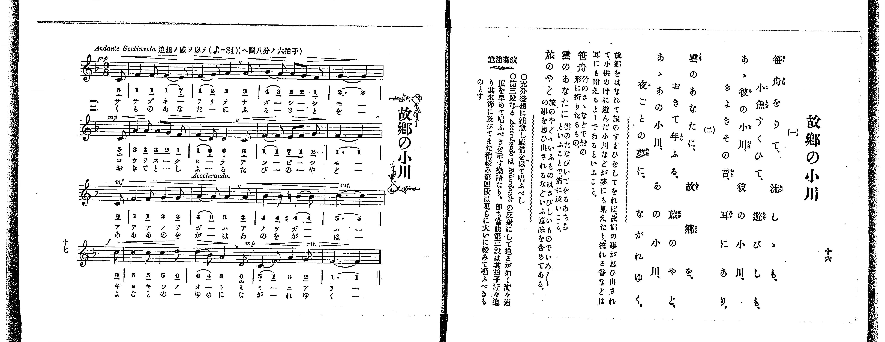

# 故郷の小川

> Re:Shōka 使用 AI 協助辨識與重建樂譜，可能會有錯誤。歡迎回報。

- **NEUTRINO 歌聲合成版**：<br><audio controls src="furusato_no_ogawa_neutrino.mp3"></audio>
- **鋼琴伴奏版**：<br><audio controls src="furusato_no_ogawa.mp3"></audio>


- 出處：共益商社樂器店《唱歌教科書 教師用 巻三》第十六～十七頁（第二學期第三曲）
- NDL Digital Collections PID 854864（https://dl.ndl.go.jp/pid/854864）掃描 P014.jpg

## 說明

原書資訊與歌詞全文（NDL PID 854864《唱歌教科書 教師用 巻三》第十六～十七頁，掃描 P014.jpg）：
調性與拍號：ヘ調八分ノ六拍子（F 大調 6/8 拍），♪=84（八分音符=84，折合四分音符 ♩=42），Andante Sentimento.「追想ノ感ヲ以テ」，弱起一拍（八分音符）
註記：單聲部，二節分節歌。開頭 mp，第八小節末拍（第三段弱起）轉 mf，第十小節標 Accelerando.，第十一小節第四至六拍為 ♮4（B♮4，4'），第十二小節標 rit.、末拍（第四段弱起）轉 f，第十四小節末拍轉 mp，第十五小節標 rit.。第七小節第四至六拍五線譜為三個八分音符（7_̲ 1̲ 2̲），簡譜中間「1」漏印底線，以五線譜為準。
原典演奏注意：充分注意發想、富感情歌唱；第三段之 Accelerando 為 Ritardando 之反對，示如迫近般漸快之樂語，即當曲第三段拍子漸迫，至其末節稍緩，第四段更大大放緩歌唱。
原典曲意：「故郷をはなれて旅のすまひをしてをれば、故郷の事が思ひ出されて、小供の時に遊んだ小川などが夢にも見えたり、流れる音などは耳にも聞えるよーであるといふこと。」
原典語釋：「笹舟」：竹のさゝなどで船の形に折りたるもの；「雲のあなたに」：雲のたなびいてをるあちらといふことで、遙に遠いこと；「旅のやど」：旅のやどゝいふものはさびしいものでいろ／＼の事を思ひ出されるなどいふ意味を含めてある。


## 歌詞

```text
一、
笹舟をりて、流しゝも、
小魚すくひて、遊びしも、
あゝ彼の小川、彼の小川、
きよきその音、耳にあり。

二、
雲のあなたに、故郷を、
おきて年ふる、旅のやど、
あゝあの小川、あの小川、
夜ごとの夢に、ながれゆく。
```

## ABC

```abc
X:1
T:故郷の小川
M:6/8
L:1/16
Q:3/8=28
K:F
V:V1 name="Voice" snm="Voi"
[V:V1]
!mp! z2 z2 z2 z2 z2 C2 | F4 F2 F4 E2 | F4 G2 A4 A2 | B4 A2 A2 G2 F2 |
w: 1.~さ | さ ぶ ね _ | を り て な | が _ し _ し
w: 2.~く | も の あ な | た _ に ふ | る _ さ _ と
G10 C2 | A4 A2 A2 G2 F2 | F4 D2 D4 C2 | F4 F2 E2 F2 G2 |
w: 1.~も こ | う を す _ く | ひ _ て あ | そ _ び _ し
w: 2.~を お | き て と _ し | ふ _ る た | び _ の _ や
!mf! F10 C2 | F4 F2 G4 G2 | A4 A2 A4 A2 | B4 B2 =B4 B2 |
w: 1.~も あ | あ あ の を | が _ は あ | の を が _
w: 2.~ど あ | あ あ の を | が _ は あ | の を が _
!f! c10 c2 | c4 c2 c4 d2 | !mp! d4 B2 A4 D2 | C4 F2 A4 G2 |
w: 1.~は き | よ き そ の | お _ と み | み _ に あ
w: 2.~は よ | ご と の _ | ゆ め に な | が _ れ ゆ
F10 z2 |
w: 1.~り
w: 2.~く
```

## TMD 檔案連結

- [主旋律 TMD 檔案](furusato_no_ogawa.tmd) [[在 TMD Studio 編輯](https://tmdlang.github.io/Tmd-TS/#tmd=s7IKdvYPcrWy4qpTUCpJTLdSSM7PyUlNLsnMz7PKrsxPzc6ML87Iz05Ugisoy88pzU21yk7MizeOtzA1sTAzQUgW55cWJadaFSdn5OfnxJekVpQk5edno8vHFySmp1oFGBgi6Swoyi9LzUvMA-ouKMrMK0lNAWtHKEgty0xJBUkXJwOtLkstykzLTE1BcldqUTHI1VArSooS84qTizILQF5BqEpPzStKtUrOyMxJKUrNiy_Oz0tHSKblF-VaFZcU5RdkZCYjhEsyUoEeLk8sSS1CF0xLzM3MqUQXTc3NR7UVIgx0UllqDkI0vygzPTPPKjc1MysTKay0tBSeTW192bz9ceO6pxv6n26fq6ClxaVoq2BixGVvq-DGZWOmb2EHMuVp-64XM6e-3zPraevG57O7nk5te75k37MVTU9nrni6a_rjhq6nUzY-W9vzbOrM58snPpu9A2juzKc7Vj-fskLh6fbdT3Z0Pm7ofr5mzdPexqeta9_vnQdkPNnR_HJB4_s9HUDxJ7t6nq7d8WzOfBB7R-ez2Zve7-kEO9_PxUfBBej4ksQcBWd4gilWCPB0UYAkCaAJGSUlBcVW-vopOXp5QJyer5dVoF-QmaIPU9H5rK_5WX-_AighAOWAEcGlr6VgSy3ApaCg8LRvPtDfLza3v1jR9aKjHRgYL1bOe9q64tm0dqALQd5AOJmi8OpB8wvQd8B4ATnhxar9zxqWgyzv7n0xcz5Q9HHzDKDg09bVTzvaHjf3Ac0CSj1dOwHoIjeFp0uWAyUVgFGsABQFG9PzaOYqWwtQkEL0vJy_-fmaZWCRnmddM55O6Hg6ezZcXOHRzJW2JkYQnY55KYnAvKQQnJpXkpkLJPL1Hjf0vNi_91nzZqDVz1rmP27e9GT30sfNbY8bgLb1PN2z8cXW7U92NIAtR7EQaCLYPyt2v1gxA5Topq170bjpZfMKoDZgUnm-vgGoFEgCQ_BxQ9PLad0vF6xVyC0AyoLCDGjQhn6Q7JzVEKOhiWrdVoiVQNNf7O1UyE2DqgeGMUT9ipkKjsnJqTmpwAydkq8Hlwa6EaICxJ09-0X7ZkhAPm_aBQyCdaDgcoLQPSbqkNCAagQma7jRRZklwBBpRHYV0DB0VyE5ChjSSP4AOxnmRZDRU9CNbgL7sxmrU4HKn2-f9WLtHKCbgWHxtKEbNbw7zOPPbFIwBGKjM6C8B7Jnw0Kg-ic71r6cNhkYk4bAWHu2p_9p74anu6YCzQJFxe6lyOY-2zUN6AhoXnjauuPZnilPl_Y_27ziWUs_uORoBVoI4T6fuQeULBoan67vAaaMZ82twKgEZon3e2bDI-vJzm7k6FAAhXYQsBwoAqYzIBco_bS_9-kGUFJ6vmTX02VNL_avfrF_4ouONc_27Hi6fzVQAbCAerFqHiit9W5-PnUbsFiBmw7JB0CVQF1ABeCA2gYMaVDQreh9vn0lNKTBMfRs9hZgZgGiZ1P2AaUgbkX16-xNEF8CQwpapDZNety4_nHjqsdNPY8blz2b3gosZB83znzcuO9x4yaw7HSgOIgBUrABlDRgZfGTXd2PG3ueNcwFqgSWvI8bp0IMAQXYhv4n-2YD1Tyb2fS4cfXLxq7HTZMfNy6AFN8g6xpXAvU-XbIIKPu4qenFMqBRHY8b5z9u6gJZsbURZFRTNzDiYYrXv2gAssGKG-eBFDd1P27qeNy853Hj8seNTSBu44rHjS2PG7c-bgTatQLoc2BiQHgeGMYv27shnn--ZueLjvngHD7r-eqdYD8DXQ93GbB4Agk-3QtyH7BIATkL5DiglUD_rAMmAKAhL2dvAmsEigB1zQc5DmwgTBwoAhQHOhroJkgIAp0IVLzwcVMnuluBfmhofAkKd2BgLQBLgcQhFkFjpQkouBJiBYoIyNlgo8BuA0fnVLC9wJhrgQkCwwjIBuoFRj8wyMCR1zQJPfJALoSEAMhAYFp5OnEzUNnTCcBwbwT5AhLQwDQFCldgiQN0NYgFDU-QH4EBBUoBoCgEOgDoNqADIIqAkf9y7Sxw4uoHJS6wOlDSgLgVrg5sydyne0HOhCYYYIpC5ULU9YJSAJBsBPpiHSitNDRCUwnICGBKgrpzF7AABmvBFmWwBA10PMxcoJOAhi57unMLOFiBHm5EjQMkd4INQzgMjQv295I5jxungGN5HTTFg9QBHQAMcCBqA4UHJJtSXslDgYKWPheXW2lRaXFiSb5fvn96YnmiVVh-ZnKqQ42uYU01yDIFGwstOzCjOregFswANjc0IAW9psLjpq0KNWDycfM0IO4F4j0gkeZNQLwKiNuAuAusZg1Y7nHTdjgNUrcIqgPJyM0gh4FsqlEwgEPTeCDXUEEXiEGkOYxrpGAMJI2BPBMwbQwUMQTyjIA8CATpBBvnY1ijEA-HwNQMcgCQ1AWS24B4LVg5yKmTQGJNXUCxZWDZVWCVPWB5YDKEkiCVTXBrgJkRZo8Rqj39cJXAyAWlCCQz50P1rgaTkMDshopBXLYC7iKYPcDghEXE46ZlkLBu2gkN1fXgUJ0E4YFCv2kR2IC9UJHJhEJ_ESL0ISELC1FQaJvFgxAkTKGxAYwJQ6AKCBcCq3PTalGD_XFjGzhIge5qnAn2BDhQGjdBvQQJ5iaw2Fyo2GYcwQxUBQ9mYB6E6gcFFFw9MCDBasFBCQpkkBjIPEgUgGRawGIrsZgLDlZgwIBwcx84eIEBhNycAgUTNDU398NCGKoUJgPUAmrLAJWClKAH8lpEIENCEZRcQYEIC3JEkjZRMFEHUepAvikiiEEhjBLAkFTVBPfgJJQ0ux4pgGHyMFmQGEgeFhC9KAFMNXObOpACuHkFOBQg6bIPHMeg0gIUoh0KGrkFoHADRxuQhAh3wwMUGt4Q9fBwBIWNKZg0A_LMwCEHCkdQuQVKtEAVoJRrCBZETa8GyAEJdCYkECApEeQtkEe6oB6GpLL9YLH9UDFI5gUHArDQgJkKT__gYJwC1Q0JJkgxA8kTjXATUIqZJhANUgMS60cxtZaLS9dOAa3kVgAKKXMBAA)]
- [鋼琴伴奏 TMD 檔案](furusato_no_ogawa_piano.tmd) [[在 TMD Studio 編輯](https://tmdlang.github.io/Tmd-TS/#tmd=s7IKdvYPcrWy4tLSUng2tfVl8_bHjeuebuh_un3u-z0dL7v3PJ-w5cmeLU-X9j_v7Hi_p1NBS4tL0VbBxIjL3lbBjcvGTN_CjqtOQelp-64XM6e-3zPraevG57O7nk5te75k37MVTU9nrni6a_rjhq6nUzY-W9vzbOrM58snPpu9A2jZzKc7Vj-fskLh6fbdT3Z0Pm7ofr5mzdPexqeta9_vnQdkPNnR_HJBI9AVQPEnu3qert3xbM58EHtH57PZm4BuUQJZ7Ofio-CSmZ5Zkpij4Jyfk5OaXJKZn1esEODpomBhamJhZgI0IaOkpKDYSl8_JUcvD4jT8_WyCvQLMlP0YSo6n_U1P-vvVwgwMDQByqUrcXG5lRaVFieW5Pvl-6cnlidaBWQm5uUHeTjU6BrWVHMpAIGNhZYdmFGdW1ALZuhrKWg83bPxxdbtmgqPm7Yq1IDJx83TgLgXiPeARJo3AfEqIG4D4i6wmjVgucdN2-E0SN0iqA4kIzcraOmDbapRMIBD03gg11BBF4hBpDmMa6RgDCSNgTwTMG0MFDEE8oyAPAgE6QQb52NYoxAPh48bp4IcACR1geQ2IF4LVg5y6iSQWFMXUGwZWHYVWGUPWP5x43QoCVLZBLfmceNkmD1GqPb0w1UCkx0QQ1gQM-dD9a4Gk5DA7IaKQVy2Au4imD3A4IRFxOOmZZCwbtoJDdX14FCdBOGBQr9pEdiAvVCRyYRCfxEi9CEhCwtRUGibxYMQJEyhsQGMCUOgCggXAqtz02pRg_1xYxs4SIHuapwJ9gQ4UBo3Qb0ECeYmsNhcqNhmHMEMVAUP5seNvVD9oICCqwcGJFgtOChBgQwSA5kHiQKQTAtYbCUWc8HBCgwYEG7uAwcvMIAck5NTc1KLEvNS8vVAwQRNzc39sBCGKoXJALUUZZaAlIKUoAfyWkQgQ0IRlFxBgQgLckSSNlEwUQdR6kC-KSKIQSGMEsCQVNUE9-AklDS7HimAYfIwWZAYSB4WEL0oAUw1c5s6kAK4eQU4FCDpsg8cx6DSAhSiHQoauQWgcANHG5CECHfDAxQa3hD18HAEhY0pmDQD8szAIQcKR1C5BUq0QBWglGsIFkRNrwbIAQl0JiQQICkR5C2QR7qgHoaksv1gsf1QMUjmBQcCsNCAmQpP_-BgnALVDQkmSDEDyRONcBNQipkmEA1SAxLrRzG1FkfB7YO14AYG94u-rpftvU9bd7yc3Qqp6JDSXzwoYKINY5FYNeDQilcwAnJNY5GZEC_hlKWZPhNQKRNtQsCRBqCAxW4TWIqgNbgCA5v15GshzjP4nAbxKDAd6NopoCWFaB-gEmzCRmBhZS4A)]

## 分析

```text
================================================================================
📊 TMD Song Profile: [ 故郷の小川 ]
================================================================================
⏱  Duration:       1:08 (68.6s), 16 measures total
🎼 Key & Tempo:    首調基準 F, != 42.0 BPM, <6/8>
   - 分析範圍：      由實際發聲的音符與和弦推測調性；播放脈絡另行呈現
🎤 人聲音域:    C4 (MIDI 60) – D5 (MIDI 74) [跨度: 14 個半音 / 1.2 個八度, 難度: moderate]
   - 最低音:  C4 in [FurusatoNoOgawa #1 @ m.1, 0:03]
   - 最高音: D5 in [FurusatoNoOgawa #1 @ m.14, 0:59]
   - 適合: soprano, mezzo-soprano, contralto, tenor, baritone, bass
🏛  結構:      FurusatoNoOgawa (68.6s)
⚡ 編曲密度:        Peak 1 軌道同時演奏
🗝  調性診斷：       F 大調（純淨自然大調，未偵測到可信轉調）
   - 風格氣質:    純淨自然大調（陽光明朗、易唱易記，無明顯調外色彩）
   - 轉調歷程:    全曲維持單一推測調性（未偵測到可信轉調）
   - 核心骨幹音:  F, A, C, G, D
   - 調性數值:    F 大調 [相關度: 0.94, 穩定度: High, 自然音純度: 96.9%]
   - 候選調性 (K-S): F 大調 (0.94), C 大調 (0.62), D 小調 (0.60)
   - 五度圈歷程:   -1
   - 各段落調性細節:
     • [FurusatoNoOgawa #1]: F 大調 (r: 0.93, 自然音純度: 96.7%, 調外音: B)

  [ 五度圈游移軌跡 ]
               C  
        [F ]*          G  
      Bb               D  
      Eb               A  
         Ab           E  
            Db       B  
               F# 
     (* = active key center)

  [ 十二半音累積音高分佈 ]
     C  : ██████████████            17.7%
     C# :                            0.0%
     D  : ██████                     7.3%
     D# :                            0.0%
     E  : ██                         2.1%
     F  : ████████████████████████  30.2%
     F# :                            0.0%
     G  : ███████████               13.5%
     G# :                            0.0%
     A  : ████████████████          19.8%
     A# : █████                      6.2%
     B  : ██                         3.1%
--------------------------------------------------------------------------------
Assignment 軌道音域：
  - Voice         : C4 – D5 (14 個半音 / 1.2 個八度, 59 個音符)
================================================================================
```


## 原書掃描頁




