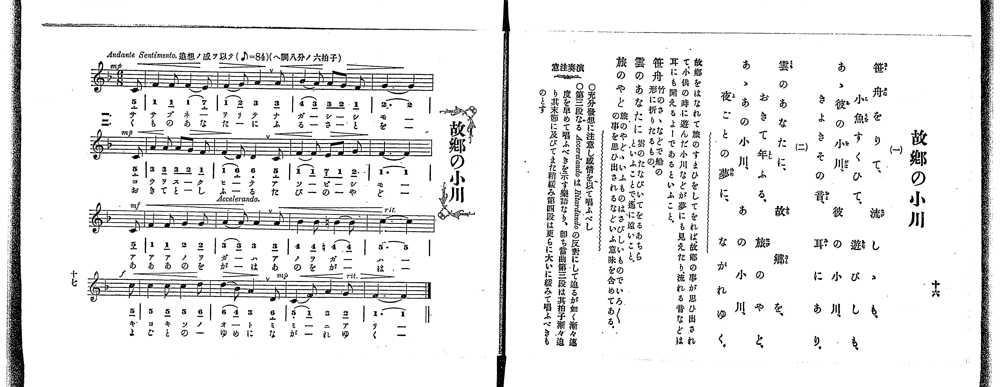

# 故郷の小川

> Re:Shoka 使用 AI 辨識樂譜，可能會有錯誤。歡迎回報。

<audio controls src="furusato_no_ogawa.mp3"></audio>

- 出處：共益商社樂器店《唱歌教科書 教師用 巻三》第十六～十七頁（第二學期第三曲）
- NDL Digital Collections PID 854864（https://dl.ndl.go.jp/pid/854864）掃描 P014.jpg

## 說明

原書資訊與歌詞全文（NDL PID 854864《唱歌教科書 教師用 巻三》第十六～十七頁，掃描 P014.jpg）：
調性與拍號：ヘ調八分ノ六拍子（F 大調 6/8 拍），♪=84（八分音符=84，折合四分音符 ♩=42），Andante Sentimento.「追想ノ感ヲ以テ」，弱起一拍（八分音符）
註記：單聲部，二節分節歌。開頭 mp，第八小節末拍（第三段弱起）轉 mf，第十小節標 Accelerando.，第十一小節第四至六拍為 ♮4（B♮4，4'），第十二小節標 rit.、末拍（第四段弱起）轉 f，第十四小節末拍轉 mp，第十五小節標 rit.。第七小節第四至六拍五線譜為三個八分音符（7_̲ 1̲ 2̲），簡譜中間「1」漏印底線，以五線譜為準。
原典演奏注意：充分注意發想、富感情歌唱；第三段之 Accelerando 為 Ritardando 之反對，示如迫近般漸快之樂語，即當曲第三段拍子漸迫，至其末節稍緩，第四段更大大放緩歌唱。
原典曲意：「故郷をはなれて旅のすまひをしてをれば、故郷の事が思ひ出されて、小供の時に遊んだ小川などが夢にも見えたり、流れる音などは耳にも聞えるよーであるといふこと。」
原典語釋：「笹舟」：竹のさゝなどで船の形に折りたるもの；「雲のあなたに」：雲のたなびいてをるあちらといふことで、遙に遠いこと；「旅のやど」：旅のやどゝいふものはさびしいものでいろ／＼の事を思ひ出されるなどいふ意味を含めてある。

## 歌詞

```text
一、
笹舟をりて、流しゝも、
小魚すくひて、遊びしも、
あゝ彼の小川、彼の小川、
きよきその音、耳にあり。

二、
雲のあなたに、故郷を、
おきて年ふる、旅のやど、
あゝあの小川、あの小川、
夜ごとの夢に、ながれゆく。
```

## ABC

```abc
X:1
T:故郷の小川
M:6/8
L:1/16
Q:3/8=28
K:F
V:V1 name="Voice" snm="Voi"
[V:V1]
!mp! z2 z2 z2 z2 z2 C2 | F4 F2 F4 E2 | F4 G2 A4 A2 | B4 A2 A2 G2 F2 |
G10 C2 | A4 A2 A2 G2 F2 | F4 D2 D4 C2 | F4 F2 E2 F2 G2 |
!mf! F10 C2 | F4 F2 G4 G2 | A4 A2 A4 A2 | B4 B2 =B4 B2 |
!f! c10 c2 | c4 c2 c4 d2 | !mp! d4 B2 A4 D2 | C4 F2 A4 G2 |
F10 z2 | !mp! z2 z2 z2 z2 z2 C2 | F4 F2 F4 E2 | F4 G2 A4 A2 |
B4 A2 A2 G2 F2 | G10 C2 | A4 A2 A2 G2 F2 | F4 D2 D4 C2 |
F4 F2 E2 F2 G2 | !mf! F10 C2 | F4 F2 G4 G2 | A4 A2 A4 A2 |
B4 B2 =B4 B2 | !f! c10 c2 | c4 c2 c4 d2 | !mp! d4 B2 A4 D2 |
C4 F2 A4 G2 | F10 z2 |
```

## TMD 檔案連結

- [主旋律 TMD 檔案](furusato_no_ogawa.tmd) [[在 TMD Studio 編輯](https://tmdlang.github.io/Tmd-TS/#tmd=s7IKdvYPcrWy4qpTUCpJTLdSSM7PyUlNLsnMz7PKrsxPzc6ML87Iz05Ugisoy88pzU21yk7MizeOtzA1sTAzQUgW55cWJadaFSdn5OfnxJekVpQk5edno8vHFySmp1oFGBgi6Swoyi9LzUvMA-ouKMrMK0lNAWtHKEgty0xJBUkXJwOtLkstykzLTE1BcldqUTHI1VArSooS84qTizILQF5BqEpPzStKtUrOyMxJKUrNiy_Oz0tHSKblF-VaFZcU5RdkZCYjhEsyUoEeLk8sSS1CF0xLzM3MqUQXTc3NR7UVIgx0UllqjhKXlpbCs6mtL5u3P25c93RD_9PtcxW0tLgUbRVMjLjsbRXcuGzM9C3sQJqftu96MXPq-z2znrZufD676-nUtudL9j1b0fR05oqnu6Y_buh6OmXjs7U9z6bOfL584rPZO4Dmzny6Y_XzKSsUnm7f_WRH5-OG7udr1jztbXzauvb93nlAxpMdzS8XNL7f0wEUf7Kr5-naHc_mzAexd3Q-m73p_Z5OsKv9XHwUXDLTM0sScxSc4SmiWCHA00UBEudAEzJKSgqKrfT1U3L08oA4PV8vq0C_IDNFH6ai81lf87P-fgVQTAPlgCHNpa-lYEstwKWgoPC0bz7Q3y82t79Y0fWiox0YGC9WznvauuLZtHagC0HeQDiZovDqQfML0HfAeAE54cWq_c8aloMs7-59MXM-UPRx8wyg4NPW1U872h439wHNAko9XTsB6CI3hadLlgMlFYBRrAAUBRvT82jmKlsLUJBC9Lycv_n5mmVgkZ5nXTOeTuh4Ons2XFzh0cyVtiZGEJ2OeSmJwMyiEJyaV5KZCyTy9R439LzYv_dZ82ag1c9a5j9u3vRk99LHzW2PG4C29Tzds_HF1u1PdjSALUexEGgi2D8rdr9YMQOU6Kate9G46WXzCqA2YFJ5vr4BqBRIAkPwcUPTy2ndLxesVcgtAMqCwgxo0IZ-kOyc1RCjoYlq3VaIlUDTX-ztVMhNg6oHhjFE_YqZCo7Jyak5qcAcm5KvB5cGuhGiAsSdPftF-2ZIQD5v2gUMgnWg4HKC0D0m6pDQgGoEJmu40UWZJcAQaUR2FdAwdFchOQoY0kj-ADsZ5kWQ0VPQjW4C-7MZq1OByp9vn_Vi7Rygm4Fh8bShGzW8O8zjz2xSMARiozOgvAeyZ8NCoPonO9a-nDYZGJOGwFh7tqf_ae-Gp7umAs0CRcXupcjmPts1DegIaF542rrj2Z4pT5f2P9u84llLP7jkaAVaCOE-n7kHlCwaGp-u7wGmjGfNrcCoBGaJ93tmwyPryc5u5OhQAIV2ELAcKAKmMyAXKP20v_fpBlBSer5k19NlTS_2r36xf-KLjjXP9ux4un81UAGwgHqxah4orfVufj51G7BYgZsOyQdAlUBdQAXggNoGDGlQ0K3ofb59JTSkwTH0bPYWYGYBomdT9gGlIG5F9evsTRBfAkMKWqQ2TXrcuP5x46rHTT2PG5c9m94KLGQfN8583LjvceMmsOx0oDiIAVKwAZQ0YGXxk13djxt7njXMBaoElryPG6dCDAEF2Ib-J_tmA9U8m9n0uHH1y8aux02THzcugBTfIOsaVwL1Pl2yCCj7uKnpxTKgUR2PG-c_buoCWbG1EWRUUzcw4mGK179oALLBihvngRQ3dT9u6njcvOdx4_LHjU0gbuOKx40tjxu3Pm4E2rUC6HNgYkB4HhjGL9u7IZ5_vmbni4754Bw-6_nqnWA_A10PdxmweAIJPt0Lch-wSAE5C-Q4oJVA_6wDJgCgIS9nbwJrBIoAdc0HOQ5sIEwcKAIUBzoa6CZICAKdCFS88HFTJ7pbgX5oaHwJCndgYC0AS4HEIRZBY6UJKLgSYgWKCMjZYKPAbgNH51SwvcCYa4EJAsMIyAbqBUY_MMjAkdc0CT3yQC6EhADIQGBaeTpxM1DZ0wnAcG8E-QIS0MA0BQpXYIkDdDWIBQ1PkB-BAQVKAaAoBDoA6DagAyCKgJH_cu0scOLqByUusDpQ0oC4Fa4ObMncp3tBzoQmGGCKQuVC1PWCUgCQbAT6Yh0orTQ0QlMJyAhgSoK6cxewAAZrwRZlsAQNdDzMXKCTgIYue7pzCzhYgR5uRI0DJHeCDUM4DI0L9veSOY8bp4BjeR00xYPUAR0ADHAgagOFBySbUl7JQ4GClj4Xl1tpUWlxYkm-X75_emJ5olVYfmZyqkONQY1CNcgyBRsLLTswozq3oBbMADY3NCAFvabC46atCjVg8nHzNCDuBeI9IJHmTUC8CojbgLgLrGYNWO5x03Y4DVK3CKoDycjNIIeBbKpRMIBD03gg11BBF4hBpDmMa6RgDCSNgTwTMG0MFDEE8oyAPAgE6YQ5_HHTMojbmnZCXbEe7IpJEB7ItU2LwK7dCxWZTMi1ixCuhbgE5gKQ68ziQQjiBqjrgS43BKqAcCGwOjetFs2ZQItAuLkP7FyghcjVOchaaGg298NcDFUKkwFqAdWlQKUgJeiOXotwNMRVoOACOQrmBUSQmiiYqIModSDfFOFkkIuRHNy8AmwqJNz6wCEIin2QCzsUNHILQO6YD3bmfKhwN9yBUPdD1MPdBbLLFEyaAXlmYJeA3AVKh6BABaoAhawhWBA1PA2ADqvl4tK1U0BL3QrYhZS5AA)]

## 分析

```text
================================================================================
📊 TMD Song Profile: [ 故郷の小川 ]
================================================================================
⏱  Duration:       2:25 (145.7s), 34 measures total
🎼 Key & Tempo:    首調基準 F, != 42.0 BPM, <6/8>
   - 分析範圍：      由實際發聲的音符與和弦推測調性；播放脈絡另行呈現
🎤 人聲音域:    C4 (MIDI 60) – D5 (MIDI 74) [跨度: 14 個半音 / 1.2 個八度, 難度: moderate]
   - 最低音:  C4 in [FurusatoNoOgawa #1 @ m.1, 0:03]
   - 最高音: D5 in [FurusatoNoOgawa #1 @ m.14, 0:59]
   - 適合: soprano, mezzo-soprano, contralto, tenor, baritone, bass
🏛  結構:      FurusatoNoOgawa (72.9s) -> FurusatoNoOgawa (72.9s)
⚡ 編曲密度:        Peak 1 軌道同時演奏
🗝  調性診斷：       F 大調（純淨自然大調，未偵測到可信轉調）
   - 風格氣質:    純淨自然大調（陽光明朗、易唱易記，無明顯調外色彩）
   - 轉調歷程:    全曲維持單一推測調性（未偵測到可信轉調）
   - 核心骨幹音:  F, A, C, G, D
   - 調性數值:    F 大調 [相關度: 0.94, 穩定度: High, 自然音純度: 96.9%]
   - 候選調性 (K-S): F 大調 (0.94), C 大調 (0.62), D 小調 (0.60)
   - 五度圈歷程:   -1 -> -1
   - 各段落調性細節:
     • [FurusatoNoOgawa #1]: F 大調 (r: 0.94, 自然音純度: 96.9%, 調外音: B)
     • [FurusatoNoOgawa #2]: F 大調 (r: 0.94, 自然音純度: 96.9%, 調外音: B)

  [ 五度圈游移軌跡 ]
               C  
        [F ]*          G  
      Bb               D  
      Eb               A  
         Ab           E  
            Db       B  
               F# 
     (* = active key center)

  [ 十二半音累積音高分佈 ]
     C  : ██████████████            17.7%
     C# :                            0.0%
     D  : ██████                     7.3%
     D# :                            0.0%
     E  : ██                         2.1%
     F  : ████████████████████████  30.2%
     F# :                            0.0%
     G  : ███████████               13.5%
     G# :                            0.0%
     A  : ████████████████          19.8%
     A# : █████                      6.2%
     B  : ██                         3.1%
--------------------------------------------------------------------------------
Assignment 軌道音域：
  - Voice         : C4 – D5 (14 個半音 / 1.2 個八度, 118 個音符)
================================================================================
```


## 原書掃描頁




