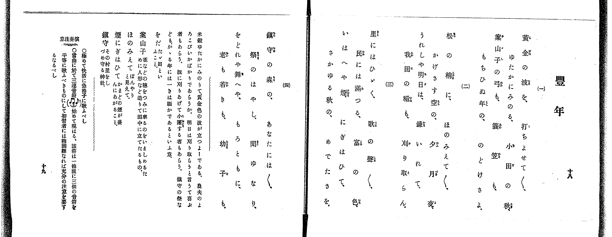
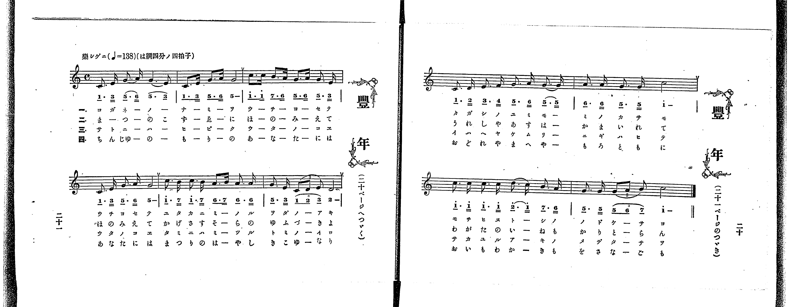

# 豐年

> Re:Shoka 使用 AI 協助辨識與重建樂譜，可能會有錯誤。歡迎回報。

<audio controls src="honen.mp3"></audio>

- 出處：共益商社樂器店《唱歌教科書 教師用 巻三》第十八～二十一頁（第二學期第四曲）
- NDL Digital Collections PID 854864（https://dl.ndl.go.jp/pid/854864）掃描 P015.jpg、P016.jpg

## 說明

原書資訊與歌詞全文（NDL PID 854864《唱歌教科書 教師用 巻三》第十八～二十一頁，掃描 P015.jpg、P016.jpg）：
調性與拍號：ハ調四分ノ四拍子（C 大調 4/4 拍），♩=138，「樂シゲニ」
註記：單聲部，四節分節歌。第十八～十九頁（P015.jpg）為四節歌詞、曲意、語釋與演奏注意；第二十一頁（P016.jpg 左頁，註「二十ページへつゞく」）為前六小節樂譜，第二十頁（P016.jpg 右頁，註「二十一ページのつゞき」）為後四小節樂譜。第六小節及第十小節第二拍出現八分音符三連音。第五小節第四拍（「ノ ル」）五線譜印為兩個八分音符（6̲ 6̲），簡譜印為附點八分音符加十六分音符（6̲. 6̿），以五線譜為準。
原典演奏注意：極快活且以急拍子歌唱；當曲首次出現三連音符，該符於一拍間平均唱出三個音符，對初習者稍困難，須充分注意。
原典曲意：「米穀ゆたかにみのりて、黄金色の波が立つよーである。農夫のよろこびいかばかりであらうか。明日は刈り取らうと言うて喜ぶ者もあらう。既に刈りあげて小躍する者もあらう。鎮守の祭なども、かゝる年には一きは賑かであるといふ意。」
原典語釋：「をだ」：たゞ田といふこと；「案山子」：雀などの穗をつみに來るのをいましめるために人形など造りて田中に立てたるもの；「ほのみえて」：ぼんやりと見えて；「煙にぎはひて」：かまどの煙が盛んにあがること；「鎮守」：その村里をしづめ守る神社。

## 歌詞

```text
一、
黄金の波を、打ちよせて／＼、
ゆたかにみのる、小田の秋、
案山子の弓も、簑笠も、
もちひぬ年の、のどけさよ。

二、
松の梢に、ほのみえて／＼、
かげさす空の、夕月夜、
うれしや明日は、鎌いれて、
我田の稻も、刈り取らん。

三、
里にはひゞく、歌の聲／＼、
民には滿つる、富の色、
いはへや煙、にぎはひて、
さかゆる秋の、めでたさを。

四、
鎮守の森の、あなたには／＼、
祭のはやし、聞ゆなり、
をどれや舞へや、もろともに、
老も若きも、幼子も。
```

## ABC

```abc
X:1
T:豐年
M:4/4
L:1/16
Q:1/4=138
K:C
V:V1 name="Voice" snm="Voi"
[V:V1]
C3 E G3 A G6 E2 | C3 E G3 A G8 | c3 c B3 A G3 A G3 E | C3 E G3 A G8 |
c3 B c3 B A3 B A2 A2 | G3 E C4/3 D4/3 E4/3 D8 | C3 D E3 F G3 A G3 G | A3 A G3 G c8 |
c3 c c3 c d3 c B3 A | G3 G G4/3 A4/3 B4/3 c8 | C3 E G3 A G6 E2 | C3 E G3 A G8 |
c3 c B3 A G3 A G3 E | C3 E G3 A G8 | c3 B c3 B A3 B A2 A2 | G3 E C4/3 D4/3 E4/3 D8 |
C3 D E3 F G3 A G3 G | A3 A G3 G c8 | c3 c c3 c d3 c B3 A | G3 G G4/3 A4/3 B4/3 c8 |
C3 E G3 A G6 E2 | C3 E G3 A G8 | c3 c B3 A G3 A G3 E | C3 E G3 A G8 |
c3 B c3 B A3 B A2 A2 | G3 E C4/3 D4/3 E4/3 D8 | C3 D E3 F G3 A G3 G | A3 A G3 G c8 |
c3 c c3 c d3 c B3 A | G3 G G4/3 A4/3 B4/3 c8 | C3 E G3 A G6 E2 | C3 E G3 A G8 |
c3 c B3 A G3 A G3 E | C3 E G3 A G8 | c3 B c3 B A3 B A2 A2 | G3 E C4/3 D4/3 E4/3 D8 |
C3 D E3 F G3 A G3 G | A3 A G3 G c8 | c3 c c3 c d3 c B3 A | G3 G G4/3 A4/3 B4/3 c8 |
```

## TMD 檔案連結

- [主旋律 TMD 檔案](honen.tmd) [[在 TMD Studio 編輯](https://tmdlang.github.io/Tmd-TS/#tmd=s7IKdvYPcrWy4qpTUCpJTLdSSM7PyUlNLsnMz7PKrsxPzc6ML87Iz05Ugisoy88pzU21yk7MizeOtzA1sTAzQUgW55cWJadaFSdn5OfnxJekVpQk5edno8vHFySmp1oFGBiaImQKivLLUvMS84C6C4oy80pSU8DaEQpSyzJTUkHSxclAq8tSizLTMlNTkNyVWlQMcjXUipKixLzi5KLMApBXEKrSU_OKUq2SMzJzUopS8-KL8_PSEZJp-UW5VsUlRfkFGZnJCOGSjFSgh4tTE4Gqi9GFy_OLkPwHESvIScxDcjlEMC21uCSzLDEHXTw5Pze3NC-zpFKJS0tL4cXGCU93blHQ0uJStFUwNLbgsrdVcOayMdE3sQPpe9q-68XMqe_3zHrauvH57K6nU9ueL9n3bEXT05krnu6a_rih6-mUjc_W9jybOvP58onPZu9QALKe7lj9fMoKhafbdz_Z0fm4ofv5mjVPexuftq5-v3fek109QPaTHQ0vFzS-39MBlAKJrN3xbM58kLLZs5_N3vR-TyfYzX4uPgoumemZJYk5Cs7wVFKsEODpogBJB0ATMkpKCoqt9PVTcvTygDg9Xy-rQL8gM0UfpqLzWV_zs_5-BVDsA-XSHzc0AplmIKYSF5e-loIttQCXgoLC0775wFB4sbn9xYquFx3twKB5sXLe09YVz6a1Ax0L8hHC9ZSGXg9unwG9DYwzkINerNr_rGE5yCndvS9mzgeKPm7uBwoCg_ppR9vj5j5QmHf3Pl07Aeg-Z4WnS5YDJRWA0a8AFAUb0_No5kpbYMoAsh439ADj_nHT9sdNmx43dz9u6AVbsWL3ixUzQGlk2roXjZteNq8AKgUa-3x9A9AKIAn04uOGJmSPgHyxcy4kDcCcD7TsedMuiD5IuAE9BEwOz1r6gYwXq-a9bO8G-WPPlKdL-59tXgEUf79nNjQFIaUpWBgAg3AZJJyADgS6HKLscTMwAPY8btrxuBGIljxumve4EWg-yKsg2zt7n7aufbqhH-SGFU0v1s4BaodbgW5-_2ZM84HOQLJiHcyKXoQV-0Bhg2wFNGxg9j7t74IGFZgLsR0URe27nvfvA4YfMFBfzt_8fM0yYAJ52bAYyIaY8GTXFLgWSKwCXQt0GDCSFR43r4a4AKjo-fZZQFuf9m4AuaZ15dOGbmRDgXrMzmxSAGJI7D_fsBCu-uXMlpe7gckZofpp1wJwpK5F068HNGA_xIAnu5fCLQWa8WzXNKBzoXnlaesO1Pic9Wzp1qf7Vz_bAkz9U4A6nzUshaROYIoAZhZQhE_dBkwUL5dNe7ZmISRI4MEAth2YcDYBGc-m7QFGBVDvy2mTn-7c_HRuO1A7UD1QMdDDcMVPN_Q-7Zj7fP-kFw2tz1f0Pp294eXsxUDxlws6nra2Aj0FcRiqi8FpEpSTGnqeb9z8fGXD46a2x43zHzd2P25c_bhxPyjem7oeNy4DptuXu1tetk980bkJKPhs86LHjT3PVwOVAVNFByiRNC5_3AjMUMCs1PRi36anS4DagXo7Hjf1Pm6c_Lhx8-PGFrCxG0AkyEyI-s7HjUAbQbqezeh7Nn3p48b1TzuAurqe9k-Dya54saIBzFj2dNqcx43bgD583NSE0A7UOx3oHmBcgjSCxBsngRRv6H-xC2j7TKCrMLW87Fv3dF0H0JHPl6593LjqceNKkIKGRrDz5gK1ACsTcCCsB2UEYLJvXP9i80SwF2A-bVwB9tRWSLBCyxBIyEIyOSRkHzcBXbMAnGhngQK3ad7zKcBQgGoGhw6wnJkNKpIWdjzduBGYRiCKX84GWgx2GdCVK6eDzVkCjpXVT_a1gV0ADGKgINCcfY8bgQoawYJAK4DeWP1k166ne4HhAjLhZcMCSEQCrX6yA-jh1eDIWwZWDPQwMGjWQdzwuHE3OLcDbQGGDjDiIc4GlgKTHze1gA1Z8WIZUC9IFqLleetMcEj1AcPocSMwfcB1AZUBHQZ2P0hNz_PZs0HmgBQDbQSGDFABwvvQKIHqnQtKZ3MnvmyHBOD0x41Lgf4CKWjqfr50HrD2BqVlUJCDIqihEcSCpFFoAgXqAha7nUDzF4ISYuNssIOByX0PVDW2xA5MieDiChRD654vB3FBShEx07ju6R5gSICSyvMNE5-vAYYriA0xD-ipheAQWANOPevA6QkYmMAQALpqKsgZMDfvAtYkEKPnAoNo3bNFoBQMVo8S_qgOBjkVGBZTgYn6-cpdEAueLpn6bE7H0yXA0heqCJg0gNEITA4t8DwFyr99QEFgBAJJUHYGW90xEepRYLkP9gZK3gPGFDyEgRU4JISB0QHOFSBvQqucRlC12AiqMVFc-2wD0M8gpc92Az0DLCfAYbserBRYisBcC0y8QMN2AF0LSiOgAEBLSlB1QE8DEyoo2YOiBRK2oHQOzI3AOASGLTC6Ia4FVhkw18Iy-bPFwCCFRAcwjoA5AqgF5DQUB4NLAqC69aCEDgw_YF3dOA-cSFaB0j0skoERACwrgKmy5UUHMABALge7BVgmAEuJFeBUAIpJcIsCLPGiGxgHvdAQ3rkHlIxAbHBJTHlrDQoUtPS5uDzy81LzrMLyM5NTHWoMahSqQVYo2BiaadmBWcBW4uOmzUC8BliR9gLxHiAGVap7FGqAZBdUZD6U3gQSbVoG5TVC6RUQumk3kG4DWQsyuUbBUEEXCI0VTMG0GZSGQGMgxq8CBIEq4sAMIGWOogZGGyvUIPwBchfITUD3QN0C8gNQtGk_EK8GsruR_AJuOoBVbALiBri_HzctAuK1xPkDxZXmCIYZEg3CNXD3ahgqGCkYa6pq6AKBJpCNZhjCO0AHg6KlaTvUaSDvgRwPdB40ekA8oAxY5VawDJqjgTaBaRM0x5sCVUCciBCBuh2bU8BWgkJ2EhD3AHEHNKQgTgM5BeTATqDIRqgMyDkrkJwDj0cEywgjbmGhZKqgYQrkmsNDCYvbarm4dO0UwOlbAT9DmQsA)]

## 分析

```text
================================================================================
📊 TMD Song Profile: [ 豐年 ]
================================================================================
⏱  Duration:       1:09 (69.6s), 40 measures total
🎼 Key & Tempo:    首調基準 C, != 138.0 BPM, <4/4>
   - 分析範圍：      由實際發聲的音符與和弦推測調性；播放脈絡另行呈現
🎤 人聲音域:    C4 (MIDI 60) – D5 (MIDI 74) [跨度: 14 個半音 / 1.2 個八度, 難度: moderate]
   - 最低音:  C4 in [Honen #1 @ m.1, 0:00]
   - 最高音: D5 in [Honen #1 @ m.9, 0:14]
   - 適合: soprano, mezzo-soprano, contralto, tenor, baritone, bass
🏛  結構:      Honen (17.4s) -> Honen (17.4s) -> Honen (17.4s) -> Honen (17.4s)
⚡ 編曲密度:        Peak 1 軌道同時演奏
🗝  調性診斷：       C 大調（純淨自然大調，未偵測到可信轉調）
   - 風格氣質:    純淨自然大調（陽光明朗、易唱易記，無明顯調外色彩）
   - 轉調歷程:    全曲維持單一推測調性（未偵測到可信轉調）
   - 核心骨幹音:  G, C, A, D, E
   - 調性數值:    C 大調 [相關度: 0.86, 穩定度: Moderate, 自然音純度: 100.0%]
   - 候選調性 (K-S): C 大調 (0.86), G 大調 (0.79), C 小調 (0.56)
   - 五度圈歷程:   +0 -> +0 -> +0 -> +0
   - 各段落調性細節:
     • [Honen #1]: C 大調 (r: 0.86, 自然音純度: 100.0%)
     • [Honen #2]: C 大調 (r: 0.86, 自然音純度: 100.0%)
     • [Honen #3]: C 大調 (r: 0.86, 自然音純度: 100.0%)
     • [Honen #4]: C 大調 (r: 0.86, 自然音純度: 100.0%)

  [ 五度圈游移軌跡 ]
              [C ]*
         F            G  
      Bb               D  
      Eb               A  
         Ab           E  
            Db       B  
               F# 
     (* = active key center)

  [ 十二半音累積音高分佈 ]
     C  : █████████████████████     30.2%
     C# :                            0.0%
     D  : ██████                     8.3%
     D# :                            0.0%
     E  : █████                      7.1%
     F  :                            0.6%
     F# :                            0.0%
     G  : ████████████████████████  35.2%
     G# :                            0.0%
     A  : ████████                  12.1%
     A# :                            0.0%
     B  : ████                       6.5%
--------------------------------------------------------------------------------
Assignment 軌道音域：
  - Voice         : C4 – D5 (14 個半音 / 1.2 個八度, 260 個音符)
================================================================================
```


## 原書掃描頁






