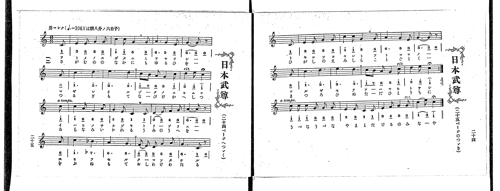

# 日本武尊

> Re:Shōka 使用 AI 協助辨識與重建樂譜，可能會有錯誤。歡迎回報。

- **鋼琴伴奏版**：<br><audio controls src="yamato_takeru_no_mikoto.mp3"></audio>
- **NEUTRINO 歌聲合成版**：<br><audio controls src="yamato_takeru_no_mikoto_neutrino.mp3"></audio>

- 出處：共益商社樂器店《唱歌教科書 教師用 巻四》第二十二～二十五頁（第二學期第五曲）
- NDL Digital Collections PID 854865（https://dl.ndl.go.jp/pid/854865）掃描 P017.jpg, P018.jpg

## 說明

原書資訊與歌詞全文（NDL PID 854865《唱歌教科書 教師用 巻四》第二十二～二十五頁，掃描 P017.jpg, P018.jpg）：
調性與拍號：は調八分ノ六拍子（C 大調 6/8 拍），♩.=104，「勇マシク」，弱起一拍（八分音符）
註記：單聲部，二節分節歌加四小節尾聲（跨第二十四～二十五頁：第二十五頁為前十六小節，第二十四頁為第十七～二十四小節及反覆記號，其後接第二十四頁第三行四小節尾聲「うべなうべな 日本武の御名や。」）。第八、二十四小節標有「rit.」與延長記號（fermata），第九、二十五小節標有「a tempo.」，第二十七小節末標有「rit.」，最末音標有延長記號。第十三小節第二大拍為降 B4（b7.，TMD 記為 7,）。右頁僅印歌詞（第一節漢字旁附小字註解：少女、身、賊、祝、醉、劍），未附演奏注意與語釋。


## 歌詞

```text
一、
をとめのすがたに、みをやつし、
まぎれいる、ぞくのにひむろ、
いはひのさかづき、とりぐに、
ゑひふせる、くまそたける、
ときこそよけれと、ふところの、
つるぎもて、あはやひとさし。

二、
さがむの野なかに、もゆる火を、
つるぎもて、なびけかへしつ、
あらなみいかれる、うみのうへを、
小舟もて、おしわけわたる、
ひがしのえみしら、ことぐく、
まつろひぬ、たゞひとうちに、
うべなうべな、日本武の御名や。
```

## ABC

<div class="abc-score" data-abc-src="yamato_takeru_no_mikoto.abc" aria-label="五線譜載入中"></div>

[下載 ABC 原始檔](yamato_takeru_no_mikoto.abc)

## TMD 檔案連結

- [主旋律 TMD 檔案](yamato_takeru_no_mikoto.tmd) [[在 TMD Studio 編輯](https://tmdlang.github.io/Tmd-TS/#tmd=s7IKdvYPcrWy4qpTUCpJTLdSSM7PyUlNLsnMz7PKrsxPzc6ML87Iz05Ugisoy88pzU21yk7MizeJtzA1sTAzRUgW55cWJadaFSdn5OfnxJekVpQk5edno8vHFySmp1oFGBiaI2QKivLLUvMS84C6C4oy80pSU8DaEQpSyzJTUkHSxclAq8tSizLTMlNTkNyVWlQMcjXUipKixLzi5KLMApBXEKrSU_OKUq2SMzJzUopS8-KL8_PSEZJp-UW5VsUlRfkFGZnJCOGSjFSghzMyi0vyiyrRhdPyc7Jz8otS0cVzM3MySxKR1ecXZaZn5lnlpmZmZWIJmvyikoz89KLEgoxKqF2ZyYk58cBwBga-lpbCs-lLn81Z82ztsqcbuhS0tLgUbRUMDUy47G0VnLlszPQt7EAmPW3f9WLm1Pd7Zj1t3fh8dtfTqW3Pl-x7tqLp6cwVT3dNf9zQ9XTKxmdre55Nnfl8-cRns3coAFlPd6x-PmWFwtPtu5_Onv24ofv5mjVPdvU87W0Eku_3zoOxp7xc0Ph-TwdUdu2OZ3Pmg9lTns3e9H5PJ9gjfi4-Ci5AX5Yk5ig4wxNSsUKAp4sCJKkATcgoKSkottLXT8nRywPi9Hy9rAL9gswUfZiKzmd9zc_6-xVACQQol64DYlmAWEpcXPpaCrbUAlwKCgpP--YDw-HF5vYXK7pedLQDA-fFynlPW1c8m9YOdCvIQwjHUyH8enD6DehvYLyBnPRi1f5nDctBjunufTFzPlD0ceN6oODT1tVPO9oeN_c9bV0LlHq6dgLQhc4KT5csB0oqAJOAAlAUbEzPo5kr9WyByQPIfNzQ87S7_XHzvMdN2x83rX_cAFTS83TPxhdbtz_Z0QDW0QEx-eX8zc_XLAMaAHbEit0vVswApaRp6140bnrZvAKoDeiX5-sbgEqBJDAYnnYtAHr56YZ-kOCGfUBlQLNebF8BDwGgLEYIzEIKH5DI86ZdTzt7QYpb10KMAlqEbAJEDVAEpGVHM9xAhNX9XU_7e18sawM6GBxePU9btz3dBwzqpejmALk7Ol8s7EFzNjCMHje2PW7c-bhxFZyByHGPG9c93bfw6YTex00tjxuawEHYCWSA3NS6-nEDKKaRHfRsxcxnc4AKeooyS_SAqoFR-XT3tpdTt8Mc2JGWWpSbWJIIiSyQq3bOhRsDDBY0YxIVSlJzC_JBRiGHDTAwoArnrEa3EpTS5oAkgJEKkUN2AdTtICM6IUZADV2yHJgggKH9cmavghMw9XQkmesBjQrxdQEmiBlACQVzHYjfn_ZvBgbo0-bWp70bIJkGWjjsaAC5aM-ip2unP5ve-HJmC9ACIBuUnpYvBqWnDROfLt0M9O2LXaCge7G5C0g-Xwry_8s2oMmNT7ugifjZnFVA7c_2THm6tP_Z5hXPWvqBAfli1byX7d1AB3CBUinQNqAOEOtx06THjSseNzUCI-tx48zHjcAYnf-4EWTF48b9IFlg3DUuedwILAUhGhr3PW7se9wEVNfyuAloIlDdvMeN_WD9qx8DE0VTw-OmXrhqoO71IFGQ9NTHjd2PG5c-bgRJg63tetw4AWIbxDETwUq3Pm6cDTMbaDDQwrlgV02ECEIMXgEypnEySK6pAywHdNIKsB6gfqDsZJAzgNbCNCwB6QY5velx4zKwOiBjPdh_QDuBGoDOA_oSGkK7gCUAVCNQvAfkq8Z1L9v7wEkdaA44hIBGNbUBjX0O5AKDCrdNQD2bQW4E6dwBsgaoBqYaaEYnWMV-cGh1gzwC9TwwSwEFgSEHZOxA2ABMGi865iMZDwzG6Y-bgEEFDAUgCZRChBPQb8CAAdoINAYYTkDzgEpBCQYceEBvAyOgHzlyga4HhhtQ2xqwIqBhwPiFhBDQGQuRogsj7wMlcOV-kAbKqx4oUNDS5-IKA7ZcUq3C8jOTUx1qDGqqQTYo2Fho2YEZwApPA1Jca4ISuUINKMkAWY1Aeh0QzwSL9ADxfCBeDcT7QSJAlUD3guIQLD9d4XHzHlCwgGwEGVujYACHhkCesYIuEJsCSVMgzzAOyAASML4ZkAaxQGpqwDQIGoDkwKb5GNYoxMMhwpm6cIcCWXCngtgQx4JYMOeCTAQ5GSQGczTEHqCJQIdDbTJCsalxKsLMpga4TevAoqvA7G6YTU1NYJvaoDZ1g2U3IdkOsQloNyzggWkfKNkDNgwYlkAtINY8aFj2Q2NgNVh0E8QBTb1gtfBQBoekroIRhAKGMxofKG8ODF5QkAKZNRAJoCJYDCDCF-QYiMtBvgXpBVmE8AtEZB7YVxCngVgwx0HDB-g8kGgLUmjCdMPMB4k0QUWWwc2FhOVmIJ4IDVWQ6A4wG5i4gKEGYgFDGBF26yGhAg4jSDSBomIpEIPCaAXYoi5oWE4As0FqgCkYJNI0ES0MzRRMwCQk-RkDEy0wfEABBuaB5BAJFZQ0gSqRgm49NLJhwQJzD4gNcRGIBXMTxPMTwIEGcxU8gQBdhhx4nWC1q8AJGRq0MJOBEQVLZm1gUYgKUHiAEiEo-NASHyjjIAIQ5NytYI2z4YkPGLPQjAysMIB4Plh0Ilge5AH0hGeuA41CRBYG8UyAYWYE5sFCFBSa4KIAKdRAyQbkzq3wZDAbI8H1g1VAnAPJ2BAHwdSBshQwXBEh1rgNaupaPMkNFAfghAWuDMBG9YMl5qMYDMy9iOACparJkGBp6oAHC6hkBJaX0IAEsYBqgNkAxAPGBDgwlyCCjfJyEJaYIE4BuRXmGGiSgJSLcAdBvD4ZLAtzFmZpBAk6SNkJym-QZAwxGZKsQIEFSYyTUUyeAibBSRscWeglKijswImnDxoXoHgAKQaywKEDzMfgmgRcVIJDcCrYOuqUcQbIQUdUUQQSgbkKXoRDAxXiMpAHkYMNVDhBghdmBixlr4GLgBLW48YFUDlYgEHy6UIgBpUAIFNrubhc81Iy89Lx1dggjcCWBBCDCgYEG-QhUFCCsgsoIBeg5F5QwQCuDUG6wIUgakUCQaZgCEupsGIQxDNBTbewEAb6DxIWEA_hdhcsI0OCEuY2SG6DpTiY-yABCql_wIGia6cAbsgoABmQAAKxlLkA)]
- [鋼琴伴奏 TMD 檔案](yamato_takeru_no_mikoto_piano.tmd) [[在 TMD Studio 編輯](https://tmdlang.github.io/Tmd-TS/#tmd=s7IKdvYPcrWy4qpTUCpJTLdSyC8qychPL0osyKi0ysgsLskvykxOzInPTsxLVOLS0lJ4Nn3pszlrnq1d9nRD1_s9HS-79zyfsOXJni1Pl_Y_7-x4v6dTQUuLS9FWwdDAhMveVsGZy8ZM38IOZPzT9l0vZk59v2fW09aNz2d3PZ3a9nzJvmcrmp7OXPF01_THDV1Pp2x8trbn2dSZz5dPfDZ7hwKQ9XTH6udTVig83b776ezZjxu6n69Z82RXz9PeRiD5fu88GHvKywWNQMdAZdfueDZnPpg95dnsTUAnKYGs93PxUXDJTM8sScxRcM7PyUlNLsnMzytWCPB0UbAwNbEwMwWakFFSUlBspa-fkqOXB8Tp-XpZBfoFmSn6MBWdz_qan_X3KwQYGJoD5dJ1QCwLEEuJiysstag41SogMzEvP8jDocagpppLAQhsLLTswAx9LQWNp3s2vti6XVPhcdMkhRqFx40rgKxGIL0OiGeCRXqAeD4Qrwbi_SARoMrHTS1A3hKw_HSFx817gPQ-BS19sLE1CgZwaAjkGSvoArEpkDQF8gzjgAwgAeObAWkQC6SmBkyDoAFIDmyaj2GNQjwcIpypC3cokAV3KogNcSyIBXMuyESQk0FiMEdD7AGaCHQ41CYjFJsapyLMbGqA27QOLLoKzO6G2dTUBLapDWpTN1h2E5LtEJuAdsMC_nFjH1CyB2wYMCyBWkCsedCw7IfGwGqw6CaIA5p6wWrhoQwOSV0FIwgFDGc0PlDeHBi8oCAFMmsgEkBFsBhAhC_IMRCXg3wL0guyCOEXiMg8sK8gTgOxYI6Dhg_QeSDRFqTQhOmGmQ8SaYKKLIObCwnLzUA8ERqqINEdYDYwcQFDDcQChjAi7NZDQgUcRpBoAkXFUiAGhdEKsEVd0LCcAGaD1ABTMEikaSJaGJopmIBJSPIzBiZaYPiAAgzMA8khEiooaQJVIgXdemhkw4IF5h4QG-IiEAvmJojnJ4ADDeYqeAIBugw58DrBaleBEzI0aGEmAyMKlszawKIQFaDwACVCUPChJT5QxkEEIMi5W8EaZ8MTHzBmoRn5ceNcIJ4PFp0Ilgd5AD3hmetAoxCRhUE8E2CYGYF5sBAFhSa4KEAKNVCyAblzKzwZzMZIcP1gFRDnQDI2xEEwdaAsBQxXRIg1boOauhZPcgPFAThhNfVDU1xTP1hiPorBwNyLCC5QqpoMCZamDniwgEpGYHkJDUgQC6gGmA1APGBMgANzCSLYKC8HYYkJ4hSQW2GOgSYJSLkIdxDE65PBsjBnYZZGkKCDlJ2g_AZJxhCTIckKFFiQxDgZxeQpYBKctMGRhV6igsIOnHj6oHEBigeQYiALHDrAfAyuScBFJTgEp4Kto04ZZ4AcdEQVRSARmKvgRTg0UCEuA3kQOdhAhRMkeGFmwFL2GrgIKGE9blwAlYMFGCSfLgRiUAkAMrUWpcr2wVFlv-jretne-7R1x8vZrZCGDlJwxSuYxitEG8YisWpwiRPQYxIPzLLRJqRoMY2PVzACck1jkZkwXThkKdBHdSdiM5A2moZlTKHYZgBK_aA07ZqXkpmXjr8dCsoOjxt3AjGoukOwQdkUVECAKgFQ8bAAXviCihVQdQdu44F0gat21OYRBJmCIaz8hVXuIJ4JamkMKzdA7gbncEg2xe0uWPUEKSBgboPUIbByFOY-SDEBaVVhBAu98jqOpIo93nTtFMDFUbQPUALBMQJzIK4HsZS5AA)]

## 分析

```text
================================================================================
📊 TMD Song Profile: [ 日本武尊 ]
================================================================================
⏱  Duration:       0:50 (50.2s), 29 measures total
🎼 Key & Tempo:    首調基準 C, != 104.0 BPM, <6/8>
   - 分析範圍：      由實際發聲的音符與和弦推測調性；播放脈絡另行呈現
🎤 人聲音域:    C4 (MIDI 60) – E5 (MIDI 76) [跨度: 16 個半音 / 1.3 個八度, 難度: moderate]
   - 最低音:  C4 in [Verse #1 @ m.1, 0:01]
   - 最高音: E5 in [Verse #1 @ m.7, 0:10]
   - 適合: soprano, mezzo-soprano, contralto, tenor, baritone, bass
🏛  結構:      Verse (43.3s) -> Ending (6.9s)
⚡ 編曲密度:        Peak 1 軌道同時演奏
🗝  調性診斷：       C 大調（純淨自然大調，未偵測到可信轉調）
   - 風格氣質:    純淨自然大調（陽光明朗、易唱易記，無明顯調外色彩）
   - 轉調歷程:    全曲維持單一推測調性（未偵測到可信轉調）
   - 核心骨幹音:  G, C, E, D, A
   - 調性數值:    C 大調 [相關度: 0.92, 穩定度: High, 自然音純度: 98.2%]
   - 候選調性 (K-S): C 大調 (0.92), G 大調 (0.76), E 小調 (0.61)
   - 五度圈歷程:   +0 -> +0
   - 各段落調性細節:
     • [Verse #1]: C 大調 (r: 0.88, 自然音純度: 97.9%, 調外音: A#)
     • [Ending #1]: C 大調 (r: 0.90, 自然音純度: 100.0%)

  [ 五度圈游移軌跡 ]
              [C ]*
         F            G  
      Bb               D  
      Eb               A  
         Ab           E  
            Db       B  
               F# 
     (* = active key center)

  [ 十二半音累積音高分佈 ]
     C  : ██████████████████████    26.2%
     C# :                            0.0%
     D  : ██████████                11.6%
     D# :                            0.0%
     E  : █████████████             15.2%
     F  : ███                        3.7%
     F# :                            0.0%
     G  : ████████████████████████  28.7%
     G# :                            0.0%
     A  : ██████████                11.6%
     A# : ██                         1.8%
     B  : █                          1.2%
--------------------------------------------------------------------------------
Assignment 軌道音域：
  - Voice         : C4 – E5 (16 個半音 / 1.3 個八度, 95 個音符)
================================================================================
```


## 原書掃描頁




