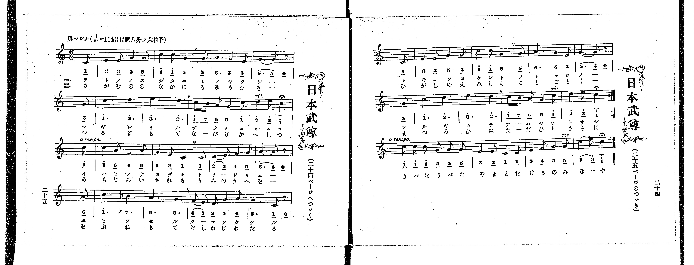

# 日本武尊

> Re:Shōka 使用 AI 協助辨識與重建樂譜，可能會有錯誤。歡迎回報。

- **鋼琴伴奏版**：<br><audio controls src="yamato_takeru_no_mikoto.mp3"></audio>
- **NEUTRINO 歌聲合成版**：<br><audio controls src="yamato_takeru_no_mikoto_neutrino.mp3"></audio>

- 出處：共益商社樂器店《唱歌教科書 教師用 巻四》第二十二～二十五頁（第二學期第五曲）
- NDL Digital Collections PID 854865（https://dl.ndl.go.jp/pid/854865）掃描 P017.jpg, P018.jpg

## 說明

原書資訊與歌詞全文（NDL PID 854865《唱歌教科書 教師用 巻四》第二十二～二十五頁，掃描 P017.jpg, P018.jpg）：
調性與拍號：は調八分ノ六拍子（C 大調 6/8 拍），♩.=104，「勇マシク」，弱起一拍（八分音符）
註記：單聲部，二節分節歌加四小節尾聲（跨第二十四～二十五頁：第二十五頁為前十六小節，第二十四頁為第十七～二十四小節及反覆記號，其後接第二十四頁第三行四小節尾聲「うべなうべな 日本武の御名や。」）。第八、二十四小節標有「rit.」與延長記號（fermata），第九、二十五小節標有「a tempo.」，第二十七小節末標有「rit.」，最末音標有延長記號。第十三小節第二大拍為降 B4（b7.，TMD 記為 7,）。右頁僅印歌詞（第一節漢字旁附小字註解：少女、身、賊、祝、醉、劍），未附演奏注意與語釋。


## 歌詞

```text
一、
をとめのすがたに、みをやつし、
まぎれいる、ぞくのにひむろ、
いはひのさかづき、とりぐに、
ゑひふせる、くまそたける、
ときこそよけれと、ふところの、
つるぎもて、あはやひとさし。

二、
さがむの野なかに、もゆる火を、
つるぎもて、なびけかへしつ、
あらなみいかれる、うみのうへを、
小舟もて、おしわけわたる、
ひがしのえみしら、ことぐく、
まつろひぬ、たゞひとうちに、
うべなうべな、日本武の御名や。
```

## ABC

```abc
X:1
T:日本武尊
M:6/8
L:1/16
Q:3/8=69
K:C
V:V1 name="Voice" snm="Voi"
[V:V1]
z2 z2 z2 z2 z2 C2 | E4 E2 G4 G2 | c4 c2 G4 G2 | A6 G4 E2 |
w: 1.~を | と め の す | が た に み | を や つ
w: 2.~さ | が む の の | な か に も | ゆ る ひ
G8 z2 G2 | c6 d6 | e6 d6 | c2 B2 A2 G4 c2 |
w: 1.~し ま | ぎ れ | い る | ぞ _ く の に
w: 2.~を つ | る ぎ | も て | な _ び け か
d4 e2 c4 c2 | c4 A2 F4 A2 | G4 E2 C4 C2 | D4 E2 F4 G2 |
w: 1.~ひ む ろ い | は ひ の さ | か づ き と | り _ ぐ り
w: 2.~へ し つ あ | ら な み い | か れ る う | み の う へ
A8 z2 A2 | c6 _B6 | A6 G6 | F2 E2 D2 G4 A2 |
w: 1.~に ゑ | ひ ふ | せ る | く _ ま そ た
w: 2.~を を | ぶ ね | も て | お _ し わけ わ
G6 C2 z2 C2 | E4 E2 G4 G2 | c4 c2 G4 G2 | A6 G4 E2 |
w: 1.~け る と | き こ そ よ | け れ と ふ | と こ ろ
w: 2.~た る ひ | が し の え | み し ら こ | と ご と
G8 z2 G2 | c6 d6 | e6 d6 | c2 B2 A2 G4 c2 |
w: 1.~の つ | る ぎ | も て | あ _ は や ひ
w: 2.~く ま | つ ろ | ひ ぬ | た _ だ ひ と
d4 e2 c4 z2 | c2 c2 c2 G2 G2 G2 | E4 E2 C4 C2 | E4 F2 G4 G2 |
w: 1.~と さ し | う べ な う べ な | や ま と だ | け る の み
w: 2.~う ち に | * * * * * * | * * * * | * * * *
c4 e2 c6 |
w: な _ や
```

## TMD 檔案連結

- [主旋律 TMD 檔案](yamato_takeru_no_mikoto.tmd) [[在 TMD Studio 編輯](https://tmdlang.github.io/Tmd-TS/#tmd=s7IKdvYPcrWy4qpTUCpJTLdSSM7PyUlNLsnMz7PKrsxPzc6ML87Iz05Ugisoy88pzU21yk7MizeJtzA1sTAzRUgW55cWJadaFSdn5OfnxJekVpQk5edno8vHFySmp1oFGBiaI2QKivLLUvMS84C6C4oy80pSU8DaEQpSyzJTUkHSxclAq8tSizLTMlNTkNyVWlQMcjXUipKixLzi5KLMApBXEKrSU_OKUq2SMzJzUopS8-KL8_PSEZJp-UW5VsUlRfkFGZnJCOGSjFSghzMyi0vyiyrRhdPyc7Jz8otS0cVzM3MySxKR1ecXZaZn5lnlpmZmZSIFjZaWwrPpS5_NWfNs7bKnG7oUtLS4FG0VDA1MuOxtFZy5bMz0LexAZjxt3_Vi5tT3e2Y9bd34fHbX06ltz5fse7ai6enMFU93TX_c0PV0ysZna3ueTZ35fPnEZ7N3KABZT3esfj5lhcLT7bufzp79uKH7-Zo1T3b1PO1tBJLv986Dsae8XND4fk8HVHbtjmdz5oPZU57N3vR-TyfYC34uPgouQA-UJOYoOMPTSLFCgKeLAiQVAE3IKCkpKLbS10_J0csD4vR8vawC_YLMFH2Yis5nfc3P-vsVQHEPlEvXAbEsQCwlLi59LQVbagEuBQWFp33zgeHwYnP7ixVdLzragYHzYuW8p60rnk1rB7oV5CGE46kQfj04_Qb0NzDeQE56sWr_s4blIMd0976YOR8o-rhxPVDwaevqpx1tj5v7nrauBUo9XTsB6EJnhadLlgMlFYBJQAEoCjam59HMlXq2wOQBZD5u6Hna3f64ed7jpu2Pm9Y_bgAq6Xm6Z-OLrduf7GgA6-iAmPxy_ubna5YBDQA7YsXuFytmgFLStHUvGje9bF4B1Ab0y_P1DUClQBIYDE-7FgC9_HRDP0hwwz6gMqBZL7avgIcAUBYjBGYhhQ9I5HnTrqedvSDFrWshRgEtQjYBogYoAtKyoxluIMLq_q6n_b0vlrUBHQwOr56nrdue7gMG9VJ0c4DcHZ0vFvagORsYRo8b2x437nzcuArOQOS4x43rnu5b-HRC7-OmlscNTeAg7AQyQG5qXf24ARTTyA56tmLmszlABT1FmSV6QNXAqHy6e9vLqdthDuxISy3KTSxJhEQWyFU758KNAQYLmjGJCiWpuQX5IKOQwwYYGFCFc1ajWwlKaXNAEsBIhcghuwDqdpARnRAjoIYuWQ5MEMDQfjmzV8EJmHo6ksz1gEaF-LoAE8QMoISCuQ7E70_7NwMD9Glz69PeDZBMAy0cdjSAXLRn0dO1059Nb3w5swVoAZANSk_LF4PS04aJT5duBvr2xS5Q0L3Y3AUkny8F-f9lG9Dkxqdd0ET8bM4qoPZne6Y8Xdr_bPOKZy39wIB8sWrey_ZuoAO4QKkUaBtQB4j1uGnS48YVj5sagZH1uHHm40ZgjM5_3Aiy4nHjfpAsMO4alzxuBJaCEA2N-x439j1uAqpredwENBGobt7jxn6w_tWPgYmiqeFxUy9cNVD3epAoSHrq48bux41LHzeCpMHWdj1unACxDeKYiWClWx83zoaZDTQYaOFcsKsmQgQhBq8AGdM4GSTX1AGWAzppBVgPUD9QdjLIGUBrYRqWgHSDnN70uHEZWB2QsR7sP6CdQA1A5wF9CQ2hXcASAKoRKN4D8lXjupftfeCkDjQHHEJAo5ragMY-B3KBQYXbJqCezSA3gnTuAFkDVANTDTSjE6xiPzi0ukEegXoemKWAgsCQAzJ2IGwAJo0XHfORjAcG4_THTcCgAoYCkARKIcIJ6DdgwABtBBoDDCegeUCloAQDDjygt4ER0I8cuUDXA8MNqG0NWBHQMGD8QkII6IyFSNGFkfeBErhyP0gD5VUPFCho6XNxhQEbJalWYfmZyakONQY11SAbFGwstOzADGCFpwEprjVBiVyhBpRkgKxGIL0OiGeCRXqAeD4Qrwbi_SARoEqge0FxCJafrvC4eQ8oWEA2goytUTCAQ0Mgz1hBF4hNgaQpkGcYB2QACRjfDEiDWCA1NWAaBA1AcmDTfAxrFOLhEOFMXbhDgSy4U0FsiGNBLJhzQSaCnAwSgzkaYg_QRKDDoTYZodjUOBVhZlMD3KZ1YNFVYHY3zKamJrBNbVCbusGym5Bsh9gEtBsW8MC0D5TsARsGDEugFhBrHjQs-6ExsBosugnigKZesFp4KINDUlfBCEIBwxmND5Q3BwYvKEiBzBqIBFARLAYQ4QtyDMTlIN-C9IIsQvgFIjIP7CuI00AsmOOg4QN0Hki0BSk0Ybph5oNEmqAiy-DmQsJyMxBPhIYqSHQHmA1MXMBQA7GAIYwIu_WQUAGHESSaQFGxFIhBYbQCbFEXNCwngNkgNcAUDBJpmogWhmYKJmASkvyMgYkWGD6gAAPzQHKIhApKmkCVSEG3HhrZsGCBuQfEhrgIxIK5CeL5CeBAg7kKnkCALkMOvE6w2lXghAwNWpjJwIiCJbM2sChEBSg8QIkQFHxoiQ-UcRABCHLuVrDG2fDEB4xZaEYGVhhAPB8sOhEsD_IAesIz14FGISILg3gmwDAzAvNgIQoKTXBRgBRqoGQDcudWeDKYjZHg-sEqIM6BZGyIg2DqQFkKGK6IEGvcBjV1LZ7kBooDcMICVwZgo_rBEvNRDAbmXkRwgVLVZEiwNHXAgwVUMgLLS2hAglhANcBsAOIBYwIcmEsQwUZ5OQhLTBCngNwKcww0SUDKRbiDIF6fDJaFOQuzNIIEHaTsBOU3SDKGmAxJVqDAgiTGySgmTwGT4KQNjiz0EhUUduDE0weNC1A8gBQDWeDQAeZjcE0CLirBITgVbB11yjgD5KAjqigCicBcBS_CoYEKcRnIg8jBBiqcIMELMwOWstfARUAJ63HjAqgcLMAg-XQhEINKAJCptVxcrnkpmXnp-GpskEZgSwKIQQUDgg3yECgoQdkFFJALUHIvqGAA14YgXeBCELUigSBTMISlVFgxCOKZoKZbWAgD_QcJC4iHcLsLlpEhQQlzGyS3wVIczH2QAIXUP-BA0bVTADdkFIAMSACBWMpcAA)]
- [鋼琴伴奏 TMD 檔案](yamato_takeru_no_mikoto_piano.tmd) [[在 TMD Studio 編輯](https://tmdlang.github.io/Tmd-TS/#tmd=s7IKdvYPcrWy4tLSUng2femzOWuerV32dEPX-z0dL7v3PJ-w5cmeLU-X9j_v7Hi_p1NBS4tL0VbB0MCEy95WwZnLxkzfwo6rTkHpafuuFzOnvt8z62nrxuezu55ObXu-ZN-zFU1PZ654umv644aup1M2Plvb82zqzOfLJz6bvUMByHq6Y_XzKSsUnm7f_XT27McN3c_XrHmyq-dpbyOQfL93How95eWCRqBjoLJrdzybMx_MnvJs9iagk5RA1vu5-Ci4ZKZnliTmKDjn5-SkJpdk5ucVKwR4uihYmJpYmJkCTcgoKSkottLXT8nRywPi9Hy9rAL9gswUfZiKzmd9zc_6-xUCDAzNgXLpOiCWBYilxMUVllpUnGoVkJmYlx_k4VBjUFPNpQAENhZadmCGvpaCxtM9G19s3a6p8LhpkkKNwuPGFUBWI5BeB8QzwSI9QDwfiFcD8X6QCFDl46YWIG8JWH66wuPmPUB6n4KWPtjYGgUDODQE8owVdIHYFEiaAnmGcUAGkIDxzYA0iAVSUwOmQdAAJAc2zcewRiEeDhHO1IU7FMiCOxXEhjgWxII5F2QiyMkgMZijIfYATQQ6HGqTEYpNjVMRZjY1wG1aBxZdBWZ3w2xqagLb1Aa1qRssuwnJdohNQLthAf-4sQ8o2QM2DBiWQC0g1jxoWPZDY2A1WHQTxAFNvWC18FAGh6SughGEAoYzGh8obw4MXlCQApk1EAmgIlgMIMIX5BiIy0G-BekFWYTwC0RkHthXEKeBWDDHQcMH6DyQaAtSaMJ0w8wHiTRBRZbBzYWE5WYgnggNVZDoDjAbmLiAoQZiAUMYEXbrIaECDiNINIGiYikQg8JoBdiiLmhYTgCzQWqAKRgk0jQRLQzNFEzAJCT5GQMTLTB8QAEG5oHkEAkVlDSBKpGCbj00smHBAnMPiA1xEYgFcxPE8xPAgQZzFTyBAF2GHHidYLWrwAkZGrQwk4ERBUtmbWBRiApQeIASISj40BIfKOMgAhDk3K1gjbPhiQ8Ys9CM_LhxLhDPB4tOBMuDPICe8Mx1oFGIyMIgngkwzIzAPFiIgkITXBQghRoo2YDcuRWeDGZjJLh-sAqIcyAZG-IgmDpQlgKGKyLEGrdBTV2LJ7mB4gCcsJr6oSmuqR8sMR_FYGDuRQQXKFVNhgRLUwc8WEAlI7C8hAYkiAVUA8wGIB4wJsCBuQQRbJSXg7DEBHEKyK0wx0CTBKRchDsI4vXJYFmYszBLI0jQQcpOUH6DJGOIyZBkBQosSGKcjGLyFDAJTtrgyEIvUUFhB048fdC4AMUDSDGQBQ4dYD4G1yTgohIcglPB1lGnjDNADjqiiiKQCMxV8CIcGqgQl4E8iBxsoMIJErwwM2Apew1cBJSwHjcugMrBAgySTxcCMagEAJlai1Jl--Cosl_0db1s733auuPl7FZIQwcpuOIVTOMVog1jkVg1uMQJ6DGJB2bZaBNStJjGxysYAbmmschMmC4cshToo7oTsRlIG03DMqZQbDMApX5QmnbNS8nMS8ffDgVlh8eNO4EYVN0h2KBsCiogQJUAqHhYAC98QcUKqLoDt_FAusBVO2rzCIJMwRBW_sIqdxDPBLU0hpUbIHeDczgkm-J2F6x6ghQQMLdB6hBYOQpzH6SYgLSqMIKFXnkdR1LFHm-6dgrg4ijaByiB4BiBORDXg1jKXAA)]

## 分析

```text
================================================================================
📊 TMD Song Profile: [ 日本武尊 ]
================================================================================
⏱  Duration:       0:50 (50.2s), 29 measures total
🎼 Key & Tempo:    首調基準 C, != 104.0 BPM, <6/8>
   - 分析範圍：      由實際發聲的音符與和弦推測調性；播放脈絡另行呈現
🎤 人聲音域:    C4 (MIDI 60) – E5 (MIDI 76) [跨度: 16 個半音 / 1.3 個八度, 難度: moderate]
   - 最低音:  C4 in [Verse #1 @ m.1, 0:01]
   - 最高音: E5 in [Verse #1 @ m.7, 0:10]
   - 適合: soprano, mezzo-soprano, contralto, tenor, baritone, bass
🏛  結構:      Verse (43.3s) -> Ending (6.9s)
⚡ 編曲密度:        Peak 1 軌道同時演奏
🗝  調性診斷：       C 大調（純淨自然大調，未偵測到可信轉調）
   - 風格氣質:    純淨自然大調（陽光明朗、易唱易記，無明顯調外色彩）
   - 轉調歷程:    全曲維持單一推測調性（未偵測到可信轉調）
   - 核心骨幹音:  G, C, E, D, A
   - 調性數值:    C 大調 [相關度: 0.92, 穩定度: High, 自然音純度: 98.2%]
   - 候選調性 (K-S): C 大調 (0.92), G 大調 (0.76), E 小調 (0.61)
   - 五度圈歷程:   +0 -> +0
   - 各段落調性細節:
     • [Verse #1]: C 大調 (r: 0.88, 自然音純度: 97.9%, 調外音: A#)
     • [Ending #1]: C 大調 (r: 0.90, 自然音純度: 100.0%)

  [ 五度圈游移軌跡 ]
              [C ]*
         F            G  
      Bb               D  
      Eb               A  
         Ab           E  
            Db       B  
               F# 
     (* = active key center)

  [ 十二半音累積音高分佈 ]
     C  : ██████████████████████    26.2%
     C# :                            0.0%
     D  : ██████████                11.6%
     D# :                            0.0%
     E  : █████████████             15.2%
     F  : ███                        3.7%
     F# :                            0.0%
     G  : ████████████████████████  28.7%
     G# :                            0.0%
     A  : ██████████                11.6%
     A# : ██                         1.8%
     B  : █                          1.2%
--------------------------------------------------------------------------------
Assignment 軌道音域：
  - Voice         : C4 – E5 (16 個半音 / 1.3 個八度, 95 個音符)
================================================================================
```


## 原書掃描頁




